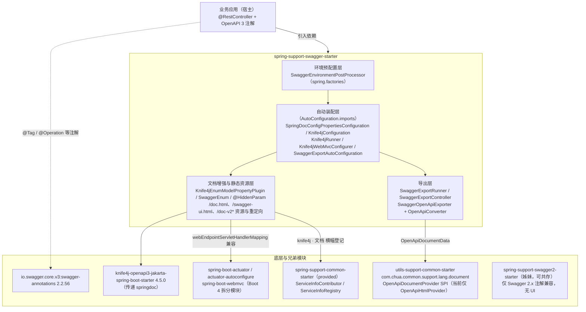
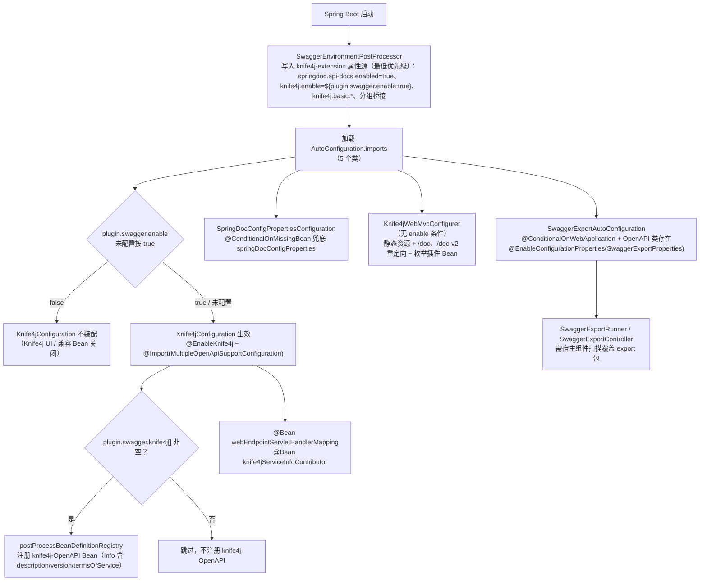

# spring-support-swagger-starter

基于 **springdoc + Knife4j** 的 OpenAPI 3 接口文档 starter：自动聚合宿主 `@RestController`，生成 `/v3/api-docs` 描述与 Knife4j 交互式文档（`/doc.html`），并提供启动期离线导出与在线导出端点。在 spring-support 体系中属于**可选的 API 文档能力模块**：宿主引入即获得完整文档能力，不引入则对业务零影响；与 `spring-support-swagger2-starter`（Swagger 2.x 注解兼容壳）互为姊妹模块。

- 适配 Spring Boot **4.1.2**（父 POM `spring-boot-starter-parent` 4.1.2）；knife4j `knife4j-openapi3-jakarta-spring-boot-starter` **4.5.0**（本模块 pom），`io.swagger.core.v3:swagger-annotations` **2.2.56**（父 POM 依赖管理）。
- 文档**默认开启**：`Knife4jConfiguration` 装配条件为 `@ConditionalOnProperty(prefix = "plugin.swagger", name = "enable", havingValue = "true", matchIfMissing = true)`；`Knife4jProperties.enable` 字段默认值虽为 `false`，但未配置时按 `true` 处理，仅显式 `plugin.swagger.enable=false` 才关闭。

## 1. 架构图



内部分层：`SwaggerEnvironmentPostProcessor` 在自动配置前把 `plugin.swagger.*` 桥接为 `knife4j.*` / `springdoc.*` 属性（属性源 `knife4j-extension`，`addLast` 最低优先级）；5 个自动配置类经 `META-INF/spring/org.springframework.boot.autoconfigure.AutoConfiguration.imports` 注册；导出层把 springdoc 的 `OpenAPI` 经 `OpenApiConverter` 转为 utils 层 `OpenApiDocumentData`，再交给 `OpenApiDocumentProvider` SPI 渲染。另含 `org.springdoc.core.service.GenericResponseService` 同包补丁（本模块源码内覆盖 jar 同类，服务 Boot 4 兼容，升级 springdoc 时需同步维护）。

## 2. 核心流程图

**自动装配流程**（启动期）：



运行期数据流：`GET /v3/api-docs` 由 springdoc 扫描 `@RestController` 生成 JSON；`Knife4jEnumModelPropertyPlugin` 把实现 `SwaggerEnum` 的枚举属性渲染为 `code:name`。导出链路：`OpenApiConverter.fromOpenApi` → `OpenApiDocumentProvider.create(type)` → `OpenApiHtmlProvider`（`html`）写文件或 HTTP 返回；`markdown` / `word` 当前无内置 SPI 实现。

## 3. 能力清单

| 能力域 | 关键类 | 入口 / 触发方式 |
|:-------|:-------|:----------------|
| 环境预配置（knife4j/springdoc 桥接） | `SwaggerEnvironmentPostProcessor` | `META-INF/spring.factories`（`EnvironmentPostProcessor`） |
| 分组桥接 → `springdoc.group-configs` / `knife4j.documents` | `SwaggerEnvironmentPostProcessor` | 配置 `plugin.swagger.knife4j[]` |
| 文档聚合与 Knife4j UI | `Knife4jConfiguration` | `/doc.html`、`/swagger-ui.html`、`/v3/api-docs` |
| springdoc 配置兜底 | `SpringDocConfigPropertiesConfiguration` | `springDocConfigProperties` Bean（`@Primary` + `@ConditionalOnMissingBean`） |
| 静态资源与页面重定向 | `Knife4jWebMvcConfigurer` | `/doc.html`、`/swagger-ui.html`、`/doc-v2*`、`/doc`、`/doc-v2` |
| 枚举属性文档增强 | `Knife4jEnumModelPropertyPlugin`（springdoc `PropertyCustomizer`） | 业务枚举实现 `SwaggerEnum` 即生效 |
| 服务信息横幅登记 | `Knife4jConfiguration#knife4jServiceInfoContributor` | `ServiceInfoContributor` 登记 `knife4j · 文档` 标记 |
| Boot 4 actuator 端点映射兼容 | `Knife4jConfiguration#webEndpointServletHandlerMapping` | `WebMvcEndpointHandlerMapping`（`org.springframework.boot.webmvc.actuate.endpoint.web`） |
| 启动期离线导出 | `SwaggerExportRunner` → `SwaggerOpenApiExporter` | `plugin.swagger.export.enabled=true`（缺省 true）+ 组件扫描 |
| 在线导出 HTTP 端点 | `SwaggerExportController` | `GET /chua/swagger/export[?format=]`、`GET /chua/swagger/export/preview` |
| 文档模型转换 | `OpenApiConverter` | springdoc `OpenAPI` → utils 层 `OpenApiDocumentData` |
| 文档渲染 SPI 消费 | `SwaggerOpenApiExporter` / `SwaggerExportController` | utils 层 `OpenApiDocumentProvider.create(type)`；内置实现仅 `OpenApiHtmlProvider`（`html`） |
| 枚举文档契约 / 隐藏参数 | `SwaggerEnum`（接口）、`@HiddenParam`（注解） | 业务代码实现 / 标注后由文档层识别 |
| springdoc 兼容补丁 | `org.springdoc.core.service.GenericResponseService` | classpath 同包同类覆盖（本模块源码目录优先于 jar） |

> 源码中存在但**未装配**的预留类：`CustomOperationCustomizer`、`CustomKnife4jOpenApiCustomizer`、`ParameterFilterOperationCustomizer`、`CustomModelResolver`、`InheritedPropertyResolver`（无任何 `@Bean` / `@Component` / imports / META-INF-services 注册）。因此「默认请求头注入」「参数隐藏过滤」「继承属性合并」当前不生效，见第 8 节。

## 4. Bean 能力矩阵

| Bean 名 | 类型 | 装配条件（含默认值） | 可否覆盖 | 典型用途 |
|:--------|:-----|:---------------------|:---------|:---------|
| `springDocConfigProperties` | `org.springdoc.core.properties.SpringDocConfigProperties` | 类上 `@ConditionalOnClass(SpringDocConfigProperties)`；方法上 `@Primary` + `@ConditionalOnMissingBean`（springdoc 自动配置已注册时让位） | 可以：自定义同类型 Bean 后兜底退场 | knife4j 自动配置依赖它，缺它启动失败；可直接 `@Autowired` |
| `knife4j-OpenAPI` | `io.swagger.v3.oas.models.OpenAPI` | `Knife4jConfiguration` 生效（`plugin.swagger.enable` 缺省 true）**且** `plugin.swagger.knife4j[]` 非空；由 `postProcessBeanDefinitionRegistry` 编程式注册 | 同名覆盖默认禁止（Boot `allow-bean-definition-overriding=false`）；可另起 Bean 名并存 | 一般不注入；springdoc 生成文档时合并容器中的 `OpenAPI` Bean，其 `Info` 来自 `plugin.swagger.description/version/terms-of-service` |
| `webEndpointServletHandlerMapping` | `org.springframework.boot.webmvc.actuate.endpoint.web.WebMvcEndpointHandlerMapping` | 随 `Knife4jConfiguration`（缺省 true） | 普通 `@Bean` 可覆盖，但属 actuator 端点映射，覆盖自担风险，一般不动 | 无需注入；解决 springdoc 与 Boot 4 的端点映射兼容 |
| `knife4jServiceInfoContributor` | `com.chua.starter.common.support.serviceinfo.ServiceInfoContributor` | 随 `Knife4jConfiguration` | 可以 | 无需注入；由服务信息横幅体系统一收集渲染 |
| `getKnife4jEnumModelPropertyPlugin` | `Knife4jEnumModelPropertyPlugin`（springdoc `PropertyCustomizer`） | `@ConditionalOnClass(name = "io.swagger.v3.oas.models.media.Schema")`（引入本模块即满足） | 可叠加：springdoc 收集容器中全部 `PropertyCustomizer` | 无需注入；业务枚举实现 `SwaggerEnum` 即自动生效 |
| `knife4jRunner` | `Knife4jRunner`（`CommandLineRunner`） | `AutoConfiguration.imports` 注册，无条件 | 可以（无意义） | 不要依赖：`@Deprecated`，`run()` 为空，横幅由 `ServiceInfoBannerListener` 统一渲染 |
| `swaggerExportProperties` | `SwaggerExportProperties`（`plugin.swagger.export`） | `SwaggerExportAutoConfiguration`：`@ConditionalOnWebApplication` + `@ConditionalOnClass(name = "io.swagger.v3.oas.models.OpenAPI")` | 可以 | `@Autowired` 读取导出配置 |
| `swaggerExportRunner` | `SwaggerExportRunner`（`CommandLineRunner`，`@Order(LOWEST_PRECEDENCE)`） | `@Component` + `@ConditionalOnProperty(prefix="plugin.swagger.export", name="enabled", havingValue="true", matchIfMissing=true)`；**且宿主组件扫描覆盖 `com.chua.starter.swagger.support.export` 包** | 条件不满足则不注册；受 `export.enabled` 控制，无独立开关 | 无需注入；启动期写 `output` 文件 |
| `swaggerExportController` | `SwaggerExportController`（`@RestController`） | 同上 | 同上 | 无需注入；HTTP 端点 `/chua/swagger/export`、`/chua/swagger/export/preview` |

> 注意：`Knife4jWebMvcConfigurer` 经 imports 注册且类上**没有** `plugin.swagger.enable` 条件，`enable=false` 时静态资源映射与枚举插件 Bean 仍会注册；但此时 `Knife4jConfiguration` 不装配、`knife4j.enable` 被桥接为 `false`，文档页面没有可用数据。另外 `SwaggerEnvironmentPostProcessor` 会无条件写入 `springdoc.api-docs.enabled=true`，因此总开关只关闭本模块与 knife4j 的装配，不保证 springdoc 自身的 `/v3/api-docs` 端点消失。

## 5. 完整配置

前缀：**`plugin.swagger`**（`Knife4jProperties`）与 **`plugin.swagger.export`**（`SwaggerExportProperties`）。历史上部分文档写过的 `plugin.knife4j` 前缀在本模块源码中不存在。

### 5.1 基础（`plugin.swagger`，`Knife4jProperties`）

| 配置路径 | 类型 | 默认值 | 说明 |
|:---------|:-----|:-------|:-----|
| `plugin.swagger.enable` | `boolean` | 字段默认 `false`；自动配置 `matchIfMissing=true`，**未配置时文档默认开启** | 总开关，控制 `Knife4jConfiguration` 装配并经桥接决定 `knife4j.enable` |
| `plugin.swagger.knife4j` | `List<Knife4j>` | 无 | 分组列表（见 5.2）；非空时注册 `knife4j-OpenAPI` 与分组配置 |
| `plugin.swagger.default-header` | `Map<String, String>` | 无 | 默认请求头；**当前不生效**（仅未被装配的 customize 类消费） |
| `plugin.swagger.username` | `String` | `""`（桥接占位符缺省 `root`） | 文档 Basic 认证账号 → `knife4j.basic.username` |
| `plugin.swagger.password` | `String` | `""`（桥接占位符缺省 `root123`） | 文档 Basic 认证密码 → `knife4j.basic.password` |
| `plugin.swagger.log` | `boolean` | `false` | 声明「Swagger 注解记录操作日志」；**当前运行期无代码读取** |
| `plugin.swagger.description` | `String` | `"无"` | 文档描述，写入 `knife4j-OpenAPI` 的 `Info`（需配置分组） |
| `plugin.swagger.version` | `String` | `"1.0"` | 文档版本，同上 |
| `plugin.swagger.terms-of-service` | `String` | 内置服务条款长文本（12 条，含责任限制/知识产权/隐私保护等） | 服务条款，写入 `knife4j-OpenAPI` 的 `Info`（需配置分组） |

### 5.2 分组（`plugin.swagger.knife4j[]`，内部类 `Knife4jProperties.Knife4j`）

| 配置路径 | 类型 | 默认值 | 说明 |
|:---------|:-----|:-------|:-----|
| `plugin.swagger.knife4j[].group` | `String` | 无 | 分组编码；为空取 `group-name`，写入 `knife4j.documents[i].group/name` |
| `plugin.swagger.knife4j[].group-name` | `String` | 无 | 分组名 → `springdoc.group-configs[i].group` 与 `display-name` |
| `plugin.swagger.knife4j[].paths-to-match` | `String[]` | 无（桥接时空值缺省 `/**`） | 该分组匹配路径 → `springdoc.group-configs[i].paths-to-match` |
| `plugin.swagger.knife4j[].base-package` | `String[]` | 无 | 该分组扫描包 → `springdoc.group-configs[i].packages-to-scan` |
| `plugin.swagger.knife4j[].title` | `String` | `""` | 分组标题 → `springdoc.group-configs[i].title` |
| `plugin.swagger.knife4j[].description` | `String` | `""` | 分组描述 → `springdoc.group-configs[i].description` |
| `plugin.swagger.knife4j[].version` | `String` | `"v1.0.0"` | 分组版本 → `springdoc.group-configs[i].version` |

### 5.3 导出（`plugin.swagger.export`，`SwaggerExportProperties`）

| 配置路径 | 类型 | 默认值 | 说明 |
|:---------|:-----|:-------|:-----|
| `plugin.swagger.export.enabled` | `boolean` | `true` | 导出总开关（Runner / Controller 的 `@ConditionalOnProperty`，`matchIfMissing=true`） |
| `plugin.swagger.export.output` | `String` | `./swagger-export.html` | 输出文件路径（相对工作目录）；后缀决定类型：`.html/.htm`→`html`、`.md/.markdown`→`markdown`、`.docx/.doc`→`word` |
| `plugin.swagger.export.title` | `String` | `"Open API 接口文档"` | 顶部标题；**仅在原 OpenAPI 标题为空时回填**，不覆盖业务标题 |
| `plugin.swagger.export.version` | `String` | `"1.0.0"` | 版本徽标；**仅在原 OpenAPI 版本为空时回填** |
| `plugin.swagger.export.download-after-start` | `boolean` | `true` | 启动后是否立即离线导出 |
| `plugin.swagger.export.include-request-sample` | `boolean` | `true` | 声明「是否生成请求/响应示例」；**当前运行期无代码读取** |
| `plugin.swagger.export.path` | `String` | `/chua/swagger/export` | **不是字段**：`SwaggerExportController` 上 `@RequestMapping` 的占位符，宿主 `Environment` 存在该 key 时改变端点路径 |

### 5.4 桥接出的属性（`SwaggerEnvironmentPostProcessor`，属性源 `knife4j-extension`，最低优先级，可被应用配置覆盖）

| 桥接 key | 值 | 条件 |
|:---------|:---|:-----|
| `springdoc.api-docs.enabled` / `springdoc.api-docs.groups.enabled` / `springdoc.default-flat-param-object` | `true` | 无条件 |
| `knife4j.enable` | `${plugin.swagger.enable:true}` | 无条件（跟随总开关） |
| `knife4j.basic.enable` | `true` | 无条件（Basic 认证固定开启） |
| `knife4j.basic.username` / `knife4j.basic.password` | `${plugin.swagger.username:root}` / `${plugin.swagger.password:root123}` | 无条件 |
| `knife4j.documents[i].group` / `.name` | 分组 `group`（为空取 `group-name`） | 配置了分组时 |
| `springdoc.group-configs[i].group/title/description/version/display-name/paths-to-match/packages-to-scan` | 对应分组字段 | 配置了分组时 |

## 6. 使用方式

```xml
<dependency>
    <groupId>com.chua</groupId>
    <artifactId>spring-support-swagger-starter</artifactId>
    <version>4.0.0.51</version>
</dependency>
```

引入即生效（文档默认开启），无需额外配置。按需配置示例（生产环境务必改掉 Basic 弱口令）：

```yaml
plugin:
  swagger:
    enable: true          # 显式关闭用 false
    username: admin       # 缺省 root
    password: admin@2026  # 缺省 root123
    description: 业务接口文档
    version: 1.0.0
    knife4j:
      - group: user
        group-name: 用户模块
        title: 用户服务
        base-package:
          - com.example.user.controller
        paths-to-match:
          - /user/**
    export:
      enabled: true
      output: ./docs/api.html   # 后缀决定导出类型（当前仅 html 有内置渲染实现）
      download-after-start: true
```

启动后验证：`curl -u admin:admin@2026 http://localhost:8080/doc.html`（Knife4j UI，Basic 认证）、`curl http://localhost:8080/v3/api-docs`（OpenAPI JSON）、`curl -u admin:admin@2026 'http://localhost:8080/chua/swagger/export' -o api.html`（在线导出）。控制台横幅出现 `knife4j · 文档` 标记（由 `knife4jServiceInfoContributor` 登记）；工作目录默认生成 `./swagger-export.html`（`download-after-start=true` 缺省行为）。

可选依赖说明：

| 依赖 | 必选性 | 缺失影响 |
|:-----|:-------|:---------|
| `com.github.xiaoymin:knife4j-openapi3-jakarta-spring-boot-starter`（4.5.0）、`io.swagger.core.v3:swagger-annotations`（2.2.56）、`spring-boot-actuator` / `spring-boot-actuator-autoconfigure`、`spring-boot-webmvc` | 传递必选（本模块 pom 已带） | 缺失会导致文档 UI、OpenAPI 3 注解或 Boot 4 端点兼容 Bean 无法工作 |
| `spring-support-common-starter`（`provided`，须宿主自带） | 编译期必需 | `Knife4jConfiguration` 的 `@Bean` 方法返回 `ServiceInfoContributor`、lambda 参数为 `ServiceInfoRegistry`，类加载即需要该包；缺失会导致该自动配置加载失败，文档 UI 与 Boot 4 端点兼容 Bean 一并失效，而非只少一条 `knife4j · 文档` 横幅 |
| utils 层 `com.chua.common.support.lang.document`（需宿主显式引入 `utils-support-common-starter`） | 运行时必需 | `OpenApiDocumentProvider` SPI 与 `OpenApiDocumentData` 模型缺失时导出链路不可用；本模块的 `spring-support-common-starter` 为 `provided` 作用域，**不会**把 utils 传递进来，宿主必须自行声明 |

## 7. 使用场景

**适用**：

- Spring MVC（Servlet Web）REST 服务需要交互式接口文档与 OpenAPI 3 JSON；
- 多模块/多分组接口聚合（`plugin.swagger.knife4j[]` → springdoc group-configs）；
- 需要启动期离线归档 HTML 文档，或 CI 通过 HTTP 端点拉取文档；
- 希望枚举字段在文档中展示 `code:name` 语义（业务枚举实现 `SwaggerEnum`）。

**不适用/慎用**：

- 纯 WebFlux 响应式服务：静态资源、重定向与端点兼容 Bean 均基于 spring-webmvc；
- 不对外提供 HTTP 服务的后台任务/消费者进程：无端点可文档化，引入只增加无意义自动配置。

**与相邻模块的取舍**：

| 模块 | 关系 | 取舍 |
|:-----|:-----|:-----|
| `spring-support-swagger2-starter` | 姊妹模块，可共存 | 仅 Swagger 2.x 注解兼容壳（无 UI / 无自动配置）；仍在用 2.x 注解的老项目用它，新项目直接用本模块 3.x 注解体系 |
| `spring-support-common-starter` | 本模块 `provided`（宿主自带） | 横幅登记走其 `ServiceInfoContributor`；common 的操作日志切面负责识别 Swagger 注解。`Knife4jConfiguration` 在类签名上依赖其 `ServiceInfoContributor` / `ServiceInfoRegistry`，缺失时文档 UI 的装配会失败，但文档渲染本身不依赖其业务能力 |
| springdoc / knife4j | 底层实现 | 本模块只做装配、桥接、分组、枚举增强与导出；文档协议能力全部来自 knife4j 4.5.0 + springdoc |
| utils 层 `OpenApiDocumentProvider` SPI | 下沉到最底层 | 渲染实现（HTML 单页）属通用能力，放 `utils-support-common-starter`，本模块只是消费方，避免重复实现 |

## 8. 扩展点

1. **导出渲染 SPI `OpenApiDocumentProvider`（主要扩展点）**：导出链路不耦合具体渲染实现，`SwaggerOpenApiExporter` 与 `SwaggerExportController` 统一调用 utils 层 `com.chua.common.support.lang.document.OpenApiDocumentProvider#create(type)`（内部经 SPI 按名称发现实现）。当前工作区内置实现仅 `OpenApiHtmlProvider`（`@Spi("html")`，泛微 E10 风格单页 HTML），故 `output` 后缀为 `.md/.docx` 或 `format=markdown/word` 时返回 `null`：Runner 记 `[SwaggerExport] 未找到 OpenApiDocumentProvider SPI` error 日志后跳过，Controller 返回 500。新增格式只需提供 SPI 实现放入 classpath，本模块零改动：

   ```java
   @Spi("markdown")
   public class OpenApiMarkdownProvider implements OpenApiDocumentProvider {
       @Override public String getType() { return "markdown"; }
       @Override public String[] getExtensions() { return new String[]{".md"}; }
       @Override public void export(OpenApiDocumentData data, File outputFile) { /* 自定义渲染 */ }
   }
   ```

2. **文档契约**：业务枚举实现 `SwaggerEnum`（`getCode()` / `getName()`）后，`Knife4jEnumModelPropertyPlugin` 把枚举属性文档渲染为 `code:name` 列表并写入可选值；`@HiddenParam` 自带 `@Schema(hidden = true)`，模型字段隐藏依赖 springdoc 原生语义（参数过滤逻辑位于未装配的 `ParameterFilterOperationCustomizer`，当前不生效）。
3. **springdoc 原生扩展**：本模块 `Knife4jConfiguration` 上 `@Import(MultipleOpenApiSupportConfiguration.class)`，springdoc 的分组与定制机制可用。可自行注册另起 Bean 名的 `OpenAPI` `@Bean`（避免与 `knife4j-OpenAPI` 同名冲突），以及 springdoc 的 `PropertyCustomizer` / `GlobalOperationCustomizer` / `GlobalOpenApiCustomizer` Bean（springdoc 会收集全部实例）。
4. **未装配的预留类**：`customize` 包（`CustomOperationCustomizer`、`CustomKnife4jOpenApiCustomizer`、`ParameterFilterOperationCustomizer`）、`resolver` 包（`CustomModelResolver`）、`converter` 包（`InheritedPropertyResolver`）源码存在但无任何注册入口；如需启用可自行 `@Bean` 注册对应类型，否则请基于第 3 条的 springdoc 原生扩展实现同类需求。

## 9. 常见问题

**Q1：引入后 `/doc.html` 打不开或没数据？**
依次检查：① 宿主是否为 Servlet Web 应用；② 是否显式配置了 `plugin.swagger.enable=false`（未配置默认开启）；③ Basic 认证固定开启（`knife4j.basic.enable=true`），用配置的 `plugin.swagger.username/password` 或缺省 `root / root123` 访问；④ `SwaggerExportRunner` / `SwaggerExportController` 是 `@Component` / `@RestController`，不在 `AutoConfiguration.imports` 中，需宿主组件扫描覆盖 `com.chua.starter.swagger.support.export` 包，否则导出能力不存在（文档 UI 不受影响）。

**Q2：`plugin.swagger.enable=false` 后 `/v3/api-docs` 为什么还在？**
总开关只控制本模块 `Knife4jConfiguration` 的装配与 `knife4j.enable` 桥接值；`SwaggerEnvironmentPostProcessor` 会无条件写入 `springdoc.api-docs.enabled=true`、`springdoc.api-docs.groups.enabled=true`（最低优先级属性源）。springdoc 自身端点是否关闭由 springdoc 的条件决定，仅设 `enable=false` 不能保证移除 `/v3/api-docs`。

**Q3：与 Spring Boot 4.x 的兼容处理有哪些？**
① Boot 4 将 `WebMvcEndpointHandlerMapping` 从 actuator 拆分到 `spring-boot-webmvc` 模块，本模块显式依赖它，并通过 `Knife4jConfiguration#webEndpointServletHandlerMapping` 注册兼容 Bean；② `org.springdoc.core.service.GenericResponseService` 是本模块源码内的 springdoc 同包同类补丁，与 knife4j 4.5.0 传递的 springdoc 版本配对，升级 knife4j/springdoc 后必须重新核对该补丁的类签名，否则可能失效；③ 父 POM 为 `spring-boot-starter-parent` 4.1.2。

**Q4：导出 markdown/word 报「未找到 OpenApiDocumentProvider SPI」或启动后没生成 `swagger-export.html`？**
内置 SPI 实现只有 `OpenApiHtmlProvider`（`html`），其余格式需自定义 SPI（见第 8 节）。没生成文件再依次检查：`plugin.swagger.export.enabled`（缺省 true）与组件扫描、`download-after-start` 是否为 `false`、容器中是否存在 `OpenAPI` Bean（springdoc 未启用时 Runner 告警跳过）、输出后缀对应的 SPI 是否存在；`title`/`version` 仅在原 OpenAPI 信息为空时回填，不会覆盖业务配置。
