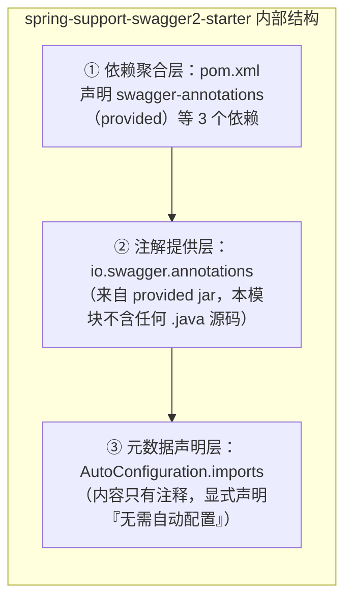
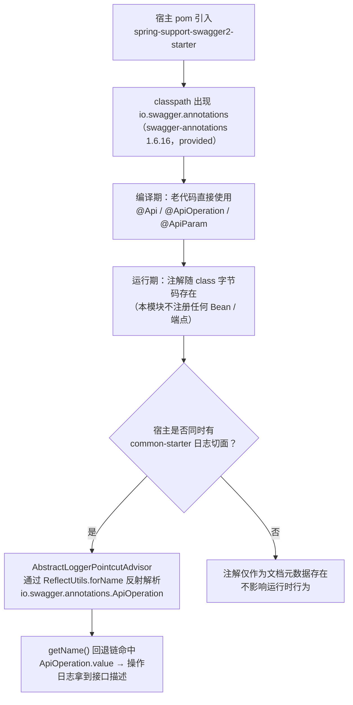
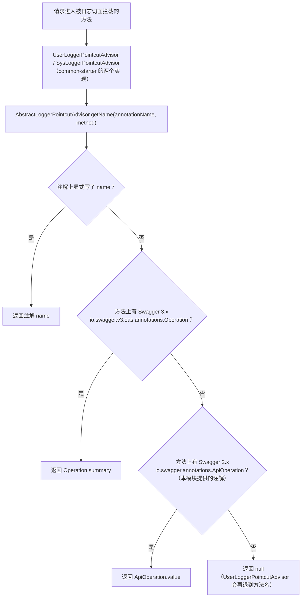

# spring-support-swagger2-starter

Swagger 2.x 兼容壳 starter：只提供 `io.swagger.annotations`（`@Api`、`@ApiOperation`、`@ApiParam` 等注解）的依赖，供仍在用老版 Swagger 2.x 注解的项目使用。**默认开、无运行时组件、无自动配置类、不装配任何 Bean、不占用端口。**

- 模块坐标：`com.chua:spring-support-swagger2-starter:4.0.0.51`
- 父模块：`com.chua:spring-support-parent-starter:4.0.0.51`
- 运行环境：Spring Boot 4.1.2（Jakarta 命名空间）
- 模块内 Java 源码：**无**（整个模块只有 `pom.xml` + 一份仅含注释的自动配置声明文件）

## 1. 架构图

### 1.1 模块在体系中的位置

```mermaid
flowchart TB
    subgraph PARENT["spring-support-parent-starter（父 pom，4.0.0.51）"]
        DEP_MGMT["dependencyManagement<br/>io.swagger:swagger-annotations:1.6.16<br/>（${swagger.annotations.v2.version}）"]
    end

    subgraph SELF["spring-support-swagger2-starter（本模块，纯注解壳）"]
        POM["pom.xml 依赖聚合"]
        IMPORTS["META-INF/spring/...AutoConfiguration.imports<br/>（仅 2 行注释，无自动配置类）"]
    end

    subgraph DEPS["本模块声明的依赖"]
        SWAGGER["io.swagger:swagger-annotations<br/>（provided，仅编译期）"]
        AUTOCONF["spring-boot-autoconfigure"]
        UTILS["com.chua:utils-support-common-starter"]
    end

    subgraph SISTER["姊妹模块（可共存，包名不冲突）"]
        SWAGGER3["spring-support-swagger-starter<br/>（Swagger 3.x：springdoc + Knife4j + 导出）"]
    end

    subgraph COLLAB["间接协作方（非本模块依赖，运行期反射识别 2.x 注解）"]
        COMMON["spring-support-common-starter<br/>AbstractLoggerPointcutAdvisor"]
        OAUTH["spring-support-oauth-client-starter<br/>UserLoggerPointcutAdvisor"]
        MYBATIS["spring-support-mybatis-starter<br/>SysLoggerPointcutAdvisor"]
    end

    PARENT -->|继承版本管理| SELF
    SELF --> DEPS
    SELF -.同一宿主可同时引入.-> SISTER
    SELF -.classpath 提供 io.swagger.annotations.-> COLLAB
```

### 1.2 模块内部分层



> 内部分层的含义：本模块是"壳"，① 把 2.x 注解 jar 带进 classpath，② 让老代码能编译期使用注解，③ 向 Spring Boot 明确本模块没有自动配置类。三层都不产生运行时对象。

## 2. 核心流程图

### 2.1 模块生效流程（引入 → 编译 → 运行识别）



### 2.2 操作日志名称解析（回退链，配合方视角）



> 图中所有类均真实存在：`AbstractLoggerPointcutAdvisor` 位于 `spring-support-common-starter`（`com.chua.starter.common.support.logger` 包），`UserLoggerPointcutAdvisor` 位于 `spring-support-oauth-client-starter`，`SysLoggerPointcutAdvisor` 位于 `spring-support-mybatis-starter`。2.x/3.x 注解类均通过 `ReflectUtils.forName` 反射解析，classpath 缺失时静默返回 null，不报错。

## 3. 能力清单

| 能力域 | 关键类 | 入口 |
|:-------|:-------|:-----|
| Swagger 2.x 注解依赖（provided） | `io.swagger.annotations`（依赖 jar 内，1.6.16） | `@Api`、`@ApiOperation`、`@ApiParam`、`@ApiModel`、`@ApiModelProperty` 等 |
| 操作日志注解识别（配合方，非本模块代码） | `AbstractLoggerPointcutAdvisor`（spring-support-common-starter） | `getName()` 回退链：注解 name > 3.x `Operation.summary` > 2.x `ApiOperation.value` |
| 自动配置 | — | **无**（`AutoConfiguration.imports` 仅含 2 行注释说明） |

实际生效的能力：

- 引入后 `io.swagger.annotations` 包下注解可直接用于老项目代码，编译期不缺类；
- 与 `spring-support-swagger-starter`（3.x）**可同时引入**：二者注解包名不同（`io.swagger` vs `io.swagger.v3`），无类冲突；
- common-starter 的操作日志切面按 2.2 节回退链识别注解，本模块让老代码的操作日志也能拿到接口描述；
- **不注册任何自动配置类、不装配 Bean、不暴露 HTTP 端点、没有 web 资源**。

## 4. Bean 能力矩阵

**本模块不装配任何 Bean。** 原因：模块内没有任何 Java 源码（无 `@Configuration` / `@Bean` / `@Component`），`META-INF/spring/org.springframework.boot.autoconfigure.AutoConfiguration.imports` 只有两行注释，也不存在 `spring.factories`。因此下表除说明行外为空：

| Bean 名 | 类型 | 装配条件 | 可否覆盖 | 典型注入姿势 |
|:--------|:-----|:---------|:---------|:-------------|
| 无 | — | — | — | — |

> 运行期真正干活的相关 Bean 在**配合方模块**：`UserLoggerPointcutAdvisor`（oauth-client-starter，`@Component`）与 `SysLoggerPointcutAdvisor`（mybatis-starter）继承 common-starter 的 `AbstractLoggerPointcutAdvisor`，按 2.2 节回退链反射读取本模块提供的 2.x 注解。它们不是本模块装配的，覆盖方式见第 8 节。

## 5. 完整配置

**本模块无任何 `@ConfigurationProperties`，也没有自动配置类，因此没有任何配置项。** 生效开关不存在——引入即在编译期生效，无需任何配置。

| 配置路径 | 类型 | 默认值 | 说明 | 生效开关 |
|:---------|:-----|:-------|:-----|:---------|
| 无 | — | — | 本模块不读取任何配置 | — |

注意：不要为本模块配置 `plugin.swagger.*` 或 `plugin.swagger.export.*`——那是姊妹模块 `spring-support-swagger-starter` 的前缀（分别对应其 `Knife4jProperties` 与 `SwaggerExportProperties`）。本模块既不读取配置，也不参与文档装配。

## 6. 使用方式

### 6.1 Maven 坐标

```xml
<dependency>
    <groupId>com.chua</groupId>
    <artifactId>spring-support-swagger2-starter</artifactId>
    <version>4.0.0.51</version>
</dependency>
```

### 6.2 依赖说明

| 依赖 | 作用 | 范围 |
|:-----|:-----|:-----|
| `io.swagger:swagger-annotations`（1.6.16，版本由父 pom `${swagger.annotations.v2.version}` 统一管理） | Swagger 2.x 注解，仅编译期需要 | `provided` |
| `org.springframework.boot:spring-boot-autoconfigure` | 本模块自身的自动配置声明（实际为空，仅满足 starter 形态） | compile |
| `com.chua:utils-support-common-starter` | 工具层依赖（注解壳本身不直接使用，版本由父 pom `utils.version` 管理） | compile |

`spring-support-common-starter` **不是**本模块的直接依赖：日志切面对 2.x 注解的识别靠运行期反射（`ReflectUtils.forName`），编译期不需要本模块，反之亦然。

### 6.3 最小可运行示例

**第一步：引入依赖**（见 6.1）。

**第二步：在老代码上使用 Swagger 2.x 注解**（无需任何配置）：

```java
@RestController
@RequestMapping("/api/users")
@Api(tags = "用户管理")
public class UserController {

    @GetMapping("/{id}")
    @ApiOperation("获取用户信息")
    public User getUser(
            @ApiParam("用户ID") @PathVariable Long id) {
        return userService.findById(id);
    }
}
```

**第三步（可选）：与 3.x 文档模块共存**

若项目同时引入 `spring-support-swagger-starter`，文档页面照常由 3.x 模块提供（注解与配置均用 3.x 体系）；本模块只保证老代码的 2.x 注解不缺类，且操作日志切面能回退识别 `ApiOperation.value`。注意：2.x 注解**不会**被 3.x 模块解析进文档（见第 9 节）。

## 7. 使用场景

| 维度 | 说明 |
|:-----|:-----|
| **适用** | ① 老项目仍在用 `@Api` / `@ApiOperation` / `@ApiParam` 等 2.x 注解，升级到本生态后不缺类；② 需要老接口的操作日志能显示中文接口描述（配合 common-starter 日志切面）；③ 与 `spring-support-swagger-starter`（3.x）同进程共存 |
| **不适用** | ① 需要 Swagger UI / OpenAPI 文档生成 → 用 `spring-support-swagger-starter`；② 期望 `@EnableSwagger2`、springfox、Swagger 2 UI → 本模块一概没有；③ 期望 2.x 注解出现在 3.x 文档里 → 不支持 |
| **与相邻模块的取舍** | 见下表 |

| 需求 | 选哪个 | 原因 |
|:-----|:-------|:-----|
| 老代码补 2.x 注解、不缺类 | `spring-support-swagger2-starter`（本模块） | 纯注解依赖壳，零运行时开销 |
| 要 UI、分组、导出等文档能力 | `spring-support-swagger-starter`（3.x） | springdoc + Knife4j + 导出，配置前缀 `plugin.swagger.*` |
| 两者都要 | 同时引入 | 注解包名不同（`io.swagger` vs `io.swagger.v3`），无冲突；文档能力完全由 3.x 模块承担 |

## 8. 扩展点

**本模块不提供任何 SPI 扩展点**：没有 `META-INF/services`、没有接口、没有可替换的 Bean（模块内无 Java 源码）。

与 2.x 注解相关的扩展实际位于配合方模块，如需改变行为只能在那里做：

| 想改什么 | 位置 | 方式 |
|:---------|:-----|:-----|
| 操作日志的名称识别规则（回退链） | `spring-support-common-starter` 的 `AbstractLoggerPointcutAdvisor#getName` | 继承并覆写 `getName`（`UserLoggerPointcutAdvisor` 就是这么做的：先走父类回退链，取不到再退到方法名） |
| 操作日志的落库 / 事件发布 | `UserLoggerPointcutAdvisor`（oauth-client-starter）、`SysLoggerPointcutAdvisor`（mybatis-starter） | 替换 / 覆写对应切面 Bean（二者均为普通 Spring Bean，可用 `@Primary` 或排除自动配置后自定义） |
| 注解本身 | `io.swagger:swagger-annotations` 是第三方 jar | 本模块不修改、不扩展该 jar |

## 9. 常见问题

**Q1：引入后"Swagger 2 自动配置"没生效，是不是坏了？**
不是。本模块**设计上就没有装配**：`AutoConfiguration.imports` 只有 2 行注释（"该模块仅提供注解依赖，无需自动配置"），不存在自动配置类，也不会注册 Bean、暴露端点或启动 UI。它生效的标志是：老代码里的 2.x 注解编译不缺类、日志切面能识别 `ApiOperation.value`。期望"Swagger 2 增强 UI"的用法不成立。

**Q2：需要开端口或配置开关吗？**
不需要。本模块不监听任何端口，也没有任何配置项（见第 5 节）。给本模块配置 `plugin.swagger.*` 不会产生任何效果——该前缀属于 3.x 的 `spring-support-swagger-starter`。

**Q3：与 Spring Boot 4.x 兼容吗？**
兼容。生态当前运行在 Spring Boot 4.1.2（Jakarta 命名空间）。本模块只有 3 个依赖：`swagger-annotations` 是纯注解 jar，与 Servlet/API 版本无耦合；`spring-boot-autoconfigure` 与 `utils-support-common-starter` 由父 pom 统一按 Boot 4.1.2 体系管理。运行期识别 2.x 注解的日志切面（common-starter）本身基于 Jakarta Servlet，与 Boot 4 一致。注意：springfox / `@EnableSwagger2` 这类 Swagger 2 运行时方案本就不支持 Boot 3+/4，本模块也不提供。

**Q4：为什么 2.x 注解的接口没出现在 Swagger 文档里？**
`spring-support-swagger-starter` 解析的是 `io.swagger.v3.oas.annotations`（3.x）注解；本模块提供的是 `io.swagger.annotations`（2.x）注解，二者互不解析。要让接口进文档，请在接口上补 3.x 注解（`@Operation`、`@Tag` 等）并依赖 3.x 模块。

**Q5：`swagger-annotations` 版本想升级怎么办？**
版本由父 pom 的 `${swagger.annotations.v2.version}`（当前 1.6.16）统一管理，本模块未单独钉版本。升级需在 `spring-support-parent-starter/pom.xml` 中统一调整，避免多模块版本漂移。

**Q6：本模块会给我带来的服务里塞进哪些东西？**
按 R5"依赖即带入"口径检查过：本模块的 `AutoConfiguration.imports` 为空（仅注释），不会带来任何 Controller、定时任务或表迁移；唯一进 classpath 的第三方内容是 2.x 注解类本身。
