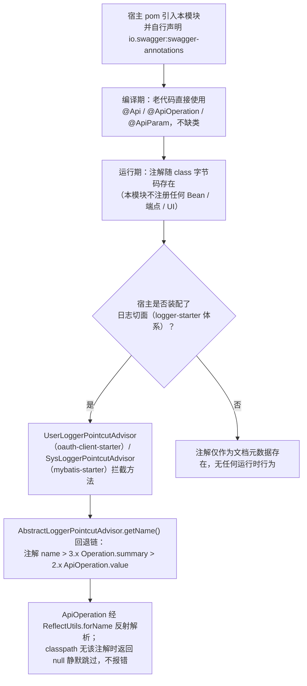

# spring-support-swagger2-starter

Swagger 2.x 兼容壳 starter：只提供 `io.swagger:swagger-annotations`（`@Api`、`@ApiOperation`、`@ApiParam`、`@ApiModel` 等 2.x 注解）的依赖声明，让仍使用老版 Swagger 2.x 注解的项目接入 spring-support 体系后编译期不缺类。它在体系中的角色是"零逻辑"兼容模块：**无 Java 源码、无自动配置类、不装配 Bean、不暴露端点、不读取任何配置**；与 `spring-support-swagger-starter`（Swagger 3.x）可同进程共存——二者注解包名不同（`io.swagger` vs `io.swagger.v3.oas.annotations`），互不冲突。

- 模块坐标：`com.chua:spring-support-swagger2-starter:4.0.0.51`（父模块 `com.chua:spring-support-parent-starter:4.0.0.51`）
- 运行环境：Spring Boot 4.1.2（Jakarta 命名空间，版本由父 pom `${spring.boot.version}` 管理）
- 模块内 Java 源码：**无**。唯一资源是 `META-INF/spring/org.springframework.boot.autoconfigure.AutoConfiguration.imports`，内容只有 2 行注释（"该模块仅提供注解依赖，无需自动配置"）；不存在 `spring.factories`。

## 1. 架构图

```mermaid
flowchart TB
    subgraph HOST["宿主应用"]
        CODE["业务代码（Controller / Service 上标注 2.x 注解）"]
        POM["宿主 pom.xml"]
    end

    subgraph SELF["spring-support-swagger2-starter（纯注解壳）"]
        direction TB
        L1["① 依赖聚合层：pom.xml<br/>swagger-annotations（provided）+ spring-boot-autoconfigure + utils-support-common-starter"]
        L2["② 自动装配层：空<br/>AutoConfiguration.imports 仅 2 行注释，无自动配置类"]
        L3["③ 核心服务/模板层：无<br/>模块内没有任何 .java 文件"]
        L4["④ SPI 层：无<br/>无接口、无 META-INF/services"]
        L1 --> L2 --> L3 --> L4
    end

    subgraph SIBLING["兄弟模块（可同时引入，包名不冲突）"]
        SW3["spring-support-swagger-starter（3.x）<br/>Knife4jProperties：plugin.swagger.*<br/>SwaggerExportProperties：plugin.swagger.export.*"]
    end

    subgraph COLLAB["配合方（运行期反射识别 2.x 注解，非本模块依赖）"]
        COMMON["spring-support-logger-starter<br/>AbstractLoggerPointcutAdvisor<br/>（com.chua.starter.common.support.logger 包）"]
        OAUTH["spring-support-oauth-client-starter<br/>UserLoggerPointcutAdvisor"]
        MB["spring-support-mybatis-starter<br/>SysLoggerPointcutAdvisor"]
    end

    subgraph UTILS["底层工具"]
        UTILSC["utils-support-common-starter<br/>ReflectUtils.forName（加载失败返回 null，不抛异常）"]
    end

    POM -->|引入| SELF
    SELF -.编译期提供 2.x 注解.-> CODE
    POM -.按需自行声明 io.swagger:swagger-annotations.-> CODE
    SELF -.同一宿主可共存.-> SIBLING
    CODE -.运行期注解元数据.-> COLLAB
    COMMON --> UTILSC
```

> 分层说明：本模块是"壳"。①把 2.x 注解 jar 声明进依赖（provided，仅本模块编译期可见）；②向 Spring Boot 显式声明没有自动配置类；③④本模块既无核心服务也无 SPI。真正读取这些注解的逻辑在配合方模块（logger-starter 的日志切面基类 `AbstractLoggerPointcutAdvisor` 与各业务模块的子类切面），通过反射解耦，本模块不参与其装配。

## 2. 核心流程图

最贴切的流程是"2.x 注解从编译期到运行期被识别"的完整链路：



> 回退链中"注解 name"指方法上日志类注解自身的 name 属性；`io.swagger.annotations.ApiOperation` 的静态引用在 `AbstractLoggerPointcutAdvisor` 中通过 `resolveAnnotationClass("io.swagger.annotations.ApiOperation")` 解析（`API_OPERATION` 常量），缺失时回退链自然跳过 2.x 分支。

## 3. 能力清单

| 能力域 | 关键类 | 入口/触发方式 |
|:-------|:-------|:--------------|
| Swagger 2.x 注解供给 | `io.swagger.annotations.*`（`@Api`、`@ApiOperation`、`@ApiParam`、`@ApiModel`、`@ApiModelProperty` 等，来自 provided 依赖 jar，本模块不含源码） | 宿主 pom 引入本模块并自行声明 `io.swagger:swagger-annotations` 后，编译期直接标注在代码上 |
| 操作日志接口名识别（配合方能力，非本模块代码） | `AbstractLoggerPointcutAdvisor`（spring-support-logger-starter，`com.chua.starter.common.support.logger` 包，类寄宿于 common 命名空间）；`UserLoggerPointcutAdvisor`（spring-support-oauth-client-starter）；`SysLoggerPointcutAdvisor`（spring-support-mybatis-starter） | 请求命中日志切面时，按"注解 name > 3.x `Operation.summary` > 2.x `ApiOperation.value`"回退链反射读取，拿到接口中文描述 |
| 自动配置 | — | **无**：`AutoConfiguration.imports` 仅含 2 行注释，无自动配置类、无 Bean、无端点 |

实际生效的能力边界：

- 引入后老代码里的 2.x 注解**编译期不缺类**（前提：宿主 classpath 上有 `io.swagger:swagger-annotations`，见第 6 节 provided 依赖说明）；
- 与 `spring-support-swagger-starter`（3.x）**可同时引入**，注解包名不同，无类冲突；
- logger-starter 体系的操作日志切面按第 2 节回退链识别 2.x 注解，让老接口的操作日志也能显示接口描述；
- **不注册任何自动配置类、不装配 Bean、不暴露 HTTP 端点、没有 web 资源、不占用端口**。

## 4. Bean 能力矩阵

**本模块不注册任何 Bean。** 原因：模块内没有任何 Java 源码（无 `@Configuration` / `@Bean` / `@Component`），`META-INF/spring/org.springframework.boot.autoconfigure.AutoConfiguration.imports` 只有两行注释，也不存在 `spring.factories`，因此 Spring Boot 启动时不会从本模块装配任何东西。

| Bean 名 | 类型 | 装配条件 | 可否覆盖 | 典型用途 |
|:--------|:-----|:---------|:---------|:---------|
| 无 | — | — | — | — |

> 运行期真正读取 2.x 注解的 Bean 在**配合方模块**：`UserLoggerPointcutAdvisor`（oauth-client-starter，`@Component`）与 `SysLoggerPointcutAdvisor`（mybatis-starter）继承 spring-support-logger-starter 的 `AbstractLoggerPointcutAdvisor`（类在 logger-starter 模块、common 命名空间包下）。它们不是本模块装配的，覆盖方式见第 8 节。

## 5. 完整配置

**本模块没有任何 `@ConfigurationProperties` 配置类，也没有自动配置类，因此没有任何配置项。** 引入即在编译期生效，无需任何开关或参数。

| 配置路径（前缀.字段） | 类型 | 默认值 | 说明 |
|:----------------------|:-----|:-------|:-----|
| 无 | — | — | 本模块不读取任何配置，也不提供生效开关 |

注意：不要为本模块配置 `plugin.swagger.*` 或 `plugin.swagger.export.*`——那是姊妹模块 `spring-support-swagger-starter` 的前缀（分别对应其 `Knife4jProperties` 与 `SwaggerExportProperties`；`Knife4jConfiguration` 由 `@ConditionalOnProperty(prefix = "plugin.swagger", name = "enable", havingValue = "true", matchIfMissing = true)` 控制）。本模块既不读取配置，也不参与文档装配。

### 5.1 逐项配置示例

本模块没有配置类，因此**没有可逐项列举的配置项**：不存在配置前缀，也就没有"含义 / 默认值 / YAML 示例"可写。把口径固定为三条：

- **配置前缀**：无——模块内没有任何 `@ConfigurationProperties`，不绑定任何前缀；
- **配置项数量**：0——多写、少写或写错任何键，本模块都不读取、不校验、不报错；
- **生效方式**：引入依赖即在编译期生效（提供 2.x 注解），没有运行时开关，因此不存在"默认值 / ≤0 或为空时的回落值"一说。

若老项目习惯性想给"Swagger2"留一段配置，请直接删掉——留空与写错效果相同（都无效果）。

### 5.2 完整 YAML 使用示例

宿主的 `application.yml` **无需为本模块增加任何键**。下面是一份可直接使用的完整示例（与本模块相关的部分刻意为空并注释说明）：

```yaml
# spring-support-swagger2-starter：零配置模块，无需任何配置键。
# 下面 spring 段只是宿主自身的常规配置示意，与本模块无关。
spring:
  application:
    name: demo-service
  profiles:
    active: dev

# 不要为本模块写"伪配置"（不存在的前缀，写了也无效）：
# swagger2:
#   enable: true
```

若同进程还引入了姊妹模块 `spring-support-swagger-starter`（3.x），文档能力的配置属于它，示例如下（仅作区分，避免误挂到本模块头上）：

```yaml
# 姊妹模块 spring-support-swagger-starter（3.x）的配置前缀：
plugin:
  swagger:
    enable: true            # Knife4jConfiguration 开关，缺省即开启
#  export:
#    enabled: true          # SwaggerExportProperties（plugin.swagger.export.enabled）
```

## 6. 使用方式

### 6.1 Maven 坐标

```xml
<dependency>
    <groupId>com.chua</groupId>
    <artifactId>spring-support-swagger2-starter</artifactId>
    <version>4.0.0.51</version>
</dependency>
```

### 6.2 依赖说明（含 provided 依赖缺了会怎样）

| 依赖 | 作用 | 范围 | 缺失后果 |
|:-----|:-----|:-----|:---------|
| `io.swagger:swagger-annotations`（1.6.16，版本由父 pom `${swagger.annotations.v2.version}` 统一管理） | Swagger 2.x 注解 | `provided` | 见下方重点说明 |
| `org.springframework.boot:spring-boot-autoconfigure` | starter 形态所需的自动配置支撑（本模块声明为空） | compile | 正常传递，无感知 |
| `com.chua:utils-support-common-starter`（`${utils.version}` = 4.0.0.51） | 底层工具依赖（注解壳本身不直接使用） | compile | 正常传递，无感知；按 R5"依赖即带入"口径，宿主会连带引入该工具包 |

**provided 依赖重点**：Maven 的 `provided` 依赖**不会传递**给宿主，也**不会打进 fat jar**。因此：

- 宿主代码要**编写** `@Api` / `@ApiOperation` 等 2.x 注解时，必须在宿主 pom 里**自行声明** `io.swagger:swagger-annotations`（版本可交给父 pom 管理，即 1.6.16）；只引入本模块而不声明它，编译会报 `package io.swagger.annotations does not exist`；
- 运行期 classpath 上没有该 jar 也**不会出错**：本模块无代码引用它；配合方日志切面用 `ReflectUtils.forName` 反射解析 `io.swagger.annotations.ApiOperation`，加载失败仅记录 debug 日志并返回 null，回退链静默跳过 2.x 分支。

### 6.3 最小启用示例

本模块无需任何 yml/properties 配置。最小用法只有两步：

**第一步**：引入本模块（见 6.1），并在宿主 pom 补充 2.x 注解依赖：

```xml
<dependency>
    <groupId>io.swagger</groupId>
    <artifactId>swagger-annotations</artifactId>
</dependency>
```

**第二步**：在老代码上直接使用 Swagger 2.x 注解：

```java
@RestController
@RequestMapping("/api/users")
@Api(tags = "用户管理")
public class UserController {

    @GetMapping("/{id}")
    @ApiOperation("获取用户信息")
    public User getUser(@ApiParam("用户ID") @PathVariable Long id) {
        return userService.findById(id);
    }
}
```

**可选**：与 `spring-support-swagger-starter`（3.x）共存。文档页面、分组、导出全部由 3.x 模块提供（注解与配置均用 3.x 体系）；本模块只保证老代码的 2.x 注解不缺类，且日志切面能回退识别 `ApiOperation.value`。注意：2.x 注解**不会**被 3.x 模块解析进 OpenAPI 文档（见第 9 节）。

## 7. 使用场景

**适用：**

1. 老项目仍在使用 `@Api` / `@ApiOperation` / `@ApiParam` 等 2.x 注解，迁移到本生态后需要这些注解编译期不缺类；
2. 需要老接口的操作日志显示中文接口描述——配合 logger-starter 日志切面体系的回退链，`ApiOperation.value` 可作为日志名称兜底；
3. 与 `spring-support-swagger-starter`（3.x）同进程共存：老代码保留 2.x 注解，新文档体系用 3.x。

**不适用/慎用：**

1. 需要 Swagger UI、OpenAPI 文档生成、分组或导出能力的，直接用 `spring-support-swagger-starter`，本模块一概没有；
2. 期望 `@EnableSwagger2`、springfox 或 Swagger 2 UI 的——本模块不提供，且 springfox 类方案本就不支持 Boot 3+/4。

**与相邻模块的取舍：**

| 需求 | 选哪个 | 原因 |
|:-----|:-------|:-----|
| 老代码补 2.x 注解、不缺类 | `spring-support-swagger2-starter`（本模块） | 纯注解依赖壳，零运行时开销、零配置 |
| 要 UI、分组、导出等文档能力 | `spring-support-swagger-starter`（3.x） | springdoc + Knife4j + 导出，配置前缀 `plugin.swagger.*` |
| 两者都要 | 同时引入 | 注解包名不同（`io.swagger` vs `io.swagger.v3.oas.annotations`），无冲突；文档能力完全由 3.x 模块承担 |

## 8. 扩展点

**本模块不提供任何扩展点**：没有 SPI 接口、没有抽象类、没有 `META-INF/services`，也没有可覆盖的 Bean（模块内无 Java 源码）。

与 2.x 注解相关的扩展实际位于配合方模块，如需改变行为只能在那里做：

| 想改什么 | 位置 | 方式 |
|:---------|:-----|:-----|
| 操作日志的名称识别规则（回退链） | `spring-support-logger-starter` 的 `AbstractLoggerPointcutAdvisor#getName` | 继承并覆写 `getName`（`UserLoggerPointcutAdvisor` 即如此：先走父类回退链，取不到再退到方法名） |
| 操作日志的落库 / 事件发布 | `UserLoggerPointcutAdvisor`（oauth-client-starter）、`SysLoggerPointcutAdvisor`（mybatis-starter） | 替换或覆写对应切面 Bean（普通 Spring Bean，可 `@Primary` 覆盖） |
| 注解本身 | `io.swagger:swagger-annotations` 是第三方 jar | 本模块不修改、不扩展该 jar |

## 9. 常见问题

**Q1：引入后"Swagger 2 自动配置"没生效，是不是坏了？**
不是。本模块**设计上就没有装配**：`AutoConfiguration.imports` 只有 2 行注释（"该模块仅提供注解依赖，无需自动配置"），不存在自动配置类，也不注册 Bean、不暴露端点、不启动 UI。它生效的标志是：老代码里的 2.x 注解编译不缺类、日志切面能识别 `ApiOperation.value`。期望"Swagger 2 增强 UI"的用法不成立。

**Q2：编译报 `package io.swagger.annotations does not exist` 怎么办？**
本模块的 `swagger-annotations` 是 `provided` 依赖，不会传递给宿主（也不会打进 fat jar）。在宿主 pom 里补一条 `io.swagger:swagger-annotations` 依赖即可（版本交给父 pom 管理，当前 1.6.16）。若要升级版本，统一改父 pom 的 `${swagger.annotations.v2.version}`，避免多模块漂移。

**Q3：与 Spring Boot 4.x 兼容吗？**
兼容。生态当前运行在 Spring Boot 4.1.2（Jakarta 命名空间）。本模块的 `swagger-annotations` 是纯注解 jar，与 Servlet/API 版本无耦合；`spring-boot-autoconfigure` 与 `utils-support-common-starter` 由父 pom 按 Boot 4.1.2 体系统一管理。注意：springfox / `@EnableSwagger2` 这类 Swagger 2 运行时方案本就不支持 Boot 3+/4，本模块也不提供替代。

**Q4：为什么 2.x 注解的接口没出现在 Swagger 文档里？会不会和 3.x 模块冲突？**
不会冲突：本模块提供 `io.swagger.annotations`（2.x），`spring-support-swagger-starter` 解析的是 `io.swagger.v3.oas.annotations`（3.x），二者包名不同、互不解析。要让接口进 OpenAPI 文档，请在接口上补 3.x 注解（`@Operation`、`@Tag` 等）并依赖 3.x 模块；本模块只负责老注解不缺类与日志切面识别。

## 10. 生产注意事项

1. **provided 依赖必须由宿主自行声明**：本模块对 `io.swagger:swagger-annotations` 的依赖是 `provided`，不传递给宿主、也不会打进 fat jar。宿主源码要书写 2.x 注解，必须在宿主 pom 中再次声明该依赖（版本交给父 pom 的 `${swagger.annotations.v2.version}`，当前 1.6.16），否则编译期报 `package io.swagger.annotations does not exist`。
2. **运行期缺 jar 是安全的，但别外溢**：本模块与配合方日志切面都通过 `ReflectUtils.forName` 反射解析 2.x 注解，classpath 上没有该 jar 只是静默跳过 2.x 分支；但若宿主引入的第三方库在**运行期直接引用**（非反射）`io.swagger.annotations`，宿主需自行以 `compile`/`runtime` 范围引入该 jar，不能指望本模块的 provided 声明兜底。
3. **版本统一由父 pom 管理**：升级 2.x 注解版本时改父 pom 的 `${swagger.annotations.v2.version}`，不要在宿主 pom 硬编码版本，避免多模块漂移（见第 9 节 Q2）。
4. **不要为本模块编写任何配置**：它不读取 `plugin.swagger.*`、`plugin.swagger.export.*` 或任何其它前缀；文档相关配置属于 `spring-support-swagger-starter`（3.x）。
5. **不要期望 UI、文档端点或运行时行为**：本模块零 Bean、零端点、零端口占用、零 Web 资源；上线巡检 / 健康检查不必也不应为它设置任何项。
6. **2.x 注解不会生成 OpenAPI 文档**：需要接口出现在 Swagger UI / 导出文档中的，请补 3.x 注解（`@Tag`、`@Operation` 等）并依赖 3.x 模块；两套注解可共存，建议渐进迁移。
7. **日志名称回退是有条件的**：只有宿主同时装配了日志切面（如 oauth-client-starter 的 `UserLoggerPointcutAdvisor`、mybatis-starter 的 `SysLoggerPointcutAdvisor`）时，`ApiOperation.value` 才会作为操作日志名称的兜底；未装配切面时，2.x 注解仅是编译期元数据。
8. **本模块无任何凭据或密钥配置**：不涉及口令、令牌、密钥等敏感信息，无需在配置中心或环境变量中为它维护任何 secret。
