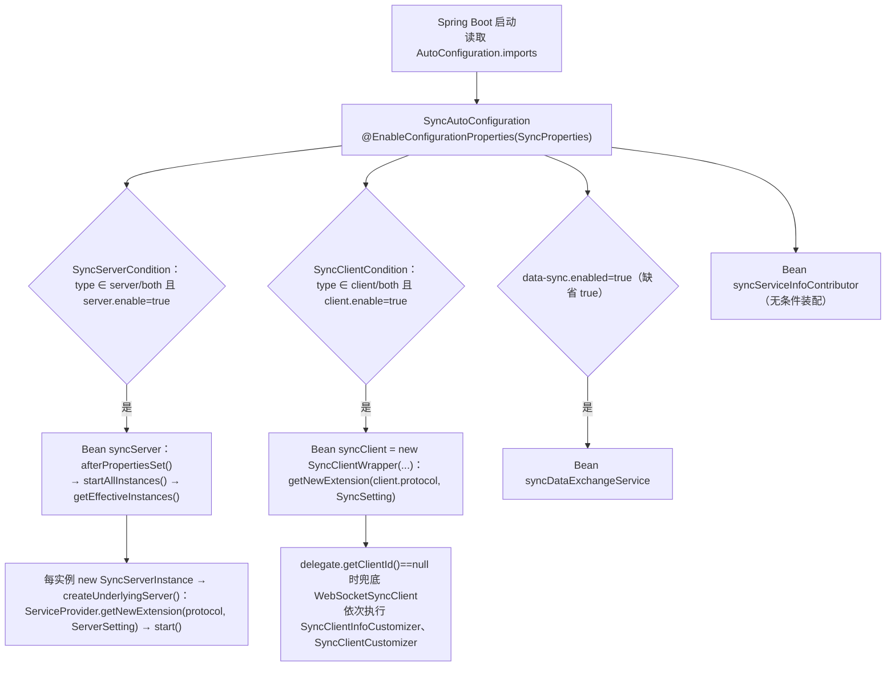

# spring-support-sync-starter

客户端/服务端双向同步通道：按 `plugin.sync.type` 装配 `SyncServer` / `SyncClient`，协议名经 `ServiceProvider` SPI 选择具体传输实现，主题消息由业务处理器消费。在 spring-support 体系中承担「控制面消息通道」角色：本模块只做自动装配、门面封装与传输加密，具体协议实现全部下沉在 utils 层。基于 Spring Boot 4.1.2（父 POM `spring-boot-starter-parent:4.1.2`，Java 25）。

## 1. 架构图

```mermaid
flowchart TB
    subgraph host["宿主应用（Spring Boot 4.1.2）"]
        APP["业务代码 / @Service"]
    end
    subgraph starter["spring-support-sync-starter（本模块）"]
        AUTO["SyncAutoConfiguration（唯一装配入口）"]
        SRV["SyncServer / SyncServerInstance"]
        CLI["SyncClient → SyncClientWrapper"]
        EX["SyncDataExchangeService"]
    end
    subgraph utils["utils 层（SPI 宿主）"]
        SPI["ServiceProvider + SyncServer/SyncClient SPI"]
        DISC["ServiceDiscovery SPI"]
    end
    subgraph proto["协议实现（META-INF/extensions 注册键）"]
        P1["http / websocket（本模块注册）"]
        P2["tcp / udp / rsocket / socketio / kcp（由 utils-support-common/network/rsocket/socketio/kcp-starter 注册）"]
    end
    APP -->|Maven 依赖| AUTO
    AUTO --> SRV
    AUTO --> CLI
    AUTO --> EX
    SRV -->|getNewExtension(protocol, setting)| SPI
    CLI -->|getNewExtension(protocol, setting)| SPI
    SPI --> P1
    SPI --> P2
    SRV -.->|service-name 注册| DISC
    CLI -.->|discovery-name 寻址| DISC
```

模块内部分层：装配层（`SyncAutoConfiguration` + `SyncServerCondition` / `SyncClientCondition` + `SyncProperties`）→ 门面层（`SyncServer`、`SyncClient` / `SyncClientWrapper`、`SyncDataExchangeService`）→ 实例与会话层（`SyncServerInstance`、`SyncSession`、`ClientInfo`、`ServerWebSocketMessage`）→ 横切能力 `SyncCryptoUtils`（AES-256-GCM + HKDF-SHA256）与服务发现注册（`com.chua.common.support.network.sync.SyncServerRegistrar`，utils 层）→ 传输层（utils SPI）。

## 2. 核心流程图

自动装配与启动流程（启动期）：



运行期服务端消息处理：上行帧 → `SyncCryptoUtils.decrypt`（失败丢弃并告警）→ `handleSystemTopic()` 消化系统主题（`sync/health`、`sync/client/register`、`sync/client/heartbeat`、`sync/client/offline` 等）→ 业务主题按 `handlerMap` 分发，消息体注入 `__syncClientId__` 后调用底层 `SyncMessageHandler.handle(topic, dataMap)`（两参）；经 `SyncServer#registerHandler` 适配的业务处理器则先拆出 clientId 作为 sessionId，再执行 `spi.SyncMessageHandler.handle(topic, sessionId, dataMap)`，处理器异常回发 `sync/response`（code=500）。

## 3. 能力清单

| 能力域 | 关键类 | 入口/触发方式 |
|---|---|---|
| 服务端通道 | `com.chua.starter.sync.support.server.SyncServer`、`SyncServerInstance`、`com.chua.starter.sync.support.AbstractSyncServer`；多实例：`SyncServer#getInstances`、`SyncProperties.ServerConfig#getEffectiveInstances` | Bean `syncServer`：`type=server/both` 且 `server.enable=true`；多实例经 `plugin.sync.server.instances[]` |
| 客户端通道 | `com.chua.starter.sync.support.client.SyncClient`（接口）、`SyncClientWrapper`（实现） | Bean `syncClient`：`type=client/both` 且 `client.enable=true` |
| 传输协议选择 | `com.chua.common.support.spi.ServiceProvider#getNewExtension(protocol, setting)` | `server.instances[].protocol` / `client.protocol`；本模块注册 `http`、`websocket` |
| 主题分发 | `SyncServer#registerHandler`、`SyncClient#registerHandler`、`com.chua.starter.sync.support.spi.SyncMessageHandler` | `plugin.sync.topics` 或编程式注册 |
| 定向/排除推送 | `publishByMetadata`、`publishByAppName`、`publish(host, port, ...)`、`publishToClients(Predicate)`；`SyncServerInstance#broadcastToOthers(excludeClientId, ...)` | `SyncServer` 编程接口；`broadcastToOthers` 经 `getInstances()` 取实例调用 |
| 客户端定制 | `spi.SyncClientCustomizer`、`spi.SyncClientInfoCustomizer` | Spring Bean，按 `getOrder()` 排序执行 |
| 传输加密 | `com.chua.starter.sync.support.security.SyncCryptoUtils`（AES-256-GCM + HKDF-SHA256，v1 密文兼容读取） | `plugin.sync.crypto-secret` / `crypto-version` |
| 服务发现 | `com.chua.common.support.network.discovery.ServiceDiscovery`、`SyncServerRegistrar` | `server.service-name` / `client.discovery-name`，容器唯一时接入 |
| 数据交换 | `com.chua.starter.sync.support.data.SyncDataExchangeService`、`SyncDataEnvelope`、`SyncResponse` | Bean `syncDataExchangeService`，`plugin.sync.data-sync.*` |
| DataSync 桥接 | `datasync.DataSyncAgentLifecycleConfiguration`、`SyncDataSyncConfiguration` | `utils-support-datasync-starter` 在 classpath 且被扫描/`@Import`（见 9.3） |
| 服务信息 | `SyncAutoConfiguration#syncServiceInfoContributor` | 无条件装配，注册 `sync` 标志 |

## 4. Bean 能力矩阵

| Bean 名 | 类型 | 装配条件（含默认值） | 可否覆盖 | 典型用途 |
|---|---|---|---|---|
| `syncServer` | `com.chua.starter.sync.support.server.SyncServer` | `@Conditional(SyncServerCondition)`：`plugin.sync.type ∈ {server, both}`（Condition 内 type 缺省按 `server` 判定）且 `plugin.sync.server.enable=true`（缺省 `false`）；外层 `@ConditionalOnMissingBean` | 可以 | 服务端主题分发与定向推送；未启用时容器无此 Bean，用 `ObjectProvider<SyncServer>` 获取 |
| `syncClient` | `com.chua.starter.sync.support.client.SyncClient`（实际实例 `SyncClientWrapper`） | `@Conditional(SyncClientCondition)`：`plugin.sync.type ∈ {client, both}`（Condition 内 type 缺省按 `client` 判定）且 `plugin.sync.client.enable=true`（缺省 `false`）；外层 `@ConditionalOnMissingBean` | 可以 | 客户端订阅、发布、注册上报；构造期即建立协议客户端，失败抛 `IllegalStateException("创建 SyncClient 失败")` |
| `syncDataExchangeService` | `com.chua.starter.sync.support.data.SyncDataExchangeService` | `@ConditionalOnProperty(prefix="plugin.sync.data-sync", name="enabled", havingValue="true", matchIfMissing=true)` + `@ConditionalOnMissingBean` | 可以 | 面向业务的数据同步门面；对应端未启用时 `requireSyncClient()` / `requireSyncServer()` 抛 `IllegalStateException` |
| `syncServiceInfoContributor` | `com.chua.starter.common.support.serviceinfo.ServiceInfoContributor` | 无条件（总是装配） | 无 `@ConditionalOnMissingBean`，勿重复定义同类型 Bean | 向服务信息注册表登记 `sync` 标志，业务一般不直接注入 |

`@EnableConfigurationProperties(SyncProperties.class)` 另注册属性 Bean `plugin.sync-com.chua.starter.sync.support.properties.SyncProperties`。

注意：`datasync` 包下两个 `@AutoConfiguration`（`DataSyncAgentLifecycleConfiguration`、`SyncDataSyncConfiguration`）未登记进 `AutoConfiguration.imports`，Boot 不会自动加载，仅当组件扫描覆盖 `com.chua.starter.sync.support.datasync` 包或显式 `@Import` 时生效。

## 5. 完整配置

两个前缀：`plugin.sync`（`SyncProperties.PRE`，经 `@EnableConfigurationProperties` 注册）与 `plugin.sync.datasync`（`SyncDatasyncProperties.PRE`；该属性类存在但未被注册为 Bean，实际由 `@ConditionalOnProperty` / `Environment` 读取）。

### 5.1 顶层 `plugin.sync.*`

| 配置路径 | 类型 | 默认值 | 说明 |
|---|---|---|---|
| `plugin.sync.type` | String | `client` | `server` 仅服务端、`client` 仅客户端、`both` 同时启用 |
| `plugin.sync.topics` | Map&lt;String,String&gt; | 空 | 主题映射（Key=主题名；Value 不用于路由，见 9.4） |
| `plugin.sync.crypto-secret` | String | 未设置 | 传输加密密钥，两端必须一致；未配置则明文 |
| `plugin.sync.crypto-version` | Integer | `2` | `2`=每条消息随机盐经 HKDF-SHA256 派生密钥；`1`=旧版固定密钥（滚动升级过渡） |
| `plugin.sync.server.*` / `client.*` / `data-sync.*` | ServerConfig / ClientConfig / DataSyncConfig | — | 嵌套配置，分别见 5.2 / 5.3 / 5.4 |

### 5.2 服务端 `plugin.sync.server.*` 与 `instances[]`

| 配置路径 | 类型 | 默认值 | 说明 |
|---|---|---|---|
| `server.enable` | boolean | `false` | 是否启用服务端（与 `type` 双条件） |
| `server.host` | String | `0.0.0.0` | 默认绑定地址（`instances` 为空时使用） |
| `server.port` | int | `19380` | 默认端口（同上） |
| `server.protocol` | String | `http` | 默认协议（同上） |
| `server.service-name` | String | 未设置 | 服务发现注册名：非空时按它注册，客户端用 `client.discovery-name` 按同名查找；为空时回落到该实例的 `instances[].name`（未配置则为随机 UUID），多实例各注册各的名字 |
| `server.scatter-id` | String | 未设置 | 业务分组，为空回落到 `service-name` |
| `server.heartbeat` | boolean | `true` | 心跳开关 |
| `server.heartbeat-interval` | int | `30` | 心跳间隔（秒） |
| `server.connect-timeout` | int | `10000` | 连接超时（毫秒） |
| `server.instances` | List&lt;ServerInstance&gt; | 空 | 多实例列表；为空时生成名为 `default` 的单实例 |
| `instances[].name` | String | 随机 UUID | 实例名（`SyncServer#getInstances` 的 Key）；服务发现注册名优先取 `server.service-name`，为空才用它 |
| `instances[].host` | String | `0.0.0.0` | 绑定地址 |
| `instances[].port` | int | `19380` | 端口 |
| `instances[].protocol` | String | `rsocket-sync` | 协议名（SPI 键）。**该默认键无实现注册，手写实例必须显式覆盖**，见 9.2 |
| `instances[].enable` | boolean | `true` | 是否启用该实例 |
| `instances[].description` | String | 未设置 | 实例说明 |
| `instances[].topics` | Map&lt;String,String&gt; | 空 | 实例专属主题映射，覆盖全局同名 Key |

### 5.3 客户端 `plugin.sync.client.*`

| 配置路径 | 类型 | 默认值 | 说明 |
|---|---|---|---|
| `client.enable` | boolean | `false` | 是否启用客户端（与 `type` 双条件） |
| `client.protocol` | String | `http` | 协议名（SPI 键） |
| `client.instance-id` | String | 未设置 | 客户端实例标识（预留字段，当前实现未消费） |
| `client.ip-address` | String | 未设置 | 预留字段，当前实现未消费（出口 IP 由底层协议实现自行决定） |
| `client.server-host` | String | `localhost` | 服务端地址（`server-address` 为空时使用） |
| `client.server-port` | int | `19380` | 服务端端口（同上） |
| `client.server-address` | String | 未设置 | 完整地址（如 `ws://host:port`），优先级高于 `server-host:server-port` |
| `client.discovery-name` | String | 未设置 | 按名称从发现中心解析服务端地址；需与服务端 `service-name` 一致 |
| `client.scatter-id` | String | 未设置 | 业务分组，为空回落到 `discovery-name` |
| `client.heartbeat` | boolean | `true` | 心跳开关 |
| `client.heartbeat-interval` | int | `30` | 心跳间隔（秒） |
| `client.connect-timeout` | int | `10000` | 连接超时（毫秒） |
| `client.auto-reconnect` | boolean | `true` | 自动重连 |
| `client.max-reconnect-attempts` | int | `-1` | 最大重连次数，`-1` 无限 |
| `client.reconnect-interval` | long | `5000` | 重连间隔（毫秒） |
| `client.capabilities` | String[] | `["job", "actuator", "file", "log"]` | 预留字段：当前注册报文未携带该字段，服务端 `ClientInfo#clientCapabilities` 不会被填充 |
| `client.metadata` | Map&lt;String,Object&gt; | 空 | 扩展元数据，供 `publishByMetadata` 定向推送 |
| `client.auto-register` | boolean | `true` | 连接后自动发送注册消息 |
| `client.register-topic` | String | `sync/client/register` | 注册主题 |
| `client.heartbeat-topic` | String | `sync/client/heartbeat` | 心跳主题 |
| `client.offline-topic` | String | `sync/client/offline` | 下线主题 |

### 5.4 数据交换与桥接

| 配置路径 | 类型 | 默认值 | 说明 |
|---|---|---|---|
| `plugin.sync.data-sync.enabled` | boolean | `true` | 是否装配 `SyncDataExchangeService`（`matchIfMissing=true`） |
| `plugin.sync.data-sync.topic-prefix` | String | `sync/data` | 主题前缀，实际主题 = `topicPrefix + "/" + channel` |
| `plugin.sync.data-sync.request-timeout` | long | `30000` | 请求超时（毫秒）；`request()` 当前不等待远端响应（见 9.4） |
| `plugin.sync.data-sync.default-channel` | String | `default` | 默认逻辑通道，channel 为空时使用 |
| `plugin.sync.datasync.enabled` | boolean | `true` | 是否启用 DataSync 桥接（仅桥接配置类被加载时读取，见 9.3） |

### 5.5 逐项配置示例（按功能分组）

下列示例均基于前缀 `plugin.sync`，YAML 使用空格缩进；`#` 后为含义与默认值说明。

**① 顶层模式与传输加密**

| 配置项 | 含义 | 默认值 |
|---|---|---|
| `type` | 运行形态：`server` 仅服务端 / `client` 仅客户端 / `both` 双端 | `client` |
| `topics` | 全局主题映射，Key=主题名；Value 仅备注、不参与路由 | 空 |
| `crypto-secret` | 传输加密密钥，两端必须一致；未配置则明文 | 未设置 |
| `crypto-version` | `2`=随机盐+HKDF 派生密钥；`1`=旧版固定密钥（过渡） | `2` |

```yaml
plugin:
  sync:
    type: both                                  # server / client / both
    crypto-secret: ${SYNC_SECRET:change-me}     # 生产用环境变量注入，两端一致
    crypto-version: 2                           # 滚动升级期间临时降为 1
    topics:
      order: 订单主题（Value 仅备注）
```

**② 服务端基础参数**

| 配置项 | 含义 | 默认值 |
|---|---|---|
| `server.enable` | 是否启用服务端（与 `type` 双条件） | `false` |
| `server.host` | 默认绑定地址（`instances` 为空时使用） | `0.0.0.0` |
| `server.port` | 默认端口（同上） | `19380` |
| `server.protocol` | 默认协议（SPI 键，同上） | `http` |
| `server.heartbeat` | 心跳开关 | `true` |
| `server.heartbeat-interval` | 心跳间隔（秒） | `30` |
| `server.connect-timeout` | 连接超时（毫秒） | `10000` |

```yaml
plugin:
  sync:
    server:
      enable: true
      host: 0.0.0.0
      port: 19380
      protocol: websocket
      heartbeat: true
      heartbeat-interval: 30
      connect-timeout: 10000
```

**③ 服务端服务发现与分组**

| 配置项 | 含义 | 默认值 |
|---|---|---|
| `server.service-name` | 服务发现注册名；为空回落到实例名 `instances[].name` | 未设置 |
| `server.scatter-id` | 业务分组；为空回落到 `service-name` | 未设置 |

```yaml
plugin:
  sync:
    server:
      service-name: sync-server
      scatter-id: sync-server
```

**④ 服务端多实例（instances[]）**

| 配置项 | 含义 | 默认值 |
|---|---|---|
| `instances[].name` | 实例名（`SyncServer#getInstances` 的 Key） | 随机 UUID |
| `instances[].host` | 绑定地址 | `0.0.0.0` |
| `instances[].port` | 端口 | `19380` |
| `instances[].protocol` | 协议名（SPI 键）；**默认键 `rsocket-sync` 无实现，手写必须显式覆盖** | `rsocket-sync` |
| `instances[].enable` | 是否启用该实例 | `true` |
| `instances[].description` | 实例说明 | 未设置 |
| `instances[].topics` | 实例专属主题，覆盖全局同名 Key | 空 |

```yaml
plugin:
  sync:
    server:
      instances:
        - name: main
          host: 0.0.0.0
          port: 19380
          protocol: websocket      # 必须写已注册协议键
          enable: true
          description: 主同步通道
          topics:
            order: 订单主题
```

**⑤ 客户端连接与寻址**

| 配置项 | 含义 | 默认值 |
|---|---|---|
| `client.enable` | 是否启用客户端（与 `type` 双条件） | `false` |
| `client.protocol` | 协议名（SPI 键） | `http` |
| `client.server-host` | 服务端地址（`server-address` 为空时使用） | `localhost` |
| `client.server-port` | 服务端端口（同上） | `19380` |
| `client.server-address` | 完整地址（如 `ws://host:port`），优先级最高 | 未设置 |
| `client.discovery-name` | 按名称从发现中心寻址，需与服务端注册名一致 | 未设置 |
| `client.scatter-id` | 业务分组；为空回落到 `discovery-name` | 未设置 |
| `client.instance-id` | 客户端实例标识（预留，当前实现未消费） | 未设置 |
| `client.ip-address` | 客户端 IP（预留，当前实现未消费） | 未设置 |

```yaml
plugin:
  sync:
    client:
      enable: true
      protocol: websocket
      server-host: 192.168.1.10
      server-port: 19380
      # server-address: ws://192.168.1.10:19380   # 配置后优先于 host:port
      discovery-name: sync-server
      scatter-id: sync-server
```

**⑥ 客户端心跳与重连**

| 配置项 | 含义 | 默认值 |
|---|---|---|
| `client.heartbeat` | 心跳开关 | `true` |
| `client.heartbeat-interval` | 心跳间隔（秒） | `30` |
| `client.connect-timeout` | 连接超时（毫秒） | `10000` |
| `client.auto-reconnect` | 自动重连 | `true` |
| `client.max-reconnect-attempts` | 最大重连次数；`-1` 无限 | `-1` |
| `client.reconnect-interval` | 重连间隔（毫秒） | `5000` |

```yaml
plugin:
  sync:
    client:
      heartbeat: true
      heartbeat-interval: 30
      connect-timeout: 10000
      auto-reconnect: true
      max-reconnect-attempts: -1
      reconnect-interval: 5000
```

**⑦ 客户端注册与元数据**

| 配置项 | 含义 | 默认值 |
|---|---|---|
| `client.auto-register` | 连接后自动发送注册消息 | `true` |
| `client.register-topic` | 注册主题 | `sync/client/register` |
| `client.heartbeat-topic` | 心跳主题 | `sync/client/heartbeat` |
| `client.offline-topic` | 下线主题 | `sync/client/offline` |
| `client.capabilities` | 能力清单（预留：当前注册报文未携带） | `[job, actuator, file, log]` |
| `client.metadata` | 扩展元数据，供 `publishByMetadata` 定向推送 | 空 |

```yaml
plugin:
  sync:
    client:
      auto-register: true
      register-topic: sync/client/register
      heartbeat-topic: sync/client/heartbeat
      offline-topic: sync/client/offline
      capabilities: [job, actuator, file, log]
      metadata:
        tenant: t-001
        region: north
```

**⑧ 数据交换（data-sync）**

| 配置项 | 含义 | 默认值 |
|---|---|---|
| `data-sync.enabled` | 是否装配 `SyncDataExchangeService`（`matchIfMissing=true`） | `true` |
| `data-sync.topic-prefix` | 主题前缀，实际主题 = 前缀 + `/` + channel | `sync/data` |
| `data-sync.request-timeout` | 请求超时（毫秒）；当前 `request()` 即发即忘，该值为预留 | `30000` |
| `data-sync.default-channel` | 默认逻辑通道 | `default` |

```yaml
plugin:
  sync:
    data-sync:
      enabled: true
      topic-prefix: sync/data
      request-timeout: 30000
      default-channel: default
```

**⑨ DataSync 桥接（datasync）**

| 配置项 | 含义 | 默认值 |
|---|---|---|
| `datasync.enabled` | 是否启用 DataSync 桥接；仅当桥接配置类被扫描/`@Import` 加载时读取（见 9.3） | `true` |

```yaml
plugin:
  sync:
    datasync:
      enabled: true
```

### 5.6 完整配置示例（生产参考）

服务端（`type=server`，只开服务端）：

```yaml
plugin:
  sync:
    type: server
    crypto-secret: ${SYNC_SECRET:change-me}     # 生产从环境变量/配置中心注入，禁止明文入库
    crypto-version: 2
    topics:
      order: 订单主题
    server:
      enable: true
      host: 0.0.0.0
      port: 19380
      protocol: websocket
      service-name: sync-server
      scatter-id: sync-server
      heartbeat: true
      heartbeat-interval: 30
      connect-timeout: 10000
      instances:
        - name: main
          host: 0.0.0.0
          port: 19380
          protocol: websocket
          enable: true
          description: 主同步通道
    data-sync:
      enabled: true
      topic-prefix: sync/data
      request-timeout: 30000
      default-channel: default
```

客户端（`type=client`，只开客户端；`crypto-secret` 必须与服务端一致）：

```yaml
plugin:
  sync:
    type: client
    crypto-secret: ${SYNC_SECRET:change-me}
    crypto-version: 2
    client:
      enable: true
      protocol: websocket
      server-host: 192.168.1.10
      server-port: 19380
      discovery-name: sync-server
      scatter-id: sync-server
      heartbeat: true
      heartbeat-interval: 30
      connect-timeout: 10000
      auto-reconnect: true
      max-reconnect-attempts: -1
      reconnect-interval: 5000
      auto-register: true
      metadata:
        tenant: t-001
```

## 6. 使用方式

Maven 坐标：

```xml
<dependency>
    <groupId>com.chua</groupId>
    <artifactId>spring-support-sync-starter</artifactId>
    <version>4.0.0.51</version>
</dependency>
```

最小启用示例（`type: both` 同进程开两端；生产建议两端分离部署）：

```yaml
plugin:
  sync:
    type: both
    crypto-secret: ${SYNC_SECRET:}
    server:
      enable: true
      protocol: websocket
      port: 19380
    client:
      enable: true
      protocol: websocket
      server-host: 127.0.0.1
      server-port: 19380
```

```java
// 未启用的一端容器中无 Bean，用 ObjectProvider 判空获取
SyncServer syncServer = serverProvider.getIfAvailable();   // type=server/both 时存在
SyncClient syncClient = clientProvider.getIfAvailable();   // type=client/both 时存在
syncServer.registerHandler("order", (topic, sessionId, data) -> Map.of("ack", true)); // 服务端：按主题注册处理器
syncClient.subscribe("order", "notice");                       // 客户端：批量订阅
syncClient.publish("order", Map.<String, Object>of("orderId", 1, "amount", 100)); // 客户端：发布结构化数据（形参是 Map<String, Object>，需显式类型参数；无链式 API，收发返回 void/int）
```

可选依赖说明（与 pom.xml 一致）：

| 依赖 | 作用域 | 缺失影响 |
|---|---|---|
| `spring-boot-starter`、`spring-support-common-starter` | compile | 必需：后者提供 `ModuleLog` 日志与 `ServiceInfoContributor` |
| `spring-boot-configuration-processor` | optional | 仅影响配置元数据生成，不影响运行 |
| `spring-support-job-starter` / `spring-support-swagger-starter` | provided | 任务 / 接口文档能力由使用方自行引入 |
| `utils-support-datasync-starter` | optional | 缺失时 DataSync 桥接不生效，本模块其余功能不受影响 |
| `io.rsocket:rsocket-core` / `rsocket-transport-netty`、`com.corundumstudio.socketio:netty-socketio` | provided | 编译期依赖；运行期需引入 `utils-support-rsocket-starter` / `utils-support-socketio-starter` 才注册 `rsocket` / `socketio` 协议键 |

协议键注册位置：本模块 `META-INF/extensions` 只注册 `http`、`websocket`；`tcp`、`udp` 在 `utils-support-common-starter`（本模块经 `spring-support-common-starter` 传递引入，开箱可用）；`rsocket`、`socketio`、`kcp` 在对应 utils starter（需显式引入）。不额外引入 utils starter 时，`protocol` 可取 `http` / `websocket` / `tcp` / `udp`。

## 7. 使用场景

**适用**：
- 多节点业务集群的指令下发与状态回传（服务端 ↔ 客户端双向主题消息，含心跳保活、断线重连）。
- 按应用名 / IP:端口 / 自定义 metadata 定向推送（灰度、租户隔离、定向通知）。
- 多协议共存：同一套业务代码通过 `protocol` 键在 http / websocket / tcp / udp / rsocket / socketio / kcp 间切换。
- 需要传输层透明加密的内部通道（配置 `crypto-secret` 即启用 AES-256-GCM）。

**不适用/慎用**：
- 需要「请求-响应」可靠往返的 RPC 调用：`SyncDataExchangeService#request()` 只发送并立即返回本地成功回执，不等待远端结果；此类需求用 `spring-support-rpc-starter`。
- 高吞吐流式数据管道、与非 Java 端互通：通道定位是控制面消息；协议实现是本仓库 utils 层私有封装，不是标准 WebSocket/HTTP 语义对齐的外部协议端点。

**与相邻模块的取舍**：
- `spring-support-job-starter`：任务模块借用同一套 `SyncClient` / `SyncServer` 下发指令（`provided` 依赖），两者常配对；任务编排属于 job，通道属于本模块。
- `spring-support-rpc-starter`：方法级 RPC 与本模块的主题消息是两种形态，互不替代。
- `spring-support-datasync-starter` + `utils-support-datasync-starter`：数据同步的映射加载与 Agent 能力在 datasync 侧，本模块经 `SyncDataSyncConfiguration` / `DataSyncAgentLifecycleConfiguration` 把同步结果沿通道下发并维护 Agent 生命周期。

## 8. 扩展点

**业务定制（Spring Bean，容器自动收集，按 `getOrder()` 排序）**：

| 扩展点 | 方法 | 时机 |
|---|---|---|
| `spi.SyncClientInfoCustomizer` | `customize(ClientInfo)` | `SyncClientWrapper` 构造期、注册报文发送前；补充租户等 metadata，配合服务端 `publishByMetadata` |
| `spi.SyncClientCustomizer` | `customize(SyncClient)` | 早于底层网络连接建立；适合提前 `subscribe` / `registerHandler` |
| `spi.SyncMessageHandler` | `handle(topic, sessionId, data)`、`getName()`、`supports(topic)` | 服务端 `registerHandler(topic, handler)` 的业务处理器形态，自动注入源客户端标识 |

```java
@Bean
public SyncClientInfoCustomizer tenantCustomizer() {
    return clientInfo -> clientInfo.getClientMetadata().put("tenant", "t-001"); // 注册报文携带 tenant，服务端即可 publishByMetadata("tenant", "t-001", ...)
}
```

**传输协议（utils 层 SPI）**：`SyncServerInstance#createUnderlyingServer` 与 `SyncClientWrapper` 构造器都调用 `ServiceProvider#getNewExtension(protocol, setting)`。新增协议：实现 `com.chua.common.support.network.server.SyncServer` / `com.chua.common.support.network.sync.SyncClient`（服务端可继承 `AbstractSyncServer`，实现 `doStart()` / `doStop()` / `doSend(...)`，并在合适时机触发 `fireConnectionEstablished` / `fireConnectionClosed` / `fireMessageReceived`），在协议 jar 的 `META-INF/extensions/<SPI 接口全限定名>` 登记键名；键名即配置值。

**服务发现**：实现/引入 `com.chua.common.support.network.discovery.ServiceDiscovery` 并保证容器唯一。容器存在多个实现时本模块不接入并告警，回落显式地址——即使其中一个标记 `@Primary` 也不接入（`SyncAutoConfiguration#resolveServiceDiscovery` 仅按候选个数判断）。

## 9. 常见问题

**9.1 装配不生效与 Boot 4 兼容**：`plugin.sync.type` 与对应 `enable` 双条件缺一不可，且 `enable` 均缺省 `false`——什么都不配时两端都不会启动；两个 Condition 对 `type` 的缺省兜底不同（`SyncServerCondition` 缺省按 `server`、`SyncClientCondition` 缺省按 `client`）。未启用的一端容器里没有对应 Bean，直接构造器注入会 `NoSuchBeanDefinitionException`，用 `ObjectProvider<...>.getIfAvailable()` 判空；替换实现时自定义同类型 `@Bean` 即可（`@ConditionalOnMissingBean` 让位），但 `SyncClientWrapper` 构造期就选协议、创建 delegate 对象（`connect()` 才真正建立连接），自定义实现要自行保证时序。本模块仅提供 `META-INF/spring/org.springframework.boot.autoconfigure.AutoConfiguration.imports`，无 `spring.factories`（Boot 4 不再从 `spring.factories` 加载自动配置）；代码使用 `jakarta.annotation.PostConstruct` 与 `org.springframework.boot.autoconfigure.AutoConfiguration`，附带 GraalVM native-image 元数据（`META-INF/native-image/com.chua/spring-support-sync-starter/`）；属性绑定走 `@ConfigurationProperties`（`SyncProperties`，`ignoreInvalidFields=true`），升级 Boot 版本无需改动配置键。

**9.2 端口、协议与服务发现**：`server.instances[].protocol` 字段默认值是 `rsocket-sync`，但已注册的键只有 `http` / `websocket` / `tcp` / `udp` / `rsocket` / `socketio` / `kcp`（其中 `socketio` 目前只注册了客户端键，服务端 `instances[].protocol` 取它取不到实例）——手写 `instances[]` 必须显式写出服务端已注册的协议名，否则 `ServiceProvider.getNewExtension` 取不到实例；不配 `instances` 时只生成一个 `default` 实例，多端口必须显式写 `instances[]`。客户端侧 `SyncClientWrapper` 在 `delegate.getClientId()==null` 时兜底改用 `WebSocketSyncClient`。服务发现：容器中存在多个 `ServiceDiscovery` 时不接入并回落显式地址（`@Primary` 也不接入）；`client.discovery-name` 必须与服务端注册名一致——有 `server.service-name` 用它的值，没有则用该实例的 `instances[].name`；协议名（redis/nacos 等）由 discovery Bean 决定，不在这两个配置项里。

**9.3 DataSync 桥接为何没生效**：`DataSyncAgentLifecycleConfiguration`（`@ConditionalOnClass(name="com.chua.starter.datasync.agent.DataSyncAgentServer")`）与 `SyncDataSyncConfiguration` 虽标注 `@AutoConfiguration`，但未登记进 `AutoConfiguration.imports`（该文件只有 `SyncAutoConfiguration` 一行），Boot 4 不会自动加载。需 `utils-support-datasync-starter` 在 classpath（本模块中为 optional），且宿主组件扫描覆盖 `com.chua.starter.sync.support.datasync` 包或显式 `@Import`，再配合 `plugin.sync.datasync.enabled=true`（`@ConditionalOnProperty` 缺省视为 true）。注意 `SyncDataSyncConfiguration#init()` 内读同一个键时缺省是 `false`，未显式配置时桥接 Bean 仍会创建，但服务信息标志与启动日志会显示未启用。

**9.4 数据交换、主题路由与加密**：`SyncDataExchangeService#request(channel, payload)` 是发送后立即返回本地 `SyncResponse.success(...)`，不挂起等待远端回执（`data-sync.request-timeout` 未参与该路径）；真正往返请用主题 handler + `sync/response` 自行编排，或改用 RPC 模块。`plugin.sync.topics` 的 Value 在 `SyncServer#registerHandlersToInstance` 中不用于选择处理器（实现是把所有已注册处理器挂到配置的每个主题上），精确绑定请用 `registerHandler(topic, handler)`；系统主题里 `sync/health`、`sync/client/register`、`sync/client/heartbeat`、`sync/client/offline` 由服务端 `handleSystemTopic` 内部消化，`sync/response`、`sync/connect`、`sync/disconnect` 由服务端主动下发，业务主题避开这些名字。加密：`crypto-secret` 未配置即明文，配置后两端必须一致；加解密失败抛异常并丢弃消息，不静默降级为明文；滚动升级先让新节点以 `crypto-version=1` 与旧节点互通，全部升级后统一改回 `2`。

## 10. 生产注意事项

1. **双条件缺一不可**：`type` 与对应端的 `enable` 必须同时配置；`enable` 缺省 `false`，只写 `type: server` 不会启动服务端。
2. **密钥管理**：`crypto-secret` 通过环境变量或配置中心注入（如 `${SYNC_SECRET}`），禁止提交到代码库或写死在配置里；两端必须一致；轮换按 9.4 的 `crypto-version=1` 过渡流程执行。
3. **网络与端口**：服务端绑定 `0.0.0.0` 会监听所有网卡，生产建议绑定内网地址；`server.port` / `instances[].port` 需在防火墙/安全组放行。
4. **协议键必须真实注册**：`instances[].protocol` 字段默认值 `rsocket-sync` 没有对应实现，手写 `instances[]` 时必须显式写 `http` / `websocket` / `tcp` / `udp` 等已注册键（见 9.2）。
5. **未启用端判空获取**：未启用的端在容器中没有对应 Bean，用 `ObjectProvider<SyncServer>` / `ObjectProvider<SyncClient>` 的 `getIfAvailable()` 判空，避免 `NoSuchBeanDefinitionException`。
6. **服务发现唯一性**：容器中存在多个 `ServiceDiscovery` 实例时不接入（标记 `@Primary` 也不接入），回落显式地址；确保 discovery Bean 唯一。
7. **主题命名避让**：业务主题避开系统主题 `sync/health`、`sync/client/register`、`sync/client/heartbeat`、`sync/client/offline`、`sync/response`、`sync/connect`、`sync/disconnect`。
8. **不要当 RPC 用**：`SyncDataExchangeService#request()` 即发即忘、不等待远端回执；可靠往返用主题 handler + `sync/response` 自行编排，或改用 `spring-support-rpc-starter`。
9. **心跳/重连参数按网络调整**：`heartbeat-interval` 单位是秒、`reconnect-interval` 单位是毫秒，注意单位差异；弱网环境适当调大 `connect-timeout` 与 `reconnect-interval`。
10. **DataSync 桥接需显式引入**：`utils-support-datasync-starter` 为 optional 依赖，且桥接配置类不在 `AutoConfiguration.imports` 中，需组件扫描覆盖 `datasync` 包或显式 `@Import`（见 9.3）。
