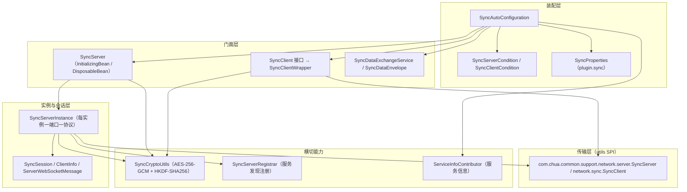
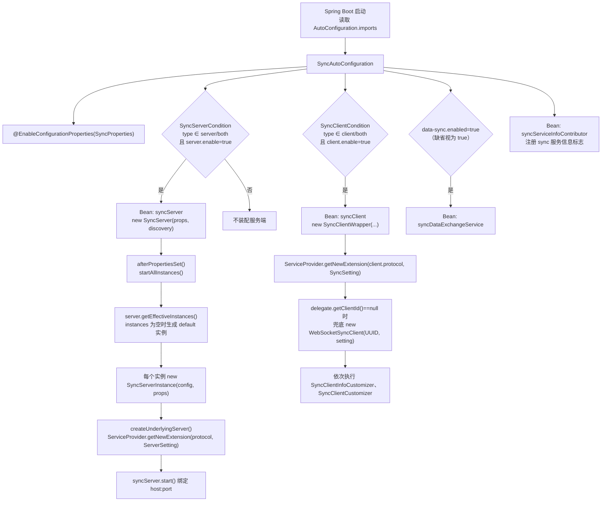
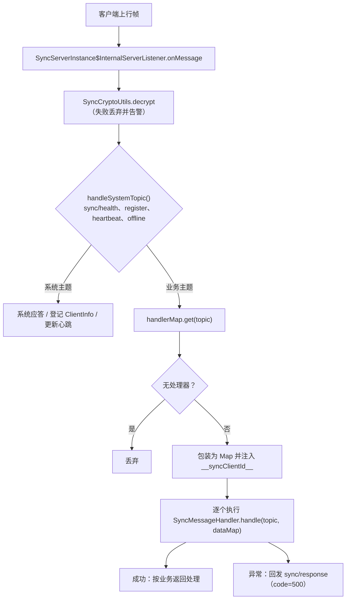
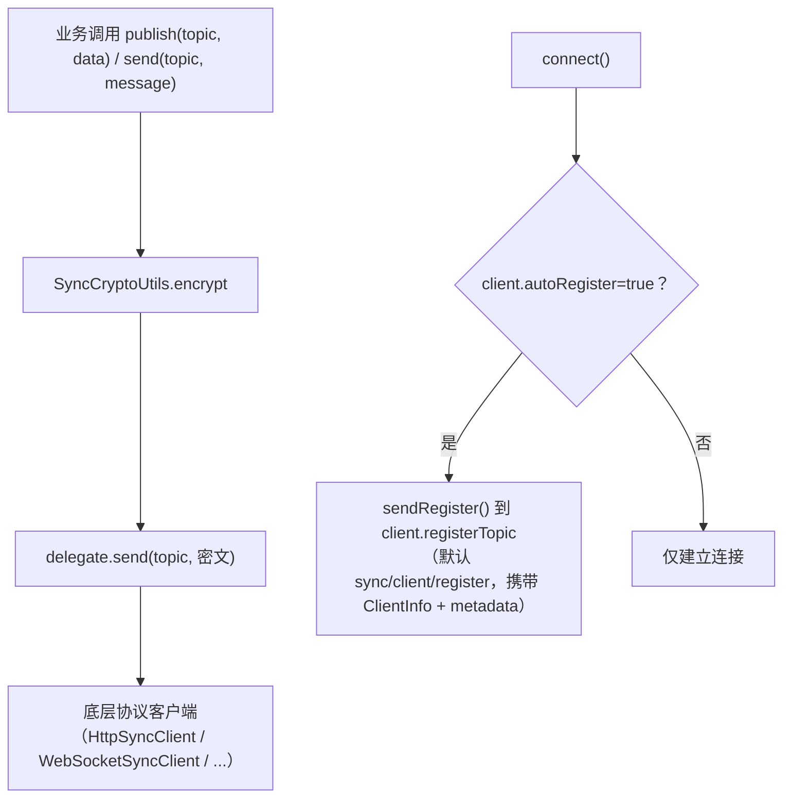

# spring-support-sync-starter

客户端/服务端双向同步通道：按 `plugin.sync.type` 装配 `SyncServer` / `SyncClient`，协议名通过 `ServiceProvider` SPI 选择具体传输实现，主题消息由业务处理器消费。基于 Spring Boot 4.1.2（仓库父 POM `spring-boot-starter-parent:4.1.2`，Java 25）。

- 自动配置入口（唯一）：`META-INF/spring/org.springframework.boot.autoconfigure.AutoConfiguration.imports` → `com.chua.starter.sync.support.configuration.SyncAutoConfiguration`。本模块无 `spring.factories`。
- 模块定位：传输通道与消息编排；具体协议实现全部下沉在 utils 层，本模块只做装配、封装与加密。

## 1. 架构图

### 1.1 模块在体系中的位置

```mermaid
flowchart TB
    subgraph host["宿主应用（Spring Boot 4.1.2）"]
        APP["业务代码 / @Service"]
    end

    subgraph starter["spring-support-sync-starter（本模块）"]
        AUTO["SyncAutoConfiguration"]
        SRV["SyncServer"]
        CLI["SyncClient / SyncClientWrapper"]
        EX["SyncDataExchangeService"]
    end

    subgraph utils["utils 层（SPI 宿主）"]
        SPI["ServiceProvider + SyncServer/SyncClient SPI"]
        DISC["ServiceDiscovery SPI"]
    end

    subgraph proto["协议实现（META-INF/extensions 注册键）"]
        P1["http / websocket / tcp / udp（utils-support-common-starter、utils-support-network-starter）"]
        P2["rsocket（utils-support-rsocket-starter）"]
        P3["socketio（utils-support-socketio-starter）"]
        P4["kcp（utils-support-kcp-starter）"]
    end

    APP -->|Maven 依赖| AUTO
    AUTO --> SRV
    AUTO --> CLI
    AUTO --> EX
    SRV -->|getNewExtension(protocol, setting)| SPI
    CLI -->|getNewExtension(protocol, setting)| SPI
    SPI --> P1
    SPI --> P2
    SPI --> P3
    SPI --> P4
    SRV -.->|可选：service-name 注册| DISC
    CLI -.->|可选：discovery-name 寻址| DISC
```

### 1.2 模块内部分层



## 2. 核心流程图

### 2.1 装配流程（启动期）



### 2.2 服务端消息处理流程（运行期）



### 2.3 客户端发送与注册流程（运行期）



## 3. 能力清单

| 能力域 | 关键类 | 入口 |
|---|---|---|
| 服务端通道 | `com.chua.starter.sync.support.server.SyncServer`、`SyncServerInstance`、`com.chua.starter.sync.support.AbstractSyncServer`、`SyncSession` | Bean `syncServer`，`plugin.sync.type=server\|both` 且 `server.enable=true` |
| 客户端通道 | `com.chua.starter.sync.support.client.SyncClient`（接口）、`SyncClientWrapper`（实现） | Bean `syncClient`，`plugin.sync.type=client\|both` 且 `client.enable=true` |
| 传输协议选择 | `com.chua.common.support.spi.ServiceProvider#getNewExtension(protocol, setting)` | `server.instances[].protocol` / `client.protocol` |
| 本模块内置协议键 | `META-INF/extensions` 注册 `http`、`websocket`（`HttpSyncServer/Client`、`WebSocketSyncServer/Client`） | 同上 |
| 其它已注册协议键 | `tcp`、`udp`（utils-support-common-starter / utils-support-network-starter）；`rsocket`、`socketio`、`kcp`（对应 utils starter） | 同上 |
| 主题分发 | `SyncServer#registerHandler`、`SyncClient#registerHandler`、`com.chua.starter.sync.support.spi.SyncMessageHandler` | `plugin.sync.topics` 或编程式注册 |
| 多实例监听 | `SyncServer#getInstances`、`SyncProperties.ServerConfig#getEffectiveInstances` | `plugin.sync.server.instances[]` |
| 定向推送 | `publishByMetadata`、`publishByAppName`、`publish(host, port, ...)`、`publishToClients(Predicate)` | `SyncServer` 编程接口 |
| 排除式广播 | `SyncServerInstance#broadcastToOthers(excludeClientId, topic, data)`（`SyncServer` 未委托该方法，需经 `SyncServer#getInstances()` 取实例调用） | `SyncServerInstance` 实例方法 |
| 客户端定制 | `SyncClientCustomizer`、`SyncClientInfoCustomizer` | Spring Bean，按 `getOrder()` 排序执行 |
| 传输加密 | `SyncCryptoUtils`（AES-256-GCM + HKDF-SHA256，v1 密文兼容读取） | `plugin.sync.crypto-secret` / `crypto-version` |
| 服务发现寻址 | `com.chua.common.support.network.discovery.ServiceDiscovery`（仅容器唯一时接入，多实现即使 `@Primary` 也不接入）、`SyncServerRegistrar` | `server.service-name` / `client.discovery-name` |
| 数据交换 | `SyncDataExchangeService`、`SyncDataEnvelope`、`SyncResponse` | Bean `syncDataExchangeService`，`plugin.sync.data-sync.*` |
| 数据同步桥接 | `DataSyncAgentLifecycleConfiguration`、`SyncDataSyncConfiguration` | `utils-support-datasync-starter` 在 classpath 且被扫描/`@Import` 时（见 9.4） |
| 服务信息 | `SyncAutoConfiguration#syncServiceInfoContributor` | 无条件装配，注册 `sync` 标志 |

## 4. Bean 能力矩阵

| Bean 名 | 类型 | 装配条件 | 可否覆盖 | 典型注入姿势 |
|---|---|---|---|---|
| `syncServer` | `com.chua.starter.sync.support.server.SyncServer` | `@Conditional(SyncServerCondition)`：`plugin.sync.type ∈ {server, both}`（Condition 内 type 缺省按 `server` 判定）**且** `plugin.sync.server.enable=true`（缺省 `false`）；外层 `@ConditionalOnMissingBean` | 可以：自定义同类型 Bean 后自动配置让位 | `ObjectProvider<SyncServer>` 获取（未启用时容器无此 Bean，直接注入会启动失败） |
| `syncClient` | `com.chua.starter.sync.support.client.SyncClient`（实际实例 `SyncClientWrapper`） | `@Conditional(SyncClientCondition)`：`plugin.sync.type ∈ {client, both}`（Condition 内 type 缺省按 `client` 判定）**且** `plugin.sync.client.enable=true`（缺省 `false`）；外层 `@ConditionalOnMissingBean` | 可以：`@ConditionalOnMissingBean` | `ObjectProvider<SyncClient>`；构造期即建立协议客户端，失败抛 `IllegalStateException("创建 SyncClient 失败")` |
| `syncDataExchangeService` | `com.chua.starter.sync.support.data.SyncDataExchangeService` | `@ConditionalOnProperty(prefix="plugin.sync.data-sync", name="enabled", havingValue="true", matchIfMissing=true)` + `@ConditionalOnMissingBean` | 可以：`@ConditionalOnMissingBean` | 直接注入或 `ObjectProvider`；调用 `requireSyncClient()/requireSyncServer()` 时对应端未启用会抛 `IllegalStateException` |
| `syncServiceInfoContributor` | `com.chua.starter.common.support.serviceinfo.ServiceInfoContributor` | 无条件（总是装配） | 无 `@ConditionalOnMissingBean`；重复定义同类型 Bean 会共存，注意别与其它模块的 Contributor 冲突 | 由服务信息注册表收集，业务一般不直接注入 |

`@EnableConfigurationProperties(SyncProperties.class)` 注册属性 Bean `plugin.sync-com.chua.starter.sync.support.properties.SyncProperties`。

**未列入 imports 的 `@AutoConfiguration`**：`DataSyncAgentLifecycleConfiguration`（`@ConditionalOnClass(name="com.chua.starter.datasync.agent.DataSyncAgentServer")` + `plugin.sync.datasync.enabled` 缺省 true）与 `SyncDataSyncConfiguration`（`plugin.sync.datasync.enabled`）虽标注 `@AutoConfiguration`，但**没有**登记进 `AutoConfiguration.imports`，Boot 不会自动加载；仅当宿主组件扫描覆盖 `com.chua.starter.sync.support.datasync` 包或显式 `@Import` 时生效（详见 9.4）。

## 5. 完整配置

两个前缀：`plugin.sync`（`SyncProperties.PRE`，经 `@EnableConfigurationProperties` 注册）与 `plugin.sync.datasync`（`SyncDatasyncProperties.PRE`；该属性类存在但未被注册为 Bean，实际由 `@ConditionalOnProperty` / `Environment.getProperty` 读取）。

### 5.1 顶层 `plugin.sync.*`

| 路径 | 类型 | 默认值 | 说明 | 生效开关 |
|---|---|---|---|---|
| `plugin.sync.type` | String | `client` | `server` 仅服务端、`client` 仅客户端、`both` 同时启用 | 总是读取 |
| `plugin.sync.topics` | Map&lt;String,String&gt; | 空 | 主题与处理器映射（Key=主题名；Value 不用于选择处理器，见 9.3） | 服务端启动分发时读取 |
| `plugin.sync.crypto-secret` | String | 未设置（null） | 传输加密密钥，两端必须一致；未配置则明文 | 配置后收发自动加解密 |
| `plugin.sync.crypto-version` | Integer | `2` | `2`=每条消息随机盐经 HKDF-SHA256 派生密钥；`1`=旧版固定密钥（仅滚动升级过渡） | 配合 `crypto-secret` |
| `plugin.sync.server.*` | ServerConfig | — | 服务端配置，见 5.2 | `type ∈ {server, both}` |
| `plugin.sync.client.*` | ClientConfig | — | 客户端配置，见 5.3 | `type ∈ {client, both}` |
| `plugin.sync.data-sync.*` | DataSyncConfig | — | 数据交换配置，见 5.4 | 控制 `syncDataExchangeService` 装配 |

### 5.2 服务端 `plugin.sync.server.*`

| 路径 | 类型 | 默认值 | 说明 | 生效开关 |
|---|---|---|---|---|
| `server.enable` | boolean | `false` | 是否启用服务端 | 与 `type` 双条件 |
| `server.host` | String | `0.0.0.0` | 默认绑定地址 | `instances` 为空时使用 |
| `server.port` | int | `19380` | 默认端口（`instances` 为空时使用） | 同上 |
| `server.protocol` | String | `http` | 默认协议 | 同上 |
| `server.service-name` | String | 未设置 | 非空时服务端启动后注册到发现中心；客户端按同名查找，两端通常同值 | 容器存在唯一 `ServiceDiscovery` |
| `server.scatter-id` | String | 未设置 | 业务分组标识，为空回落到 `service-name` | 同上 |
| `server.heartbeat` | boolean | `true` | 心跳开关 | 服务端启用时 |
| `server.heartbeat-interval` | int | `30` | 心跳间隔（秒） | 同上 |
| `server.connect-timeout` | int | `10000` | 连接超时（毫秒） | 同上 |
| `server.instances` | List&lt;ServerInstance&gt; | 空 | 多实例列表；为空时自动生成名为 `default` 的单实例 | 服务端启用时 |

### 5.3 服务实例 `plugin.sync.server.instances[]`

| 路径 | 类型 | 默认值 | 说明 | 生效开关 |
|---|---|---|---|---|
| `instances[].name` | String | 随机 UUID | 实例名；服务发现注册时服务名优先用它 | 显式写 `instances[]` 时 |
| `instances[].host` | String | `0.0.0.0` | 绑定地址 | 同上 |
| `instances[].port` | int | `19380` | 端口 | 同上 |
| `instances[].protocol` | String | `rsocket-sync` | 协议名，必须是 SPI 已注册键。**注意：`rsocket-sync` 键没有任何实现注册，手写实例必须显式覆盖**，见 9.2 | 同上 |
| `instances[].enable` | boolean | `true` | 是否启用该实例 | 同上 |
| `instances[].description` | String | 未设置 | 实例说明 | 同上 |
| `instances[].topics` | Map&lt;String,String&gt; | 空 | 实例专属主题映射，合并时覆盖全局同名 Key | 同上 |

### 5.4 客户端 `plugin.sync.client.*`

| 路径 | 类型 | 默认值 | 说明 | 生效开关 |
|---|---|---|---|---|
| `client.enable` | boolean | `false` | 是否启用客户端 | 与 `type` 双条件 |
| `client.protocol` | String | `http` | 协议名（SPI 键） | 客户端启用时 |
| `client.instance-id` | String | 未设置（当前实现未消费该配置） | 客户端实例标识 | 同上 |
| `client.ip-address` | String | 未设置 | 多网卡时指定出口 IP，为空自动获取 | 同上 |
| `client.server-host` | String | `localhost` | 服务端地址 | `server-address` 为空时 |
| `client.server-port` | int | `19380` | 服务端端口 | 同上 |
| `client.server-address` | String | 未设置 | 完整地址（如 `ws://host:port`），优先级高于 `server-host:server-port` | 客户端启用时 |
| `client.discovery-name` | String | 未设置 | 按名称从发现中心解析服务端地址，解析不到才回落显式地址；需与服务端注册的 `service-name` 一致 | 容器存在唯一 `ServiceDiscovery` |
| `client.scatter-id` | String | 未设置 | 业务分组，为空回落到 `discovery-name` | 同上 |
| `client.heartbeat` | boolean | `true` | 心跳开关 | 客户端启用时 |
| `client.heartbeat-interval` | int | `30` | 心跳间隔（秒） | 同上 |
| `client.connect-timeout` | int | `10000` | 连接超时（毫秒） | 同上 |
| `client.auto-reconnect` | boolean | `true` | 自动重连 | 同上 |
| `client.max-reconnect-attempts` | int | `-1` | 最大重连次数，`-1` 为无限 | 同上 |
| `client.reconnect-interval` | long | `5000` | 重连间隔（毫秒） | 同上 |
| `client.capabilities` | String[] | `["job", "actuator", "file", "log"]` | 能力声明，随注册上报 | 同上 |
| `client.metadata` | Map&lt;String,Object&gt; | 空 | 扩展元数据，供服务端 `publishByMetadata` 定向推送 | 同上 |
| `client.auto-register` | boolean | `true` | 连接后自动发送注册消息 | 同上 |
| `client.register-topic` | String | `sync/client/register` | 注册主题 | 同上 |
| `client.heartbeat-topic` | String | `sync/client/heartbeat` | 心跳主题 | 同上 |
| `client.offline-topic` | String | `sync/client/offline` | 下线主题 | 同上 |

### 5.5 数据交换 `plugin.sync.data-sync.*`

| 路径 | 类型 | 默认值 | 说明 | 生效开关 |
|---|---|---|---|---|
| `data-sync.enabled` | boolean | `true` | 是否装配 `SyncDataExchangeService` | `@ConditionalOnProperty(matchIfMissing=true)` |
| `data-sync.topic-prefix` | String | `sync/data` | 主题前缀，实际主题 = `topicPrefix + "/" + channel` | 服务启用后 |
| `data-sync.request-timeout` | long | `30000` | 请求超时（毫秒）；注意 `request()` 当前实现并不等待远端响应（见 9.5） | 同上 |
| `data-sync.default-channel` | String | `default` | 默认逻辑通道，channel 为空时使用 | 同上 |

### 5.6 数据同步桥接 `plugin.sync.datasync.*`

| 路径 | 类型 | 默认值 | 说明 | 生效开关 |
|---|---|---|---|---|
| `datasync.enabled` | boolean | `true`（`matchIfMissing=true`） | 是否启用 DataSync 桥接 | 仅在桥接配置类被加载时读取（见 9.4） |

## 6. 使用方式

### 6.1 Maven 坐标

```xml
<dependency>
    <groupId>com.chua</groupId>
    <artifactId>spring-support-sync-starter</artifactId>
    <version>4.0.0.51</version>
</dependency>
```

### 6.2 依赖说明（与 pom.xml 一致）

| 依赖 | 作用域 | 说明 |
|---|---|---|
| `spring-boot-starter` | compile | Spring Boot 基础 |
| `spring-boot-configuration-processor` | optional | 配置元数据生成 |
| `spring-support-common-starter` | compile | 日志（`ModuleLog`）与服务信息（`ServiceInfoContributor`），必需 |
| `spring-support-job-starter` | provided | 任务能力扩展，使用方自行提供 |
| `spring-support-swagger-starter` | provided | 接口文档，非必需 |
| `utils-support-datasync-starter` | optional（4.0.0.51） | 数据同步桥接所需 Agent 能力，可选 |
| `io.rsocket:rsocket-core`、`rsocket-transport-netty` | provided | RSocket 传输编译期依赖，需自行引入 `utils-support-rsocket-starter` 才注册 `rsocket` 键 |
| `com.corundumstudio.socketio:netty-socketio` | provided | Socket.IO 编译期依赖，需自行引入 `utils-support-socketio-starter` 才注册 `socketio` 键 |

> 协议键注册位置：本模块自身注册 `http`、`websocket`；`tcp`、`udp` 来自 `utils-support-common-starter`（`utils-support-network-starter` 亦有同名注册）；`rsocket`、`socketio`、`kcp` 分别在对应 utils starter。只引本模块时，`client.protocol` / `instances[].protocol` 只能取 `http` / `websocket`。

### 6.3 最小可运行示例

1. 引入依赖，按需补齐传输层 starter。
2. 选定 `type` 并打开对应 `enable`：

```yaml
plugin:
  sync:
    type: both
    crypto-secret: ${SYNC_SECRET:}
    server:
      enable: true
      protocol: websocket
      port: 19380
    client:
      enable: true
      protocol: websocket
      server-host: 127.0.0.1
      server-port: 19380
```

3. 业务侧注册主题处理器并收发消息。本模块无链式 API：收发方法返回 `void` / `boolean` / 命中数量 `int`，没有 Builder，也没有 `return this` 风格入口。

```java
@Service
public class SyncGateway {

    private final SyncServer syncServer;   // type=server/both 时存在
    private final SyncClient syncClient;   // type=client/both 时存在

    public SyncGateway(ObjectProvider<SyncServer> serverProvider,
                       ObjectProvider<SyncClient> clientProvider) {
        this.syncServer = serverProvider.getIfAvailable();
        this.syncClient = clientProvider.getIfAvailable();
    }

    public void start() {
        if (syncServer != null) {
            // 服务端：按主题注册处理器，handle(topic, sessionId, data)
            syncServer.registerHandler("order", (topic, sessionId, data) -> Map.of("ack", true));
        }
        if (syncClient != null) {
            // 客户端：批量订阅 + 发布结构化数据
            syncClient.subscribe("order", "notice");
            syncClient.registerHandler("notice", (topic, sessionId, data) -> null);
            syncClient.publish("order", Map.of("orderId", 1, "amount", 100));
        }
    }

    public void pushToTenant() {
        // 服务端定向推送：按客户端 metadata 过滤，返回命中数量
        int hit = syncServer.publishByMetadata("tenant", "t-001", "notice", Map.of("msg", "hello"));
    }
}
```

## 7. 使用场景

**适用**：
- 多节点业务集群的指令下发与状态回传（服务端 ↔ 客户端双向主题消息）。
- 需要按应用名 / IP:端口 / 自定义 metadata 定向推送的场景（灰度、租户隔离、定向通知）。
- 多协议共存：同一套业务代码通过 `protocol` 键在 http / websocket / tcp / udp / rsocket / socketio / kcp 间切换。
- 需要传输层透明加密的内部通道（配置 `crypto-secret` 即启用 AES-256-GCM）。
- 客户端在线登记、心跳保活、断线自动重连的常驻连接场景。

**不适用**：
- 需要「请求-响应」可靠往返的 RPC 调用：`SyncDataExchangeService#request()` 只是发送并立即返回本地成功回执，不等待远端结果；此类需求用 `spring-support-rpc-starter`。
- 高吞吐流式数据管道：通道定位是控制面消息，不是数据面吞吐。
- 与非 Java 端互通：协议实现是本仓库 utils 层私有封装，不是标准 WebSocket/HTTP 语义对齐的外部协议端点。

**与相邻模块的取舍**：
- `spring-support-common-starter`：本模块必需依赖，提供日志与服务信息；无功能重叠。
- `spring-support-job-starter`：任务模块借用同一套 `SyncClient`/`SyncServer` 做指令下发（`provided` 依赖），两者常配对；任务编排属于 job，通道属于本模块。
- `spring-support-rpc-starter`：方法级 RPC 门面与本模块的主题消息是两种形态，互不替代。
- `spring-support-datasync-starter` + `utils-support-datasync-starter`：数据同步的映射加载与 Agent 能力在 datasync 侧，本模块通过 `SyncDataSyncConfiguration` / `DataSyncAgentLifecycleConfiguration` 把同步结果沿通道下发并维护 Agent 生命周期。

## 8. 扩展点

### 8.1 业务定制（Spring Bean，容器自动收集）

| 扩展点 | 方法 | 时机 |
|---|---|---|
| `SyncClientInfoCustomizer` | `customize(ClientInfo)` + `getOrder()` | `SyncClientWrapper` 构造期、注册报文发送前；用于补充租户等 metadata，配合服务端 `publishByMetadata` |
| `SyncClientCustomizer` | `customize(SyncClient)` + `getOrder()` | 早于底层网络连接建立；适合提前 `subscribe` / `registerHandler` |
| `SyncMessageHandler`（本模块 SPI 包） | `handle(topic, sessionId, data)`、`getName()`、`getOrder()`、`supports(topic)` | 服务端 `registerHandler(topic, handler)` 的业务处理器形态，自动注入源客户端标识 |

```java
// 1) 实现：客户端注册前补充元数据
public class TenantClientInfoCustomizer implements SyncClientInfoCustomizer {

    @Override
    public int getOrder() {
        return 0;
    }

    @Override
    public void customize(ClientInfo clientInfo) {
        Map<String, Object> metadata = clientInfo.getClientMetadata();
        if (metadata == null) {
            metadata = new HashMap<>();
            clientInfo.setClientMetadata(metadata);
        }
        metadata.put("tenant", "t-001");
    }
}

// 2) 登记
@Bean
public SyncClientInfoCustomizer tenantClientInfoCustomizer() {
    return new TenantClientInfoCustomizer();
}
// 3) 生效：注册报文携带 tenant，服务端即可 publishByMetadata("tenant", "t-001", ...)
```

### 8.2 传输协议（utils 层 SPI）

`SyncServerInstance#createUnderlyingServer` 与 `SyncClientWrapper` 构造器都调用 `ServiceProvider#getNewExtension(protocol, setting)`，协议键由各 jar 的 `META-INF/extensions` 注册决定：

- `com.chua.common.support.network.server.SyncServer`：新增服务端协议实现 `com.chua.common.support.network.server.SyncServer`（可继承 `AbstractSyncServer`，只需实现 `doStart()` / `doStop()` / `doSend(...)`，并在合适时机调用 `fireConnectionEstablished` / `fireConnectionClosed` / `fireMessageReceived`），登记键名。
- `com.chua.common.support.network.sync.SyncClient`：新增客户端协议实现并登记键名。
- 键名即配置值：`server.instances[].protocol` / `client.protocol` 填登记的键。

### 8.3 服务发现接入

实现/引入 `com.chua.common.support.network.discovery.ServiceDiscovery` 并保证容器中唯一：服务端配置 `server.service-name` 后启动自动注册、停止前注销（`SyncServerRegistrar`）；客户端配置 `client.discovery-name` 后按名寻址。容器中存在多个实现时本模块不接入并告警，回落显式地址——即使其中一个标记了 `@Primary` 也同样不接入（`SyncAutoConfiguration#resolveServiceDiscovery` 仅按候选个数判断，不识别 `@Primary`）。

## 9. 常见问题

### 9.1 装配不生效

- **双条件缺一不可**：`plugin.sync.type` 与对应 `enable` 必须同时满足。只写 `client.enable: true` 而 `type` 保持默认 `client` 可以生效；但 `type: server` 时客户端条件不成立。两个 Condition 对 `type` 的缺省兜底不同（`SyncServerCondition` 缺省按 `server`、`SyncClientCondition` 缺省按 `client`），而 `enable` 均缺省 `false`——所以**什么都不配时两端都不会启动**。
- **注入失败**：未启用的一端容器里没有对应 Bean，直接构造器注入会 `NoSuchBeanDefinitionException`；用 `ObjectProvider<...>.getIfAvailable()` 判空。
- **覆盖 Bean**：想替换实现时自定义同类型 `@Bean` 即可（`@ConditionalOnMissingBean` 让位）；但注意 `SyncClientWrapper` 构造期就会选协议、建连接，自定义实现要自行保证时序。

### 9.2 端口与协议

- **`rsocket-sync` 键不存在**：`server.instances[].protocol` 字段默认值是 `rsocket-sync`，但 utils 层注册的键只有 `http`/`websocket`/`tcp`/`udp`/`rsocket`/`socketio`/`kcp`。手写 `instances[]` 时必须显式写出已注册协议名，否则 `ServiceProvider.getNewExtension` 取不到实例。
- **多端口**：不配 `instances` 时只生成一个 `default` 实例（用 `server.host/port/protocol`）；多端口必须显式写 `instances[]`，每项独立 `host:port:protocol`。
- **RSocket / Socket.IO / KCP**：本模块 pom 里只有 `provided` 编译期依赖；运行期协议实例来自 `utils-support-rsocket-starter` / `utils-support-socketio-starter` / `utils-support-kcp-starter`，未引入对应 starter 时这些键取不到实现。
- **客户端协议兜底**：`SyncClientWrapper` 在 `delegate.getClientId()==null` 时会兜底改用 `WebSocketSyncClient`，若你依赖特定协议行为请注意该分支。

### 9.3 主题路由

- `plugin.sync.topics` 的 Value 在 `SyncServer#registerHandlersToInstance` 中未被用于选择处理器：实现是把所有已注册处理器挂到配置的每个主题上。**不要依赖 Value 做路由**，需要精确绑定请用 `registerHandler(topic, handler)`。
- 实例级 `instances[].topics` 会覆盖全局同名主题 Key。
- 系统主题（`sync/health`、`sync/response`、`sync/connect`、`sync/disconnect`、`sync/client/register`、`sync/client/heartbeat`、`sync/client/offline`）由服务端内部处理，业务主题避开这些名字。

### 9.4 DataSync 桥接为何没生效

`DataSyncAgentLifecycleConfiguration` 与 `SyncDataSyncConfiguration` 虽标注 `@AutoConfiguration`，但**未登记**进本模块的 `AutoConfiguration.imports`（该文件只有 `SyncAutoConfiguration` 一行），Boot 4 不会自动加载它们。要让桥接生效，需满足：`utils-support-datasync-starter` 在 classpath（本模块里是 optional），且宿主组件扫描覆盖 `com.chua.starter.sync.support.datasync` 包，或显式 `@Import` 这两个配置类；再配合 `plugin.sync.datasync.enabled=true`（缺省视为 true）。

### 9.5 数据交换的「请求」语义

`SyncDataExchangeService#request(channel, payload)` 当前实现是发送消息后立即返回本地构造的 `SyncResponse.success(...)`，并不会挂起等待服务端回执（`data-sync.request-timeout` 未参与该路径）。需要真正往返请使用主题 handler + `sync/response` 自行编排，或改用 RPC 模块。

### 9.6 加密

- `crypto-secret` 未配置即明文传输；配置后服务端与客户端必须一致。
- 加解密失败会抛异常并丢弃消息，**不会静默降级为明文**。
- 滚动升级：解密端始终兼容 v1 与 v2；先让新节点以 `crypto-version=1` 与旧节点互通，全部升级完成后再统一改回 `2`。

### 9.7 服务发现

- 容器中存在多个 `ServiceDiscovery` 时，本模块不接入发现并告警，回落到显式地址（避免注册到 A 中心却从 B 中心查询）；即使其中之一标记了 `@Primary` 也同样不接入——`resolveServiceDiscovery` 只比较候选个数，从不判断 `@Primary`，仅容器唯一时才接入。
- `client.discovery-name` 必须与服务端注册用的 `server.service-name` 一致，两端才能互相找到；协议名（redis/nacos 等）由 discovery Bean 名决定，不在这两个配置项里。

### 9.8 与 Spring Boot 4 兼容性

- 本模块按 Boot 4 体系装配：仅提供 `META-INF/spring/org.springframework.boot.autoconfigure.AutoConfiguration.imports`，无 `spring.factories`（Boot 4 已不再从 `spring.factories` 加载自动配置）。
- 父 POM 为 `spring-boot-starter-parent:4.1.2`，Java 25；代码使用 `jakarta.annotation.PostConstruct` 与 `org.springframework.boot.autoconfigure.AutoConfiguration`，与 Boot 4 语义一致。
- 附带 GraalVM native-image 元数据（`META-INF/native-image/com.chua/spring-support-sync-starter/reflect-config.json`、`resource-config.json`），native 化时可直接被收录。
- Boot 4 下属性绑定仍走 `@ConfigurationProperties`（`SyncProperties`，`ignoreInvalidFields=true`）；升级 Boot 版本无需改动本模块配置键。
