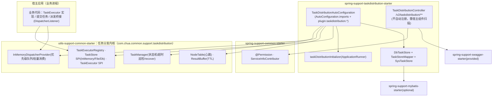
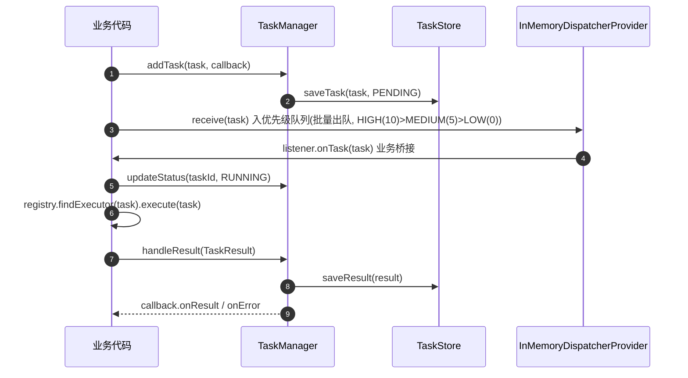

# spring-support-taskdistribution-starter

任务分发模块：基于 utils 层任务分发内核（`com.chua.common.support.taskdistribution` 包，核心类 `TaskManager` / `InMemoryDispatcherProvider` / `TaskStore`）实现进程内任务的提交、优先级派发、执行、结果回调、状态管理（取消/暂停/恢复）、超时检测与重启恢复。在 spring-support 体系中，它是业务可选的能力 starter：宿主引入即获得「提交-查询-取消-恢复-持久化」的完整任务语义；框架内核位于 `utils-support-common-starter`，本模块负责自动装配、配置绑定、数据库存储适配与管理 API。

## 1. 架构图



内部分层：装配层（`TaskDistributionAutoConfiguration` + `TaskDistributionProperties`）→ 接入层（`TaskDistributionController`、`taskDistributionInitializer`、`taskDistributionServiceInfoContributor`）→ 存储适配层（`DbTaskStore` / `TaskStoreMapper` / `SysTaskStore`）→ 框架内核（utils 层，非本模块代码）。

## 2. 核心流程图

任务派发数据流（单机内存模式）。注意：自动配置只创建 Bean，**不自动接通派发回路**——`InMemoryDispatcherProvider` 默认没有 `DispatcherListener`，`listener.onTask` 之后的执行与结果回传必须由业务侧桥接（见 6.2），否则任务只被存储、最终被超时巡检标记 TIMEOUT。



## 3. 能力清单

| 能力域 | 关键类 | 入口/触发方式 |
|:---|:---|:---|
| 自动装配与配置绑定 | `TaskDistributionAutoConfiguration` · `TaskDistributionProperties` | `AutoConfiguration.imports` + `plugin.taskdistribution.*`（enabled 默认 true） |
| 任务存储（多态） | `TaskStore`：`InMemoryTaskStore` / `FileTaskStore` / `DbTaskStore`（+ `TaskStoreMapper` / `SysTaskStore`） | `store-type`=memory(默认)/file/db；db 需 MyBatis-Plus optional 依赖 |
| 任务管理器 | `TaskManager`（1s 超时巡检、`recover()` 恢复、`getRetryableTasks()`） | 注入 Bean |
| 节点注册表 | `NodeTable`（心跳 60s 超时 / 15s 巡检） | 注入 Bean / `node/list` 接口 |
| 结果缓冲 | `ResultBuffer`（TTL 60s，30s 清理周期） | 注入 Bean / 删除任务接口 |
| 派发提供者与执行器注册 | `DispatcherProvider` → `InMemoryDispatcherProvider`（容量 1024） · `TaskExecutorRegistry` | `batch-size` / `consumer-threads`；容器内 `TaskExecutor<?>` 自动注册 |
| 启动初始化 | `taskDistributionInitializer`（`ApplicationRunner`） | 生成/回写 nodeId，注册全部执行器 |
| 管理接口 | `TaskDistributionController` | `/v2/taskdistribution/**` 8 个端点，带 `@Permission` |
| 服务信息登记与链路追踪 | `taskDistributionServiceInfoContributor` · `MdcDecorator` | 控制台能力开关展示；派发/存储过程注入 `taskId`/`traceId` 到 SLF4J MDC |

## 4. Bean 能力矩阵

以下 Bean 全部由 `TaskDistributionAutoConfiguration` 装配，整体受 `plugin.taskdistribution.enabled=true` 控制（`matchIfMissing=true`，缺省即开启）：

| Bean 名 | 类型 | 装配条件 | 可否覆盖 | 典型用途 |
|:---|:---|:---|:---|:---|
| `taskStore` | `TaskStore`（按 store-type 返回 `InMemoryTaskStore`/`FileTaskStore`/`DbTaskStore`） | `@ConditionalOnMissingBean`；db 时还需容器存在 `TaskStoreMapper`，否则 WARN 回退内存 | 可（自定义 Bean 优先，如 Redis 适配） | 经 `TaskManager` 间接使用，一般不直接注入 |
| `nodeTable` | `NodeTable` | `@ConditionalOnMissingBean` | 可 | 节点信息维护、管理接口内部使用 |
| `taskManager` | `TaskManager` | `@ConditionalOnMissingBean`；依赖 `taskStore`，装配时 `recover()` | 可 | 提交任务、查询状态、取消/暂停/恢复 |
| `resultBuffer` | `ResultBuffer` | `@ConditionalOnMissingBean` | 可 | 结果缓存与移除 |
| `taskExecutorRegistry` | `TaskExecutorRegistry` | `@ConditionalOnMissingBean` | 可 | 派发桥接按 `taskType` 查执行器 |
| `dispatcherProvider` | `DispatcherProvider`（`InMemoryDispatcherProvider`） | `@ConditionalOnMissingBean`；容量固定 1024，batch-size/consumer-threads 来自配置，装配即 `start()` | 可（如换分布式队列实现） | `receive` / `listener` / `pendingCount` |
| `taskDistributionInitializer` | `ApplicationRunner` | 模块开启即装配（无 missing-bean 条件） | 否（基础设施） | 不注入；nodeId 初始化 + 执行器注册 |
| `taskDistributionServiceInfoContributor` | `ServiceInfoContributor` | 模块开启即装配；依赖 common-starter 服务信息体系 | 可 | 不注入；控制台展示模块开关 |

两个关键类**不属于自动配置**，需宿主配合装配：

- `TaskDistributionController`：宿主组件扫描覆盖 `com.chua.starter.taskdistribution.support.controller` + Web 环境才存在（自动配置不注册它）；鉴权走 common-starter 的 `@Permission`，Swagger 注解需 provided 的 swagger-starter。
- `TaskStoreMapper`：需 MyBatis-Plus 环境且 `@MapperScan`（或 `@Mapper` 自动扫描）覆盖 `...support.mapper`；自动配置以 `@Autowired(required=false)` 注入，扫不到则 `store-type=db` 回退内存并打 WARN。

## 5. 完整配置

前缀 `plugin.taskdistribution`（`TaskDistributionProperties`，含嵌套 `ServerConfig` / `TaskConfig`）：

| 配置路径 | 类型 | 默认值 | 说明 |
|:---|:---|:---|:---|
| `plugin.taskdistribution.enabled` | `boolean` | `true` | 模块总开关，`matchIfMissing=true` 缺省即开启；false 则整个自动配置不加载 |
| `plugin.taskdistribution.node-id` | `String` | null（自动生成 `node-<时间戳>` 并回写） | 节点标识，写入 `TaskIdGenerator` 作任务 ID 前缀，建议显式配置 |
| `plugin.taskdistribution.strategy` | `DispatchStrategy`：`FIRST`/`LAST`/`RANDOM`/`ROUND`/`WEIGHT` | `ROUND` | 仅用于初始化日志与服务信息登记，**当前未传给派发器** |
| `plugin.taskdistribution.batch-size` | `int` | `1` | 每次批量处理的任务数，传入 `InMemoryDispatcherProvider` |
| `plugin.taskdistribution.consumer-threads` | `int` | `1` | 消费线程数，传入 `InMemoryDispatcherProvider` |
| `plugin.taskdistribution.store-type` | `String` | `memory` | `memory` / `file` / `db`；非法值按内存处理 |
| `plugin.taskdistribution.store-path` | `String` | `./data/taskstore/` | 文件存储目录，仅 `store-type=file` 生效 |
| `plugin.taskdistribution.server.enabled` | `boolean` | `true` | 服务端模式开关；**仅声明，无任何消费点** |
| `plugin.taskdistribution.server.port` | `int` | `19390` | **运行期未读取，不会监听该端口** |
| `plugin.taskdistribution.server.host` | `String` | `0.0.0.0` | **运行期未读取** |
| `plugin.taskdistribution.server.protocol` | `String` | `tcp` | **运行期未读取** |
| `plugin.taskdistribution.task.timeout-ms` | `long` | `30000` | **配置未接线**；实际超时取每个 `Task` 的 `timeoutMs` 字段（`Task.builder().timeoutMs(...)`，框架默认同为 30000） |
| `plugin.taskdistribution.task.max-retries` | `int` | `3` | **配置未接线**；实际取每个 `Task` 的 `maxRetries` 字段（框架默认 3） |

### 5.1 逐项配置示例（按功能分组）

#### 开关与节点标识

| 配置项 | 含义 | 默认值 |
|:---|:---|:---|
| `enabled` | 模块总开关，false 则整个自动配置不加载 | `true`（缺省即开启） |
| `node-id` | 节点唯一标识，写入 `TaskIdGenerator` 作任务 ID 前缀；多实例部署必须显式配置且全局唯一 | null → 自动生成 `node-<时间戳>` 并回写 |

```yaml
plugin:
  taskdistribution:
    enabled: true        # 缺省即 true，可不写
    node-id: node-01     # 不配则自动生成 node-<时间戳>
```

#### 派发与消费

| 配置项 | 含义 | 默认值 |
|:---|:---|:---|
| `strategy` | 派发策略：`FIRST` / `LAST` / `RANDOM` / `ROUND` / `WEIGHT`；当前仅用于初始化日志与服务信息登记，未传给派发器 | `ROUND` |
| `batch-size` | 内存派发器单次批量出队的任务数；配置 ≤0 时派发器内部回落为 1 | `1` |
| `consumer-threads` | 内存派发器消费线程数（任务经桥接后在这些线程内执行）；配置 ≤0 时派发器内部回落为 1 | `1` |

```yaml
plugin:
  taskdistribution:
    strategy: ROUND         # FIRST / LAST / RANDOM / ROUND / WEIGHT
    batch-size: 10          # 每次批量出队任务数
    consumer-threads: 4     # 消费线程数
```

#### 存储模式

| 配置项 | 含义 | 默认值 |
|:---|:---|:---|
| `store-type` | 任务/结果持久化实现：`memory` / `file` / `db`；db 缺 MyBatis 环境或非法值均回落 memory | `memory` |
| `store-path` | 文件存储落盘目录，仅 `store-type=file` 生效 | `./data/taskstore/` |

```yaml
plugin:
  taskdistribution:
    store-type: file                  # memory / file / db
    store-path: ./data/taskstore/     # 仅 store-type=file 生效
```

#### 服务端与任务默认值（当前仅声明，运行期未消费）

| 配置项 | 含义 | 默认值 |
|:---|:---|:---|
| `server.enabled` | 服务端模式开关声明 | `true` |
| `server.port` | 声明监听端口（不会实际监听） | `19390` |
| `server.host` | 声明监听主机 | `0.0.0.0` |
| `server.protocol` | 声明传输协议 tcp / udp | `tcp` |
| `task.timeout-ms` | 任务默认超时声明；实际取每个 Task 的 `timeoutMs` 字段 | `30000` |
| `task.max-retries` | 任务默认重试声明；实际取每个 Task 的 `maxRetries` 字段 | `3` |

```yaml
plugin:
  taskdistribution:
    server:              # 仅声明，当前不会监听端口
      enabled: true
      port: 19390
      host: 0.0.0.0
      protocol: tcp
    task:                # 仅声明，实际以每个 Task 的字段为准
      timeout-ms: 30000
      max-retries: 3
```

### 5.2 完整 YAML 使用示例（生产参考：db 存储）

```yaml
plugin:
  taskdistribution:
    enabled: true
    node-id: prod-node-01          # 多实例部署必须全局唯一
    batch-size: 10
    consumer-threads: 4
    store-type: db                 # 生产推荐 db：重启后 recover() 自动恢复 PENDING/RUNNING 任务
    # store-path 仅 store-type=file 时需要，db 模式忽略：
    # store-path: ./data/taskstore/
    # server.* / task.* / strategy 当前为仅声明配置，可不写
```

db 模式的三个前提（缺一自动回退内存并打 WARN）：

1. 引入 optional 依赖 `spring-support-mybatis-starter` 并配置好数据源（数据源配置属宿主/mybatis-starter，不在本模块 `plugin.taskdistribution` 前缀内）；
2. `@MapperScan` 扫描到 `com.chua.starter.taskdistribution.support.mapper`；
3. 执行建表脚本 `src/main/resources/db/init/V2.0__init_all_taskdistribution.sql`（表 `sys_task_store`）。

### 5.3 生产注意事项

- **不要基于 19390 端口做防火墙/监控配置**：`server.*` 未接线，本模块不监听任何端口，也不存在 TCP/UDP 集群节点（详见 Q3）。
- **超时与重试逐任务设置**：`task.timeout-ms` / `task.max-retries` 未接线，需在 `Task.builder().timeoutMs(...).maxRetries(...)` 中显式指定；框架没有自动重试调度器，需业务侧定期调 `getRetryableTasks()` 重新派发。
- **nodeId 唯一性**：多实例共用一套存储（尤其 db/file 模式）时，`node-id` 必须全局唯一，否则任务 ID 前缀冲突、链路排查困难。
- **db 模式写入语义**：`DbTaskStore` 的 upsert 异常只打日志不抛出（写失败不阻断业务但不落库）；`task_json`/`result_json` 为 TEXT（约 64KB），大 payload 请改 LONGTEXT 或先压缩。
- **恢复范围**：启动恢复仅覆盖 PENDING/RUNNING 状态，已完成任务不重放；内存模式（默认）重启即丢任务。
- **文件存储**：`store-path` 目录需宿主进程有读写权限；多实例不要指向同一目录，避免互相覆盖。
- **消费线程与批量**：`consumer-threads` 决定派发消费并发度、`batch-size` 决定单轮出队数；队列为无界 `PriorityBlockingQueue`（初始容量 1024，超出自动扩容、不拒绝不阻塞），积压可通过 `pendingCount()` 观测，重任务场景请自行监控积压防止内存膨胀。

## 6. 使用方式

### 6.1 Maven 坐标

```xml
<dependency>
    <groupId>com.chua</groupId>
    <artifactId>spring-support-taskdistribution-starter</artifactId>
    <version>4.0.0.51</version>
</dependency>
```

- `spring-boot-starter`：容器与自动配置。
- `spring-support-common-starter`：`@Permission`、`ServiceInfoContributor`，并传递引入 `utils-support-common-starter`（任务分发内核：`TaskManager` / `InMemoryDispatcherProvider` / `TaskStore`）。
- `spring-support-mybatis-starter`：**optional**，仅 `store-type=db` 需要；未引入则 db 模式回退内存。
- `spring-support-swagger-starter`：**provided**，仅 `@Tag`/`@Operation` 文档注解，缺失不影响运行。
- `spring-boot-configuration-processor`：**optional**，生成配置元数据（IDE 提示）。

### 6.2 最小启用示例（单机内存）

```yaml
plugin:
  taskdistribution:
    enabled: true          # 缺省即 true，可不写
    node-id: node-01       # 推荐显式配置，不配则自动生成
    consumer-threads: 2    # batch-size 默认 1
    store-type: memory     # 生产可切 db / file
```

实现一个 `TaskExecutor`（声明为 `@Component` 即自动注册）：

```java
@Component
public class HelloExecutor implements TaskExecutor<String> {
    @Override public String taskType() { return "hello"; }
    @Override public TaskResult<String> execute(Task<String> task) {
        // success 为 3 参：taskId、数据、执行节点标识
        return TaskResult.success(task.getTaskId(), "Hello, " + task.getPayload(), "node-01");
    }
}
```

接通派发回路（必须，否则任务不会被执行）：

```java
@Component
public class InJvmDispatchBridge {
    @SuppressWarnings({"rawtypes", "unchecked"})
    public InJvmDispatchBridge(DispatcherProvider dp, TaskExecutorRegistry registry,
                               TaskManager tm, TaskDistributionProperties props) {
        dp.listener(new DispatcherListener() {
            @Override
            public void onTask(Task<?> task) {
                tm.updateStatus(task.getTaskId(), TaskStatus.RUNNING);
                TaskExecutor<?> ex = registry.findExecutor(task);
                TaskResult<?> result;
                try {
                    result = ex == null
                            ? TaskResult.failure(task.getTaskId(), "无执行器: " + task.getTaskType(), props.getNodeId())
                            : ((TaskExecutor) ex).execute(task);
                } catch (Exception e) {
                    result = TaskResult.failure(task.getTaskId(), e.getMessage(), props.getNodeId());
                }
                tm.handleResult(result);
            }
            @Override
            public void onResult(TaskResult<?> result) { /* 单机模式结果已在 onTask 内回传 */ }
        });
    }
}
```

提交任务（`taskId` 必须显式生成，`addTask` 对 null 静默忽略）：

```java
Task<String> task = Task.<String>builder()
        .taskId(TaskIdGenerator.generateId())   // 必须显式生成
        .taskType("hello").payload("CH").priority(TaskPriority.HIGH)
        .timeoutMs(10_000).maxRetries(2).build();   // task.* 配置未接线，逐任务显式指定
taskManager.addTask(task, new TaskCallback() {
    @Override public void onResult(TaskResult<?> r) { /* 成功 */ }
    @Override public void onTimeout(String taskId) { /* 超时 */ }
});
```

### 6.3 切换数据库存储与管理接口

`store-type=db` 三前提：① 引入 optional 的 `spring-support-mybatis-starter` 并配置数据源；② `@MapperScan` 扫描 `com.chua.starter.taskdistribution.support.mapper`；③ 执行建表脚本 `src/main/resources/db/init/V2.0__init_all_taskdistribution.sql`（表 `sys_task_store`，MySQL/H2 通用子集；`task_json`/`result_json` 为 TEXT，大 payload 自行改 LONGTEXT）。starter 不负责执行建表，是否自动执行取决于宿主的 Flyway/Liquibase 装配。

管理接口（均带 `@Permission` 权限声明与 Swagger 注解）：

```text
GET    /v2/taskdistribution/task/list              # 任务清单 (taskdistribution:task:list)
GET    /v2/taskdistribution/task/{taskId}          # 任务详情 task/status/result (taskdistribution:task:get)
POST   /v2/taskdistribution/task/{taskId}/cancel   # 取消任务 (taskdistribution:task:cancel)
POST   /v2/taskdistribution/task/{taskId}/pause    # 暂停任务 (taskdistribution:task:pause)
POST   /v2/taskdistribution/task/{taskId}/resume   # 恢复任务 (taskdistribution:task:resume)
DELETE /v2/taskdistribution/task/{taskId}          # 删除任务记录(移出 ResultBuffer) (taskdistribution:task:delete)
GET    /v2/taskdistribution/node/list              # 节点清单(含离线) (taskdistribution:node:list)
DELETE /v2/taskdistribution/node/{nodeId}          # 注销节点 (taskdistribution:node:delete)
```

## 7. 使用场景

**适用**：单机内异步任务派发（图片处理、报表生成、消息推送等后台任务）且需要任务状态可查、可取消/暂停/恢复；需要优先级调度（高优先级先出队）；需要重启恢复（切 `file`/`db`，启动时 `recover()` 自动恢复 PENDING/RUNNING）；需要跨线程链路追踪（MDC 注入 `taskId`/`traceId`）。

**不适用/慎用**：

- **分布式多节点负载均衡**：本 starter 未装配任何网络服务端（`server.*` 未接线），`InMemoryDispatcherProvider` 只在单 JVM 内派发；`NodeTable` 只被管理接口读取（无任何节点注册来源），`DispatchStrategy` 未传给派发器，二者当前「有 Bean、无实际调度的消费方」。
- **强一致/不丢任务/自动重试**：`DbTaskStore` 的 upsert 异常只打日志不抛出，`task_json`/`result_json` 为 TEXT（约 64KB）；恢复仅覆盖 PENDING/RUNNING，已完成任务不重放；内核无自动重试调度器，`getRetryableTasks()` 只返回待重试清单，需业务自行拉起。

**与相邻模块取舍**：common-starter（直接依赖，提供 `@Permission`/`ServiceInfoContributor` 并传递引入内核）、mybatis-starter（optional，仅 db 模式）、swagger-starter（provided，仅注解）见 6.1。此外：

- Spring `@Scheduled` / `ThreadPoolTaskScheduler`：简单定时任务直接用 Spring 调度；需要完整任务语义（状态/取消/恢复/持久化）时用本模块。
- 消息队列（RocketMQ/Kafka）：跨服务解耦投递用 MQ；本模块定位 JVM 内任务编排，可叠加使用（MQ 收到消息后转成本模块任务）。

## 8. 扩展点

扩展一律走「实现接口 + Spring Bean / 编程注册」；本模块**不提供** `META-INF/extensions` SPI 装配（`FileTaskStore` 上的 `@Spi("file")` 属 utils 层注解，本 starter 用 if/else 选择实现，不走 SPI 加载器）。

| 扩展点 | 类型 | 注册方式与说明 |
|:---|:---|:---|
| `TaskExecutor<T>` | 接口（业务实现） | `taskType()` + `execute(Task<T>)`；声明为 `@Component` 即被 `taskDistributionInitializer` 自动注册到 `TaskExecutorRegistry`，按 `taskType` 精确路由 |
| `TaskStore` | 接口（Bean 覆盖） | 持久化 SPI：saveTask/updateStatus/saveResult/getTask/getStatus/getResult/getRecoverableTasks/removeTask/clear；自定义 Bean 因 `@ConditionalOnMissingBean` 自动优先，可接 Redis 等 |
| `DispatcherProvider` | 接口（Bean 覆盖） | 派发 SPI：receive/cancel/pause/resume/pauseAll/resumeAll/setBatchSize/pendingCount/listener/start/close；可换分布式队列实现 |
| `DispatcherListener` | 接口（业务接线） | `onTask`/`onResult`；自动配置不接线，业务侧通过 `dispatcherProvider.listener(...)` 接到 `TaskExecutorRegistry` + `TaskManager.handleResult` |
| `NodeTable` / `ResultBuffer` / `TaskExecutorRegistry` | 类（Bean 覆盖） | 均可自定义 Bean 替换默认实现 |
| `TaskStateListener` / `TaskCallback` | 接口（编程/逐任务注册） | `onStateChanged`/`onCompleted` 经 `taskManager.addStateListener(...)` 注册；`onResult`/`onError`/`onTimeout`/`onProgress` 随任务提交传入，均为 default 按需覆盖 |

`TaskIdGenerator` 为静态工具：`setDefaultNodeId(nodeId)` 由初始化器调用，`generateId()` 生成 `nodeId-timestamp-seq` 格式任务 ID。utils 层另有 `ReactiveTaskManager`、`TaskDeduplicator` 等组件，本 starter 默认未装配，需要时自行创建。

## 9. 常见问题

**Q1：引入依赖后什么都没装配？**
依次检查：① `plugin.taskdistribution.enabled` 是否被设为 false（缺省即 true）；② 自动配置经 `META-INF/spring/org.springframework.boot.autoconfigure.AutoConfiguration.imports` 注册（Boot 3+/4 标准），`spring.factories` 已不含 EnableAutoConfiguration 键，不会从那里加载；③ `TaskDistributionController` 不由自动配置注册——宿主组件扫描必须覆盖 `com.chua.starter.taskdistribution.support.controller` 且为 Web 环境。

**Q2：任务提交后一直没执行，最后超时？**
最常见原因是没接派发桥接：自动配置只创建并启动 `InMemoryDispatcherProvider`，但没有注册 `DispatcherListener`，任务不会流向任何 `TaskExecutor`，最终被超时巡检标记 TIMEOUT。按 6.2 补桥接。另外 `TaskManager.addTask` 对 null taskId **静默忽略**（不抛错、不记日志），必须 `TaskIdGenerator.generateId()` 显式生成。框架也没有自动重试调度器：需要重试时逐任务设 `Task.builder().maxRetries(n)`，并由业务侧定期调用 `getRetryableTasks()` 重新派发。

**Q3：19390 端口没监听 / `task.timeout-ms`、`task.max-retries`、`strategy` 不生效？**
`server.*`、`task.*` 与 `strategy` 目前是「仅声明」配置：自动配置中没有 server Bean、不读取这些键，不会监听 19390，也不存在 TCP/UDP 集群节点。实际超时/重试取每个 `Task` 的 `timeoutMs` / `maxRetries` 字段；`strategy` 只出现在初始化日志与服务信息登记中。

**Q4：`store-type=db` 回退内存或报表不存在？**
三个前提缺一不可：① 引入 optional 的 `spring-support-mybatis-starter` 并配好数据源；② `@MapperScan` 扫到 `com.chua.starter.taskdistribution.support.mapper`；③ 执行建表脚本 `db/init/V2.0__init_all_taskdistribution.sql`（`sys_task_store`）。任一不满足，自动配置打 WARN「storeType=db 但未引入 mybatis 依赖或未配置数据源」并回退内存。另注意 `DbTaskStore` 的 upsert 是「先 insert 失败再 updateById」，以 `taskId.intern()` 同步（高并发有 intern 锁竞争），写失败只告警不抛异常。
