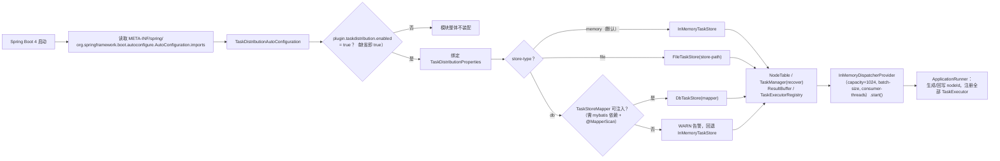
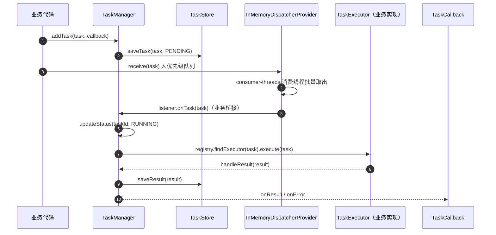
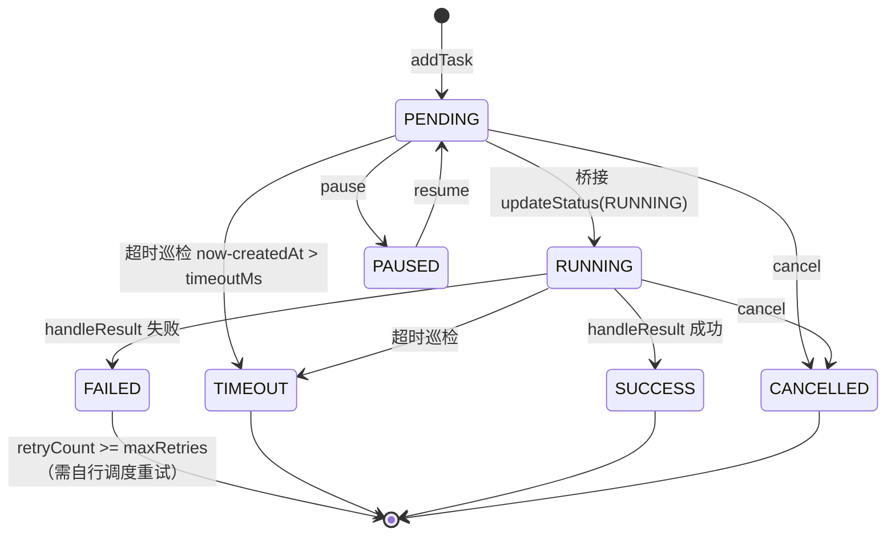

# spring-support-taskdistribution-starter

任务分发模块：基于 `TaskDistributionFramework`（utils 层 `com.chua.common.support.taskdistribution`）实现任务的派发、执行、结果回传、重试/超时与多节点负载均衡。

- 默认开启（`plugin.taskdistribution.enabled` 缺省即 true），零配置即可装配（内存存储、单消费线程）。
- 存储可切换为内存 / 文件 / 数据库（MyBatis-Plus，optional 依赖）。
- 管理接口挂在 `/v2/taskdistribution/**`，带 `@Permission` 权限声明。
- `taskdistribution.server.*`（监听端口等）与 `taskdistribution.task.*`（默认超时/重试）**仅声明、运行期未接线**，见「5. 完整配置」与「9. 常见问题」。

## 1. 架构图

### 1.1 模块在体系中的位置

```mermaid
flowchart TB
    subgraph HOST["宿主应用（业务进程）"]
        BIZ["业务代码<br/>TaskExecutor 实现 / 提交任务 / 派发桥接"]
        CTRL["TaskDistributionController<br/>/v2/taskdistribution/**（需宿主组件扫描）"]
    end

    subgraph STARTER["spring-support-taskdistribution-starter（本模块）"]
        AUTO["TaskDistributionAutoConfiguration<br/>（AutoConfiguration.imports 注册）"]
        PROP["TaskDistributionProperties<br/>plugin.taskdistribution.*"]
        INIT["taskDistributionInitializer（ApplicationRunner）"]
        SIC["taskDistributionServiceInfoContributor"]
        DBSTORE["DbTaskStore + TaskStoreMapper + SysTaskStore<br/>（store-type=db）"]
    end

    subgraph COMMON["spring-support-common-starter"]
        PERM["@Permission 权限注解"]
        PASS["传递引入 utils-support-common-starter"]
    end

    subgraph FRAMEWORK["utils-support-common-starter：TaskDistributionFramework"]
        TM["TaskManager（状态机/超时巡检/恢复）"]
        DP["DispatcherProvider → InMemoryDispatcherProvider"]
        NT["NodeTable（节点注册表）"]
        RB["ResultBuffer（结果缓冲）"]
        TSI["TaskStore SPI：InMemoryTaskStore / FileTaskStore"]
        REG["TaskExecutorRegistry + TaskExecutor SPI"]
    end

    MYBATIS["spring-support-mybatis-starter（optional）"]
    SWAGGER["spring-support-swagger-starter（provided，仅注解）"]

    AUTO --> PROP
    AUTO --> TM
    AUTO --> DP
    AUTO --> NT
    AUTO --> RB
    AUTO --> TSI
    AUTO --> REG
    AUTO --> INIT
    AUTO --> SIC
    DBSTORE --> MYBATIS
    CTRL --> PERM
    CTRL --> SWAGGER
    BIZ --> REG
    BIZ --> TM
    BIZ --> DP
```



### 1.2 内部分层

| 层 | 类 | 职责 |
|:---|:---|:---|
| 装配层 | `TaskDistributionAutoConfiguration`、`TaskDistributionProperties` | 按 `plugin.taskdistribution.enabled` 开关装配全部核心 Bean；绑定配置 |
| 接入层 | `TaskDistributionController`、`taskDistributionServiceInfoContributor` | 管理 API（任务/节点查询与控制）、控制台服务信息登记 |
| 初始化层 | `taskDistributionInitializer`（`ApplicationRunner`） | 生成/回写 nodeId、把容器内全部 `TaskExecutor<?>` 注册进 `TaskExecutorRegistry` |
| 存储适配层 | `DbTaskStore`、`TaskStoreMapper`、`SysTaskStore`、`db/init/*.sql` | 数据库存储实现（`sys_task_store` 表，任务/结果 JSON 落库） |
| 框架内核（utils 层，非本模块代码） | `TaskManager`、`DispatcherProvider`、`NodeTable`、`ResultBuffer`、`TaskStore`、`TaskExecutor` | 状态机、派发、节点、缓冲、持久化 SPI、执行器 SPI |

## 2. 核心流程图

### 2.1 装配流程（Spring Boot 启动期）



### 2.2 任务派发数据流（单机内存模式，真实类名）

> 注意：自动配置只创建 Bean，**不自动接通派发回路**；步骤 4~7 的桥接需业务侧实现（见 6.3），否则任务只会被存储、最终被超时巡检标记 TIMEOUT。



### 2.3 任务状态机（`TaskStatus`，由 `TaskManager` 驱动）



## 3. 能力清单

| 能力域 | 关键类 | 入口 |
|:-------|:-------|:-----|
| 自动配置 | `TaskDistributionAutoConfiguration` | `plugin.taskdistribution.enabled`（默认 true，`AutoConfiguration.imports` 注册） |
| 配置绑定 | `TaskDistributionProperties` | `plugin.taskdistribution.*` |
| 持久化存储（多态） | `TaskStore`：`InMemoryTaskStore` / `FileTaskStore` / `DbTaskStore` | `plugin.taskdistribution.store-type` |
| 数据库存储实现 | `DbTaskStore` / `TaskStoreMapper` / `SysTaskStore` | `store-type=db` + MyBatis-Plus（optional 依赖） |
| 节点注册表 | `NodeTable`（心跳检测 60s 超时 / 15s 巡检） | `node/list` 管理接口、直接注入 |
| 任务管理器 | `TaskManager`（启动 `recover()` 恢复 PENDING/RUNNING 任务） | 直接注入 Bean |
| 结果缓冲 | `ResultBuffer`（TTL 60s，30s 清理周期） | 注入 Bean / 删除任务记录接口 |
| 执行器注册中心 | `TaskExecutorRegistry` | 容器内 `TaskExecutor<?>` 自动注册 |
| 派发提供者（优先级队列 + 批量消费） | `DispatcherProvider` / `InMemoryDispatcherProvider`（容量 1024） | `batch-size` / `consumer-threads` |
| 初始化（nodeId + 执行器注册） | `taskDistributionInitializer`（`ApplicationRunner`） | 启动日志 |
| 管理接口 | `TaskDistributionController` | `/v2/taskdistribution/**`（8 个端点，见 6.4） |
| 服务信息登记 | `taskDistributionServiceInfoContributor` | 控制台模块能力开关展示 |
| MDC 链路追踪 | `MdcDecorator`（`taskId` / `traceId` 键） | 存储与派发过程自动注入 SLF4J MDC |

实际生效的能力：

- 启动时生成/校验 nodeId（未配置时自动生成 `node-<timestamp>` 并回写配置）并设置到 `TaskIdGenerator`；
- 自动注册容器内全部 `TaskExecutor<?>` 实现（按 `taskType()` 归类）；
- 按 `store-type` 选择存储：内存（默认）/ 文件 / 数据库，`TaskManager` 启动时 `recover()` 恢复未完成任务；
- `InMemoryDispatcherProvider` 按 `consumer-threads` 消费线程与 `batch-size` 批量派发（高优先级先出队：HIGH(10) > MEDIUM(5) > LOW(0)）；
- 超时巡检：`TaskManager` 每秒检查 PENDING/RUNNING 任务，`now - createdAt > task.timeoutMs` 即标记 TIMEOUT 并回调 `onTimeout`；
- 管理接口：任务清单、任务详情、取消/暂停/恢复、删除任务记录、节点清单、注销节点（均带 `@Permission` 权限声明与 Swagger 注解）；
- 数据库存储的 upsert 语义与 MDC 链路追踪（`MdcDecorator.KEY_TASK_ID` / `KEY_TRACE_ID`）。

## 4. Bean 能力矩阵

以下 Bean 全部由 `TaskDistributionAutoConfiguration` 装配（整体受 `plugin.taskdistribution.enabled=true` 控制，缺省即开启）：

| Bean 名 | 类型 | 装配条件 | 可否覆盖 | 生命周期 | 典型注入姿势 |
|:--------|:-----|:---------|:---------|:---------|:-------------|
| `taskStore` | `TaskStore`（按 store-type 返回 `InMemoryTaskStore` / `FileTaskStore` / `DbTaskStore`） | `@ConditionalOnMissingBean`；`store-type=db` 时还需容器存在 `TaskStoreMapper`，否则告警回退内存 | 可：自定义 `TaskStore` Bean 优先（如 Redis/Elasticsearch 适配） | `AutoCloseable` | 少直接注入；一般经 `TaskManager` 间接使用 |
| `nodeTable` | `NodeTable` | `@ConditionalOnMissingBean` | 可 | `destroyMethod="destroy"`（停心跳线程、清节点） | 构造器注入；管理接口内部使用 |
| `taskManager` | `TaskManager` | `@ConditionalOnMissingBean`；依赖 `TaskStore` Bean | 可 | `destroyMethod="destroy"`（停超时巡检线程） | 构造器注入；提交任务/查询状态/取消暂停恢复 |
| `resultBuffer` | `ResultBuffer` | `@ConditionalOnMissingBean` | 可 | `destroyMethod="close"`（停清理线程、清缓冲） | 构造器注入；结果缓存/移除 |
| `taskExecutorRegistry` | `TaskExecutorRegistry` | `@ConditionalOnMissingBean` | 可 | — | 构造器注入；派发桥接按 `taskType` 查执行器 |
| `dispatcherProvider` | `DispatcherProvider`（`InMemoryDispatcherProvider`） | `@ConditionalOnMissingBean`；容量固定 `DEFAULT_CAPACITY=1024`，batch-size / consumer-threads 来自配置 | 可：自定义 `DispatcherProvider` Bean 优先（如接入分布式队列） | `destroyMethod="close"`；装配时即 `start()` 启动消费线程 | 构造器注入；`receive` / `listener` / `pendingCount` |
| `taskDistributionInitializer` | `ApplicationRunner` | 模块开启即装配（无 missing-bean 条件） | 否（基础设施） | 启动期执行一次 | 不注入；自动生成 nodeId 并注册执行器 |
| `taskDistributionServiceInfoContributor` | `ServiceInfoContributor` | 模块开启即装配；需 common-starter 的服务信息体系 | 可 | — | 不注入；控制台展示「任务分发」开关与存储/策略信息 |

**不属于自动配置、需宿主配合装配的两个关键类：**

| 类 | 装配条件 | 说明 |
|:---|:---------|:-----|
| `TaskDistributionController` | 宿主组件扫描覆盖 `com.chua.starter.taskdistribution.support.controller` + Web 环境 | 自动配置**不注册**该 Controller；未扫描则 8 个管理端点不存在。接口带 `@Permission`，鉴权依赖 common-starter 体系；Swagger 注解需 provided 的 swagger-starter |
| `TaskStoreMapper` | `@MapperScan` 扫描到 `com.chua.starter.taskdistribution.support.mapper` + MyBatis-Plus 环境 | `store-type=db` 时自动配置以 `@Autowired(required=false)` 注入；扫不到则回退内存存储并打 WARN |

## 5. 完整配置

配置前缀：**`plugin.taskdistribution`**（`TaskDistributionProperties`，`@ConfigurationProperties` + `spring-boot-configuration-processor` 生成元数据）。

### 5.1 基础项（运行期真实消费）

| 路径 | 类型 | 默认值 | 说明 | 生效开关 |
|:-----|:-----|:-------|:-----|:---------|
| `plugin.taskdistribution.enabled` | `boolean` | `true` | 模块总开关；`@ConditionalOnProperty(matchIfMissing=true)`，缺省即开启，设为 false 整个自动配置不加载 | — |
| `plugin.taskdistribution.node-id` | `String` | null（自动生成 `node-<时间戳>` 并回写） | 节点标识，建议显式配置；写入 `TaskIdGenerator` 用于任务 ID 前缀 | 总开关开启 |
| `plugin.taskdistribution.strategy` | `DispatchStrategy` 枚举：`FIRST` / `LAST` / `RANDOM` / `ROUND` / `WEIGHT` | `ROUND` | 派发策略；**仅用于初始化日志与服务信息登记，当前未传给派发器** | 总开关开启 |
| `plugin.taskdistribution.batch-size` | `int` | `1` | 每次批量处理的任务数，传入 `InMemoryDispatcherProvider` | 总开关开启 |
| `plugin.taskdistribution.consumer-threads` | `int` | `1` | 消费线程数，传入 `InMemoryDispatcherProvider` | 总开关开启 |
| `plugin.taskdistribution.store-type` | `String` | `memory` | 持久化类型：`memory` / `file` / `db`；非法值按内存处理 | 总开关开启 |
| `plugin.taskdistribution.store-path` | `String` | `./data/taskstore/` | 文件存储数据目录 | `store-type=file` 时生效 |

### 5.2 服务端项（`plugin.taskdistribution.server.*`）—— 仅声明，运行期未接线

| 路径 | 类型 | 默认值 | 说明 | 生效开关 |
|:-----|:-----|:-------|:-----|:---------|
| `plugin.taskdistribution.server.enabled` | `boolean` | `true` | 是否启用服务端模式（接收任务）；**无任何 `@ConditionalOnProperty` 消费，未装配 server Bean** | 不生效 |
| `plugin.taskdistribution.server.port` | `int` | `19390` | 监听端口；**运行期未读取，不会监听该端口** | 不生效 |
| `plugin.taskdistribution.server.host` | `String` | `0.0.0.0` | 监听主机；**运行期未读取** | 不生效 |
| `plugin.taskdistribution.server.protocol` | `String` | `tcp` | 传输协议 tcp/udp；**运行期未读取** | 不生效 |

### 5.3 任务默认参数（`plugin.taskdistribution.task.*`）—— 仅声明，运行期未接线

| 路径 | 类型 | 默认值 | 说明 | 生效开关 |
|:-----|:-----|:-------|:-----|:---------|
| `plugin.taskdistribution.task.timeout-ms` | `long` | `30000` | 默认超时（毫秒）；**配置项未读取**。实际超时取每个 `Task` 的 `timeoutMs` 字段（`Task.builder().timeoutMs(...)`，不设时框架默认也是 30000） | 不生效 |
| `plugin.taskdistribution.task.max-retries` | `int` | `3` | 默认最大重试次数；**配置项未读取**。实际重试上限取每个 `Task` 的 `maxRetries` 字段（框架默认 3） | 不生效 |

> 松散绑定：yaml 中用 `node-id` / `store-type` / `batch-size` / `consumer-threads` / `timeout-ms` / `max-retries` 等短横线写法，Java 字段为驼峰。

## 6. 使用方式

### 6.1 Maven 坐标

```xml
<dependency>
    <groupId>com.chua</groupId>
    <artifactId>spring-support-taskdistribution-starter</artifactId>
    <version>4.0.0.51</version> <!-- 或 ${revision} -->
</dependency>
```

依赖说明：

| 依赖 | 作用 |
|:-----|:-----|
| `spring-boot-starter` | 容器与自动配置 |
| `spring-support-common-starter` | `ServiceInfoContributor`、`@Permission` 注解，并**传递引入** `utils-support-common-starter`（`TaskManager` / `TaskStore` / `DispatcherProvider` / `TaskExecutor` SPI 等 TaskDistributionFramework 内核） |
| `spring-support-mybatis-starter` | **optional**：仅 `store-type=db` 需要（MyBatis-Plus / 数据源环境） |
| `spring-support-swagger-starter` | **provided**：`@Tag` / `@Operation` 文档注解，不强制 |
| `spring-boot-configuration-processor` | **optional**：生成配置元数据（IDE 提示） |

### 6.2 最小可运行示例（单机内存，含必要桥接）

**第一步：yaml（零配置可跑，下面为推荐显式项）**

```yaml
plugin:
  taskdistribution:
    enabled: true
    node-id: node-01          # 推荐显式配置，不配则自动生成
    consumer-threads: 2
    batch-size: 1
    store-type: memory        # 默认 memory；生产可切 db / file
```

**第二步：实现一个 `TaskExecutor`（会被自动注册）**

```java
@Component
public class HelloExecutor implements TaskExecutor<String> {

    @Override
    public String taskType() {
        return "hello";
    }

    @Override
    public TaskResult<String> execute(Task<String> task) {
        // TaskResult.success 为 3 参：taskId、数据、执行节点标识
        return TaskResult.success(task.getTaskId(), "Hello, " + task.getPayload(), "node-01");
    }
}
```

**第三步：把派发器接到执行器（必须！否则任务不会被执行）**

自动配置只创建 Bean，不负责把 `DispatcherProvider` 的消费回路接到 `TaskExecutorRegistry`。业务侧加一个桥接组件：

```java
@Component
public class InJvmDispatchBridge {

    public InJvmDispatchBridge(DispatcherProvider dispatcherProvider,
                               TaskExecutorRegistry registry,
                               TaskManager taskManager,
                               TaskDistributionProperties properties) {
        dispatcherProvider.listener(new DispatcherListener() {
            @Override
            public void onTask(Task<?> task) {
                taskManager.updateStatus(task.getTaskId(), TaskStatus.RUNNING);
                taskManager.handleResult(executeSafely(task));
            }

            @Override
            public void onResult(TaskResult<?> result) {
                // 单机模式结果已在 onTask 内回传；多节点模式在此接 TaskManager.handleResult
            }
        });
        this.registry = registry;
        this.taskManager = taskManager;
        this.properties = properties;
    }

    private TaskExecutorRegistry registry;
    private TaskManager taskManager;
    private TaskDistributionProperties properties;

    @SuppressWarnings({"rawtypes", "unchecked"})
    private TaskResult<?> executeSafely(Task<?> task) {
        TaskExecutor<?> executor = registry.findExecutor(task);
        if (executor == null) {
            return TaskResult.failure(task.getTaskId(),
                    "没有匹配的任务执行器: " + task.getTaskType(), properties.getNodeId());
        }
        try {
            return ((TaskExecutor) executor).execute(task);
        } catch (Exception e) {
            return TaskResult.failure(task.getTaskId(), e.getMessage(), properties.getNodeId());
        }
    }
}
```

**第四步：提交任务并回调**

```java
@Bean
public ApplicationRunner demoTask(TaskManager taskManager) {
    return args -> {
        Task<String> task = Task.<String>builder()
                .taskId(TaskIdGenerator.generateId())   // 必须显式生成；addTask 对 null taskId 静默忽略
                .taskType("hello")
                .payload("CH")
                .priority(TaskPriority.HIGH)
                .timeoutMs(10_000)                      // task.timeout-ms 配置未接线，逐任务显式指定
                .maxRetries(2)
                .build();
        // TaskCallback 四个方法均为 default，按需覆盖
        taskManager.addTask(task, new TaskCallback() {
            @Override
            public void onResult(TaskResult<?> result) {
                System.out.println("任务成功: " + result.getData());
            }
            @Override
            public void onTimeout(String taskId) {
                System.out.println("任务超时: " + taskId);
            }
        });
    };
}
```

**第五步：验证**

1. 启动日志出现 `任务分发初始化完成, nodeId: node-01, strategy: ROUND, batchSize: 1, consumerThreads: 2`；
2. 回调触发（`onResult`），管理接口可查到任务与节点：

```bash
curl http://127.0.0.1:8080/v2/taskdistribution/task/list
curl http://127.0.0.1:8080/v2/taskdistribution/node/list
```

### 6.3 切换数据库存储（store-type=db）

1. 引入 optional 依赖 `spring-support-mybatis-starter` 并配置数据源；
2. `@MapperScan` 扫描 `com.chua.starter.taskdistribution.support.mapper`（否则 `TaskStoreMapper` 注入为 null，回退内存存储并告警）；
3. 建表：脚本 `src/main/resources/db/init/V2.0__init_all_taskdistribution.sql`（表 `sys_task_store`，MySQL/H2 通用子集；`task_json` / `result_json` 为 TEXT，大 payload 自行改 LONGTEXT）；种子脚本 `V2.0__initdata_all_taskdistribution.sql` 为空占位。starter 不负责执行建表，是否自动执行取决于宿主的 Flyway/Liquibase 装配。

```yaml
plugin:
  taskdistribution:
    store-type: db
spring:
  datasource:
    url: jdbc:mysql://mysql-host:3306/app_db?useSSL=false
    username: ${DB_USER}
    password: ${DB_PASS}
```

### 6.4 管理接口一览（均带 `@Permission` 权限声明）

```text
GET    /v2/taskdistribution/task/list              # 任务清单（taskdistribution:task:list）
GET    /v2/taskdistribution/task/{taskId}          # 单个任务详情 task/status/result（taskdistribution:task:get）
POST   /v2/taskdistribution/task/{taskId}/cancel   # 取消任务（taskdistribution:task:cancel）
POST   /v2/taskdistribution/task/{taskId}/pause    # 暂停任务（taskdistribution:task:pause）
POST   /v2/taskdistribution/task/{taskId}/resume   # 恢复任务（taskdistribution:task:resume）
DELETE /v2/taskdistribution/task/{taskId}          # 删除任务记录（从 ResultBuffer 移除，taskdistribution:task:delete）
GET    /v2/taskdistribution/node/list              # 节点清单（含离线节点，taskdistribution:node:list）
DELETE /v2/taskdistribution/node/{nodeId}          # 注销节点（taskdistribution:node:delete）
```

### 6.5 编程式使用

注入 `TaskManager` / `DispatcherProvider` / `NodeTable` / `ResultBuffer` 直接操作：

```java
@Service
@RequiredArgsConstructor
public class TaskDispatchDemo {

    private final TaskManager taskManager;
    private final DispatcherProvider dispatcherProvider;
    private final NodeTable nodeTable;
    private final ResultBuffer resultBuffer;

    public void manage(String taskId, Task<?> newTask, TaskCallback callback) {
        taskManager.addTask(newTask, callback);     // 提交任务（taskId 必须已生成）
        boolean cancelled = taskManager.cancel(taskId);
        dispatcherProvider.cancel(taskId);          // 通知派发器同步取消
        boolean paused = taskManager.pause(taskId);
        dispatcherProvider.pause(taskId);
        boolean resumed = taskManager.resume(taskId);
        dispatcherProvider.resume(taskId);
        TaskStatus status = taskManager.getStatus(taskId);
        TaskResult<?> result = taskManager.getResult(taskId);
        TaskResult<?> buffered = resultBuffer.remove(taskId);
        nodeTable.unregister("node-01");            // 注销节点
        int pending = dispatcherProvider.pendingCount(); // 队列积压
    }
}
```

## 7. 使用场景

### 7.1 适用

- 单机内的异步任务派发：图片处理、报表生成、消息推送等 CPU/IO 密集型后台任务；
- 需要任务状态可查、可取消/暂停/恢复的管理面；
- 需要重启恢复：切 `store-type=db` 或 `file`，启动时自动恢复 PENDING/RUNNING 任务；
- 需要优先级调度：高优先级任务先出队（`TaskPriority.HIGH/MEDIUM/LOW`）；
- 需要链路追踪：`MdcDecorator` 把 `taskId` / `traceId` 注入 SLF4J MDC，跨线程不丢。

### 7.2 不适用

- **分布式多节点负载均衡**：当前 starter 未装配 `NodeTable` 散射-汇聚路由与 TCP/UDP 服务端（`server.*` 未接线），`InMemoryDispatcherProvider` 只在单 JVM 内派发；`NodeTable` / `DispatchStrategy` 目前是"有 Bean、无消费"。
- **强一致/不丢任务**：`DbTaskStore` 的 upsert 是"先 insert 失败再 updateById"，异常只打日志不抛出；`task_json`/`result_json` 为 TEXT（约 64KB）；内存/文件存储重启有丢失窗口（仅恢复 PENDING/RUNNING）。
- **自动重试**：`TaskManager.getRetryableTasks()` 只返回待重试清单，框架内没有调度器自动重试，需业务侧自行拉起。
- **精确一次语义 / 死信队列 / 熔断**：内核未实现（见 utils 层 README 已知限制）。

### 7.3 与相邻模块的取舍

| 模块 | 方向 | 取舍 |
|:-----|:-----|:-----|
| `spring-support-common-starter` | 本模块依赖 | 提供 `ServiceInfoContributor`、`@Permission`，并传递引入 TaskDistributionFramework 内核；几乎所有业务 starter 都会带它，无额外成本 |
| `spring-support-mybatis-starter` | optional 依赖 | 只有用 `store-type=db` 才需要；纯内存/文件模式可不引入 |
| `spring-support-swagger-starter` | provided 依赖 | 仅接口文档注解；宿主没接 swagger 也不影响运行 |
| Spring `@Scheduled` / `ThreadPoolTaskScheduler` | 无依赖 | 简单定时任务直接用 Spring 调度即可；需要"提交-查询-取消-恢复-持久化"完整任务语义时再用本模块 |
| 消息队列（RocketMQ / Kafka） | 无依赖 | 跨服务解耦投递用 MQ；本模块定位是 JVM 内任务编排与状态管理，二者可叠加（MQ 收到消息后转成本模块任务） |
| `spring-support-hotsport-starter`（APM） | 独立模块，无依赖 | 若两者同装，任务执行链路可被其采集（字节码/日志层） |
| `spring-support-osgi-starter` | 独立模块，无依赖 | OSGi 插件框架；任务执行器可作为扩展点由框架侧加载 |
| `spring-support-device-starter` | 独立模块，无依赖 | 设备接入；不参与任务分发 |

## 8. 扩展点

本模块暴露的 SPI 与可自定义方法（均来自 utils 层 `com.chua.common.support.taskdistribution`，通过 Spring Bean 覆盖或实现接入）：

| 扩展点 | 类型 | 说明 |
|:-------|:-----|:-----|
| `TaskExecutor<T>` | 接口（业务实现） | 工作端执行器：`taskType()` + `execute(Task<T>)`，`canExecute` 有默认实现；`@Component` 声明即被 `taskDistributionInitializer` 自动注册到 `TaskExecutorRegistry`，按 `taskType` 精确路由 |
| `TaskStore` | 接口（Bean 覆盖） | 持久化 SPI：`saveTask` / `updateStatus` / `saveResult` / `getTask` / `getStatus` / `getResult` / `getRecoverableTasks` / `removeTask` / `clear`。内置内存/文件/DB 三实现；自定义 Bean（如 Redis）因 `@ConditionalOnMissingBean` 自动优先生效 |
| `DispatcherProvider` | 接口（Bean 覆盖） | 派发 SPI：`receive`（任务/结果入队）、`cancel` / `pause` / `resume` / `pauseAll` / `resumeAll`、`setBatchSize`、`pendingCount`、`listener`、`start` / `await` / `close`。默认 `InMemoryDispatcherProvider`；可换分布式队列实现 |
| `DispatcherListener` | 接口（业务接线） | 派发回调：`onTask` / `onResult`。自动配置不接线，业务侧负责把它接到 `TaskExecutorRegistry` + `TaskManager.handleResult`（见 6.2） |
| `NodeTable` | 类（Bean 覆盖） | 节点注册表：`register` / `unregister` / `heartbeat` / `matchByTags` / `select`（五种 `DispatchStrategy`）/ 心跳剔除。可自定义 Bean 覆盖 |
| `ResultBuffer` | 类（Bean 覆盖） | 结果缓冲：`cacheResult` / `getResult` / `remove` / `contains`，TTL 自动清理，可挂 `TaskStore` 持久化。可自定义 Bean 覆盖（如对接 Redis） |
| `TaskExecutorRegistry` | 类（Bean 覆盖） | 执行器注册中心：`register` / `unregister` / `find` / `findExecutor` / `all`。可自定义 Bean 覆盖 |
| `TaskStateListener` | 接口（编程注册） | 任务状态变更监听：`onStateChanged(taskId, old, new)` / `onCompleted(result)`；通过 `taskManager.addStateListener(...)` 注册（自动配置不装配） |
| `TaskCallback` | 接口（逐任务） | 提交任务时传入：`onResult` / `onError` / `onTimeout` / `onProgress`，均为 default 方法按需覆盖 |
| `TaskIdGenerator` | 静态工具 | `setDefaultNodeId(nodeId)` 由初始化器调用；`generateId()` 生成 `nodeId-timestamp-seq` 格式任务 ID |

本模块**不提供** `META-INF/extensions` 形式的 SPI 装配；扩展一律走「实现接口 + Spring Bean / 编程注册」。注意 `FileTaskStore` 上的 `@Spi("file")` 注解属于 utils 层 SPI 体系，本 starter 选择存储实现是自动配置里的 if/else 判断，不走 SPI 加载器。

## 9. 常见问题

**Q1：引入依赖后什么都没装配？**
依次检查：① `plugin.taskdistribution.enabled` 是否被设为 false（缺省即 true）；② 自动配置经 `META-INF/spring/org.springframework.boot.autoconfigure.AutoConfiguration.imports` 注册（Boot 3+/4 标准），`spring.factories` 已不含 EnableAutoConfiguration 键，无需也不会从那里加载；③ `TaskManager` 等 Bean 由自动配置创建，但 `TaskDistributionController` 不在其中——宿主的组件扫描必须覆盖 `com.chua.starter.taskdistribution.support.controller`，且宿主是 Web 应用。

**Q2：任务提交后一直没执行，最后超时了？**
最常见原因：没有接派发桥接。自动配置只创建 `InMemoryDispatcherProvider` 并启动消费线程，但没有注册 `DispatcherListener`，任务不会流向任何 `TaskExecutor`，最终被超时巡检标记 TIMEOUT。按 6.2 第三步补一个桥接组件。另外检查 `Task` 是否设置了 `taskId`——`TaskManager.addTask` 对 null taskId **静默忽略**（不抛错、不记日志），必须 `TaskIdGenerator.generateId()` 显式生成。

**Q3：`TaskResult.success(...)` 编译报错？**
该方法签名是 3 参：`success(String taskId, T data, String workerNodeId)`（`failure` 同理），没有 2 参重载。执行节点标识可传配置的 `nodeId`。

**Q4：19390 端口没有监听 / 集群不生效？**
`plugin.taskdistribution.server.*`（enabled/port/host/protocol）目前是「仅声明」配置：自动配置中没有 server Bean、没有 `@ConditionalOnProperty` 消费这些键，不会监听 19390 端口，也不存在 TCP/UDP 散射-汇聚节点。utils 层虽有 `TcpScatterGatherNodeServer` / `UdpScatterGatherNodeServer` 等集群实现，但本 starter 未装配它们。`strategy` 同理，只出现在初始化日志与服务信息登记里。

**Q5：`store-type=db` 报表不存在或回退到内存？**
三件事缺一不可：① 引入 `spring-support-mybatis-starter`（optional 依赖，不会自动带入）并配好数据源；② `@MapperScan` 扫到 `com.chua.starter.taskdistribution.support.mapper`；③ 执行建表脚本 `src/main/resources/db/init/V2.0__init_all_taskdistribution.sql`（`sys_task_store`）。任一不满足，自动配置打 WARN「storeType=db 但未引入 mybatis 依赖或未配置数据源」并回退内存存储。另注意 `DbTaskStore` 的 upsert 用 `taskId.intern()` 同步（高并发写入有 String-intern 锁竞争），写入失败只告警不抛异常，`task_json`/`result_json` 是 TEXT 列。

**Q6：与 Spring Boot 4 的兼容性？**
本仓库父 pom 为 `spring-boot-starter-parent 4.1.2`（`spring.boot.version=4.1.2`），Java 25，jakarta 命名空间。本模块自动配置采用 Boot 3+ 标准的 `AutoConfiguration.imports` 文件；`spring.factories` 仅保留注释与未来非自动装配工厂键的占位。在 Boot 4 宿主中按标准 starter 方式引入即可，无需额外适配。

**Q7：配置了重试次数为什么没有自动重试？**
`task.max-retries` 配置项未接线，且内核的 `getRetryableTasks()` 只返回 FAILED/TIMEOUT 且 `retryCount < maxRetries` 的任务清单，框架内没有调度器自动重试。需要重试时：逐任务设置 `Task.builder().maxRetries(n)`，并由业务侧定期调用 `getRetryableTasks()` 自行重新派发。

**Q8：重启后任务会丢吗？**
`store-type=memory` 重启全丢。`file` / `db` 只恢复 PENDING / RUNNING 状态的任务（`getRecoverableTasks` 按状态过滤，`TaskManager.recover()` 启动时重置为 PENDING 等待重新派发）；已完成（SUCCESS/FAILED/TIMEOUT/CANCELLED）任务不会重放。
