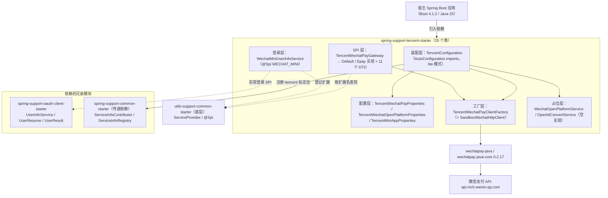
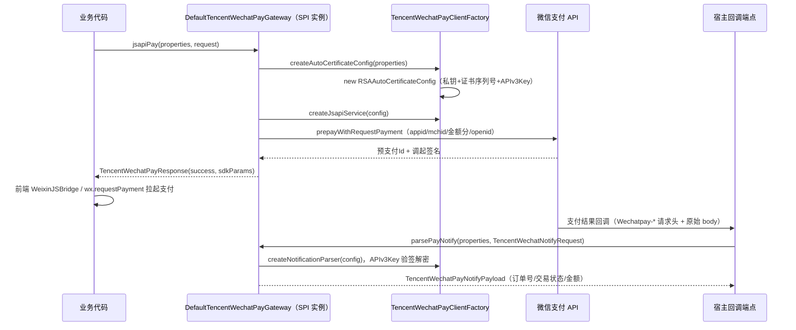

# spring-support-tencent-starter

腾讯（微信）能力集成 Starter：把微信支付五种通道（JSAPI / H5 / Native / APP / 小程序）的下单、查单、关单、退款、支付分（先享后付）与支付/退款通知验签，收敛为一个 `TencentWechatPayGateway` SPI；并把微信小程序登录注册为 `spring-support-oauth-client-starter` 的 `UserInfoService` 实现（`@Spi("WECHAT_MINI")`）。在 spring-support 体系中属「外部渠道适配」业务 starter：宿主引入即得能力，不携带 Controller、表结构与定时任务。范围仅限微信支付 + 小程序登录，**不含**短信、COS、公众号消息、小程序码。

## 1. 架构图



## 2. 核心流程图

以 JSAPI 下单 + 支付通知验签为例（H5 / Native / APP / 小程序 / 退款同构）：



> 网关是 `ServiceProvider` SPI 实例，**不是 Spring Bean**；`TencentConfiguration` 注册的 `tencentWechatPayClientFactory` Bean 与网关内部 `new TencentWechatPayClientFactory()` 是两个实例，网关不消费该 Bean。每次调用都新建 `Config`，不做缓存。

## 3. 能力清单

| 能力域 | 关键类 | 入口/触发方式 |
|---|---|---|
| 自动装配 | `TencentConfiguration` | `META-INF/spring/org.springframework.boot.autoconfigure.AutoConfiguration.imports`（无 spring.factories） |
| 支付网关 SPI | `TencentWechatPayGateway`（24 方法） | `ServiceProvider.of(TencentWechatPayGateway.class).getExtension("wechat-pay")` |
| 默认实现 | `DefaultTencentWechatPayGateway`（`@Spi({"default","wechat-pay"})`） | 扩展名 `default` / `wechat-pay` |
| epay 实现 | `EpayTencentWechatPayGateway`（`@Spi("epay")`，直接继承默认实现，无独立逻辑） | 扩展名 `epay` |
| 客户端工厂 | `TencentWechatPayClientFactory` | 10 个 public 工厂方法：`createAutoCertificateConfig`×2、`createJsapiService`、`createH5Service`、`createNativePayService`、`createAppService`、`createAppServiceExtension`、`createRefundService`、`createNotificationParser`、`createHttpClient` |
| 沙箱包装 | `SandboxWechatHttpClient`（生产 URL 重写为 `/sandboxnew/`） | public 类，模块内无引用，沙箱通道未接线 |
| 下单/查单 DTO | `TencentWechatPayRequest`、`TencentWechatPayResponse`、`TencentWechatOrderResponse` | 五通道共用 record |
| 退款 | `TencentWechatRefundRequest`、`TencentWechatRefundResponse`、`TencentWechatRefundNotifyPayload` | `refund` / `queryRefund` / `parseRefundNotify` |
| 支付分 | `TencentWechatPayScoreRequest`、`TencentWechatPayScoreResponse`、`TencentWechatPayScoreNotifyPayload` | 创建/查询/完结/撤销/通知解析（`HttpClient` 直连 `/v3/payscore/serviceorder*`） |
| 通知解析 | `TencentWechatNotifyRequest`、`TencentWechatPayNotifyPayload` | `parsePayNotify` / `parseRefundNotify`，签名类型缺省 `WECHATPAY2-SHA256-RSA2048` |
| 小程序登录 | `WechatMiniUserInfoService`（`@Spi("WECHAT_MINI")`） | `META-INF/extensions/com.chua.starter.oauth.client.support.user.UserInfoService` |
| 开放平台占位 | `WechatOpenPlatformService`、`OpenIdConvertService` 及默认实现 | `open-platform.enable=true` 时装配，接口当前无方法 |
| 服务信息 | `tencentServiceInfoContributor` | 启动时向 `ServiceInfoRegistry` 注册 `tencent` 标志位 |

网关 24 方法分组：JSAPI / H5 / Native / APP / 小程序各 3 个（下单 / 查单 / 关单，小程序内部委托 JSAPI 通道），退款 2 个，通知解析 2 个，支付分 5 个。所有方法第一参数均为 `TencentWechatPayProperties`，网关无状态。金额单位一律为**分（Long）**；通知地址规则：下单只用请求级 `request.notifyUrl()`，退款与支付分按 `firstNonBlank(request.notifyUrl(), properties.getNotifyUrl())`。

## 4. Bean 能力矩阵

| Bean 名 | 类型 | 装配条件（含默认值） | 可否覆盖 | 典型用途 |
|---|---|---|---|---|
| `tencentWechatPayClientFactory` | `TencentWechatPayClientFactory` | 无条件；`@ConditionalOnMissingBean` | 可覆盖 | 注入后自行构建 SDK `Config` / Service；注意网关内部自建工厂，替换该 Bean 不影响网关 |
| `wechatOpenPlatformService` | `WechatOpenPlatformService`（默认 `DefaultWechatOpenPlatformService`） | `@ConditionalOnProperty(prefix="plugin.tencent.open-platform", name="enable", havingValue="true")` + `@ConditionalOnMissingBean` | 可覆盖 | 占位接口无方法；宿主可提供真实实现让其让位 |
| `openIdConvertService` | `OpenIdConvertService`（默认 `WechatOpenIdConvertService`） | 同上（`open-platform.enable=true` 才装配） | 可覆盖 | 占位接口无方法 |
| `tencentServiceInfoContributor` | `ServiceInfoContributor`（lambda） | 无条件；无 `@ConditionalOnMissingBean` | 可并存：收集型回调，多 contributor 互不冲突 | 向 `ServiceInfoRegistry` 注册 `tencent` 服务标志 |

另由 `@EnableConfigurationProperties` 注册 3 个配置 Bean：`TencentWechatPayProperties`、`TencentWechatOpenPlatformProperties`、`TencentMiniAppProperties`，可直接构造器注入；`TencentWechatPayProperties` 同时是网关每个方法的入参。**支付网关不是 Bean**，只能经 SPI 获取。

## 5. 完整配置

三个配置类均标注 `@ConfigurationProperties(..., ignoreInvalidFields = true)`。

**`plugin.tencent.wechat-pay`（`TencentWechatPayProperties`）——微信支付**

| 配置路径 | 类型 | 默认值 | 说明 |
|---|---|---|---|
| `plugin.tencent.wechat-pay.enable` | boolean | false | 死开关：无任何条件装配或业务代码读取 |
| `plugin.tencent.wechat-pay.enabled` | boolean | false | 兼容字段，未被读取 |
| `plugin.tencent.wechat-pay.app-id` | String | 空 | 公众号/小程序/APP 的 AppID，下单 `appid` |
| `plugin.tencent.wechat-pay.merchant-id` | String | 空 | 商户号 `mchid`，下单/查单/关单/退款均读取 |
| `plugin.tencent.wechat-pay.private-key` | String | 空 | 商户 API 私钥**内容**（非文件路径） |
| `plugin.tencent.wechat-pay.merchant-serial-number` | String | 空 | 商户证书序列号 |
| `plugin.tencent.wechat-pay.api-v3-key` | String | 空 | APIv3 密钥，通知验签与解密 |
| `plugin.tencent.wechat-pay.notify-url` | String | 空 | 默认通知地址；仅退款/支付分回退使用，下单只用请求级 notifyUrl |
| `plugin.tencent.wechat-pay.sandbox` | boolean | false | 未接线：网关固定走生产域名，无代码读取 |
| `plugin.tencent.wechat-pay.sandbox-sign-key` | String | 空 | 未接线：无代码读取 |

**`plugin.tencent.open-platform`（`TencentWechatOpenPlatformProperties`）——微信开放平台**

| 配置路径 | 类型 | 默认值 | 说明 |
|---|---|---|---|
| `plugin.tencent.open-platform.enable` | boolean | false | `true` 才装配两个开放平台占位 Bean |
| `plugin.tencent.open-platform.component-app-id` | String | 空 | 第三方平台 AppID（当前仅启动日志） |
| `plugin.tencent.open-platform.component-app-secret` | String | 空 | 第三方平台 AppSecret（当前仅启动日志） |
| `plugin.tencent.open-platform.default-mini-app-id` | String | 空 | 默认小程序 AppID（当前仅启动日志） |
| `plugin.tencent.open-platform.storage-path` | String | wechat-openid-mapping.json | openid 映射存储路径（未实现持久化） |

**`plugin.tencent.mini-app`（`TencentMiniAppProperties`）——小程序**

| 配置路径 | 类型 | 默认值 | 说明 |
|---|---|---|---|
| `plugin.tencent.mini-app.enable` / `enabled` | boolean | false | 死开关，无代码读取 |
| `plugin.tencent.mini-app.app-id` | String | 空 | 无消费方：小程序登录走 `WECHAT_MINI` SPI |
| `plugin.tencent.mini-app.app-secret` | String | 空 | 同上 |

### 5.1 逐项配置示例

按功能分组列出每个配置项的含义、默认值与 YAML 写法（示例中的凭据均为占位符，生产请经环境变量/配置中心注入）。

**微信支付 `plugin.tencent.wechat-pay`**

| 配置项 | 含义 | 默认值 | YAML 示例 |
|---|---|---|---|
| `enable` | 总开关；当前为死开关（装配与网关均不读取） | `false` | `enable: false` |
| `enabled` | 兼容字段，未被读取 | `false` | `enabled: false` |
| `app-id` | 公众号/小程序/APP 的 AppID（下单 `appid`；支付分/分账请求未带 appId 时回退本值） | 空 | `app-id: your-app-id` |
| `merchant-id` | 商户号 `mchid`，下单/查单/关单/退款均读取 | 空 | `merchant-id: your-merchant-id` |
| `private-key` | 商户 API 私钥**内容**（PEM 全文，非文件路径） | 空 | `private-key: ${WECHAT_MCH_PRIVATE_KEY}` |
| `merchant-serial-number` | 商户证书序列号，与私钥配对 | 空 | `merchant-serial-number: your-merchant-serial-number` |
| `api-v3-key` | APIv3 密钥（32 位），通知验签与解密 | 空 | `api-v3-key: ${WECHAT_API_V3_KEY}` |
| `notify-url` | 默认通知地址；仅退款/支付分回退使用，下单只用请求级 notifyUrl | 空 | `notify-url: https://example.com/pay/wechat/notify` |
| `sandbox` | 沙箱开关（未接线，网关固定走生产域名） | `false` | `sandbox: false` |
| `sandbox-sign-key` | 沙箱 APIv3 密钥（未接线） | 空 | `sandbox-sign-key: your-sandbox-sign-key` |

```yaml
plugin:
  tencent:
    wechat-pay:
      enable: false
      enabled: false
      app-id: your-app-id
      merchant-id: your-merchant-id
      private-key: ${WECHAT_MCH_PRIVATE_KEY}
      merchant-serial-number: your-merchant-serial-number
      api-v3-key: ${WECHAT_API_V3_KEY}
      notify-url: https://example.com/pay/wechat/notify
      sandbox: false
      sandbox-sign-key: your-sandbox-sign-key
```

**微信开放平台 `plugin.tencent.open-platform`**

| 配置项 | 含义 | 默认值 | YAML 示例 |
|---|---|---|---|
| `enable` | `true` 才装配 `wechatOpenPlatformService` / `openIdConvertService` 两个占位 Bean | `false` | `enable: false` |
| `component-app-id` | 第三方平台 AppID（当前仅启动日志与占位实现构造入参） | 空 | `component-app-id: your-component-app-id` |
| `component-app-secret` | 第三方平台 AppSecret（占位实现构造入参） | 空 | `component-app-secret: your-component-app-secret` |
| `default-mini-app-id` | 默认小程序 AppID，调用 openid 转换接口时可省略 miniappid 参数 | 空 | `default-mini-app-id: your-default-mini-app-id` |
| `storage-path` | openid 映射 JSON 存储路径（持久化未实现） | `wechat-openid-mapping.json` | `storage-path: /data/wechat-openid-mapping.json` |

```yaml
plugin:
  tencent:
    open-platform:
      enable: false
      component-app-id: your-component-app-id
      component-app-secret: your-component-app-secret
      default-mini-app-id: your-default-mini-app-id
      storage-path: /data/wechat-openid-mapping.json
```

**小程序 `plugin.tencent.mini-app`**

| 配置项 | 含义 | 默认值 | YAML 示例 |
|---|---|---|---|
| `enable` / `enabled` | 死开关，无代码读取 | `false` | `enable: false` |
| `app-id` | 小程序 AppID（当前无消费方） | 空 | `app-id: your-mini-app-id` |
| `app-secret` | 小程序 AppSecret（当前无消费方） | 空 | `app-secret: your-mini-app-secret` |

```yaml
plugin:
  tencent:
    mini-app:
      enable: false
      enabled: false
      app-id: your-mini-app-id
      app-secret: your-mini-app-secret
```

### 5.2 完整 YAML 示例

可直接落地的生产配置骨架（凭据一律经环境变量或配置中心注入，避免明文落盘）：

```yaml
plugin:
  tencent:
    wechat-pay:
      app-id: ${WECHAT_APP_ID}                      # 必填：公众号/小程序/APP AppID
      merchant-id: ${WECHAT_MCH_ID}                 # 必填：商户号
      private-key: ${WECHAT_MCH_PRIVATE_KEY}        # 必填：商户 API 私钥内容（PEM 全文，非路径）
      merchant-serial-number: ${WECHAT_MCH_SERIAL}  # 必填：商户证书序列号
      api-v3-key: ${WECHAT_API_V3_KEY}              # 必填：APIv3 密钥（32 位）
      notify-url: https://pay.example.com/wechat/notify   # 退款/支付分默认回调；下单建议每单显式传
      sandbox: false                                # 未接线，保持 false
    open-platform:
      enable: false                                 # 需要开放平台占位 Bean 时再打开
      component-app-id: ${WECHAT_COMPONENT_APP_ID}
      component-app-secret: ${WECHAT_COMPONENT_APP_SECRET}
      default-mini-app-id: ${WECHAT_MINI_APP_ID}
      storage-path: /data/wechat-openid-mapping.json
    mini-app:
      enable: false                                 # 当前无消费方，保持关闭
```

配套的最小 Java 调用示例见第 6 节。

### 5.3 生产注意事项

- **凭据保密**：`private-key` 是私钥 PEM **内容**而非文件路径，写进 YAML 即明文落盘；生产用环境变量、K8s Secret 或配置中心注入，并对接收配置的日志做脱敏。轮换商户证书时同步更新 `merchant-serial-number`。
- **回调地址**：`notify-url` 必须外网可达且为 **HTTPS**（微信支付 APIv3 回调要求 HTTPS）；下单通道只认请求级 `notifyUrl()`，退款/支付分才回退到本配置——给 `notify-url` 赋值不会改变下单回调。
- **通知幂等**：本模块不落库、不去重；`parsePayNotify` / `parseRefundNotify` 只做验签解密，微信会重试回调，同一订单可能收到多次通知，幂等与状态机由业务侧实现。
- **性能**：默认网关每次调用都新建 `RSAAutoCertificateConfig`（含平台证书自动更新），无缓存；高并发场景建议在业务侧做网关实例缓存，或注册自定义 `TencentWechatPayGateway` 实现（见第 8 节）。
- **死开关勿误信**：`wechat-pay.enable/enabled`、`mini-app.enable/enabled`、`sandbox`、`sandbox-sign-key` 当前均无代码读取（见第 9 节 Q2/Q3）；能力启停靠依赖管理与业务侧判断。
- **依赖即带入（R5）**：本模块传递引入 `spring-support-oauth-client-starter` 与 `spring-support-common-starter` 的自动装配，引入前确认宿主需要这些副作用。

## 6. 使用方式

```xml
<dependency>
    <groupId>com.chua</groupId>
    <artifactId>spring-support-tencent-starter</artifactId>
    <version>4.0.0.51</version>
</dependency>
```

依赖说明：`com.github.wechatpay-apiv3:wechatpay-java` / `wechatpay-java-core`（0.2.17，父 pom 管理）、`spring-support-oauth-client-starter`、`utils-support-common-starter`、`spring-boot-autoconfigure`、`jackson-databind`、`slf4j-api` 均为**必需编译期依赖（无 optional）**，缺任一都会导致模块不可编译或自动装配失败；`lombok` 为 provided，仅编译期生成 getter/setter，缺失只影响编译不影响运行时。本模块会传递带入 oauth-client 与 common-starter 的自动装配（依赖即带入，引入前确认宿主需要这些副作用）。

最小启用示例：

```yaml
plugin:
  tencent:
    wechat-pay:
      app-id: wx1234567890abcdef
      merchant-id: "1900000001"
      merchant-serial-number: "5157F09EFDC096DE15EBE81A47057A7232F1B8E1"
      private-key: ${WECHAT_MCH_PRIVATE_KEY}   # 私钥内容，不是文件路径
      api-v3-key: ${WECHAT_API_V3_KEY}
      notify-url: https://example.com/pay/wechat/notify
```

```java
@Service
public class WechatPayService {

    private final TencentWechatPayProperties properties;
    private final TencentWechatPayGateway gateway =
            ServiceProvider.of(TencentWechatPayGateway.class).getExtension("wechat-pay");

    public WechatPayService(TencentWechatPayProperties properties) {
        this.properties = properties;
    }

    /** JSAPI 下单：sdkParams 可直接交给前端 WeixinJSBridge / wx.requestPayment */
    public Map<String, Object> jsapiPay(String orderNo, long amountFen, String openId, String ip) {
        TencentWechatPayResponse resp = gateway.jsapiPay(properties, new TencentWechatPayRequest(
                orderNo, amountFen, "CNY", "订单 " + orderNo,
                "https://example.com/pay/wechat/notify",   // 请求级 notify_url
                null, openId, ip, null, null, null, null, null));
        if (!resp.success()) {
            throw new IllegalStateException(resp.message());
        }
        return resp.sdkParams();
    }
}
```

其他通道：`h5Pay` / `nativePay` 取 `payUrl()`（Native 即二维码 `code_url`）；`appPay` / `miniProgramPay` 取 `sdkParams()`；退款 `refund` → `queryRefund`；支付分 `createPayScoreOrder` → `queryPayScoreOrder` → `completePayScoreOrder` / `cancelPayScoreOrder`。调用形态为「配置 + DTO → 响应 record」的步骤式风格，无链式 API。

## 7. 使用场景

**适用**：
- Spring Boot 服务接入微信支付：五通道下单/查单/关单、退款、支付与退款通知验签、支付分（先享后付）。
- 已用 `spring-support-oauth-client-starter` 做统一登录，需要接入微信小程序登录（`WECHAT_MINI`）。
- 需要按扩展名切换/聚合支付网关实现（内置 `default`/`wechat-pay`/`epay`）的收单场景。

**不适用/慎用**：
- 需要短信、COS、公众号模板消息、小程序码等能力——本模块不含，请直连腾讯云/微信官方 SDK。
- 需要托管回调端点、订单/退款单持久化、对账账单——本模块无 Controller、无表、无任务，通知幂等与状态机由业务侧实现；高并发场景慎用默认网关（每次调用新建 `RSAAutoCertificateConfig`，不缓存）。

**与相邻模块取舍**：与 `spring-support-aliyun-starter` 为平行模块（同为「支付网关 SPI + 登录实现」结构），互不依赖，可只取其一或共存，均按 `ServiceProvider` 扩展名取用互不干扰；做登录必须同时引入 `spring-support-oauth-client-starter`（本模块已传递依赖，纯支付也会带入）。

## 8. 扩展点

| 扩展点 | 类型 | 注册方式 |
|---|---|---|
| `TencentWechatPayGateway` | SPI 接口（24 方法） | 实现类标注 `@Spi("扩展名")`；放在接口同包树 `com.chua.starter.tencent.support.payment.*` 下自动扫描，或在自家 jar `src/main/resources/META-INF/extensions/com.chua.starter.tencent.support.payment.TencentWechatPayGateway` 写入实现类全名（一行一个） |
| `UserInfoService` | oauth 登录 SPI | 本模块已登记 `WECHAT_MINI`；新增微信登录形态（如公众号网页授权）实现接口并按同规则登记扩展文件 |
| `TencentWechatPayClientFactory` / `SandboxWechatHttpClient` | public 工具类 | 直接复用组合 SDK 能力（如账单下载等网关未暴露的接口）；替换 `tencentWechatPayClientFactory` Bean 需配合自定义网关才影响网关行为 |
| `WechatOpenPlatformService` / `OpenIdConvertService` | 占位接口 | 宿主提供真实实现 Bean 即可让位（`@ConditionalOnMissingBean`） |

自定义网关示例：

```java
@Spi("acme")
public class AcmeTencentWechatPayGateway implements TencentWechatPayGateway {
    @Override
    public TencentWechatPayResponse jsapiPay(TencentWechatPayProperties p, TencentWechatPayRequest r) {
        throw new UnsupportedOperationException("聚合通道暂不支持 jsapi 下单");
    }
    // 其余 23 个方法同理；也可像 EpayTencentWechatPayGateway 一样直接 extends 默认实现换扩展名
}
```

调用方改用 `getExtension("acme")` 即可切换。注意：不要把无关实现放进 `com.chua.starter.tencent.support.payment.*` 包树——同包扫描会误命中。

## 9. 常见问题

**Q1：注入 `TencentWechatPayGateway` 失败？**
它是 SPI 实现，不是 Spring Bean。正确取法：`ServiceProvider.of(TencentWechatPayGateway.class).getExtension("wechat-pay")`；配置用 `TencentWechatPayProperties` 作为方法第一参数传入。

**Q2：配了 `plugin.tencent.wechat-pay.enable=true` 却没有任何变化？**
`enable` / `enabled` 是死开关：自动装配没有按支付配置做条件装配，网关也不读取。支付能力只要类在 classpath 就可用，真正必需的是 `app-id`、`merchant-id`、`private-key`、`merchant-serial-number`、`api-v3-key`。

**Q3：`sandbox`、`sandbox-sign-key`、`mini-app.*` 配置为什么不起作用？**
沙箱字段无代码读取，`SandboxWechatHttpClient` 虽提供 URL 重写但未接线；`mini-app` 配置无消费方（小程序登录走 `WECHAT_MINI` SPI）。`open-platform.enable=true` 只装配两个空占位 Bean，真实开放平台能力需自行实现接口并覆盖。

**Q4：Spring Boot 4 下自动装配失效或通知验签失败？**
本模块只提供 `META-INF/spring/org.springframework.boot.autoconfigure.AutoConfiguration.imports`（Boot 2.7+ 标准机制，Boot 4 继续支持），无 `spring.factories` 条目，不受 Boot 4 移除该机制影响；排查时确认 imports 文件在 classpath、组件扫描未排除 `com.chua.starter.tencent.support`。通知验签失败另需确认：`api-v3-key` 正确、`Wechatpay-Serial/Timestamp/Nonce/Signature` 请求头与**原始报文 body** 完整传入 `TencentWechatNotifyRequest`、平台证书可自动下载、回调地址外网可达。
