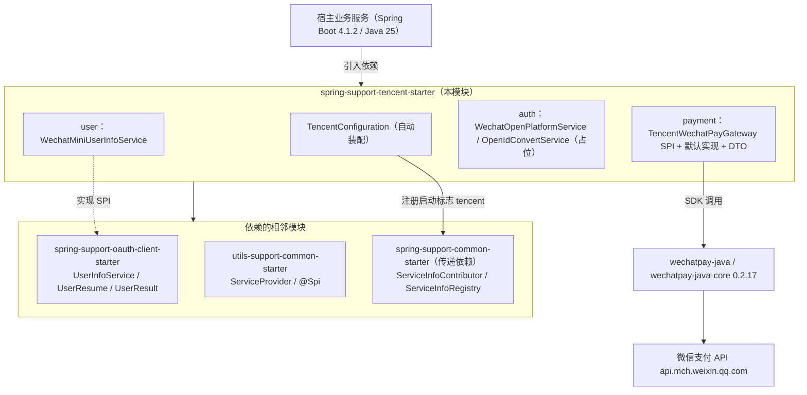
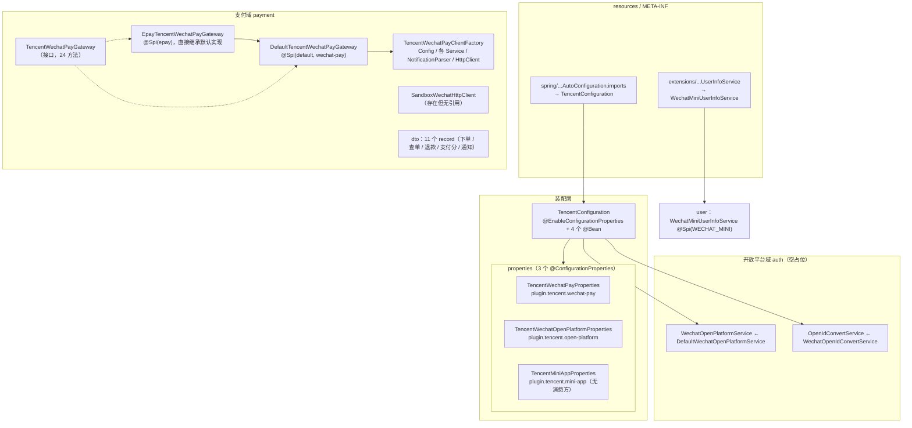
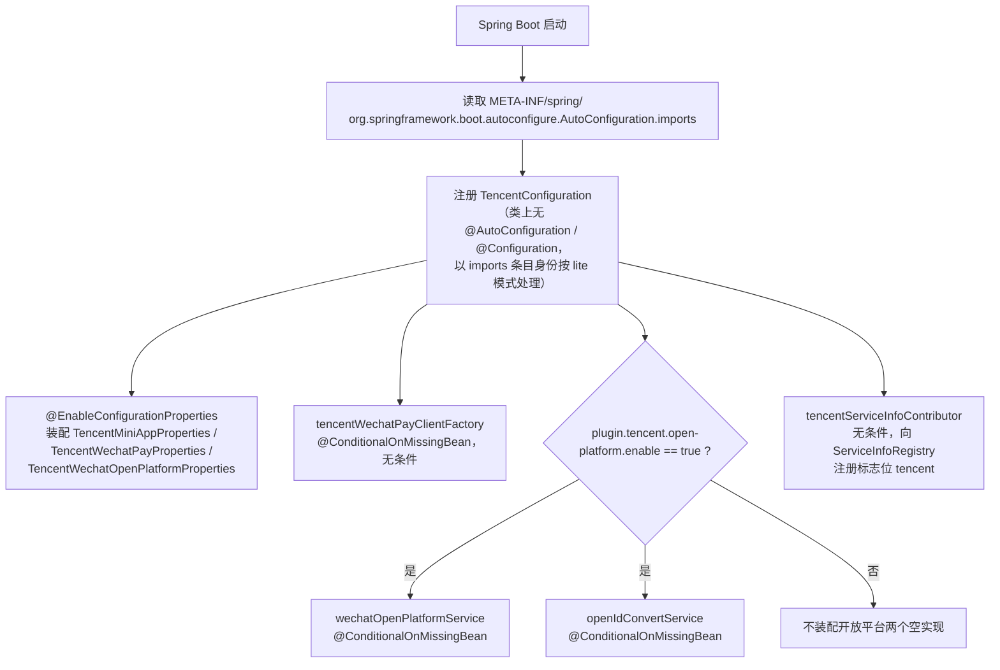
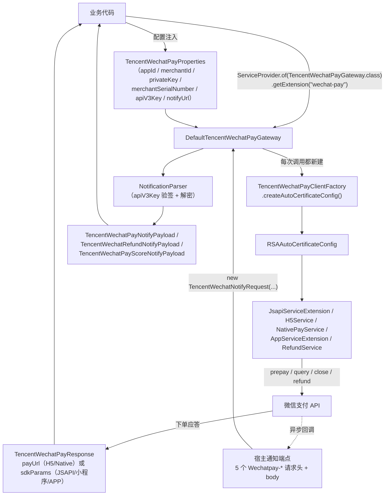

# spring-support-tencent-starter

腾讯（微信）能力集成 Starter：把 JSAPI / H5 / Native / APP / 小程序五种支付下单、查单、关单、
退款、退款查询、支付与退款通知验签解析、支付分（先享后付）收敛成一个 `TencentWechatPayGateway`
SPI，并把微信小程序登录注册成 oauth-client 的 `UserInfoService` 实现（`@Spi("WECHAT_MINI")`）。

- GAV：`com.chua:spring-support-tencent-starter:4.0.0.51`（模块描述「腾讯接口」）
- 包名：`com.chua.starter.tencent.support`，共 25 个类
- 仓库基线：父 pom `spring-support-parent-starter:4.0.0.51` → `spring-boot-starter-parent:4.1.2`，Java 25
- 范围：**只有微信支付 + 微信小程序登录**。本模块**不含**短信（SMS）、对象存储（COS）、
  公众号消息推送、小程序码生成等能力；需要这些请直接引腾讯云 / 微信官方 SDK。

---

## 1. 架构图

### 1.1 模块在体系中的位置



### 1.2 模块内部分层



---

## 2. 核心流程图

### 2.1 自动装配流程



### 2.2 支付下单与通知解析数据流



> 说明：网关是 SPI 实例，**不是 Spring Bean**；`TencentConfiguration` 装配的
> `tencentWechatPayClientFactory` Bean 与网关内部 `new TencentWechatPayClientFactory()`
> 是两个实例，网关不消费该 Bean（详见第 4 节）。

---

## 3. 能力清单

| 能力域 | 关键类 | 入口 |
|---|---|---|
| 自动装配 | `TencentConfiguration` | `META-INF/spring/...AutoConfiguration.imports`（本模块无 `spring.factories`） |
| 支付配置 | `TencentWechatPayProperties`（前缀 `plugin.tencent.wechat-pay`） | `@EnableConfigurationProperties` |
| 开放平台配置 | `TencentWechatOpenPlatformProperties`（前缀 `plugin.tencent.open-platform`） | 同上 |
| 小程序配置 | `TencentMiniAppProperties`（前缀 `plugin.tencent.mini-app`） | 同上（**仅声明，无消费方**） |
| 客户端工厂 | `TencentWechatPayClientFactory` | 9 个公开工厂方法：`createAutoCertificateConfig`×2、`createJsapiService`、`createH5Service`、`createRefundService`、`createNativePayService`、`createAppService`、`createAppServiceExtension`、`createNotificationParser`、`createHttpClient` |
| 支付网关 SPI | `TencentWechatPayGateway`（24 个方法） | `ServiceProvider.of(TencentWechatPayGateway.class).getExtension(...)` |
| 默认实现 | `DefaultTencentWechatPayGateway`（`@Spi({"default","wechat-pay"})`） | 扩展名 `default` / `wechat-pay` |
| epay 实现 | `EpayTencentWechatPayGateway`（`@Spi({"epay"})`） | 扩展名 `epay`，直接 `extends DefaultTencentWechatPayGateway`，无独立逻辑 |
| 沙箱 HTTP 包装 | `SandboxWechatHttpClient`（把生产 URL 重写为 `/sandboxnew/`） | **全仓库无引用，沙箱通道未接线** |
| 下单 / 查单 DTO | `TencentWechatPayRequest`、`TencentWechatPayResponse`、`TencentWechatOrderResponse` | 五种下单方式共用 |
| 退款 | `TencentWechatRefundRequest`、`TencentWechatRefundResponse`、`TencentWechatRefundNotifyPayload` | `refund` / `queryRefund` / `parseRefundNotify` |
| 支付分 | `TencentWechatPayScoreRequest`、`TencentWechatPayScoreResponse`、`TencentWechatPayScoreNotifyPayload` | 创建 / 查询 / 完结 / 撤销 / 通知解析 |
| 通知解析 | `TencentWechatNotifyRequest`、`TencentWechatPayNotifyPayload` | `parsePayNotify`、`parseRefundNotify` |
| 登录集成 | `WechatMiniUserInfoService`（`@Spi("WECHAT_MINI")`） | `META-INF/extensions/...UserInfoService` |
| 开放平台服务 | `WechatOpenPlatformService`、`OpenIdConvertService`、`DefaultWechatOpenPlatformService`、`WechatOpenIdConvertService` | **空占位**：接口无方法，实现类构造器只打日志 |
| 服务信息 | `tencentServiceInfoContributor`（`ServiceInfoContributor`） | 启动时向 `ServiceInfoRegistry` 注册 `tencent` 标志位 |

合计 25 个类；真正被业务调用的是支付网关（`TencentWechatPayGateway` + 默认实现）与
`WechatMiniUserInfoService`。

### 3.1 TencentWechatPayGateway 的 24 个方法

| 分组 | 方法 |
|---|---|
| JSAPI | `jsapiPay`、`queryJsapiOrder`、`closeJsapiOrder` |
| H5 | `h5Pay`、`queryH5Order`、`closeH5Order` |
| Native | `nativePay`、`queryNativeOrder`、`closeNativeOrder` |
| APP | `appPay`、`queryAppOrder`、`closeAppOrder` |
| 小程序 | `miniProgramPay`、`queryMiniProgramOrder`、`closeMiniProgramOrder`（内部直接委托 JSAPI 系方法） |
| 退款 | `refund`、`queryRefund` |
| 通知 | `parsePayNotify`、`parseRefundNotify` |
| 支付分 | `createPayScoreOrder`、`queryPayScoreOrder`、`completePayScoreOrder`、`cancelPayScoreOrder`、`parsePayScoreNotify` |

约定：

- 所有方法**第一个参数都是 `TencentWechatPayProperties`**，网关无状态、不持有配置。
- `TencentWechatPayResponse` 组件为 `success` / `payUrl` / `sdkParams` / `message` / `rawResponse`：
  H5 与 Native 下单产出 `payUrl`，JSAPI / 小程序 / APP 产出 `sdkParams`
  （可直接交给前端 `WeixinJSBridge` / 小程序 `wx.requestPayment`）。
- `TencentWechatPayRequest` 组件为 `orderNo` / `amountFen`（**单位分，Long**）/ `currency` /
  `description` / `notifyUrl` / `expireTime` / `payerOpenId` / `clientIp` / `deviceId` / `attach` /
  `h5Type` / `appName` / `appUrl`。
- 通知地址取值规则（以代码为准）：**下单（JSAPI/H5/Native/APP）只用请求级 `request.notifyUrl()`**；
  **退款与支付分**按 `firstNonBlank(request.notifyUrl(), properties.getNotifyUrl())`，请求级优先。
- 支付分接口未走 SDK service 类，而是 `HttpClient` 直连 `/v3/payscore/serviceorder*`。
- 通知解析走微信 SDK 的 `NotificationParser`（`apiV3Key` 验签 + 解密），`signType` 缺省为
  `WECHATPAY2-SHA256-RSA2048`；签名头由 `TencentWechatNotifyRequest` 的
  `serialNumber` / `timestamp` / `nonce` / `signature` / `signType` + `body` 传入。

### 3.2 WechatMiniUserInfoService（oauth 侧登录）

`checkLogin(principal, credential, address, ext)`：

- `principal` = 小程序 `openid`，为空返回带错误信息的 `UserResume`。
- `ext` 是 `me.zhyd.oauth.model.AuthUser` 时补 `username`，并取 `authUser.getUuid()` 作为
  `unionId`；否则 `username` / `unionId` 都退化为 `openid`。
- `credential` 非空时当作手机号写入 `resume.phone`。
- `upgrade(UserResult)` 恒返回 `null`；`authVersion` 用接口默认实现（返回 `null`）。

---

## 4. Bean 能力矩阵

`TencentConfiguration` 共注册 4 个 Bean。**支付网关不在其中**——它通过
`ServiceProvider` SPI 获取，不走 Spring 容器。

| Bean 名 | 类型 | 装配条件 | 可否覆盖 | 典型注入姿势 |
|---|---|---|---|---|
| `tencentWechatPayClientFactory` | `TencentWechatPayClientFactory` | 无条件注册；`@ConditionalOnMissingBean` | **可覆盖**：宿主定义同类型 Bean 即替换 | 构造器注入后自行构建 `Config` / 各 service；注意 `DefaultTencentWechatPayGateway` 内部自建工厂，不使用该 Bean |
| `wechatOpenPlatformService` | `WechatOpenPlatformService`（实现 `DefaultWechatOpenPlatformService`） | `@ConditionalOnMissingBean` + `@ConditionalOnProperty(prefix="plugin.tencent.open-platform", name="enable", havingValue="true")` | **可覆盖**：`@ConditionalOnMissingBean` 让位给宿主自定义 Bean | 构造器注入；当前为空实现，注入后无可用方法 |
| `openIdConvertService` | `OpenIdConvertService`（实现 `WechatOpenIdConvertService`） | 同上（`open-platform.enable=true` 才装配） | **可覆盖**：同上 | 构造器注入；当前为空实现 |
| `tencentServiceInfoContributor` | `ServiceInfoContributor`（lambda 实现） | 无条件；无 `@ConditionalOnMissingBean` | 可并存：该接口是收集型回调，多个 contributor 同时注册互不冲突 | 一般不直接注入；由 common-starter 的 `ServiceInfoRegistry` 收集后对外展示 `tencent` 标志位 |

三个 `@ConfigurationProperties` Bean（`TencentMiniAppProperties`、`TencentWechatPayProperties`、
`TencentWechatOpenPlatformProperties`）由 `@EnableConfigurationProperties` 注册，可直接构造器注入；
`TencentWechatPayProperties` 同时也是网关每个方法的入参。

---

## 5. 完整配置

三个配置类均标注 `@ConfigurationProperties(..., ignoreInvalidFields = true)`。

### 5.1 微信支付 `plugin.tencent.wechat-pay`（`TencentWechatPayProperties`）

| key | 类型 | 默认值 | 说明 | 生效开关 |
|---|---|---|---|---|
| `enable` | `boolean` | `false` | 开关字段 | **死开关**：无任何 `@ConditionalOnProperty` 读取，配不配不影响网关可用性 |
| `enabled` | `boolean` | `false` | 兼容字段 | **死开关**：同上，未被读取 |
| `app-id` | `String` | 空 | 公众号 / 小程序 / APP 的 AppID，下单 `appid` 字段 | 网关下单时读取 |
| `merchant-id` | `String` | 空 | 商户号，下单 / 查单 / 关单 / 退款均读取 | 生效 |
| `private-key` | `String` | 空 | 商户 API 私钥**内容**（非文件路径），`RSAAutoCertificateConfig` 用 | 生效 |
| `merchant-serial-number` | `String` | 空 | 商户证书序列号 | 生效 |
| `api-v3-key` | `String` | 空 | APIv3 密钥，通知验签与解密 | 生效 |
| `notify-url` | `String` | 空 | 默认通知地址；仅退款与支付分会回退到它，下单只用请求级 `notifyUrl` | 生效（受限） |
| `sandbox` | `boolean` | `false` | 沙箱模式声明 | **未接线**：网关固定走 `https://api.mch.weixin.qq.com`，`SandboxWechatHttpClient` 无引用 |
| `sandbox-sign-key` | `String` | 空 | 沙箱 `apiV3Key` 替代品 | **未接线**：无代码读取 |

### 5.2 微信开放平台 `plugin.tencent.open-platform`（`TencentWechatOpenPlatformProperties`）

| key | 类型 | 默认值 | 说明 | 生效开关 |
|---|---|---|---|---|
| `enable` | `boolean` | `false` | 是否启用开放平台装配 | **生效**：为 `true` 才装配 `wechatOpenPlatformService` / `openIdConvertService` 两个空实现 Bean |
| `component-app-id` | `String` | 空 | 第三方平台 AppID | 仅用于启动日志 |
| `component-app-secret` | `String` | 空 | 第三方平台 AppSecret | 仅用于启动日志（未做任何业务） |
| `default-mini-app-id` | `String` | 空 | 默认小程序 AppID | 仅用于启动日志 |
| `storage-path` | `String` | `wechat-openid-mapping.json` | openid 映射 JSON 持久化路径 | **未实现**：仅传入构造器，无持久化代码 |

### 5.3 小程序 `plugin.tencent.mini-app`（`TencentMiniAppProperties`）

| key | 类型 | 默认值 | 说明 | 生效开关 |
|---|---|---|---|---|
| `enable` | `boolean` | `false` | 开关 | **死开关**：无代码读取 |
| `enabled` | `boolean` | `false` | 兼容字段 | **死开关**：无代码读取 |
| `app-id` | `String` | 空 | 小程序 AppID | **无消费方**：本模块没有小程序登录服务，登录只走 oauth-client 的 `UserInfoService`（`WECHAT_MINI`） |
| `app-secret` | `String` | 空 | 小程序 AppSecret | **无消费方**：同上 |

---

## 6. 使用方式

### 6.1 Maven 坐标

```xml
<dependency>
    <groupId>com.chua</groupId>
    <artifactId>spring-support-tencent-starter</artifactId>
    <version>4.0.0.51</version>
</dependency>
```

### 6.2 依赖说明

| 依赖 | 作用 | 必需性 |
|---|---|---|
| `com.github.wechatpay-apiv3:wechatpay-java` | 微信支付 SDK（payments / refund 等 service 类） | 必需，版本由父 pom `wechatpay.version=0.2.17` 管理 |
| `com.github.wechatpay-apiv3:wechatpay-java-core` | `Config`、`NotificationParser`、`HttpClient` 等 core 能力 | 必需，同版本 |
| `com.chua:spring-support-oauth-client-starter` | `UserInfoService` / `UserResume` / `UserResult` 契约，并传递引入 `spring-support-common-starter` | 必需（直接依赖） |
| `com.chua:utils-support-common-starter` | `ServiceProvider` / `@Spi` SPI 注册表 | 必需 |
| `org.springframework.boot:spring-boot-autoconfigure` | 自动装配支持 | 必需 |
| `com.fasterxml.jackson.core:jackson-databind` | 支付分报文 JSON 序列化 | 必需 |
| `org.slf4j:slf4j-api` | 日志 | 必需 |
| `org.projectlombok:lombok` | `@Data` | 编译期（provided） |

### 6.3 最小可运行示例

**第一步**：确认已持有商户 API 证书私钥**内容**（用于 `private-key`，不是文件路径）、证书序列号与 APIv3 密钥。

**第二步**：配置商户参数：

```yaml
plugin:
  tencent:
    wechat-pay:
      app-id: wx1234567890abcdef
      merchant-id: "1900000001"
      merchant-serial-number: "5157F09EFDC096DE15EBE81A47057A7232F1B8E1"
      private-key: ${WECHAT_MCH_PRIVATE_KEY}
      api-v3-key: ${WECHAT_API_V3_KEY}
      notify-url: https://example.com/pay/wechat/notify
```

**第三步**：取网关（SPI，不是 Bean）并下单 / 验签：

```java
@Service
public class WechatPayService {

    private final TencentWechatPayProperties properties;
    private final TencentWechatPayGateway gateway =
            ServiceProvider.of(TencentWechatPayGateway.class).getExtension("wechat-pay");

    public WechatPayService(TencentWechatPayProperties properties) {
        this.properties = properties;
    }

    /** JSAPI 下单：返回可直接交给 WeixinJSBridge 的 sdkParams */
    public Map<String, Object> jsapiPay(String orderNo, long amountFen, String openId, String clientIp) {
        TencentWechatPayResponse resp = gateway.jsapiPay(properties,
                new TencentWechatPayRequest(
                        orderNo, amountFen, "CNY", "订单 " + orderNo,
                        "https://example.com/pay/wechat/notify",   // 请求级 notify_url（下单只用这一级）
                        null,                                       // expireTime 为空则用平台默认
                        openId, clientIp, null, null, null, null, null));
        if (!resp.success()) {
            throw new IllegalStateException(resp.message());
        }
        return resp.sdkParams();
    }

    /** 支付通知：Wechatpay-* 请求头 5 个字段 + 原始 body 一起传入 */
    @PostMapping("/pay/wechat/notify")
    public String notify(@RequestHeader("Wechatpay-Serial") String serial,
                         @RequestHeader("Wechatpay-Timestamp") String timestamp,
                         @RequestHeader("Wechatpay-Nonce") String nonce,
                         @RequestHeader("Wechatpay-Signature") String signature,
                         @RequestHeader("Wechatpay-Signature-Type") String signType,
                         @RequestBody String body) {
        TencentWechatPayNotifyPayload payload = gateway.parsePayNotify(properties,
                new TencentWechatNotifyRequest(serial, timestamp, nonce, signature, signType, body));
        // 按 payload.orderNo() 幂等更新订单状态
        return "{\"code\":\"SUCCESS\",\"message\":\"成功\"}";
    }
}
```

其他通道：

- **H5**：`h5Pay(...)`，取 `resp.payUrl()` 直接 302。
- **Native**：`nativePay(...)`，`resp.payUrl()` 即二维码内容（`code_url`）。
- **小程序**：`miniProgramPay(...)`（内部走 JSAPI 通道），`payerOpenId` 填小程序 openid，取 `sdkParams`。
- **APP**：`appPay(...)`，取 `sdkParams` 交给客户端 SDK。
- **退款**：`refund(...)` → `queryRefund(...)`，通知用 `parseRefundNotify`。
- **支付分**：`createPayScoreOrder` → `queryPayScoreOrder` → `completePayScoreOrder` / `cancelPayScoreOrder`，通知用 `parsePayScoreNotify`。

调用形态为**步骤式**：所有 DTO 都是 `record`，「配置 + DTO → 响应 record」；本模块**无链式 API**
（唯一的 Builder 链在内部微信 SDK 的 `RSAAutoCertificateConfig.Builder`，不对业务暴露）。

---

## 7. 使用场景

### 7.1 适用

- 已有 Spring Boot 服务需要接入**微信支付**：JSAPI / H5 / Native / APP / 小程序下单、查单、
  关单、退款、支付与退款通知验签、支付分（先享后付）。
- 已使用本生态 `spring-support-oauth-client-starter` 做 OAuth 登录，需要把**微信小程序登录**
  以 `WECHAT_MINI` 类型接入统一用户体系。
- 希望以 SPI 方式隔离微信 SDK 细节，未来可替换成聚合支付等其它 `TencentWechatPayGateway` 实现。

### 7.2 不适用

- 需要短信、COS 对象存储、公众号模板消息、小程序码：本模块不提供。
- 需要托管回调端点、订单 / 退款单持久化、对账与账单下载：本模块无 Controller、无表、
  无对账任务，通知端点的幂等与状态机需业务侧实现。
- 需要支付宝 / 银联等其他渠道：请分别引对应模块或自建网关。

### 7.3 与相邻模块的取舍

| 相邻模块 | 关系 | 取舍建议 |
|---|---|---|
| `spring-support-oauth-client-starter` | 本模块依赖其 `UserInfoService` 契约；小程序登录通过 `META-INF/extensions` 自动发现 | 做登录必须同时引入；只做支付可单独用本模块的网关（依赖仍会带入） |
| `utils-support-common-starter` | 提供 `ServiceProvider` / `@Spi`，网关与登录实现都按扩展名取用 | 必需底层，无需取舍 |
| `spring-support-aliyun-starter` | 平行模块：同为「支付网关 SPI + 登录实现」结构，互不依赖 | 两者可只引其一，也可共存；都用 `ServiceProvider` 按扩展名取实现，互不干扰 |
| 微信官方 / 腾讯云 SDK | 本模块对其做薄封装 | 需要本模块未覆盖的能力（如小程序码、公众号消息）时绕过本模块直连官方 SDK |

---

## 8. 扩展点

### 8.1 支付网关 SPI：`TencentWechatPayGateway`

本模块最核心的扩展点，24 个方法（见 3.1）。新增实现遵循「实现 → 登记 → 生效」：

**① 实现**：实现 `TencentWechatPayGateway`，标注 `@Spi("你的扩展名")`。不支持的通道直接抛
`UnsupportedOperationException`。本模块的 `EpayTencentWechatPayGateway` 是另一种做法：
直接 `extends DefaultTencentWechatPayGateway`、只换扩展名，不覆写任何方法。

```java
@Spi("acme")
public class AcmeTencentWechatPayGateway implements TencentWechatPayGateway {
    @Override
    public TencentWechatPayResponse jsapiPay(TencentWechatPayProperties properties,
                                             TencentWechatPayRequest request) {
        throw new UnsupportedOperationException("聚合通道暂不支持 jsapi 下单");
    }
    // 其余 23 个方法同理
}
```

**② 登记**：SPI 发现由 `utils-support-common-starter` 的解析器完成，两条路径任选其一：

- **同包扫描**（`SamePackageServiceResolver`）：把实现类放在接口所在包树
  `com.chua.starter.tencent.support.payment.*` 下，`@Spi` 的值即扩展名，无需额外文件；
- **扩展文件**（`CustomServiceResolver`）：在自家 jar 的
  `src/main/resources/META-INF/extensions/` 下建
  `com.chua.starter.tencent.support.payment.TencentWechatPayGateway` 文件，写入实现类全名
  （一行一个）。

**③ 生效**：调用方改用 `getExtension("acme")`。内置扩展名：`default` / `wechat-pay` →
`DefaultTencentWechatPayGateway`；`epay` → `EpayTencentWechatPayGateway`。

### 8.2 登录 SPI：`UserInfoService`

本模块注册了 `WECHAT_MINI` 一个实现（`WechatMiniUserInfoService`，登记于
`META-INF/extensions/com.chua.starter.oauth.client.support.user.UserInfoService`）。
若要新增其它微信登录形态（如公众号网页授权），实现 `UserInfoService` 并按同样方式登记新的
扩展名即可；oauth-client 侧按扩展名路由。

### 8.3 Spring Bean 层面的覆盖

- `wechatOpenPlatformService` / `openIdConvertService`：两个接口目前**无方法**（源码注释写明
  「目前仅作为占位符」）。宿主可自行提供有真实逻辑的实现 Bean，`@ConditionalOnMissingBean`
  会让位；注意 `open-platform.enable=true` 只是本模块空实现的装配开关，不影响你自己的 Bean。
- `tencentWechatPayClientFactory`：`@ConditionalOnMissingBean`，可替换为自定义工厂
  （例如缓存 `Config`、接入代理）。但注意当前 `DefaultTencentWechatPayGateway` 内部
  `new TencentWechatPayClientFactory()`，**替换该 Bean 不会影响网关行为**，需连同网关一起扩展。
- `SandboxWechatHttpClient`：现成的沙箱 URL 重写包装器（生产 `api.mch.weixin.qq.com/...` →
  `/sandboxnew/...`），当前无引用；可结合自定义网关 / 工厂接入沙箱通道。

### 8.4 可复用的工具层

`TencentWechatPayClientFactory` 的 9 个工厂方法与 `SandboxWechatHttpClient` 均为 public，
可直接在宿主代码中复用，组合出本模块未封装的微信支付能力（如账单下载等 SDK 已有但网关未暴露的接口）。

---

## 9. 常见问题

**Q1：为什么注入 `TencentWechatPayGateway` 会失败？**
它是 SPI 实现，不是 Spring Bean。正确取法：
`ServiceProvider.of(TencentWechatPayGateway.class).getExtension("wechat-pay")`。
配置照样注入 `TencentWechatPayProperties`，把配置作为网关方法第一参数传入。

**Q2：配了 `plugin.tencent.wechat-pay.enable=true` 却没有任何变化？**
`enable` / `enabled` 是**死开关**：`TencentConfiguration` 没有按支付配置做条件装配，
网关也不读取这两个字段。支付能力只要类在 classpath 就可用；真正需要的只有
`app-id` / `merchant-id` / `private-key` / `merchant-serial-number` / `api-v3-key`。

**Q3：`wechatOpenPlatformService` / `openIdConvertService` Bean 不存在？**
检查 `plugin.tencent.open-platform.enable` 是否为 `true`。为 `false`（默认）时这两个 Bean
不装配。即使开了，当前也只是空实现（无方法），真实开放平台能力需自行实现接口并覆盖。

**Q4：`sandbox=true` 与 `sandbox-sign-key` 为什么不生效？**
沙箱通道未接线：网关固定请求 `https://api.mch.weixin.qq.com`，`SandboxWechatHttpClient`
虽已提供 URL 重写能力但全仓库无引用。需要沙箱时自行在自定义网关 / 工厂中接入该包装器。

**Q5：通知验签一直失败？**
确认五件事：`api-v3-key` 正确；请求头 `Wechatpay-Serial` / `Wechatpay-Timestamp` /
`Wechatpay-Nonce` / `Wechatpay-Signature`（及签名类型头）原样传入 `TencentWechatNotifyRequest`；
`body` 用**原始报文字符串**（不要先反序列化再传）；平台证书能自动下载（`RSAAutoCertificateConfig`
需要商户私钥与证书序列号有效）；回调地址外网可达。

**Q6：自定义网关实现没被 SPI 命中？**
检查三点：`@Spi` 扩展名与 `getExtension(...)` 入参一致；实现类位于接口同包树
`com.chua.starter.tencent.support.payment.*` 下，或已把实现类全名写入
`META-INF/extensions/com.chua.starter.tencent.support.payment.TencentWechatPayGateway`；
类是 public 且有无参构造。不要把无关实现放进该包树——同包扫描会误命中。

**Q7：与 Spring Boot 4 的兼容性如何？**
仓库基线即 Spring Boot：`spring-boot-starter-parent:4.1.2`、Java 25。本模块自动装配使用
`META-INF/spring/org.springframework.boot.autoconfigure.AutoConfiguration.imports`
（Boot 2.7+ 标准机制，Boot 4 继续支持）；**没有** `spring.factories` 自动配置条目，不受
Boot 4 移除该机制影响。微信支付 SDK 版本（0.2.17）由父 pom 统一管理，升级 Boot 时无需单独调整。

**Q8：高频调用会不会有性能问题？**
会：网关每个方法都重新 `createAutoCertificateConfig(...)`，不缓存 `Config` / service 实例。
低频收单无碍；高并发场景建议自定义 `TencentWechatPayClientFactory` 做缓存并配合自定义网关使用。

**Q9：支付分接口报错？**
`*PayScore*` 系列需要商户单独开通支付分产品；未开通时微信侧直接返回错误码，本模块不做前置探测。
