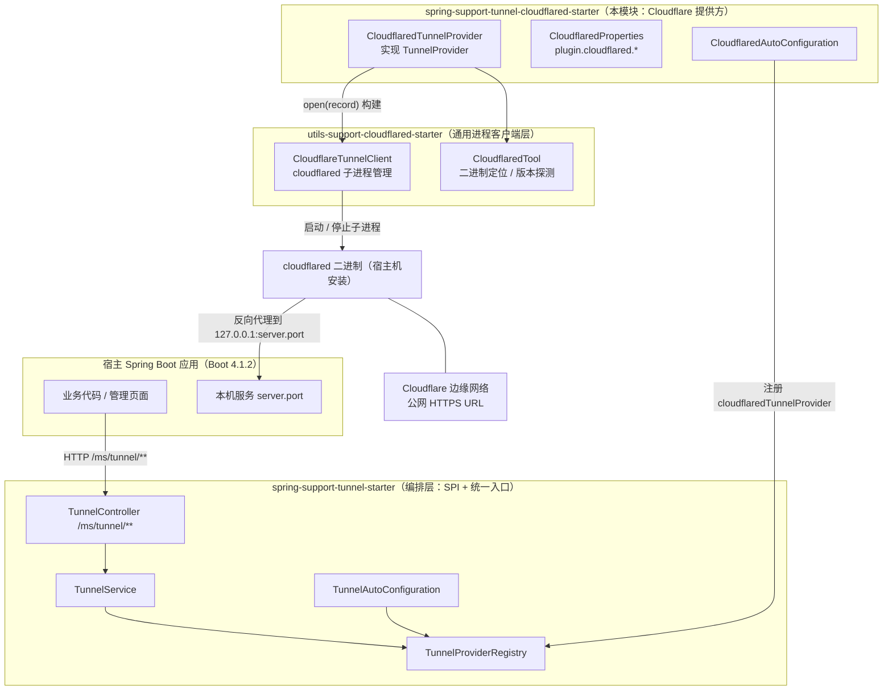
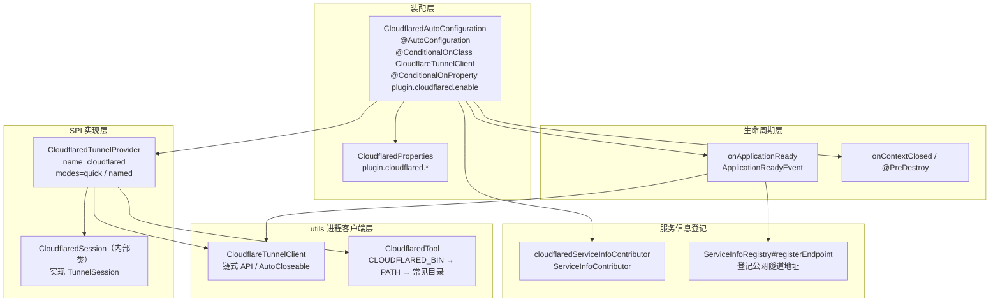
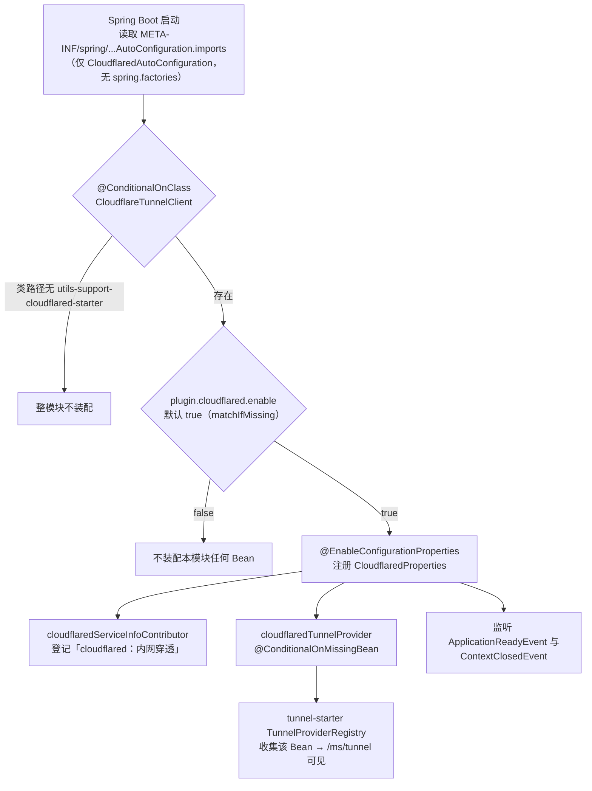
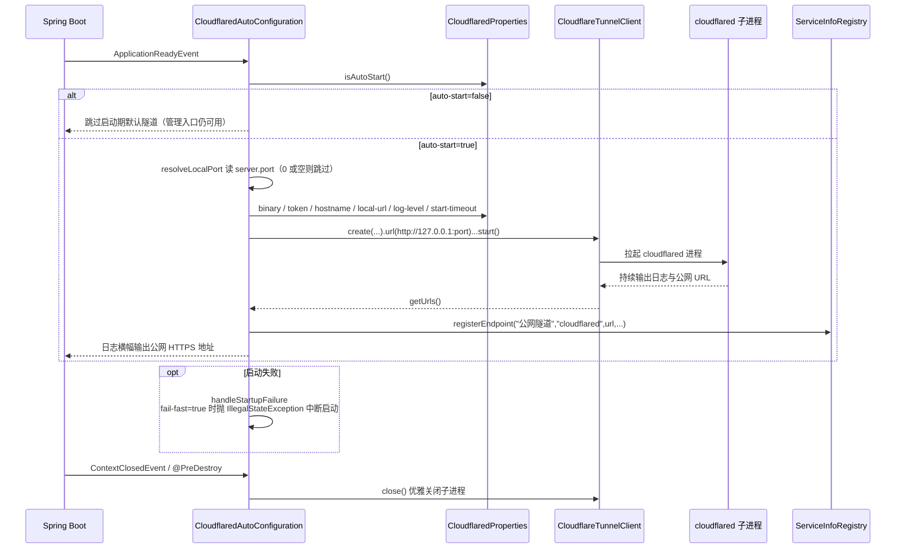
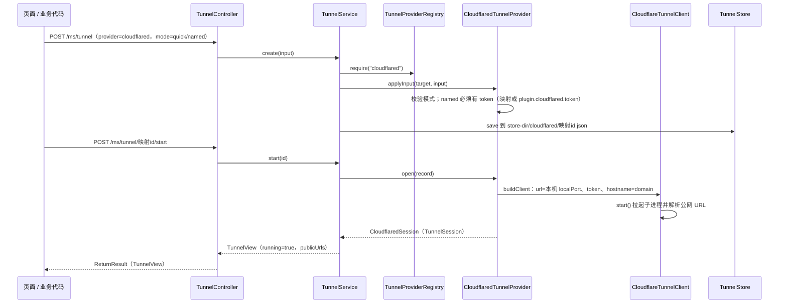

# spring-support-tunnel-cloudflared-starter

Spring Boot 集成 [Cloudflare Tunnel](https://developers.cloudflare.com/cloudflare-one/connections/connect-networks/)：管理外部 `cloudflared` 子进程，把本机服务（`server.port`）暴露为公网 HTTPS 地址。免账号 Quick Tunnel 开箱可用；实现 `spring-support-tunnel-starter` 的 `TunnelProvider` SPI，统一入口 `/ms/tunnel`。

- 基线：Spring Boot **4.1.2**（`spring-boot-starter-parent`，Jakarta 命名空间，`@AutoConfiguration` + `AutoConfiguration.imports` 装配）
- 版本：`4.0.0.51`（跟随仓库父 POM；cloudflared 能力自 `4.0.0.42`，SPI 化接入统一入口自 `4.0.0.53`）
- 统一入口：`/ms/tunnel/**`（由 `spring-support-tunnel-starter` 装配，本模块只注册提供方 Bean）
- 硬前提：宿主机需安装 `cloudflared` 二进制（本模块不自带）

---

## 1. 架构图

### 1.1 模块在体系中的位置



依赖方向：`宿主应用 → 本模块 → tunnel-starter / common-starter / utils-support-cloudflared-starter`。本模块是「厂商提供方」：只做 Cloudflare 侧的适配（模式、token、域名、子进程参数），增删改查、持久化、启动恢复、SSE 推送等公共编排全部由 tunnel-starter 提供。

### 1.2 内部分层



- **装配层**：`CloudflaredAutoConfiguration` 按「类路径存在 `CloudflareTunnelClient` + `plugin.cloudflared.enable=true`（默认开）」决定是否装配；
- **生命周期层**：`ApplicationReadyEvent`（此时 `server.port` 已确定）建立启动期默认隧道；`ContextClosedEvent` / `@PreDestroy` 优雅关闭子进程；
- **SPI 实现层**：`CloudflaredTunnelProvider` 把「本机端口 → Cloudflare 公网地址」接入 tunnel-starter 统一入口，每个映射独占一个 `cloudflared` 子进程；
- **utils 层**：`CloudflareTunnelClient` / `CloudflaredTool` 可脱离 Spring 单独使用。

---

## 2. 核心流程图

### 2.1 自动装配流程



### 2.2 启动期默认隧道（数据流）



### 2.3 统一入口创建 / 启动映射（请求处理流程）



---

## 3. 能力清单

| 能力域 | 关键类 | 入口 |
|:-------|:-------|:-----|
| 自动配置与总开关 | `CloudflaredAutoConfiguration` | `plugin.cloudflared.enable`（默认 `true`） |
| 配置绑定 | `CloudflaredProperties` | `plugin.cloudflared.*` |
| 启动期默认隧道 | `CloudflaredAutoConfiguration#onApplicationReady` | `ApplicationReadyEvent`（`server.port` 已确定） |
| 统一入口提供方 | `CloudflaredTunnelProvider`（实现 `TunnelProvider`） | `/ms/tunnel`（由 tunnel-starter 装配） |
| 隧道模式 | `CloudflaredTunnelProvider#supportedModes` | `quick`（默认，免账号）/ `named`（token） |
| 二进制定位 / 版本探测 | `CloudflaredTool#locate` / `#isAvailable`（utils 层） | `CLOUDFLARED_BIN` → `PATH` → 常见安装目录；结果见 `capabilities.binaryPath` |
| 子进程管理客户端 | `CloudflareTunnelClient`（utils 层） | 链式 API；每个映射独占一个 `cloudflared` 子进程 |
| 公网地址登记 | `CloudflaredAutoConfiguration#startTunnel` | `ServiceInfoRegistry#registerEndpoint("公网隧道", ...)` |
| 服务信息登记 | `cloudflaredServiceInfoContributor` | `ServiceInfoContributor`（控制台「模块能力」可见） |

能力说明：

- **Quick Tunnel（默认，免账号）**：`cloudflared tunnel --url ...`，得到随机 `*.trycloudflare.com` 域名，每次启动都会变化；
- **命名隧道（named）**：Zero Trust 面板生成 Token，映射 `token` 或全局 `plugin.cloudflared.token` 至少填一个；
- **固定域名**：映射记录的 `domain`（启动期配置为 `hostname`），需该域名已在 Cloudflare 账户并配置 CNAME 路由；
- 每个映射独占一个 `cloudflared` 子进程，停止 / 更新 / 删除映射时关闭；
- 凭据不写日志；启动失败默认只打 ERROR 日志（`fail-fast=true` 时中断应用）。

---

## 4. Bean 能力矩阵

| Bean 名 | 类型 | 装配条件 | 可否覆盖 | 典型注入姿势 |
|:--------|:-----|:---------|:---------|:-------------|
| `cloudflaredTunnelProvider` | `CloudflaredTunnelProvider`（实现 tunnel-starter 的 `TunnelProvider`） | 类级 `@ConditionalOnClass(CloudflareTunnelClient)` + `@ConditionalOnProperty(prefix="plugin.cloudflared", name="enable", havingValue="true", matchIfMissing=true)`；方法级 `@ConditionalOnMissingBean` | **可覆盖**（定义同类型 Bean 即替换默认实现） | 一般不直接注入；由 tunnel-starter 的 `TunnelProviderRegistry` 自动收集；也可按 `TunnelProvider` 类型注入 |
| `cloudflaredServiceInfoContributor` | `ServiceInfoContributor`（common-starter 函数式接口） | 仅类级条件；方法**无** `@ConditionalOnMissingBean` | 不可通过缺省机制覆盖；自定义同类型 Bean 会与自动装配 Bean 并存，按类型注入需 `@Primary` 或按名区分 | 一般不注入；由宿主的服务信息端点消费，登记「cloudflared：内网穿透」能力 |
| `plugin.cloudflared-...CloudflaredProperties`（`@EnableConfigurationProperties` 注册，Bean 名为「前缀-全限定类名」格式） | `CloudflaredProperties` | 类级条件成立时随自动配置注册 | 属性值可在配置文件覆盖；Bean 本身一般不替换 | 需要读取 `plugin.cloudflared.*` 时构造器注入 `CloudflaredProperties` |
| `cloudflaredAutoConfiguration`（自动配置类自身） | `CloudflaredAutoConfiguration` | 同类级条件 | 可覆盖，但**不建议** | 事件回调（`onApplicationReady` / `onContextClosed` / `destroy`）挂在该实例上；业务代码不应依赖它 |

覆盖示例（增强默认提供方，例如追加审计日志）：

```java
@Bean
public CloudflaredTunnelProvider cloudflaredTunnelProvider(CloudflaredProperties properties) {
    return new CloudflaredTunnelProvider(properties) {
        @Override
        public TunnelSession open(TunnelRecord record) {
            log.info("创建 cloudflared 映射: {}", record.getName());
            return super.open(record);
        }
    };
}
```

> 替换后 `name()` 仍须返回 `cloudflared`（存储子目录与 `/ms/tunnel/providers` 里的标识都依赖它）；若想彻底换厂商，应新建一个实现 `TunnelProvider` 的 starter，而不是改这个 Bean 的 `name()`。

---

## 5. 完整配置

配置前缀：`plugin.cloudflared`（`com.chua.starter.cloudflared.support.CloudflaredProperties`，经 `@EnableConfigurationProperties` 注册）。

| 配置项（key） | 类型 | 默认值 | 说明 | 生效开关 / 生效路径 |
|:--------------|:-----|:-------|:-----|:--------------------|
| `plugin.cloudflared.enable` | `boolean` | `true`（未配置时 `matchIfMissing` 同样视为开启） | 总开关。`false` 时不装配本模块任何 Bean | 自身即开关 |
| `plugin.cloudflared.binary` | `String` | 无 → 自动定位（`CLOUDFLARED_BIN` 环境变量 → `PATH` → 常见安装目录） | `cloudflared` 可执行文件路径，支持绝对 / 相对路径（相对路径按工作目录转绝对） | `enable=true`；启动期与提供方路径均生效 |
| `plugin.cloudflared.token` | `String` | 无 | Zero Trust 远程管理隧道 Token；为空时使用免账号 Quick Tunnel | `enable=true`；仅 `named` 模式生效（quick 模式即使配置也不传给进程） |
| `plugin.cloudflared.hostname` | `String` | 无 | 启动期固定自定义域名（需该域名已加入 Cloudflare 账户并配置 CNAME 路由） | `enable=true`；仅启动期默认隧道生效；映射路径改用记录的 `domain` |
| `plugin.cloudflared.local-url` | `String` | 无 → `http://127.0.0.1:server.port` | 启动期本地待暴露的服务地址 | `enable=true`；仅启动期默认隧道生效；提供方路径固定 `http://127.0.0.1:<localPort>` |
| `plugin.cloudflared.no-auto-update` | `boolean` | `true` | 禁用 cloudflared 运行期自动更新，避免自更新导致隧道中断 | `enable=true`；两条路径均生效 |
| `plugin.cloudflared.log-level` | `String` | `info` | cloudflared 日志级别：`debug` / `info` / `warn` / `error` / `fatal` | `enable=true`；两条路径均生效 |
| `plugin.cloudflared.start-timeout` | `Duration` | `40s` | 启动后等待公网 URL 输出的超时 | `enable=true`；两条路径均生效 |
| `plugin.cloudflared.fail-fast` | `boolean` | `false` | 启动期隧道失败时是否中断应用；`false` 只打 ERROR 日志继续启动，`true` 抛 `IllegalStateException` | `enable=true`；仅启动期默认隧道的失败处理 |
| `plugin.cloudflared.auto-start` | `boolean` | `true` | 启动时是否按本配置为 `server.port` 自动建默认隧道；`false` 时模块（含统一入口与持久化映射）仍可用 | `enable=true`；仅启动期默认隧道 |
| `plugin.cloudflared.auto-start-stored` | `boolean` | `true` | 应用重启时是否恢复上次标记为「自动启动」的持久化映射 | `enable=true` 且引入 tunnel-starter；由 `TunnelService#restoreAutoStart` 消费 |
| `plugin.cloudflared.store-dir` | `String` | 无 → `~/.chua/tunnel/cloudflared` | 映射持久化目录；一条映射一个 JSON 文件，不用数据库，目录可指向挂载盘备份 | `enable=true` 且引入 tunnel-starter；作为 `TunnelProvider#storeDir()` 覆盖值返回 |

配置元数据由 `spring-boot-configuration-processor`（optional 依赖）在编译期生成（`META-INF/spring-configuration-metadata.json`）。

映射维度的字段不属于本前缀，来自 `TunnelRecord`（common-starter），经 `CloudflaredTunnelProvider#applyInput` 校验归一：

| 字段 | 说明 |
|:-----|:-----|
| `localPort` | 本地端口，提供方固定转发到 `http://127.0.0.1:<localPort>` |
| `mode` | `quick` / `named`，默认 `quick` |
| `token` | `named` 模式必填；为空时回退 `plugin.cloudflared.token` |
| `domain` | 固定域名，映射到客户端的 `hostname` |

模式规则：`quick` 不传 token，得到随机 `trycloudflare.com` 域名；`named` 的映射 token 或全局 token 至少填一个，否则创建时抛 `named 模式必须填写 Cloudflare 隧道 Token`。ngrok 专属字段（`authtoken` / `remoteAddress` / `basicAuth` / `metadata`）在 cloudflared 记录上会被强制清空，避免两套配置互相污染。

---

## 6. 使用方式

### 6.1 Maven 坐标

```xml
<dependency>
    <groupId>com.chua</groupId>
    <artifactId>spring-support-tunnel-cloudflared-starter</artifactId>
    <version>4.0.0.51</version>
</dependency>
```

依赖说明（来自本模块 `pom.xml`）：

| 依赖 | 作用 | 是否必选 |
|:-----|:-----|:---------|
| `spring-support-tunnel-starter` | `TunnelProvider` SPI、`TunnelService` 编排与统一入口 `/ms/tunnel` | 必选 |
| `utils-support-cloudflared-starter` | `CloudflareTunnelClient` 子进程管理、`CloudflaredTool` 二进制定位（版本随父 POM `utils.version`） | 必选 |
| `spring-support-common-starter` | `TunnelRecord` / `TunnelView`、`ServiceInfoContributor` / `ServiceInfoRegistry` | 必选 |
| `spring-boot-starter` | 自动配置与容器 | 必选 |
| `spring-boot-starter-web` | 统一入口 REST/SSE 所在的 Servlet 环境 | optional；非 Web 应用可不引入 |
| `spring-boot-configuration-processor` | 配置元数据生成 | optional |
| `lombok` / `slf4j-api` | 编译期代码生成 / 日志门面 | provided / 必选 |

> 本模块是纯库：`spring-boot-maven-plugin` 已 `skip`，不打可执行 jar。宿主机需先安装 `cloudflared`（macOS `brew install cloudflared`；Windows `winget install Cloudflare.cloudflared`），并用 `cloudflared --version` 确认可执行（最低版本 2022.1）。

### 6.2 最小可运行示例

**第一步：引入依赖（统一入口 + 本提供方）**

```xml
<dependency>
    <groupId>com.chua</groupId>
    <artifactId>spring-support-tunnel-starter</artifactId>
    <version>4.0.0.51</version>
</dependency>
<dependency>
    <groupId>com.chua</groupId>
    <artifactId>spring-support-tunnel-cloudflared-starter</artifactId>
    <version>4.0.0.51</version>
</dependency>
```

**第二步：确认开关（默认已开启，可省略）**

```yaml
plugin:
  cloudflared:
    enable: true
```

**第三步：启动应用，读取公网地址**

```
=========================================================
  Cloudflare Tunnel 已建立，本机服务已暴露到公网
=========================================================
  🌐 https://xxx-xxx-xxx.trycloudflare.com
=========================================================
```

Quick Tunnel 的域名每次启动都会变化；需要稳定地址时改用 `hostname`（固定域名）或 `token`（命名隧道）。

### 6.3 按需建映射（统一入口）

REST 写法：

```bash
curl -X POST http://127.0.0.1:8080/ms/tunnel \
  -H 'Content-Type: application/json' \
  -d '{"name":"演示","provider":"cloudflared","localPort":8080,"mode":"quick","autoStart":false}'

curl -X POST http://127.0.0.1:8080/ms/tunnel/<id>/start
curl http://127.0.0.1:8080/ms/tunnel/providers
```

命名隧道请求体：

```json
{
  "provider": "cloudflared",
  "name": "命名隧道",
  "localPort": 8080,
  "mode": "named",
  "token": "<CLOUDFLARE_TUNNEL_TOKEN>",
  "domain": "tunnel.example.com"
}
```

Java 注入写法（`TunnelService` 来自 tunnel-starter）：

```java
private final TunnelService tunnelService;

public String expose() {
    TunnelRecord input = new TunnelRecord();
    input.setProvider("cloudflared");
    input.setName("演示");
    input.setLocalPort(8080);
    input.setMode("quick");          // quick / named
    TunnelView created = tunnelService.create(input);
    TunnelView running = tunnelService.start(created.getId());
    return running.getPublicUrls().get(0);
}
```

底层子进程客户端（属于 `utils-support-cloudflared-starter`，可脱离 Spring 直接用链式 API）：

```java
CloudflareTunnelClient client = CloudflareTunnelClient.create()
        .url("http://127.0.0.1:8080")
        .token(token)
        .hostname("tunnel.example.com")
        .noAutoUpdate(true)
        .logLevel("info")
        .startTimeout(Duration.ofSeconds(40));
client.start();
List<String> urls = client.getUrls();
client.close();
```

禁用本模块：`plugin.cloudflared.enable=false`，或环境变量 `PLUGIN_CLOUDFLARED_ENABLE=false`。

---

## 7. 使用场景

### 7.1 适用

- 本地开发机把内网服务临时暴露给公网：联调回调、演示、微信 / 支付验签，免账号 Quick Tunnel 零配置可用；
- 内网部署的管理端需要公网入口，并希望用 `/ms/tunnel` 页面统一管理多条映射的启停与状态（SSE 实时刷新）；
- 已有 Cloudflare 账户，需要**固定域名**或 **Zero Trust 命名隧道**的生产 / 半生产入口；
- 多提供方共存：classpath 同时有 ngrok 与 cloudflared，用 `plugin.tunnel.providers` 按环境裁剪；
- 与 ngrok 相比更在意「免账号」「官方守护进程」「子进程隔离（每映射一进程，崩溃互不影响）」。

### 7.2 不适用

- 宿主机无法安装 `cloudflared` 二进制（容器镜像受限、无外网下载渠道）且不能用 `binary` 指定路径——本模块不内置二进制，`isAvailable()` 会返回 `false`；
- 需要进程内 SDK、不希望拉起外部子进程的场景——选 ngrok-starter（内嵌 Rust Agent）；
- 需要生产级高可用入口——隧道依赖本机进程与 Cloudflare 边缘网络，本机宕机 / 断网即失效，正式入口应使用负载均衡 / 网关类产品；
- 已有 Tailscale 组网并倾向 Funnel 的团队——选 tailscale-starter，不必重复引入。

### 7.3 与相邻模块的取舍

| 模块 | 角色 | 与本模块的关系 |
|:-----|:-----|:---------------|
| `utils-support-cloudflared-starter` | 通用进程客户端层 | 本模块依赖它；纯 Java 管理 `cloudflared` 子进程，可脱离 Spring 使用 |
| `spring-support-tunnel-starter` | 编排层（SPI + 统一入口） | 本模块依赖它；REST、持久化、SSE、启动恢复、多实例接管由它提供 |
| `spring-support-tunnel-ngrok-starter` | ngrok 提供方 | 可同时引入；进程内 SDK vs 本模块的外部子进程 |
| `spring-support-tunnel-tailscale-starter` | Tailscale Funnel 提供方 | 可同时引入；依赖 tailscaled 守护进程 |

与 ngrok 的差异：

| 维度 | cloudflared（本模块） | ngrok |
|:-----|:----------------------|:------|
| 运行形态 | 外部二进制子进程，每映射一个进程 | 进程内 SDK（native 库） |
| 免账号 | 是，Quick Tunnel | 否，必须 authtoken |
| 安装要求 | 需安装 `cloudflared` | 无需额外安装 |
| 模式 | `quick` / `named` | `http` / `tcp` / `tls` |
| 固定域名 | `hostname` / 映射 `domain`（需 CNAME） | `domain`（需面板预留） |
| 可用性判定 | `CloudflaredTool#isAvailable` 真实探测二进制 | 恒 true（编译期依赖） |

两者可同时引入，用 `plugin.tunnel.providers` 裁剪；cloudflared 不可用时页面应禁用该提供方，而不是等用户点击后失败。

---

## 8. 扩展点

本模块**不定义新的 SPI 接口**：它消费 tunnel-starter 的 `TunnelProvider` / `TunnelSession` 契约，并把这些扩展点暴露给业务方：

### 8.1 上游 SPI：`TunnelProvider` / `TunnelSession`

- `CloudflaredTunnelProvider` 是 `TunnelProvider` 的参考实现（`name()=cloudflared`、`supportedModes()=[quick, named]`、`defaultMode()=quick`、`isAvailable()` 真实探测二进制、`capabilities()` 回填 `binaryAvailable` / `binaryPath` / `tokenConfigured` 等）；
- 新增其它厂商提供方时，实现 `TunnelProvider` 并注册为 Bean 即可被 `TunnelProviderRegistry` 收集，方法契约见 tunnel-starter README 第 8 节；
- `TunnelSession` 只有两个方法：`publicUrls()` 与幂等的 `close()`，本模块的内部类 `CloudflaredSession` 即按此实现。

### 8.2 Bean 级覆盖

- `cloudflaredTunnelProvider` 标注 `@ConditionalOnMissingBean`：定义同类型 Bean 即替换默认提供方（示例见第 4 节）；
- `CloudflaredProperties` 属性值可在任意配置源覆盖（环境变量、配置文件、启动参数）；
- 自定义 `ServiceInfoContributor` 可与 `cloudflaredServiceInfoContributor` 并存（无缺省覆盖机制）。

### 8.3 底层客户端直用

`utils-support-cloudflared-starter` 的 `CloudflareTunnelClient` 是独立的链式 API（`create` / `url` / `token` / `hostname` / `noAutoUpdate` / `logLevel` / `startTimeout` / `start` / `getUrls` / `close`），不需要 Spring 也能管理 `cloudflared` 生命周期；`CloudflaredTool`（`@Spi("cloudflared")`）提供二进制定位与版本校验，可被其它模块复用。

### 8.4 没有的扩展点

- 本模块无 `spring.factories`、无自定义 `BeanPostProcessor`、无额外 SPI 包；
- 统一入口的 REST / SSE / 持久化扩展属于 tunnel-starter（如自定义 `TunnelService`、`TunnelStore`），请勿在本模块重复实现。

---

## 9. 常见问题

### 9.1 装配不生效

**引入后没有任何 cloudflared 相关 Bean？**

- 检查 `plugin.cloudflared.enable` 是否被改为 `false`；
- 检查类路径是否真的有 `utils-support-cloudflared-starter`：`@ConditionalOnClass(CloudflareTunnelClient)` 不满足时整个自动配置静默跳过；
- 本模块装配来自 `META-INF/spring/org.springframework.boot.autoconfigure.AutoConfiguration.imports`（仅声明 `CloudflaredAutoConfiguration`），无 `spring.factories`——Boot 3/4 均按此机制加载。

**`GET /ms/tunnel/providers` 里看不到 cloudflared？**

- 未引入 `spring-support-tunnel-starter`，或 `plugin.tunnel.enable=false`——统一入口本身没装配；
- 设置了 `plugin.tunnel.providers` 白名单但未包含 `cloudflared`；
- 本模块 Bean 正常注册但宿主机没有 `cloudflared`：`isAvailable()=false`、`capabilities.binaryAvailable=false`，接口仍会列出该提供方，页面应据此禁用。

**覆盖 `cloudflaredTunnelProvider` 后仍是旧实例？**

确认自定义 Bean 没被 `@ConditionalOnMissingBean` 顺序问题坑到：业务方 `@Bean` / `@Component` 正常声明即可优先于自动配置；另外替换实例的 `name()` 必须仍返回 `cloudflared`，否则 registry 会当作新提供方或报名称问题。

### 9.2 端口 / 开关 / 运行行为

**`server.port=0`（随机端口）会怎样？**

启动期默认隧道会跳过：`resolveLocalPort` 读到 `0` 返回 -1，日志为「无法解析本地 server.port，跳过隧道建立」。管理入口的按需映射不受影响——它使用映射记录里的显式 `localPort`。

**`auto-start` 和 `auto-start-stored` 有什么区别？**

`auto-start` 管「启动期是否为 `server.port` 建一条默认隧道」；`auto-start-stored` 管「重启时是否恢复之前从页面创建、标记为自动启动的持久化映射」。与管理台映射同时使用时建议 `auto-start=false`，避免同一端口重复建隧道。

**Quick Tunnel 域名每次都变？**

是。`*.trycloudflare.com` 域名由 Cloudflare 随机分配，重启即换；要稳定地址用 `plugin.cloudflared.hostname`（需 CNAME 指向 `<隧道ID>.cfargotunnel.com`）或 `named` 模式 token。

**启动超时 / 失败怎么排查？**

- 默认等待 40s（`start-timeout` 可调），网络无法访问 Cloudflare 边缘时会失败；
- 失败日志为 `[Cloudflared] 隧道启动失败: ...`；`fail-fast=true` 时紧接着抛 `[Cloudflared] failFast=true，终止 Spring 启动`；
- 统一入口路径的失败会写入映射的 `error` 字段并出现在 SSE 快照里（包装为 `Cloudflare Tunnel 隧道启动失败: ...`）；
- 进程提前退出通常意味着 token 无效、端口被占用或本地服务未启动；cloudflared 的输出必须被持续消费至进程退出（utils 客户端已处理），否则隧道会立刻变 530。

**Token 安全吗？**

Token 不会写进日志，但会随映射记录写入 `<store-dir>/cloudflared/<id>.json`（tunnel-starter 的文件持久化），注意该目录的访问权限，必要时把 `store-dir` 指向受控盘。

**启动期配置和页面映射的字段等价吗？**

不完全等价：`local-url`、`hostname` 只在启动期默认隧道生效（页面路径固定 `http://127.0.0.1:<localPort>`，域名用记录的 `domain`）；`token` 只在 `named` 模式生效。

### 9.3 与 Spring Boot 4 兼容性

- 本模块随仓库父 POM 升级到 **Spring Boot 4.1.2**（2026-11-19），使用 `@AutoConfiguration` + `META-INF/spring/org.springframework.boot.autoconfigure.AutoConfiguration.imports` 装配（Boot 2.7+ 标准机制，Boot 3/4 通用），无 `spring.factories`；
- 代码基于 Jakarta 命名空间（`jakarta.annotation.PreDestroy`），不能与 `javax.*` 旧栈混用；
- `spring-boot-starter-web` 为 optional：Web 应用引入即得 `/ms/tunnel` REST/SSE（由 tunnel-starter 的 `TunnelController` 提供），非 Web 应用只装配提供方 Bean，启动期默认隧道与 Web 无关；
- `@ConfigurationProperties` 绑定（`plugin.cloudflared.*`）与 `spring-boot-configuration-processor` 元数据在 Boot 4 下行为不变，`Duration` 字段支持 `40s` 等写法。

### 9.4 常见报错速查

| 报错 / 现象 | 原因 | 解决 |
|:------------|:-----|:-----|
| `[Cloudflared] 隧道启动失败: ...` | 二进制缺失、网络不通、token 无效等 | 先看 `isAvailable()` 与 `CLOUDFLARED_BIN`；再核对 token / 网络出口 |
| `[Cloudflared] failFast=true，终止 Spring 启动` | `fail-fast=true` 且启动期隧道失败 | 修复失败原因，或临时设 `fail-fast=false` 只告警不阻断 |
| `无法解析本地 server.port，跳过隧道建立` | `server.port=0` 或未配置 | 显式配置 `server.port`，或改用统一入口显式传 `localPort` |
| `named 模式必须填写 Cloudflare 隧道 Token` | `named` 模式且映射 token 与全局 token 均为空 | 映射填 `token`，或配置 `plugin.cloudflared.token` |
| `Cloudflare Tunnel 隧道启动失败: ...`（经 tunnel-starter） | 提供方 `open` 抛出 | 查看映射 `error` 字段与 SSE 快照中的失败原因 |
| 公网地址返回 530 | cloudflared 进程退出或未把流量回源到本机 | 确认本机 `localPort` 服务存活、cloudflared 进程仍在运行、CNAME 已生效 |
