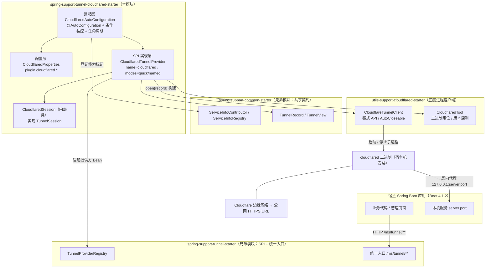
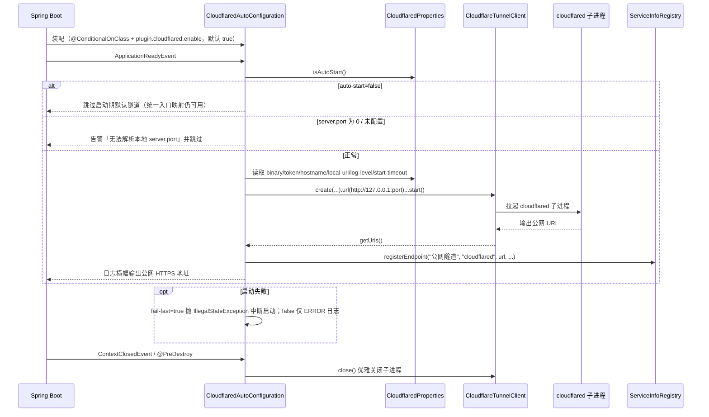

# spring-support-tunnel-cloudflared-starter

Cloudflare Tunnel（cloudflared）的 Spring Boot 集成模块：管理外部 `cloudflared` 子进程，把本机服务（`server.port`）暴露为公网 HTTPS 地址，免账号 Quick Tunnel 开箱可用。在 spring-support 体系中它是「内网穿透」能力的 **Cloudflare 提供方**：实现 `spring-support-tunnel-starter` 的 `TunnelProvider` SPI，接入统一入口 `/ms/tunnel`；公共编排（REST/SSE、持久化、启动恢复）由 tunnel-starter 提供，本模块只做 Cloudflare 侧适配，不自带 Controller 与编排 Service。

- 基线：Spring Boot **4.1.2**（`@AutoConfiguration` + `META-INF/spring/...AutoConfiguration.imports` 装配，无 `spring.factories`）
- 版本：`4.0.0.51`（跟随父 POM；cloudflared 能力自 `4.0.0.42`，SPI 化接入统一入口自 `4.0.0.53`）
- 硬前提：宿主机需安装 `cloudflared` 二进制（本模块不自带，`CloudflaredTool#isAvailable` 真实探测）

## 1. 架构图



依赖方向：`宿主应用 → 本模块 → tunnel-starter / common-starter / utils-support-cloudflared-starter`。内部三层：装配层（自动配置 + 配置绑定）→ SPI 实现层（`CloudflaredTunnelProvider` / `CloudflaredSession`）→ 底层进程客户端（utils 层，可脱离 Spring 单独使用）。本模块是「厂商提供方」：只做模式、token、域名、子进程参数等 Cloudflare 细节适配。

## 2. 核心流程图

核心流程：启动期默认隧道（`ApplicationReadyEvent` 时 `server.port` 已确定，自动拉起 cloudflared 并登记公网地址）。



## 3. 能力清单

| 能力域 | 关键类 | 入口/触发方式 |
|:-------|:-------|:--------------|
| 自动配置与总开关 | `CloudflaredAutoConfiguration` | `plugin.cloudflared.enable`（默认 `true`）+ `@ConditionalOnClass(CloudflareTunnelClient)` |
| 配置绑定 | `CloudflaredProperties` | `plugin.cloudflared.*` |
| 启动期默认隧道 | `CloudflaredAutoConfiguration#onApplicationReady` | `ApplicationReadyEvent`（此时 `server.port` 已确定） |
| 统一入口提供方 | `CloudflaredTunnelProvider`（实现 `TunnelProvider`） | 由 tunnel-starter 的 `TunnelProviderRegistry` 收集，`/ms/tunnel` 可见 |
| 隧道模式 | `CloudflaredTunnelProvider#supportedModes` | `quick`（默认，免账号随机域名）/ `named`（Zero Trust token） |
| 二进制定位 / 可用性探测 | `CloudflaredTool#locate` / `#isAvailable`（utils 层） | `CLOUDFLARED_BIN` → `PATH` → 常见安装目录；结果见 `capabilities().binaryPath` |
| 子进程管理 | `CloudflareTunnelClient`（utils 层） | 链式 API；每条映射独占一个 `cloudflared` 子进程 |
| 公网地址登记 | `CloudflaredAutoConfiguration#startTunnel` | `ServiceInfoRegistry#registerEndpoint("公网隧道", ...)` |
| 服务信息登记 | `cloudflaredServiceInfoContributor` | `ServiceInfoContributor`，登记「cloudflared：内网穿透」能力标记 |

- **Quick Tunnel（默认）**：`cloudflared tunnel --url ...`，得到随机 `*.trycloudflare.com` 域名，每次启动变化；
- **命名隧道（named）**：映射 `token` 或全局 `plugin.cloudflared.token` 至少填一个，可配固定域名 `domain`（需 CNAME 路由）；
- 凭据不写日志；启动失败默认只打 ERROR 日志（`fail-fast=true` 时中断应用）。

## 4. Bean 能力矩阵

| Bean 名 | 类型 | 装配条件 | 可否覆盖 | 典型用途 |
|:--------|:-----|:---------|:---------|:---------|
| `cloudflaredTunnelProvider` | `CloudflaredTunnelProvider`（实现 tunnel-starter 的 `TunnelProvider`） | 类级 `@ConditionalOnClass(CloudflareTunnelClient)` + `@ConditionalOnProperty(prefix="plugin.cloudflared", name="enable", havingValue="true", matchIfMissing=true)`；方法级 `@ConditionalOnMissingBean` | **可覆盖**（定义同类型 Bean 即替换默认实现） | 一般不直接注入；由 `TunnelProviderRegistry` 自动收集，支撑 `/ms/tunnel` 的 cloudflared 提供方 |
| `cloudflaredServiceInfoContributor` | `ServiceInfoContributor`（common-starter 函数式接口） | 仅类级条件；方法**无** `@ConditionalOnMissingBean` | 不可经缺省机制覆盖；自定义同类型 Bean 会并存 | 一般不注入；由宿主服务信息端点消费，登记「cloudflared：内网穿透」 |
| `plugin.cloudflared-com.chua.starter.cloudflared.support.CloudflaredProperties` | `CloudflaredProperties` | 类级条件成立时经 `@EnableConfigurationProperties` 注册 | 属性值可在任意配置源覆盖；Bean 本身一般不替换 | 需要读取 `plugin.cloudflared.*` 时构造器注入 |
| `cloudflaredAutoConfiguration`（自动配置类自身） | `CloudflaredAutoConfiguration` | 同类级条件 | 可覆盖，但**不建议** | 承载 `onApplicationReady` / `onContextClosed` / `destroy` 生命周期回调 |

覆盖示例（增强默认提供方）：

```java
@Slf4j
@Configuration
public class MyTunnelConfig {

    @Bean
    public CloudflaredTunnelProvider cloudflaredTunnelProvider(CloudflaredProperties properties) {
        return new CloudflaredTunnelProvider(properties) {
            @Override
            public TunnelSession open(TunnelRecord record) {
                // 匿名子类继承不到 CloudflaredTunnelProvider 的私有 log 字段，
                // 这里用的是本配置类（@Slf4j 生成）的 log
                log.info("创建 cloudflared 映射: {}", record.getName());
                return super.open(record);
            }
        };
    }
}
```

> 替换后 `name()` 仍须返回 `cloudflared`（存储子目录与 `/ms/tunnel/providers` 标识依赖它）；想换厂商应另写一个 `TunnelProvider` 实现，而不是改这个 Bean 的 `name()`。

## 5. 完整配置

配置前缀：`plugin.cloudflared`（`com.chua.starter.cloudflared.support.CloudflaredProperties`，无嵌套类）。

| 配置路径 | 类型 | 默认值 | 说明 |
|:---------|:-----|:-------|:-----|
| `plugin.cloudflared.enable` | `boolean` | `true` | 总开关；`false` 时本模块任何 Bean 都不装配 |
| `plugin.cloudflared.binary` | `String` | 无（自动定位：`CLOUDFLARED_BIN` → `PATH` → 常见目录） | `cloudflared` 可执行文件路径，支持绝对/相对路径（相对按工作目录转绝对） |
| `plugin.cloudflared.token` | `String` | 无 | Zero Trust 隧道 Token；为空用免账号 Quick Tunnel。仅 `named` 模式传给进程 |
| `plugin.cloudflared.hostname` | `String` | 无 | 启动期固定域名（需已加入 Cloudflare 账户并配 CNAME）。仅启动期隧道生效；映射路径改用记录 `domain` |
| `plugin.cloudflared.local-url` | `String` | 无 → `http://127.0.0.1:server.port` | 启动期本地待暴露地址。仅启动期隧道生效；提供方路径固定 `http://127.0.0.1:<localPort>` |
| `plugin.cloudflared.no-auto-update` | `boolean` | `true` | 禁用 cloudflared 运行期自更新，避免隧道中断 |
| `plugin.cloudflared.log-level` | `String` | `info` | cloudflared 日志级别：`debug`/`info`/`warn`/`error`/`fatal` |
| `plugin.cloudflared.start-timeout` | `Duration` | `40s` | 启动后等待公网 URL 输出的超时 |
| `plugin.cloudflared.fail-fast` | `boolean` | `false` | 启动期隧道失败是否中断应用；`true` 抛 `IllegalStateException` |
| `plugin.cloudflared.auto-start` | `boolean` | `true` | 启动时是否为 `server.port` 自动建默认隧道；`false` 时模块其余能力仍可用 |
| `plugin.cloudflared.auto-start-stored` | `boolean` | `true` | 重启时是否恢复上次标记「自动启动」的持久化映射（由 tunnel-starter 启动恢复流程消费） |
| `plugin.cloudflared.store-dir` | `String` | 无 → 约定 `~/.chua/tunnel/cloudflared` | 映射持久化目录（一条映射一个 JSON 文件，不用数据库）；经 `storeDir()` 交给 tunnel-starter |

映射维度字段不属于本前缀，来自 `TunnelRecord`（common-starter），经 `CloudflaredTunnelProvider#applyInput` 校验归一：`localPort`（转发到 `http://127.0.0.1:<localPort>`）、`mode`（`quick`/`named`，默认 `quick`）、`token`（named 必填，空则回退全局 token）、`domain`（对应客户端 `hostname`）；ngrok 专属字段（`authtoken`/`remoteAddress`/`basicAuth`/`metadata`）会被强制清空，避免两套配置互相污染。配置元数据由 `spring-boot-configuration-processor`（optional）在编译期生成。

### 5.1 逐项配置示例

按功能分组给出每个配置项的含义、默认值与 YAML 写法；键名挂在 `plugin.cloudflared` 前缀下（camelCase → kebab-case）。

**开关与二进制定位：**

```yaml
plugin:
  cloudflared:
    # 总开关；默认 true。设为 false 时本模块任何 Bean 都不装配
    enable: true
    # cloudflared 可执行文件路径；默认无（自动定位：CLOUDFLARED_BIN → PATH → 常见安装目录）
    # 相对路径按工作目录转绝对路径
    binary: /usr/local/bin/cloudflared
```

**隧道模式与地址（启动期默认隧道）：**

```yaml
plugin:
  cloudflared:
    # Zero Trust 命名隧道 Token；默认无（走免账号 Quick Tunnel）。仅 named 模式传给进程
    token: ${CLOUDFLARE_TUNNEL_TOKEN}
    # 固定自定义域名；默认无。需该域名已加入 Cloudflare 账户并配置 CNAME 路由
    hostname: tunnel.example.com
    # 本地待暴露服务地址；默认无 → http://127.0.0.1:server.port
    local-url: http://127.0.0.1:8080
```

**进程行为与启动控制：**

```yaml
plugin:
  cloudflared:
    # 禁用 cloudflared 运行期自更新；默认 true
    no-auto-update: true
    # cloudflared 日志级别 debug/info/warn/error/fatal；默认 info，置空同样回落 info
    log-level: info
    # 启动后等待公网 URL 的超时；默认 40s（配置为空同值）。勿配 ≤0，会被立即判超时
    start-timeout: 40s
    # 启动期隧道失败是否中断应用；默认 false（只打 ERROR 日志），true 抛 IllegalStateException
    fail-fast: false
    # 启动时是否为 server.port 自动建默认隧道；默认 true，false 时管理入口仍可用
    auto-start: true
```

**持久化与启动恢复：**

```yaml
plugin:
  cloudflared:
    # 重启时是否恢复上次标记「自动启动」的持久化映射；默认 true
    auto-start-stored: true
    # 映射持久化目录；默认无 → ~/.chua/tunnel/cloudflared（tunnel-starter 根目录 + 提供方子目录）
    store-dir: /data/tunnel/cloudflared
```

### 5.2 完整 YAML 示例

```yaml
server:
  port: 8080

plugin:
  cloudflared:
    enable: true                          # 总开关（默认 true，可省略）
    binary: /usr/local/bin/cloudflared    # 可省略：留空自动定位
    token: ${CLOUDFLARE_TUNNEL_TOKEN}     # Zero Trust 命名隧道；不配则用 Quick Tunnel
    hostname: tunnel.example.com          # 固定域名，需 CNAME 指向 <隧道ID>.cfargotunnel.com
    local-url: http://127.0.0.1:8080      # 缺省即 http://127.0.0.1:${server.port}
    no-auto-update: true
    log-level: info
    start-timeout: 40s
    fail-fast: false
    auto-start: true
    auto-start-stored: true
    store-dir: /data/tunnel/cloudflared   # 缺省即 ~/.chua/tunnel/cloudflared
```

> Quick Tunnel（不配 `token`/`hostname`）零配置可用，但域名每次启动随机变化；需要固定地址请配 `token`（named 模式）或 `hostname`（CNAME 路由）。

### 5.3 生产注意事项

- **凭据安全**：`token` 用环境变量或配置中心注入（`${CLOUDFLARE_TUNNEL_TOKEN}`），不要明文提交到仓库；底层客户端打印启动命令时会把 `--token` 脱敏为 `***`。
- **固定入口**：Quick Tunnel 域名随机，生产入口用 named 模式（Zero Trust 面板管理）或 `hostname` + CNAME 固定域名。
- **进程前提**：宿主机必须安装 `cloudflared` 且对 `PATH` 可见（或用 `binary` 指定路径）；容器镜像需自行携带二进制，否则 `isAvailable()=false`，页面应禁用该提供方而不是等点击失败。
- **失败策略**：对外暴露入口的实例建议 `fail-fast: true`，避免「应用起来了、隧道没通」的静默半可用；普通业务实例保持 `false`，隧道抖动不拖垮启动。
- **超时预算**：`start-timeout` 需覆盖 cloudflared 冷启动与边缘建连时间，弱网环境适当调大；不要设 ≤0。
- **版本管理**：保持 `no-auto-update: true`，把 cloudflared 升级纳入发布流程，避免运行期自更新中断隧道。
- **出网要求**：宿主机需能访问 Cloudflare 边缘网络（HTTPS 出网）；只需放行出站流量，无需公网入站端口。
- **多映射共存**：启动期默认隧道只服务 `server.port`；更多映射走 `/ms/tunnel`。`auto-start` 与 `auto-start-stored` 同时开启时注意避免同一端口重复建隧道。

## 6. 使用方式

Maven 坐标：

```xml
<dependency>
    <groupId>com.chua</groupId>
    <artifactId>spring-support-tunnel-cloudflared-starter</artifactId>
    <version>4.0.0.51</version>
</dependency>
```

最小启用示例（默认已开启，`enable` 可省略）：

```yaml
plugin:
  cloudflared:
    enable: true        # 总开关，默认 true
    # token: ${CLOUDFLARE_TUNNEL_TOKEN}   # 可选：named 模式
    # hostname: tunnel.example.com        # 可选：固定域名
```

启动日志即输出公网地址（Quick Tunnel 域名每次启动都会变化）：

```text
=========================================================
  Cloudflare Tunnel 已建立，本机服务已暴露到公网
=========================================================
  🌐 https://xxx-xxx-xxx.trycloudflare.com
=========================================================
```

按需建映射：REST 走统一入口 `POST /ms/tunnel`（body 传 `provider=cloudflared`、`localPort`、`mode`）、`POST /ms/tunnel/{id}/start`、`GET /ms/tunnel/providers`（端点由 tunnel-starter 提供）；Java 侧注入 tunnel-starter 的编排服务，或直接用底层链式客户端：

```java
CloudflareTunnelClient client = CloudflareTunnelClient.create()
        .url("http://127.0.0.1:8080")
        .token(token)                       // named 模式
        .hostname("tunnel.example.com")
        .noAutoUpdate(true)
        .logLevel("info")
        .startTimeout(Duration.ofSeconds(40));
client.start();
List<String> urls = client.getUrls();
client.close();
```

依赖说明（来自本模块 `pom.xml`）：

| 依赖 | 作用 | 缺失后果 |
|:-----|:-----|:---------|
| `spring-support-tunnel-starter` | `TunnelProvider`/`TunnelSession` SPI、`TunnelInputs`、统一入口 `/ms/tunnel` | 必选；缺了编译不过 |
| `utils-support-cloudflared-starter` | `CloudflareTunnelClient` 子进程管理、`CloudflaredTool` 二进制定位 | 必选；缺了 `@ConditionalOnClass` 不满足，整个模块静默不装配 |
| `spring-support-common-starter` | `TunnelRecord`/`TunnelView`、`ServiceInfoContributor`/`ServiceInfoRegistry` | 必选 |
| `spring-boot-starter` | 自动配置与容器 | 必选 |
| `spring-boot-starter-web` | 统一入口 REST/SSE 所在的 Servlet 环境 | optional；非 Web 应用可不引入，仍会装配提供方 Bean 与启动期隧道 |
| `spring-boot-configuration-processor` | 编译期生成配置元数据 | optional；缺了只少 IDE 提示 |
| `lombok` / `slf4j-api` | 编译期代码生成 / 日志门面 | provided / 必选 |

本模块是纯库（`spring-boot-maven-plugin` 已 `skip`，不打可执行 jar）；宿主机需先安装 `cloudflared`（macOS `brew install cloudflared`，Windows `winget install Cloudflare.cloudflared`），用 `cloudflared --version` 确认可用。

## 7. 使用场景

适用：

- 本地开发机把内网服务临时暴露给公网：联调回调、演示、支付/微信验签，Quick Tunnel 免账号零配置；
- 内网管理端需要公网入口，并用 `/ms/tunnel` 统一管理多条映射的启停与状态（SSE 实时刷新）；
- 已有 Cloudflare 账户，需要固定域名或 Zero Trust 命名隧道的生产/半生产入口；
- 多提供方共存：与 ngrok/tailscale 提供方同时引入，用 `plugin.tunnel.providers` 按环境裁剪。

不适用/慎用：

- 宿主机装不了 `cloudflared` 二进制（受限容器镜像、无外网下载）且无法用 `binary` 指定路径——`isAvailable()` 返回 `false`，页面应禁用该提供方；
- 需要进程内 SDK、不愿拉起外部子进程——选 `spring-support-tunnel-ngrok-starter`（内嵌 Agent）；
- 生产级高可用入口——隧道依赖本机进程与 Cloudflare 边缘，本机宕机/断网即失效，正式入口应用网关/负载均衡。

与相邻模块取舍：`spring-support-tunnel-starter` 是编排层（SPI + `/ms/tunnel` + 持久化 + SSE + 启动恢复），本模块只补 Cloudflare 实现，勿在业务代码里绕过它直接管映射；`utils-support-cloudflared-starter` 是无 Spring 依赖的进程客户端，纯 Java 场景可直接用；与 ngrok 相比，本模块胜在免账号与官方守护进程，ngrok 胜在免安装与进程内 SDK；已有 Tailscale 组网选 `spring-support-tunnel-tailscale-starter` 即可，不必重复引入。

## 8. 扩展点

本模块**不定义新的 SPI 接口**，它消费并落地 tunnel-starter 的扩展契约：

- **`TunnelProvider` / `TunnelSession`**（来自 tunnel-starter）：`CloudflaredTunnelProvider` 是参考实现（`name()=cloudflared`、`supportedModes()=[quick, named]`、`defaultMode()=quick`、`isAvailable()` 真实探测二进制、`capabilities()` 回填 `binaryAvailable`/`binaryPath`/`tokenConfigured` 等）。新增厂商提供方时实现 `TunnelProvider` 并注册为 Bean，即被 `TunnelProviderRegistry` 收集；`TunnelSession` 只有 `publicUrls()` 与幂等 `close()` 两个方法，本模块内部类 `CloudflaredSession` 即按此实现。
- **Bean 级覆盖**：`cloudflaredTunnelProvider` 标注 `@ConditionalOnMissingBean`，定义同类型 Bean 即替换默认提供方（示例见第 4 节）；`CloudflaredProperties` 属性值可在环境变量、配置文件、启动参数中覆盖。
- **底层客户端复用**：`utils-support-cloudflared-starter` 的 `CloudflareTunnelClient`（`create`/`url`/`token`/`hostname`/`noAutoUpdate`/`logLevel`/`startTimeout`/`start`/`getUrls`/`close`）不需要 Spring 即可管理 cloudflared 生命周期；`CloudflaredTool` 提供二进制定位与版本校验，可被其它模块复用。
- 本模块无 `spring.factories`、无自定义 `BeanPostProcessor`、无额外 SPI 包；REST/SSE/持久化等编排扩展属于 tunnel-starter，请勿在本模块重复实现。

## 9. 常见问题

**引入后没有任何 cloudflared 相关 Bean？** 依次检查：`plugin.cloudflared.enable` 是否被改为 `false`；类路径是否真的有 `utils-support-cloudflared-starter`（`@ConditionalOnClass(CloudflareTunnelClient)` 不满足时整个自动配置静默跳过）；装配入口是 `META-INF/spring/org.springframework.boot.autoconfigure.AutoConfiguration.imports`（仅声明 `CloudflaredAutoConfiguration`），无 `spring.factories`，Boot 3/4 均按此机制加载。

**`GET /ms/tunnel/providers` 看不到 cloudflared？** 未引入 `spring-support-tunnel-starter` 或 `plugin.tunnel.enable=false`（统一入口本身没装配）；或 `plugin.tunnel.providers` 白名单未包含 `cloudflared`；或宿主机没有 `cloudflared` 二进制——此时 Bean 仍注册，但 `isAvailable()=false`、`capabilities.binaryAvailable=false`，接口会列出该提供方，页面应据此禁用而不是等点击后失败。

**`server.port=0`（随机端口）会怎样？** 启动期默认隧道跳过（`resolveLocalPort` 读到 `0` 返回 -1，日志「无法解析本地 server.port，跳过隧道建立」）；统一入口的按需映射不受影响，它使用映射记录里的显式 `localPort`。`auto-start` 管「启动期是否为 `server.port` 建默认隧道」，`auto-start-stored` 管「重启时是否恢复页面创建的持久化映射」；两者同时使用时建议 `auto-start=false`，避免同一端口重复建隧道。

**与 Spring Boot 4 的兼容性与兄弟模块冲突？** 本模块随父 POM 升级到 Spring Boot 4.1.2，基于 Jakarta 命名空间（`jakarta.annotation.PreDestroy`），不能与 `javax.*` 旧栈混用；`@ConfigurationProperties` 绑定与 `Duration`（`40s`）写法在 Boot 4 下行为不变。与 ngrok/tailscale 提供方可同时引入，用 `plugin.tunnel.providers` 裁剪；两套映射配置字段互不污染（`applyInput` 会清空 ngrok 专属字段）。Quick Tunnel 域名每次启动随机变化，需稳定地址用 `hostname`（CNAME 指向 `<隧道ID>.cfargotunnel.com`）或 `named` 模式 token；启动失败先看 `[Cloudflared] 隧道启动失败: ...` 日志与 `fail-fast` 行为，公网 530 通常是 cloudflared 进程退出或本机 `localPort` 服务不存活。
