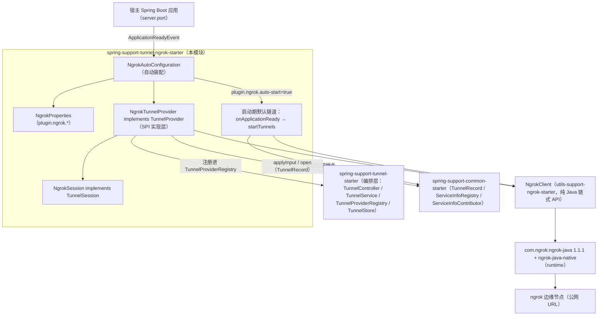
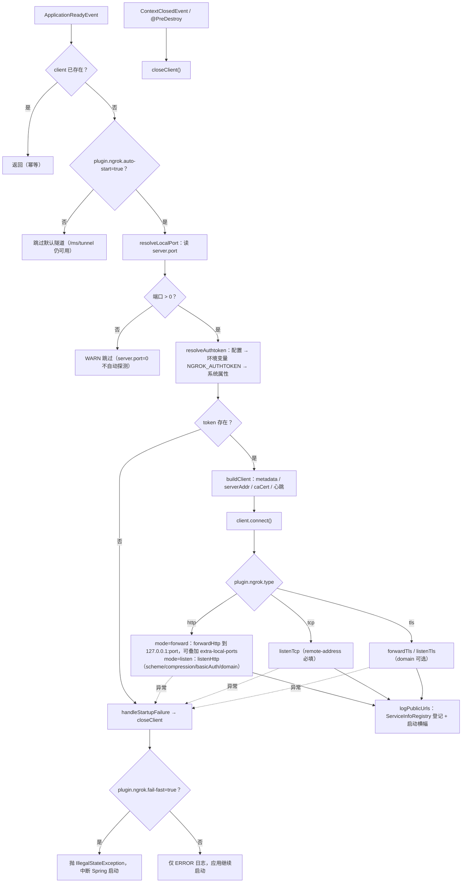

# spring-support-tunnel-ngrok-starter

基于官方 `com.ngrok:ngrok-java` Agent SDK（内嵌 Rust Agent）的 ngrok 内网穿透 starter：把本机 Spring 服务（`server.port`）自动暴露为公网 URL，无需独立 ngrok CLI。在 spring-support 体系中，它是「隧道」能力的 ngrok 平台实现层：向下复用 `utils-support-ngrok-starter` 的纯 Java 客户端，向上以 `TunnelProvider` SPI 接入 `spring-support-tunnel-starter` 的统一管理入口 `/ms/tunnel`。

## 1. 架构图



- **本模块只做 ngrok 特有的事**：自动装配、启动期默认隧道、`TunnelProvider` 的 ngrok 实现。
- **编排不归本模块**：REST 入口、持久化、SSE、启动恢复由 `spring-support-tunnel-starter` 提供，本模块不自带 Controller 与编排 Service。
- **客户端不归本模块**：`NgrokClient` 在 `utils-support-ngrok-starter`（零 Spring 依赖）。

## 2. 核心流程图

启动期自动隧道流程（`NgrokAutoConfiguration#onApplicationReady`，`@since 4.0.0.42`）：



按需创建隧道走 SPI 时序：`POST /ms/tunnel` → tunnel-starter `TunnelService` → `TunnelProviderRegistry.require("ngrok")` → `NgrokTunnelProvider#applyInput`（校验 mode/tcp/basicAuth）→ `#open(record)` 建客户端并返回 `NgrokSession`。

## 3. 能力清单

| 能力域 | 关键类 | 入口/触发方式 |
|:-------|:-------|:--------------|
| 自动配置与总开关 | `NgrokAutoConfiguration` | `META-INF/spring/...AutoConfiguration.imports` + `plugin.ngrok.enable` |
| 配置绑定 | `NgrokProperties` | `plugin.ngrok.*` |
| 启动期默认隧道 | `NgrokAutoConfiguration#onApplicationReady` | `ApplicationReadyEvent` |
| 统一入口提供方 | `NgrokTunnelProvider`（`@since 4.0.0.53`） | `/ms/tunnel`（由 tunnel-starter 的 `TunnelProviderRegistry` 收集） |
| 能力探测 | `NgrokTunnelProvider#capabilities` | `GET /ms/tunnel/providers` |
| 服务信息登记 | `ngrokServiceInfoContributor` | `ServiceInfoContributor` → `ServiceInfoRegistry` |
| 生命周期收尾 | `onContextClosed` / `@PreDestroy destroy` | `ContextClosedEvent` / 容器销毁 |

支持模式：`http` / `tcp` / `tls`（`supportedModes()` 返回同一套，`defaultMode()` 为 `http`）。http 支持 `forward`（转发本机端口）/ `listen`（仅暴露 URL）、BasicAuth、固定域名、响应压缩、多端口（`extra-local-ports`）、私有部署（`server-addr` + `ca-cert`）与心跳参数；`isAvailable()` 恒为 `true`（客户端是编译期依赖）。

## 4. Bean 能力矩阵

| Bean 名 | 类型 | 装配条件 | 可否覆盖 | 典型用途 |
|:--------|:-----|:---------|:---------|:---------|
| `ngrokAutoConfiguration` | `NgrokAutoConfiguration` | classpath 存在 `NgrokClient`（`@ConditionalOnClass`）且 `plugin.ngrok.enable=true`（缺省即开） | 否（自动配置类本身） | 事件驱动的启动期隧道与生命周期收尾 |
| `ngrokServiceInfoContributor` | `ServiceInfoContributor` | 随自动配置注册（无额外条件） | 可，但需同名 Bean + `spring.main.allow-bean-definition-overriding=true`，一般不必 | 向 `ServiceInfoRegistry` 登记 `ngrok` 能力标识 |
| `ngrokTunnelProvider` | `NgrokTunnelProvider`（实现 `TunnelProvider`） | `@ConditionalOnMissingBean`（按方法返回类型 `NgrokTunnelProvider` 判定）：容器无该类型 Bean 时注册 | **可以**：声明 `NgrokTunnelProvider` 或其子类 Bean 即可令默认 Bean 退位；声明其它 `TunnelProvider` 实现不会顶掉它，两者并存（`name()` 不可重复） | 按类型注入 `TunnelProvider`，或被 `TunnelProviderRegistry` 自动收集供 `/ms/tunnel` 使用 |
| `plugin.ngrok-com.chua.starter.ngrok.support.NgrokProperties` | `NgrokProperties` | `@EnableConfigurationProperties` 随自动配置注册 | 属性值可被任意配置源覆盖；Bean 本身一般不覆盖 | 构造器注入读取 `plugin.ngrok.*` |

说明：`ngrokTunnelProvider` 注册后还会被 tunnel-starter 的 `plugin.tunnel.providers` 白名单裁剪，被裁剪只影响 `/ms/tunnel` 暴露，不影响 Bean 存在；自定义提供方的 `name()` 不能再叫 `ngrok`（注册表对重名启动报错）。

## 5. 完整配置

配置前缀 `plugin.ngrok`（`NgrokProperties`，无嵌套类）。「生效范围」说明：全局=启动期与 SPI 两条链路都生效；启动期=仅 `auto-start` 默认隧道；SPI=仅 `/ms/tunnel` 按需映射。

| 配置路径 | 类型 | 默认值 | 说明 |
|:---------|:-----|:-------|:-----|
| `plugin.ngrok.enable` | `boolean` | `true` | 总开关，`false` 完全禁用自动配置 |
| `plugin.ngrok.authtoken` | `String` | 无 | 为空时回退环境变量/系统属性 `NGROK_AUTHTOKEN`；仍为空则隧道建立失败 |
| `plugin.ngrok.metadata` | `String` | 无 | 会话元数据，ngrok 控制台可见 |
| `plugin.ngrok.server-addr` | `String` | 无 | 私有部署服务端地址，如 `tunnel.example.com:443`（全局） |
| `plugin.ngrok.ca-cert` | `String` | 无 | 私有部署 CA 证书，classpath 资源路径，如 `classpath:ngrok-ca.crt`（全局） |
| `plugin.ngrok.heartbeat-interval` | `Duration` | ngrok 默认（30s） | 心跳间隔（全局） |
| `plugin.ngrok.heartbeat-tolerance` | `Duration` | ngrok 默认（60s） | 心跳容忍（全局） |
| `plugin.ngrok.type` | `String` | `http` | 隧道类型 `http`/`tcp`/`tls`（启动期；SPI 走映射记录的 `mode`） |
| `plugin.ngrok.mode` | `String` | `forward` | `forward` 转发本机端口 / `listen` 仅暴露 URL（启动期） |
| `plugin.ngrok.domain` | `String` | 无 | 固定域名，需 ngrok 面板预留（启动期；SPI 走映射记录的 `domain`） |
| `plugin.ngrok.subdomain` | `String` | 无 | 已下线能力：仅打印告警，不设置到 SDK |
| `plugin.ngrok.remote-address` | `String` | 无 | tcp 必填，如 `1.tcp.ngrok.io:20000`（启动期；SPI 走映射记录的 `remoteAddress`） |
| `plugin.ngrok.scheme` | `String` | `HTTPS` | 启动期 http 协议方案 `HTTP`/`HTTPS` |
| `plugin.ngrok.compression` | `boolean` | `false` | 启动期 http 响应压缩 |
| `plugin.ngrok.basic-auth` | `String` | 无 | `user:password`，与下面两个字段二选一，同时配置时优先（启动期；SPI 走映射记录的 `basicAuth`） |
| `plugin.ngrok.basic-auth-username` | `String` | 无 | BasicAuth 用户名（启动期） |
| `plugin.ngrok.basic-auth-password` | `String` | 无 | BasicAuth 密码（启动期） |
| `plugin.ngrok.fail-fast` | `boolean` | `false` | 启动期隧道失败（含 authtoken 缺失）是否中断应用 |
| `plugin.ngrok.extra-local-ports` | `String` | 无 | 额外本地端口，逗号分隔如 `8081,8082`（仅启动期 http + forward） |
| `plugin.ngrok.auto-start` | `boolean` | `true` | 启动期是否用 `server.port` 自动建默认隧道；`false` 时改由 `/ms/tunnel` 按需创建 |
| `plugin.ngrok.auto-start-stored` | `boolean` | `true` | 启动时是否恢复 `autoStart=true` 的持久化映射（SPI 启动恢复开关） |
| `plugin.ngrok.store-dir` | `String` | 无（缺省 `~/.chua/tunnel/ngrok`） | 映射持久化目录覆盖（一条映射一个 JSON 文件，不用数据库） |

### 5.1 逐项配置示例（按功能分组）

每项给出含义、默认值与 YAML 示例；键名用 kebab-case 规范形式（camelCase 也能被 Spring Boot 宽松绑定识别，建议统一 kebab-case）。

#### 开关与凭据

**`plugin.ngrok.enable`**
含义：总开关，`false` 时整个自动配置禁用（启动期隧道与 `/ms/tunnel` 的 ngrok 提供方都不装配）。默认：`true`。

```yaml
plugin:
  ngrok:
    enable: true
```

**`plugin.ngrok.authtoken`**
含义：ngrok authtoken。解析顺序：配置值 → 环境变量 `NGROK_AUTHTOKEN` → 系统属性 `NGROK_AUTHTOKEN`；全部为空时启动期隧道失败（默认仅 ERROR 日志不中断，见 `fail-fast`）。默认：无（启用隧道必填）。

```yaml
plugin:
  ngrok:
    authtoken: your-ngrok-authtoken   # 推荐 ${NGROK_AUTHTOKEN} 环境变量注入，不入 git
```

#### 会话与私有部署

**`plugin.ngrok.metadata`**
含义：会话元数据，ngrok 控制台可见；隧道级 metadata 会自动追加 `/http-<tag>` 等后缀。为空时隧道元数据使用内置基名 `spring-support-ngrok`。默认：无。

```yaml
plugin:
  ngrok:
    metadata: my-spring-service
```

**`plugin.ngrok.server-addr`**
含义：私有部署 ngrok 服务端地址，形如 `tunnel.example.com:443`；公有云不填。默认：无（连 ngrok 官方边缘节点）。

```yaml
plugin:
  ngrok:
    server-addr: tunnel.example.com:443
```

**`plugin.ngrok.ca-cert`**
含义：私有部署 CA 证书，Spring 资源路径（先按 classpath 读取，失败回退按文件路径读取）。默认：无。

```yaml
plugin:
  ngrok:
    ca-cert: classpath:ngrok-ca.crt
```

**`plugin.ngrok.heartbeat-interval`** / **`plugin.ngrok.heartbeat-tolerance`**
含义：会话心跳间隔与容忍时长；未配置（null）时不设置到客户端，使用 ngrok SDK 默认（约 30s / 60s）。弱网可适当调大。默认：无（SDK 默认）。

```yaml
plugin:
  ngrok:
    heartbeat-interval: 30s
    heartbeat-tolerance: 60s
```

#### 隧道形态（启动期默认隧道）

**`plugin.ngrok.type`**
含义：隧道类型 `http` / `tcp` / `tls`。SPI 按需映射走映射记录的 `mode`，本项只影响启动期默认隧道。默认：`http`。

```yaml
plugin:
  ngrok:
    type: http
```

**`plugin.ngrok.mode`**
含义：`forward` 把本机 `server.port` 流量转发出去；`listen` 仅建立并暴露公网 URL。默认：`forward`。

```yaml
plugin:
  ngrok:
    mode: forward
```

**`plugin.ngrok.domain`**
含义：固定域名（http/tls 生效），需先在 ngrok 面板预留；未配置时由 ngrok 分配随机域名。默认：无。

```yaml
plugin:
  ngrok:
    domain: example.ngrok-free.app
```

**`plugin.ngrok.subdomain`**
含义：已下线能力——配置后仅打印告警，不会设置到 SDK；请改用 `domain`。默认：无。

```yaml
plugin:
  ngrok:
    subdomain: my-sub   # 仅为兼容保留，实际不生效
```

**`plugin.ngrok.remote-address`**
含义：tcp 模式的远端地址（需在 ngrok 面板 reserve），形如 `1.tcp.ngrok.io:20000`；tcp 模式必填，缺失时启动期隧道失败。默认：无。

```yaml
plugin:
  ngrok:
    type: tcp
    remote-address: 1.tcp.ngrok.io:20000
```

**`plugin.ngrok.scheme`**
含义：http 模式协议方案 `HTTP` / `HTTPS`。默认：`HTTPS`。

```yaml
plugin:
  ngrok:
    scheme: HTTPS
```

**`plugin.ngrok.compression`**
含义：是否启用 HTTP 响应压缩。默认：`false`。

```yaml
plugin:
  ngrok:
    compression: true
```

#### HTTP 访问控制（BasicAuth）

**`plugin.ngrok.basic-auth`**
含义：BasicAuth 凭据，格式 `user:password`；与下面两个字段二选一，同时配置时本项优先。默认：无。

```yaml
plugin:
  ngrok:
    basic-auth: "your-username:your-password"
```

**`plugin.ngrok.basic-auth-username`** / **`plugin.ngrok.basic-auth-password`**
含义：BasicAuth 用户名/密码，拆开配置时使用；密码需 8~128 位（ngrok 限制）。默认：无。

```yaml
plugin:
  ngrok:
    basic-auth-username: your-username
    basic-auth-password: your-password
```

#### 启动行为与容错

**`plugin.ngrok.fail-fast`**
含义：启动期隧道失败（含 authtoken 缺失）是否中断应用：`true` 抛异常终止启动；`false` 仅 ERROR 日志后继续启动。默认：`false`。

```yaml
plugin:
  ngrok:
    fail-fast: false
```

**`plugin.ngrok.extra-local-ports`**
含义：额外本地端口，逗号分隔；非空时为这些端口再各建一条 http 转发隧道（仅启动期 http + forward 生效），非法端口告警跳过。默认：无（只转发 `server.port`）。

```yaml
plugin:
  ngrok:
    extra-local-ports: 8081,8082
```

**`plugin.ngrok.auto-start`**
含义：启动期是否用 `server.port` 自动建默认隧道；`false` 时模块仍启用，改由 `/ms/tunnel` 按需创建。默认：`true`。

```yaml
plugin:
  ngrok:
    auto-start: true
```

#### SPI 映射持久化

**`plugin.ngrok.auto-start-stored`**
含义：启动时是否恢复上次标记为「自动启动」的持久化映射（SPI 启动恢复开关）。默认：`true`。

```yaml
plugin:
  ngrok:
    auto-start-stored: true
```

**`plugin.ngrok.store-dir`**
含义：映射持久化目录覆盖（一条映射一个 JSON 文件，不用数据库）。为空时使用缺省目录 `~/.chua/tunnel/ngrok`。默认：无。

```yaml
plugin:
  ngrok:
    store-dir: /data/tunnel/ngrok
```

### 5.2 完整 YAML 示例

生产风格参考（token 走环境变量、固定域名 + BasicAuth、关闭启动期自动隧道改页面按需映射）：

```yaml
server:
  port: 8080

plugin:
  ngrok:
    enable: true
    authtoken: ${NGROK_AUTHTOKEN}            # 环境变量注入，不入 git
    metadata: order-service-prod             # ngrok 控制台可见
    auto-start: false                        # 启动期不自动建隧道
    auto-start-stored: true                  # 恢复上次标记自动启动的映射
    store-dir: /data/tunnel/ngrok            # 持久化目录（容器挂持久卷）
    fail-fast: true                          # 配置错误尽早暴露
    type: http
    mode: forward
    domain: order.example.ngrok-free.app     # 需在 ngrok 面板预留
    scheme: HTTPS
    compression: true
    basic-auth: "your-username:your-password"
    # extra-local-ports: 8081,8082           # 需要多端口时再打开
```

本地开发最小示例见 [6. 使用方式](#6-使用方式)。

### 5.3 生产注意事项

- **凭据管理**：authtoken 与 BasicAuth 口令一律用环境变量/启动参数注入，不写入配置文件入库、不进镜像；轮换 token 无需改代码。
- **最小暴露**：只暴露必要端口；`extra-local-ports` 会把更多本机服务带到公网，确认这些服务可被公网访问的风险后再开启。
- **访问控制**：公网入口至少固定域名 + BasicAuth；ngrok 要求 BasicAuth 密码 8~128 位。
- **管理面隔离**：`/ms/tunnel`、actuator 等管理端点不要经隧道暴露公网，或加独立鉴权/网络隔离。
- **失败策略**：生产建议 `fail-fast: true`，让配置错误在发布阶段暴露；本地开发可用默认 `false` 不阻塞启动。
- **随机端口**：`server.port: 0` 不会自动探测实际端口，启动期隧道会被跳过并告警。
- **持久化**：容器/无盘环境把 `store-dir` 指到持久卷，否则重启后持久化映射丢失。
- **私有部署**：`server-addr` 与 `ca-cert` 必须配套，证书用 classpath 或文件路径提供。
- **合规与限额**：ngrok 免费版有带宽/连接数限制；生产长期公网暴露建议改用正式网关/Ingress（参见第 7 节取舍）。

## 6. 使用方式

```xml
<dependency>
    <groupId>com.chua</groupId>
    <artifactId>spring-support-tunnel-ngrok-starter</artifactId>
    <version>4.0.0.51</version>
</dependency>
```

最小启用示例（token 走环境变量，不入 git）：

```yaml
server:
  port: 8080

plugin:
  ngrok:
    authtoken: ${NGROK_AUTHTOKEN}
```

启动标准 `@SpringBootApplication` 应用，就绪后自动打印公网 URL 横幅。要走「页面按需映射」而非自动隧道，加 `plugin.ngrok.auto-start=false`（可避免启动期与管理台各建一条隧道），然后用 `/ms/tunnel` 创建/启动映射。

依赖说明：

| 依赖 | scope | 缺了会怎样 |
|:-----|:------|:-----------|
| `spring-support-tunnel-starter` | 传递引入 | 无 `TunnelProvider` SPI 与 `/ms/tunnel` 统一入口 |
| `spring-support-common-starter` | 传递引入 | 无 `TunnelRecord`、服务信息登记 |
| `utils-support-ngrok-starter` | 传递引入 | `@ConditionalOnClass(NgrokClient)` 不成立，整个自动配置静默跳过 |
| `com.ngrok:ngrok-java` / `ngrok-java-native` | 传递引入 / runtime | SDK 主体与平台 native；native classifier 由 `os-maven-plugin`（1.7.1）按 `os.detected.classifier` 生成，不匹配会报 `UnsatisfiedLinkError` |
| `spring-boot-starter-web` | **optional** | 不引入时纯后台仍可 `auto-start` 建隧道，但 `/ms/tunnel` REST 管理接口不注册（需 Servlet Web 环境） |
| `spring-boot-configuration-processor` | **optional** | 仅影响 IDE 配置元数据提示 |
| `lombok` | provided | 仅编译期 |

统一入口端点（实现在 tunnel-starter 的 `TunnelController`，本模块提供 ngrok 提供方）：

```text
GET    /ms/tunnel/providers     提供方与能力（含 authtokenConfigured）
GET    /ms/tunnel               映射列表；GET /ms/tunnel/{id} 详情
POST   /ms/tunnel               创建映射（只保存不启动）
PUT    /ms/tunnel/{id}          修改映射
DELETE /ms/tunnel/{id}          删除映射
POST   /ms/tunnel/{id}/start    启动隧道
POST   /ms/tunnel/{id}/stop     停止隧道
GET    /ms/tunnel/stream        SSE 状态推送
```

## 7. 使用场景

适用：

- 本地开发需要公网回调：微信/钉钉回调、OAuth redirect、支付 notify_url；
- 给异地同事/测试临时演示本机服务；
- 多端口联调（`extra-local-ports` 一次暴露多个本机端口）；
- 已有 ngrok 账号与固定域名，需要稳定调试入口。

不适用/慎用：

- 生产环境长期公网暴露：应使用正式网关/Ingress，至少固定域名 + BasicAuth 并评估合规；
- 完全离线/严格内网环境（ngrok 必须连边缘节点）；
- 需要「免账号即用」的临时隧道（改选 cloudflared Quick Tunnel）。

与相邻模块的取舍：

| 模块 | 层次 | 何时选它 |
|:-----|:-----|:---------|
| `utils-support-ngrok-starter` | 通用客户端层 | 非 Spring 环境、完全自控客户端生命周期 |
| 本模块 | Spring 集成层 | Spring Boot 里要自动隧道 + 统一入口 |
| `spring-support-tunnel-starter` | 编排层 | REST 管理、持久化、SSE、多提供方共存（本模块已依赖它） |
| `spring-support-tunnel-cloudflared-starter` | 平级提供方 | 免账号 Quick Tunnel、Cloudflare 域名体系 |

ngrok 与 cloudflared 可同时引入，用 `plugin.tunnel.providers` 决定 `/ms/tunnel` 暴露哪个；ngrok 必须 authtoken、支持 `http`/`tcp`/`tls`，cloudflared 支持 `quick`/`named` 且免账号可用。

## 8. 扩展点

本模块**不定义新的 SPI**，本身是 tunnel-starter `TunnelProvider` SPI 的实现方。可扩展的点：

- **替换 ngrok 提供方**（最常用）：`ngrokTunnelProvider` 标注 `@ConditionalOnMissingBean`，按返回类型 `NgrokTunnelProvider` 判定——自行声明同类型（或其子类）Bean 即可覆盖默认注册；换成别的 `TunnelProvider` 实现不会顶掉它，只是并存，需要用 `plugin.tunnel.providers` 白名单决定 `/ms/tunnel` 暴露谁；
- **新增其它平台提供方**：实现 `TunnelProvider`（契约方法：`name` / `displayName` / `isAvailable` / `supportedModes` / `defaultMode` / `storeDir` / `autoStartStored` / `capabilities` / `applyInput` / `open`）并注册 Bean，由 `TunnelProviderRegistry` 自动收集；`name()` 须全局唯一，`ngrok` 已被本模块占用；
- **会话扩展**：`open()` 返回 `TunnelSession`（`publicUrls()` / `close()`），本模块内部实现是 `NgrokSession`；自定义提供方需返回自己的会话实现；
- **底层客户端直连**：`NgrokClient`（`utils-support-ngrok-starter`）是纯 Java 链式 API，可在任意非 Spring 代码中直接使用；本模块两条链路也都基于它；
- **服务信息登记**：`ngrokServiceInfoContributor` 只是向 `ServiceInfoRegistry` 登记能力标识的 `ServiceInfoContributor` Bean，宿主可再注册自己的 contributor 补充内容。

说明：`NgrokAutoConfiguration` 内部的 `ListenerHandle` 是 `private static final` 占位（保留内部结构），**不是**对外扩展点。

## 9. 常见问题

**Q1：引入依赖后没有任何隧道，也没看到 ngrok 日志？**
按顺序检查：① `plugin.ngrok.enable` 是否被设为 `false`；② classpath 是否真的有 `NgrokClient`（`utils-support-ngrok-starter` 被排除会导致 `@ConditionalOnClass` 不成立，整个自动配置静默跳过）；③ `plugin.ngrok.auto-start` 是否为 `false`（此时不建默认隧道，仅保留 `/ms/tunnel` 按需创建）。

**Q2：`/ms/tunnel` 返回 404？**
统一接口由 tunnel-starter 的 `TunnelController` 在 **Servlet Web 环境**注册：需引入 `spring-boot-starter-web`（本模块中为 optional，不会传递）且应用是 Web 应用；另外确认 `plugin.tunnel.enable` 未被关闭。

**Q3：启动报「authtoken 未配置」或隧道失败？**
凭据解析优先级：映射记录（仅 SPI 路径）→ `plugin.ngrok.authtoken` → 环境变量 `NGROK_AUTHTOKEN` → 系统属性 `NGROK_AUTHTOKEN`。默认 `fail-fast=false` 时失败只打 ERROR 日志（`[Ngrok] 隧道启动失败: ...`），应用照常启动；要强制中断启动需显式 `plugin.ngrok.fail-fast=true`。

**Q4：与 Spring Boot 4 的兼容性？**
本模块随父 pom `spring-support-parent-starter`（Spring Boot 4.1.2）构建：注册文件是 Boot 3+ 风格的 `META-INF/spring/org.springframework.boot.autoconfigure.AutoConfiguration.imports`（本模块**没有** `spring.factories`，Boot 4 不再读取它）；隧道建立监听 `ApplicationReadyEvent`（`WebServerInitializedEvent` 在 Boot 4.x 已移除）；使用 `jakarta.*` 命名空间。
