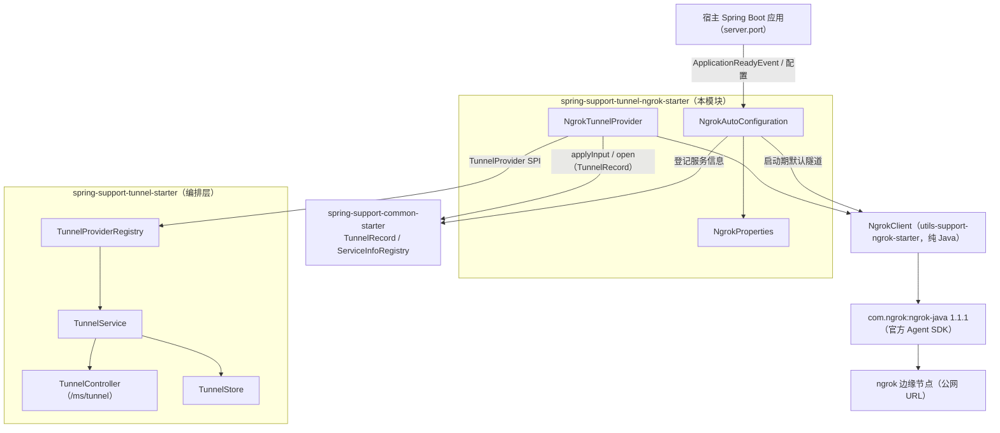
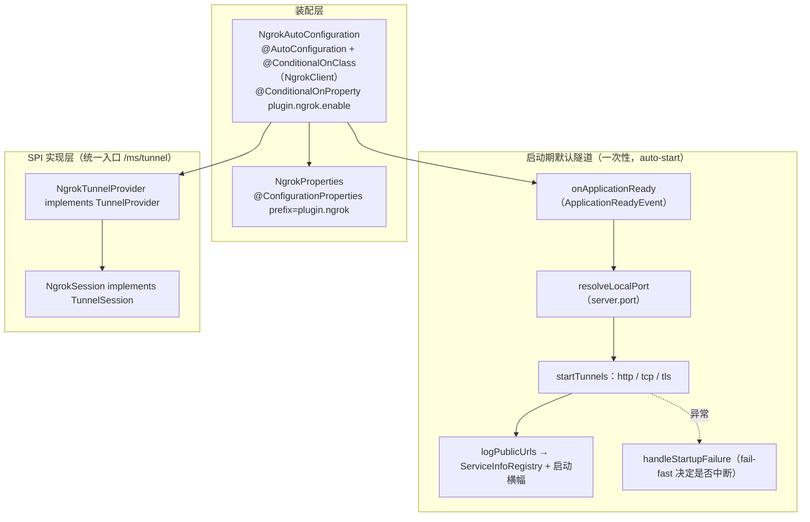
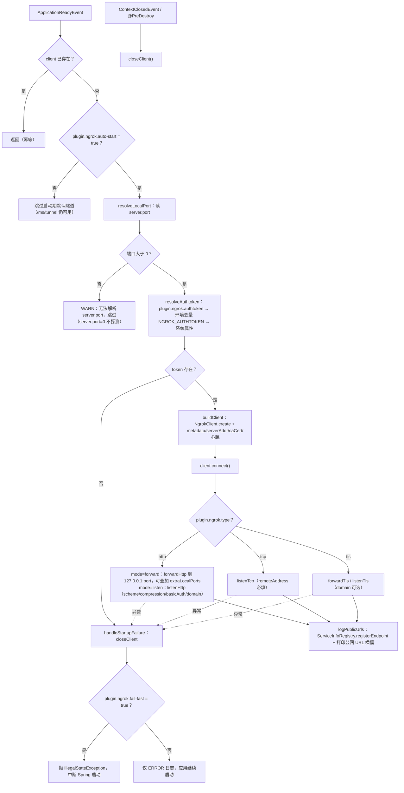
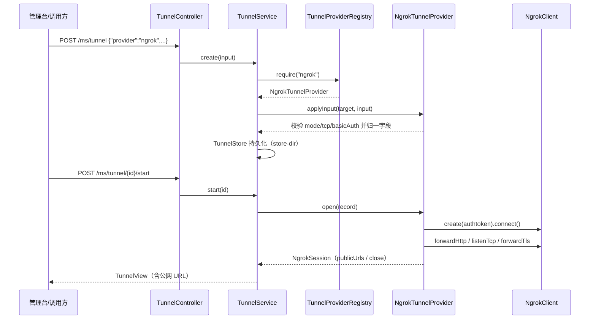

# spring-support-tunnel-ngrok-starter

基于官方 `ngrok-java` Agent SDK（内嵌 Rust Agent）的 ngrok 内网穿透 starter：把本机
Spring 服务（`server.port`）自动暴露为公网 URL，**不需要启动独立的 ngrok CLI**。

- 坐标：`com.chua:spring-support-tunnel-ngrok-starter:4.0.0.51`（父 pom `spring-support-parent-starter`，Spring Boot `4.1.2`）
- 自动配置：`com.chua.starter.ngrok.support.NgrokAutoConfiguration`（`@since 4.0.0.42`）
- 统一入口提供方：`com.chua.starter.ngrok.support.NgrokTunnelProvider`（`@since 4.0.0.53`）
- 隧道类型：`http` / `tcp` / `tls`

## 1. 架构图

### 1.1 模块在体系中的位置



- **本模块只做 ngrok 特有的事**：装配、启动期默认隧道、`TunnelProvider` 的 ngrok 实现。
- **编排不归本模块**：REST 入口、持久化、SSE、启动恢复都由 `spring-support-tunnel-starter` 提供；
  本模块不自带 Controller 与编排 Service。
- **客户端不归本模块**：`NgrokClient` 在 `utils-support-ngrok-starter`（纯 Java、零 Spring）。

### 1.2 模块内部分层



## 2. 核心流程图

### 2.1 启动期自动隧道流程（`NgrokAutoConfiguration`）



### 2.2 按需创建/启动隧道时序（`TunnelProvider` SPI，入口在 tunnel-starter）



> 启动恢复：tunnel-starter 的 `TunnelService#restoreAutoStart`（`@EventListener(ApplicationReadyEvent)`）
> 在应用就绪时恢复 `autoStart=true` 的持久化映射，是否恢复由本模块
> `NgrokTunnelProvider#autoStartStored()`（读 `plugin.ngrok.auto-start-stored`）决定。

## 3. 能力清单

| 能力域 | 关键类 | 入口 |
|:-------|:-------|:-----|
| 自动配置与总开关 | `NgrokAutoConfiguration` | `META-INF/spring/...AutoConfiguration.imports` + `plugin.ngrok.enable` |
| 配置绑定 | `NgrokProperties` | `plugin.ngrok.*` |
| 启动期默认隧道 | `NgrokAutoConfiguration#onApplicationReady` | `ApplicationReadyEvent` |
| 统一入口提供方 | `NgrokTunnelProvider` | `/ms/tunnel`（由 tunnel-starter 装配） |
| 能力探测 | `NgrokTunnelProvider#capabilities` | `GET /ms/tunnel/providers` |
| 服务信息登记 | `ngrokServiceInfoContributor` | 控制台「模块能力」（`ServiceInfoRegistry`） |
| 生命周期收尾 | `NgrokAutoConfiguration#onContextClosed` / `#destroy` | `ContextClosedEvent` / `@PreDestroy` |

支持的模式与能力：

- 隧道类型：`http` / `tcp` / `tls`（`TunnelProvider#supportedModes()` 返回同一套）；
- HTTP 转发：`forward`（转发到本机端口）/ `listen`（仅暴露 URL，启动期路径）；
- HTTP BasicAuth、固定域名、私有部署（`server-addr` + CA 证书）、心跳参数；
- 多端口同时暴露：`extra-local-ports`（仅启动期 http 类型生效）；
- 失败容错：`fail-fast` 控制启动期隧道失败是否中断 Spring 启动。

## 4. Bean 能力矩阵

| Bean 名 | 类型 | 装配条件 | 可否覆盖 | 典型注入姿势 |
|:--------|:-----|:---------|:---------|:-------------|
| `ngrokAutoConfiguration` | `NgrokAutoConfiguration` | 类路径存在 `NgrokClient`（`@ConditionalOnClass`）且 `plugin.ngrok.enable=true`（缺省即开） | 否（自动配置类） | 无需注入；容器事件驱动 |
| `ngrokServiceInfoContributor` | `ServiceInfoContributor` | 随自动配置注册（无额外条件） | 可以，但需同名 Bean + `spring.main.allow-bean-definition-overriding=true`，一般不必 | 无需注入；自动向 `ServiceInfoRegistry` 登记 `ngrok` 能力标识 |
| `ngrokTunnelProvider` | `NgrokTunnelProvider`（实现 `TunnelProvider`） | `@ConditionalOnMissingBean`：容器无同类型 Bean 时注册 | **可以**：自定义 `TunnelProvider`/`NgrokTunnelProvider` Bean 即可令其退位（推荐方式） | 按类型注入 `TunnelProvider`；或由 tunnel-starter 的 `TunnelProviderRegistry` 自动收集 |
| `plugin.ngrok-com.chua.starter.ngrok.support.NgrokProperties` | `NgrokProperties` | `@EnableConfigurationProperties` 随自动配置注册 | 属性值可被任意配置源覆盖；Bean 本身一般不覆盖 | 构造器注入 `NgrokProperties` |

说明：

- `ngrokTunnelProvider` 被 tunnel-starter 的 `TunnelProviderRegistry` 收集后，
  还会经 `plugin.tunnel.providers` 白名单裁剪；被裁剪只影响 `/ms/tunnel` 暴露，不影响 Bean 存在。
- 自定义提供方的 `name()` 不能再叫 `ngrok`（注册表对重名直接启动报错）。

## 5. 完整配置

配置前缀：`plugin.ngrok`（`NgrokProperties`，「生效范围」列标注该字段在哪条链路生效）。

| 配置路径 | 类型 | 默认值 | 说明 | 生效范围 |
|:---------|:-----|:-------|:-----|:---------|
| `plugin.ngrok.enable` | `boolean` | `true` | 总开关，`false` 完全禁用自动配置 | 自动装配开关 |
| `plugin.ngrok.authtoken` | `String` | 无 | 为空时回退环境变量 / 系统属性 `NGROK_AUTHTOKEN`；仍为空则隧道建立失败 | 启动期 + SPI 兜底 |
| `plugin.ngrok.metadata` | `String` | 无 | 会话元数据，ngrok 控制台可见 | 全局 |
| `plugin.ngrok.server-addr` | `String` | 无 | 私有部署服务端地址，如 `tunnel.example.com:443` | 全局 |
| `plugin.ngrok.ca-cert` | `String` | 无 | 私有部署 CA 证书，classpath 资源路径，如 `classpath:ngrok-ca.crt` | 全局 |
| `plugin.ngrok.heartbeat-interval` | `Duration` | ngrok 默认（30s） | 心跳间隔 | 全局 |
| `plugin.ngrok.heartbeat-tolerance` | `Duration` | ngrok 默认（60s） | 心跳容忍 | 全局 |
| `plugin.ngrok.type` | `String` | `http` | 隧道类型：`http` / `tcp` / `tls` | 仅启动期 |
| `plugin.ngrok.mode` | `String` | `forward` | `forward` 自动转发到本机端口 / `listen` 仅暴露 URL | 仅启动期 |
| `plugin.ngrok.domain` | `String` | 无 | 固定域名（需 ngrok 面板预留） | 仅启动期（SPI 走映射记录的 `domain`） |
| `plugin.ngrok.subdomain` | `String` | 无 | 已下线能力：仅打印告警，不设置到 SDK | 仅启动期（无实效） |
| `plugin.ngrok.remote-address` | `String` | 无 | tcp 模式必填，如 `1.tcp.ngrok.io:20000`（需面板 reserve） | 仅启动期（SPI 走映射记录的 `remoteAddress`） |
| `plugin.ngrok.scheme` | `String` | `HTTPS` | 启动期 http 模式协议方案（`HTTP` / `HTTPS`） | 仅启动期 |
| `plugin.ngrok.compression` | `boolean` | `false` | 启动期 http 响应压缩 | 仅启动期 |
| `plugin.ngrok.basic-auth` | `String` | 无 | `user:password`，同时配置时优先于下面两个字段 | 仅启动期 |
| `plugin.ngrok.basic-auth-username` | `String` | 无 | BasicAuth 用户名 | 仅启动期 |
| `plugin.ngrok.basic-auth-password` | `String` | 无 | BasicAuth 密码 | 仅启动期 |
| `plugin.ngrok.fail-fast` | `boolean` | `false` | 启动期隧道失败是否中断应用（含 authtoken 缺失） | 仅启动期 |
| `plugin.ngrok.extra-local-ports` | `String` | 无 | 额外本地端口，逗号分隔，如 `8081,8082`（同时建 http 转发隧道） | 仅启动期 http + forward |
| `plugin.ngrok.auto-start` | `boolean` | `true` | 启动期是否用 `server.port` 自动建默认隧道；`false` 时改由 `/ms/tunnel` 按需创建 | 启动期开关 |
| `plugin.ngrok.auto-start-stored` | `boolean` | `true` | 启动时是否恢复 `autoStart=true` 的持久化映射 | SPI 启动恢复开关 |
| `plugin.ngrok.store-dir` | `String` | 无（缺省 `~/.chua/tunnel/ngrok`） | 映射持久化目录覆盖（一条映射一个 JSON 文件，不用数据库） | SPI 持久化 |

必填项速查：

| 场景 | 必填 |
|:-----|:-----|
| HTTP 转发（默认） | `authtoken` |
| HTTP 固定域名 | `authtoken` + `domain` |
| HTTP BasicAuth | `authtoken` + `basic-auth`（或 username + password） |
| TCP 隧道 | `authtoken` + `remote-address` |
| TLS 隧道 | `authtoken` + `domain` |
| 私有部署 | `authtoken` + `server-addr` + `ca-cert` |

## 6. 使用方式

**Maven 坐标**

```xml
<dependency>
    <groupId>com.chua</groupId>
    <artifactId>spring-support-tunnel-ngrok-starter</artifactId>
    <version>4.0.0.51</version>
</dependency>
```

**最小可运行示例**

第一步：引入依赖（见上）。

第二步：配置 authtoken（推荐环境变量，token 不入 git）：

```bash
# Linux / macOS
export NGROK_AUTHTOKEN=2abc...xyz

# Windows PowerShell
$env:NGROK_AUTHTOKEN="2abc...xyz"
```

```yaml
server:
  port: 8080

plugin:
  ngrok:
    authtoken: ${NGROK_AUTHTOKEN}
```

第三步：启动标准 Spring Boot 应用（`@SpringBootApplication`），就绪后自动打印公网地址：

```text
=========================================================
  Ngrok 隧道已建立，本机服务已暴露到公网
=========================================================
  🌐 https://xxxx-xxx-xxx-xxx.ngrok-free.app
=========================================================
```

**关键依赖与可选依赖**

| 依赖 | 必选？ | 作用 |
|:-----|:-------|:-----|
| `spring-support-tunnel-starter` | 传递引入 | `TunnelProvider` SPI 与统一入口 `/ms/tunnel` |
| `spring-support-common-starter` | 传递引入 | `TunnelRecord` 与服务信息登记 |
| `utils-support-ngrok-starter` | 传递引入 | 纯 Java 客户端 `NgrokClient`（链式 API） |
| `com.ngrok:ngrok-java:1.1.1` | 传递引入 | 官方 Agent SDK |
| `com.ngrok:ngrok-java-native:1.1.1`（runtime） | 传递引入 | 平台 native，classifier 由 `os-maven-plugin`（1.7.1）按 `os.detected.classifier` 生成，无需手工指定 |
| `spring-boot-starter-web`（optional） | 按需 | 仅 `/ms/tunnel` 管理接口需要；纯后台进程可不引入（`auto-start=true` 的启动期隧道仍可用） |
| `spring-boot-configuration-processor`（optional） | 按需 | 生成配置元数据（IDE 提示） |

**按需创建（统一入口，需要 web 环境）**

```java
// TunnelService 来自 spring-support-tunnel-starter；NgrokTunnelProvider 已由
// NgrokAutoConfiguration#ngrokTunnelProvider 注册为 Bean，无需手工 new。
private final TunnelService tunnelService;

public String expose() {
    TunnelRecord input = new TunnelRecord();
    input.setProvider("ngrok");
    input.setName("调试");
    input.setLocalPort(8080);
    input.setMode("http");              // http / tcp / tls
    input.setDomain("my-app.ngrok-free.app");
    TunnelView created = tunnelService.create(input);   // 只保存，不启动
    TunnelView running = tunnelService.start(created.getId());
    return running.getPublicUrls().get(0);
}

// 走 REST 更常见（TunnelController 实际端点）：
// GET    /ms/tunnel/providers        提供方与能力
// GET    /ms/tunnel                  映射列表
// POST   /ms/tunnel                  创建映射（只保存）
// PUT    /ms/tunnel/{id}             修改映射
// DELETE /ms/tunnel/{id}             删除映射
// POST   /ms/tunnel/{id}/start       启动隧道
// POST   /ms/tunnel/{id}/stop        停止隧道
// GET    /ms/tunnel/stream           SSE 状态推送
```

**底层客户端（属于 `utils-support-ngrok-starter`，链式 API，可脱离 Spring）**

```java
NgrokClient client = NgrokClient.create(authtoken)
        .metadata("my-spring-service")
        .heartbeatInterval(Duration.ofSeconds(30));
client.connect();
client.forwardHttp(client.http().domain("my-app.ngrok-free.app").builder(),
        new URL("http://127.0.0.1:8080"));
List<String> urls = client.getUrls();
client.close();
```

## 7. 使用场景

**适用**

- 本地开发需要公网回调：微信/钉钉/企业应用回调、OAuth redirect、支付验签notify_url；
- 给异地同事/测试临时演示本机服务；
- 多端口联调（`extra-local-ports` 一次暴露多个本机端口）；
- 已有 ngrok 账号与固定域名，需要稳定调试入口。

**不适用**

- 生产环境长期公网暴露：应使用正式网关/Ingress，或至少固定域名 + BasicAuth 并评估合规；
- 完全离线/严格内网环境（ngrok 需要连边缘节点）；
- 需要「免账号即用」的临时隧道（选 cloudflared Quick Tunnel）。

**与相邻模块的取舍**

| 模块 | 层次 | 何时选它 |
|:-----|:-----|:---------|
| `utils-support-ngrok-starter` | 通用客户端层 | 非 Spring 环境、或要完全自控客户端生命周期 |
| `spring-support-tunnel-ngrok-starter`（本模块） | Spring 集成层 | Spring Boot 里要自动隧道 + 统一入口 |
| `spring-support-tunnel-starter` | 编排层 | 想要 REST 管理、持久化、SSE、多提供方共存（本模块已依赖它） |
| `spring-support-tunnel-cloudflared-starter` | 平级提供方 | 免账号 Quick Tunnel、或已用 Cloudflare 域名体系 |

ngrok 与 cloudflared 的差异：

| 维度 | ngrok | cloudflared |
|:-----|:------|:------------|
| 运行形态 | 进程内 SDK（native 库） | 外部 `cloudflared` 子进程 |
| 是否要装二进制 | 否 | 是 |
| 免账号可用 | 否，必须 authtoken | 是，Quick Tunnel 免账号 |
| 支持模式 | `http` / `tcp` / `tls` | `quick` / `named` |
| 固定域名 | `domain`（需面板预留） | `hostname`（需账户 + CNAME） |

两者可同时引入，用 `plugin.tunnel.providers` 决定 `/ms/tunnel` 暴露哪个。

## 8. 扩展点

本模块**不定义新的 SPI**；它本身是 tunnel-starter `TunnelProvider` SPI 的实现方。可扩展的点：

1. **替换/新增提供方实现**（最常用）
   - `NgrokAutoConfiguration#ngrokTunnelProvider` 标注 `@ConditionalOnMissingBean`：
     自行声明一个 `TunnelProvider` Bean（或 `NgrokTunnelProvider` 子类 Bean）即可覆盖默认注册；
   - 新增其它厂商提供方：实现 `TunnelProvider` 并注册 Bean，由 `TunnelProviderRegistry` 自动收集；
     `name()` 必须全局唯一，`ngrok` 已被本模块占用；
   - `TunnelProvider` 契约方法：`name` / `displayName` / `isAvailable` / `supportedModes` /
     `defaultMode` / `storeDir` / `autoStartStored` / `capabilities` / `applyInput` / `open`。

2. **会话扩展**：`open()` 返回 `TunnelSession`（`publicUrls()` / `close()`）；本模块的内部实现是
   `NgrokSession`。自定义提供方需返回自己的会话实现。

3. **底层客户端直连**：`NgrokClient`（`utils-support-ngrok-starter`）是纯 Java 链式 API，
   可在任意非 Spring 代码里直接使用；本模块启动期与 SPI 两条链路也都基于它。

4. **服务信息登记**：`ngrokServiceInfoContributor` 只是向 `ServiceInfoRegistry` 登记能力标识的
   `ServiceInfoContributor` Bean；宿主可再注册自己的 contributor 补充登记内容。

5. 如实说明：`NgrokAutoConfiguration` 内部的 `ListenerHandle` 是 `private static final class`
   占位（保留扩展点的内部结构），**不是**对外扩展点。

## 9. 常见问题

**Q1：引入依赖后没有任何隧道，也没看到 ngrok 日志？**
按顺序检查：① `plugin.ngrok.enable` 是否被设为 `false`（或环境变量 `PLUGIN_NGROK_ENABLE=false`）；
② classpath 是否真的有 `NgrokClient`（`utils-support-ngrok-starter` 被排除会导致
`@ConditionalOnClass(NgrokClient.class)` 不成立，整个自动配置静默跳过）；
③ `plugin.ngrok.auto-start` 是否为 `false`（此时不建默认隧道，仅保留 `/ms/tunnel` 按需创建）。

**Q2：`/ms/tunnel` 返回 404？**
统一接口由 tunnel-starter 的 `TunnelController` 在 **Servlet Web 环境**注册：
需要引入 `spring-boot-starter-web`（本模块中为 optional，不会传递），且应用是 Web 应用；
另外确认 `plugin.tunnel.enable` 未被关闭。

**Q3：启动报「authtoken 未配置」？**
解析优先级：映射记录（仅 SPI 路径）→ `plugin.ngrok.authtoken` → 环境变量 `NGROK_AUTHTOKEN`
→ 系统属性 `NGROK_AUTHTOKEN`。注意：默认 `fail-fast=false` 时该失败只打 ERROR 日志
（`[Ngrok] 隧道启动失败: ...`），应用照常启动；要强制失败需显式 `plugin.ngrok.fail-fast=true`。

**Q4：`server.port=0`（随机端口）为什么没建隧道？**
`resolveLocalPort` 读到 `0` 时返回 -1，仅打印 WARN「无法解析本地 server.port，跳过隧道建立」，
**不会自动探测实际端口**。随机端口场景请显式配置端口，或改用 `/ms/tunnel` 在映射中指定 `localPort`。

**Q5：与 Spring Boot 4 的兼容性？**
本模块随父 pom `spring.boot.version=4.1.2` 构建，已按 Boot 4 适配：
注册文件是 Boot 3+ 风格的
`META-INF/spring/org.springframework.boot.autoconfigure.AutoConfiguration.imports`
（本模块**没有** `spring.factories`，Boot 4 不再读取它）；隧道建立监听
`ApplicationReadyEvent`，因为 `WebServerInitializedEvent` 在 Boot 4.x 已移除；
使用 `jakarta.*` 命名空间。pom `<description>` 中的「Spring Boot 3」是历史文案，以实际依赖为准。

**Q6：配置了 `subdomain` 为什么不生效？**
新版 ngrok 套餐已下线该能力。代码只会打印告警
「subdomain 字段已在新版 ngrok 套餐下线，请改用 domain」，不会设置到 SDK；请改用 `domain`。

**Q7：为什么出现两条隧道 / 端口被重复映射？**
`auto-start=true`（默认）会在启动期用 `server.port` 建一条默认隧道；若同时又通过管理台
`/ms/tunnel` 创建映射，会各建一条。使用管理台部署时建议设 `plugin.ngrok.auto-start=false`。

**Q8：报 `UnsatisfiedLinkError: no ngrok-java-native-<os>`？**
native 分类器不匹配。确认构建时父 pom 的 `kr.motd.maven:os-maven-plugin` 生效，
`ngrok-java-native` 的 `${os.detected.classifier}` 能选到对应平台 jar。

**Q9：tcp / tls 模式的必填项？**
tcp 模式只接受已在 ngrok 面板 reserve 的 `remote-address`（形如 `1.tcp.ngrok.io:20000`）；
tls 模式必须有 `domain`。SPI 路径下 tcp 缺 `remoteAddress` 会在 `applyInput` 阶段直接被拦下。

**Q10：BasicAuth 安全吗？**
`basic-auth` 是明文格式 `user:password`，且会随映射写入 `<store-dir>/<id>.json`，
注意持久化目录权限；HTTP BasicAuth 本身也不加密传输，建议配合 HTTPS 域名使用。

**Q11：如何判断凭据是否已配置？**
`NgrokTunnelProvider#isAvailable()` 恒为 `true`（客户端是编译期依赖），**不代表**凭据已配置；
请看 `GET /ms/tunnel/providers` 返回的 `capabilities.authtokenConfigured`。

**Q12：公网连接被拒绝？**
先确认本机服务已启动、`server.port`（或映射的 `localPort`）与实际监听端口一致；
forward 模式目标是 `http://127.0.0.1:<port>`，只支持本机回环转发。
