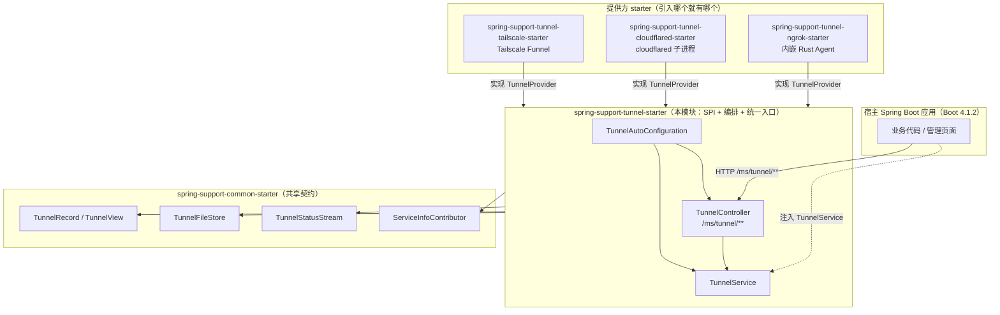
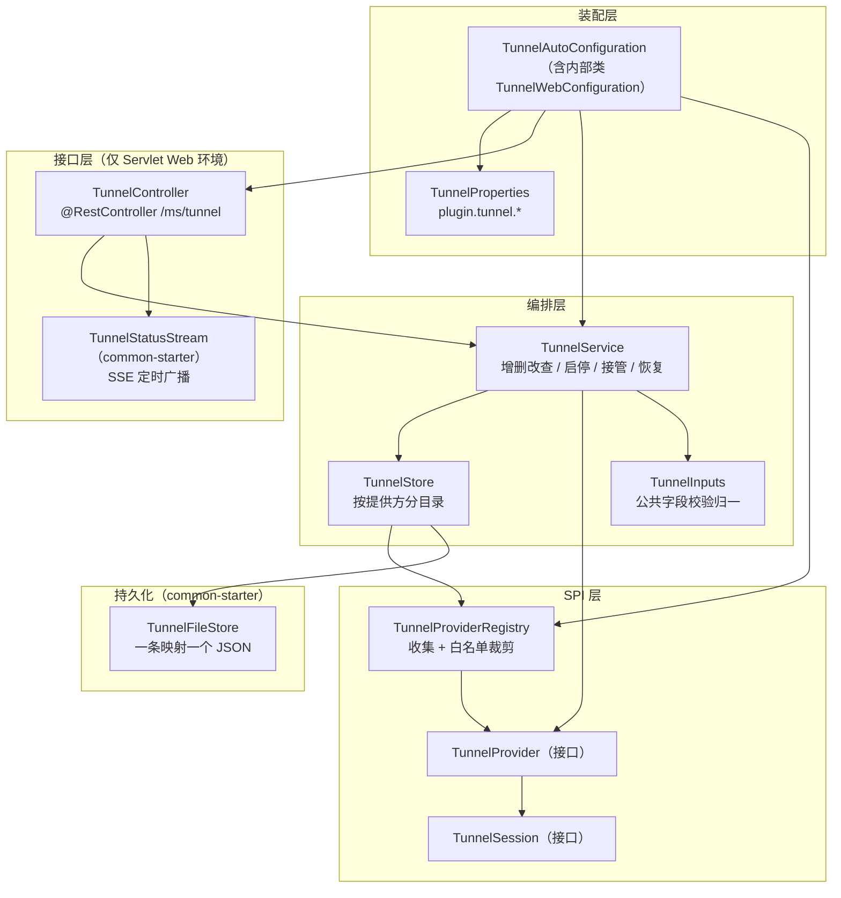
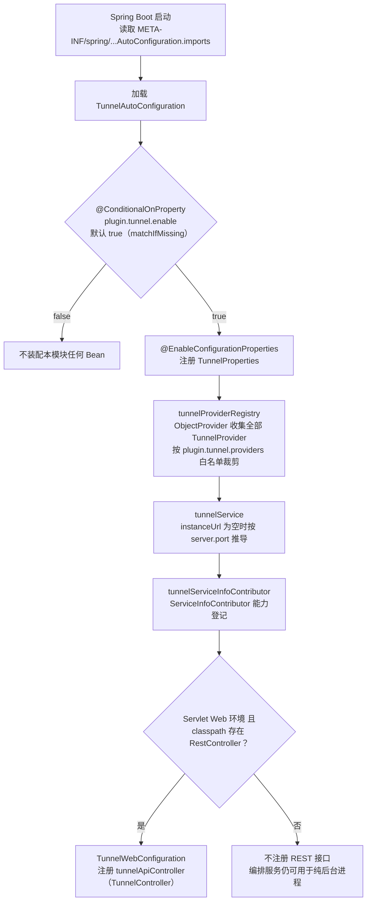
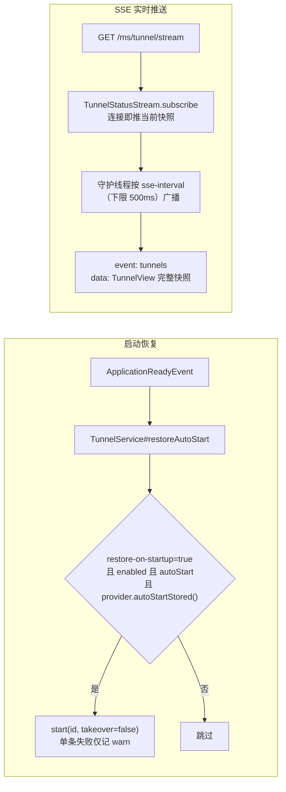

# spring-support-tunnel-starter

内网穿透统一入口：把 ngrok、Cloudflare Tunnel、Tailscale Funnel 等提供方的差异折叠成一套 `TunnelProvider` SPI，REST 接口、映射持久化、启动恢复与 SSE 推送只保留一份。本模块**不含任何厂商客户端**，引入哪个提供方 starter 就具备哪个能力。

- 基线：Spring Boot **4.1.2**（`spring-boot-starter-parent`，Jakarta 命名空间，`@AutoConfiguration` + `AutoConfiguration.imports` 装配）
- 版本：`4.0.0.51`（跟随仓库父 POM）
- 统一入口：`/ms/tunnel/**`（Servlet Web 环境下自动注册）

---

## 1. 架构图

### 1.1 模块在体系中的位置



依赖方向：`宿主应用 → 本模块 ← 各提供方 starter`；本模块向下依赖 `spring-support-common-starter` 与 `spring-boot-starter`（`spring-boot-starter-web` 为 optional）。

### 1.2 内部分层



- **装配层**：`TunnelAutoConfiguration` 按 `plugin.tunnel.enable` 决定是否装配；Web 相关 Bean 收敛在内部类 `TunnelWebConfiguration`。
- **编排层**：`TunnelService` 是唯一业务入口，运行态（会话、启动时间、错误）只存内存；`TunnelStore` 负责落盘。
- **SPI 层**：`TunnelProviderRegistry` 从容器收集全部 `TunnelProvider` 并按名称索引。

---

## 2. 核心流程图

### 2.1 自动装配流程



### 2.2 请求处理流程（创建 + 启动一条映射）

```mermaid
sequenceDiagram
    participant Page as 页面 / 业务代码
    participant C as TunnelController
    participant S as TunnelService
    participant I as TunnelInputs
    participant P as TunnelProvider 实现
    participant St as TunnelStore
    participant F as TunnelFileStore

    Page->>C: POST /ms/tunnel（TunnelRecord）
    C->>S: create(input)
    S->>S: resolveCreateProvider<br/>仅一个实现时自动选中，多实现必须显式传 provider
    S->>I: requirePort（1-65535）
    S->>P: applyInput(target, input)<br/>校验模式与专属字段
    S->>St: save(record)
    St->>F: 写 &lt;store-dir&gt;/&lt;provider&gt;/&lt;id&gt;.json
    S-->>C: TunnelView（未运行）
    C-->>Page: ReturnResult&lt;TunnelView&gt;

    Page->>C: POST /ms/tunnel/{id}/start
    C->>S: start(id)
    S->>S: acquireLock 文件锁（&lt;id&gt;.lock）<br/>被其他实例占用时先请求对方停止再接管
    S->>S: record.setOwner(selfBaseUrl) 并落盘
    S->>P: open(record)
    P-->>S: TunnelSession（publicUrls）
    S->>S: sessions/startedAt 记录运行态
    S-->>C: TunnelView（running=true）
    C-->>Page: ReturnResult&lt;TunnelView&gt;
```

### 2.3 启动恢复与 SSE 数据流



---

## 3. 能力清单

| 能力域 | 关键类 | 入口 |
|:-------|:-------|:-----|
| 提供方契约（SPI） | `TunnelProvider` / `TunnelSession` | 实现类声明为 Spring Bean 即被 `TunnelProviderRegistry` 收集 |
| 提供方注册与白名单 | `TunnelProviderRegistry` | `TunnelAutoConfiguration#tunnelProviderRegistry` |
| 映射编排（增删改查/启停/接管） | `TunnelService` | `/ms/tunnel/**`、`TunnelService` 直接注入 |
| 映射持久化台账 | `TunnelStore`（底层 common-starter `TunnelFileStore`） | `<store-dir>/<provider>/<id>.json` |
| 统一 REST 接口 | `TunnelController` | `/ms/tunnel`（仅 Servlet Web 环境装配） |
| SSE 实时状态 | `TunnelStatusStream`（common-starter） | `GET /ms/tunnel/stream` |
| 启动自动恢复 | `TunnelService#restoreAutoStart` | `ApplicationReadyEvent` |
| 多实例所有权与接管 | `TunnelService`（文件锁 + `owner` 字段） | 启动/停止时自动协商 |
| 公共字段校验与归一 | `TunnelInputs` | 供各 `TunnelProvider#applyInput` 复用 |
| 服务信息登记 | `TunnelAutoConfiguration#tunnelServiceInfoContributor` | `ServiceInfoContributor`（控制台「模块能力」可见） |

设计要点：

- 映射 id 为服务端生成的 UUID，全局唯一，不带 provider 前缀，一个 id 走通全部接口；
- 运行态（会话、启动时间、最近错误）只存内存，不落盘，避免把过期公网地址当成事实；唯一落盘的运行态是 `owner`（所有权标记）；
- 新增提供方只需实现 `TunnelProvider` 并注册为 Bean，控制器与页面不需要改动；
- 本模块自身不会建立任何隧道，未引入提供方时注册表为空、启动不失败。

---

## 4. Bean 能力矩阵

| Bean 名 | 类型 | 装配条件 | 可否覆盖 | 典型注入姿势 |
|:--------|:-----|:---------|:---------|:-------------|
| `tunnelProviderRegistry` | `TunnelProviderRegistry` | 类级 `@ConditionalOnProperty(prefix="plugin.tunnel", name="enable", havingValue="true", matchIfMissing=true)`；方法级 `@ConditionalOnMissingBean` | 可覆盖（定义同类型 Bean 即替换） | 一般不直接注入；由 `TunnelService` / `TunnelStore` 内部持有，也可注入查询 `names()` / `describeAll()` |
| `tunnelService` | `TunnelService` | 同上类级开关；方法级 `@ConditionalOnMissingBean` | 可覆盖（定义同类型 Bean 即替换） | 构造器注入 `TunnelService`，调用 `create/start/stop/delete/list` |
| `tunnelServiceInfoContributor` | `ServiceInfoContributor`（common-starter 函数式接口） | 仅类级开关；方法**无** `@ConditionalOnMissingBean` | 不可通过缺省机制覆盖；自定义同类型 Bean 会与自动装配 Bean 并存，按类型注入需 `@Primary` 或按名区分 | 一般不注入；由宿主的服务信息端点消费，登记「tunnel：内网穿透」能力 |
| `tunnelApiController` | `TunnelController` | 内部类 `TunnelWebConfiguration`：`@ConditionalOnWebApplication(type=SERVLET)` 且 `@ConditionalOnClass(name="org.springframework.web.bind.annotation.RestController")` | 不可条件覆盖（无 `@ConditionalOnMissingBean`）。Bean 名刻意不用 `tunnelController`，避免与 server-starter 组件扫描的同名 `@RestController` 冲突 | 不建议注入；通过 HTTP `/ms/tunnel/**` 访问 |
| `tunnelProperties`（`@EnableConfigurationProperties`） | `TunnelProperties` | 类级开关成立时随自动配置注册 | 属性值可在配置文件覆盖；Bean 本身一般不替换 | 需要读取 `plugin.tunnel.*` 时构造器注入 |
| 业务方 `TunnelProvider` 实现 | `TunnelProvider` 实现类 | 业务方自行声明（`@Bean` / `@Component` / 独立 starter 自动配置） | ——（由 `ObjectProvider<TunnelProvider>` 全量收集） | 在提供方 starter 的自动配置中 `@Bean` 注册 |

覆盖示例（替换默认编排服务）：

```java
@Bean
public TunnelService tunnelService(TunnelProperties properties,
                                   TunnelProviderRegistry registry,
                                   Environment environment) {
    // 自定义 instanceUrl 推导或增加审计逻辑
    return new TunnelService(properties, registry, "http://10.0.0.5:8080");
}
```

---

## 5. 完整配置

配置前缀：`plugin.tunnel`（`com.chua.starter.tunnel.properties.TunnelProperties`，经 `@EnableConfigurationProperties` 注册）。

| 配置项（key） | 类型 | 默认值 | 说明 | 生效开关 |
|:--------------|:-----|:-------|:-----|:---------|
| `plugin.tunnel.enable` | `boolean` | `true`（未配置时 `matchIfMissing` 同样视为开启） | 总开关。`false` 时不注册 REST 接口与编排服务，也不恢复自动启动映射；各提供方 starter 自己的一次性隧道能力不受影响 | 自身即开关 |
| `plugin.tunnel.store-dir` | `String` | 未配置 → `~/.chua/tunnel`（`resolveStoreDir()` 取 `user.home/.chua/tunnel`） | 映射持久化根目录，每个提供方一个子目录；提供方可用 `TunnelProvider#storeDir()` 覆盖 | `enable=true` |
| `plugin.tunnel.providers` | `List<String>` | `[]`（空 = 容器里有几个暴露几个） | 对外暴露的提供方白名单（大小写不敏感），如 `[cloudflared]`；用于多实现共存时按环境裁剪 | `enable=true` |
| `plugin.tunnel.instance-url` | `String` | 未配置 → `http://127.0.0.1:{server.port}` 自动推导 | 本实例控制地址，用作隧道记录 `owner` 所有权标记；多实例共享同一映射目录时据此互相识别与接管。留空则所有权机制关闭（退化为单实例行为） | `enable=true` |
| `plugin.tunnel.restore-on-startup` | `boolean` | `true` | 应用就绪（`ApplicationReadyEvent`）时是否恢复 `autoStart=true` 且 `enabled` 的映射 | `enable=true` |
| `plugin.tunnel.sse-interval` | `Duration` | `1500ms` | SSE 快照推送间隔；`TunnelStatusStream` 内部有 500ms 下限 | `enable=true` 且为 Web 环境 |

配置元数据由 `spring-boot-configuration-processor`（optional 依赖）在编译期生成。

字段职责边界：本配置只管「入口开不开、映射存哪、暴露哪些提供方、实例怎么协作」；authtoken、二进制路径、域名等厂商细节仍在 `plugin.ngrok.*` / `plugin.cloudflared.*` 等提供方配置中。

白名单示例（生产只允许 cloudflared，即使 classpath 里有 ngrok 也不暴露）：

```yaml
plugin:
  tunnel:
    providers: [cloudflared]
```

多实例示例（两套后端共享同一映射目录，按 `owner` 互认与接管）：

```yaml
plugin:
  tunnel:
    instance-url: http://127.0.0.1:8082
```

持久化目录布局（一条映射一个 JSON，升级后历史文件无需搬迁）：

```
~/.chua/tunnel
├── ngrok
│   └── <id>.json
├── cloudflared
│   └── <id>.json
└── tailscale
    └── <id>.json
```

---

## 6. 使用方式

### 6.1 Maven 坐标

```xml
<dependency>
    <groupId>com.chua</groupId>
    <artifactId>spring-support-tunnel-starter</artifactId>
    <version>4.0.0.51</version>
</dependency>
```

依赖说明（来自本模块 `pom.xml`）：

| 依赖 | 作用 | 是否必选 |
|:-----|:-----|:---------|
| `spring-support-common-starter` | `TunnelRecord` / `TunnelView` / `TunnelFileStore` / `TunnelStatusStream` / `ServiceInfoContributor` | 必选 |
| `spring-boot-starter` | 自动配置与容器 | 必选 |
| `spring-boot-starter-web` | `TunnelController` 与 SSE（Servlet MVC） | optional；非 Web 应用可不引入，纯后台进程仍可用 `TunnelService` |
| `swagger-annotations` | 接口文档注解 | 必选 |
| `spring-boot-configuration-processor` | 配置元数据生成 | optional |
| `lombok` / `slf4j-api` | 编译期代码生成 / 日志门面 | provided / 必选 |

> 本模块自身不会建立任何隧道。必须额外引入至少一个提供方：
> `spring-support-tunnel-ngrok-starter`、`spring-support-tunnel-cloudflared-starter` 或 `spring-support-tunnel-tailscale-starter`。

### 6.2 最小可运行示例

**第一步：引入统一入口与一个提供方**

```xml
<dependency>
    <groupId>com.chua</groupId>
    <artifactId>spring-support-tunnel-starter</artifactId>
    <version>4.0.0.51</version>
</dependency>
<dependency>
    <groupId>com.chua</groupId>
    <artifactId>spring-support-tunnel-cloudflared-starter</artifactId>
    <version>4.0.0.51</version>
</dependency>
```

**第二步：确认入口开启（默认已开启，可省略）**

```yaml
plugin:
  tunnel:
    enable: true
```

**第三步：调用接口创建并启动映射**

```bash
curl -X POST http://127.0.0.1:8080/ms/tunnel \
  -H 'Content-Type: application/json' \
  -d '{"name":"本地调试","provider":"cloudflared","localPort":8080,"mode":"quick","autoStart":false}'

curl -X POST http://127.0.0.1:8080/ms/tunnel/<id>/start
curl http://127.0.0.1:8080/ms/tunnel
```

启动日志会打印已注册提供方：

```
[Tunnel] 注册提供方 cloudflared（CloudflaredTunnelProvider），可用=true
```

### 6.3 Java 注入示例

本模块**无链式 API**，`TunnelService` 的方法直接返回 `TunnelView` / `boolean`，按步骤调用：

```java
@Service
public class TunnelDemo {

    private final TunnelService tunnelService;

    public TunnelDemo(TunnelService tunnelService) {
        this.tunnelService = tunnelService;
    }

    public void expose() {
        // 1. 新建映射（不会自动启动）
        TunnelRecord input = new TunnelRecord();
        input.setName("本地调试");
        input.setProvider("cloudflared");
        input.setLocalPort(8080);
        input.setMode("quick");
        input.setEnabled(true);
        input.setAutoStart(true);
        TunnelView created = tunnelService.create(input);

        // 2. 启动（失败信息写入 error 字段并抛出 IllegalStateException）
        TunnelView running = tunnelService.start(created.getId());
        List<String> urls = running.getPublicUrls();

        // 3. 停止 / 删除
        tunnelService.stop(created.getId());
        tunnelService.delete(created.getId());
    }
}
```

单提供方部署下 `provider` 可省略（`resolveCreateProvider` 只有一个实现时自动选中）；
多实现时必须显式指定，否则抛 `请指定提供方（provider）：当前可选 [...]`。

### 6.4 REST 接口

| 方法 | 路径 | 说明 |
|:-----|:-----|:-----|
| GET | `/ms/tunnel/providers` | 提供方列表（能力、支持模式、可用性） |
| GET | `/ms/tunnel` | 映射列表（台账 + 运行状态），可接 `?provider=xxx` |
| GET | `/ms/tunnel/stream` | SSE 实时状态推送（事件名 `tunnels`） |
| GET | `/ms/tunnel/{id}` | 映射详情 |
| POST | `/ms/tunnel` | 新建映射（请求体 `TunnelRecord`） |
| PUT | `/ms/tunnel/{id}` | 更新映射（运行中先停止再重启） |
| DELETE | `/ms/tunnel/{id}` | 删除映射（运行中先停止） |
| POST | `/ms/tunnel/{id}/start` | 启动映射 |
| POST | `/ms/tunnel/{id}/stop` | 停止映射 |

SSE 推送连接时即推当前快照，之后按 `plugin.tunnel.sse-interval` 广播完整快照，页面断线自动重连：

```
event: tunnels
data: [{ "id": "...", "name": "测试映射", "localPort": 8080, "mode": "http",
         "running": true, "publicUrls": ["https://abc.ts.net"], "error": "" }]
```

### 6.5 请求体字段（`TunnelRecord`）

```json
{
  "name": "测试映射",
  "provider": "ngrok",
  "localPort": 8080,
  "mode": "http",
  "domain": "",
  "remoteAddress": "",
  "basicAuth": "",
  "authtoken": "",
  "token": "",
  "metadata": "",
  "enabled": true,
  "autoStart": true,
  "remark": ""
}
```

字段说明：`provider` 决定由哪个提供方承载；`mode` 取值见各提供方 `supportedModes()`（ngrok：`http/tcp/tls`；cloudflared：`quick/named`）；`authtoken` 仅 ngrok、`token` 仅 Cloudflare；`domain` / `remoteAddress` / `basicAuth` / `metadata` 按提供方可选；`id`、`owner`、`createdAt`、`updatedAt` 由服务端维护，提交时忽略。响应在 `TunnelRecord` 基础上叠加运行态：`running`、`publicUrls`、`error`、`startedAt`（`TunnelView`）。

---

## 7. 使用场景

### 7.1 适用

- 本地开发机把内网服务临时暴露给公网（联调回调、演示、微信/支付验签）；
- 内网部署的管理端需要固定入口，且希望页面统一管理多条映射的启停；
- 多提供方共存：classpath 同时有 ngrok 与 cloudflared，按环境用 `plugin.tunnel.providers` 裁剪；
- 多实例部署共享同一映射目录，需要「同一条隧道同一时刻只被一个实例运行」的所有权与接管能力；
- 纯后台进程（非 Web）也要跑穿透：不引 `spring-boot-starter-web`，直接注入 `TunnelService`。

### 7.2 不适用

- 需要生产级高可用入口：隧道依赖本地进程与提供方网络，断线即失效，应使用负载均衡 / 内网穿透网关类产品；
- 需要精细化鉴权与审计：本模块不提供鉴权，`/ms/tunnel/**` 的访问控制依赖宿主应用的安全链；
- 海量映射长连接：SSE 按固定间隔广播**完整快照**，不做增量 diff，映射很多时需自行评估带宽。

### 7.3 与相邻模块的取舍

| 模块 | 角色 | 依赖方向 | 需要外部进程 | 建立隧道的方式 |
|:-----|:-----|:---------|:-------------|:---------------|
| `spring-support-tunnel-starter`（本模块） | 编排 + SPI + 统一入口 | 被三个提供方依赖 | 否，自身不建隧道 | 只调用 `TunnelProvider#open` |
| `spring-support-tunnel-ngrok-starter` | ngrok 提供方 | 依赖本模块 + `utils-support-ngrok-starter` | 否，内嵌 Rust Agent（`ngrok-java-native`） | 进程内客户端会话 |
| `spring-support-tunnel-cloudflared-starter` | Cloudflare 提供方 | 依赖本模块 + `utils-support-cloudflared-starter` | 是，需要 `cloudflared` 二进制 | 每个映射一个子进程 |
| `spring-support-tunnel-tailscale-starter` | Tailscale 提供方 | 依赖本模块 | 视 Tailscale 运行环境而定 | Tailscale Funnel |

- 本机隧道与云隧道的差别在提供方内部消化，本模块只持有 `TunnelSession`，不关心是长连接还是子进程；
- 提供方可以同时存在，用 `plugin.tunnel.providers` 按环境裁剪；
- 提供方自己的「启动期一次性隧道」（如 `plugin.ngrok.auto-start`）与本模块的持久化映射是两条独立路径，互不影响；
- server-starter 另有 `/ms/server/host/{hostId}/tunnel` 端点集（按主机维度），与本模块 `/ms/tunnel/**` 是两套独立端点，可共存。

---

## 8. 扩展点

本模块对外暴露的 SPI 与自定义方法：

### 8.1 `TunnelProvider`（核心 SPI）

实现 → 注册为 Spring Bean → `TunnelProviderRegistry` 自动收集，三步生效：

| 方法 | 是否必须实现 | 说明 |
|:-----|:-------------|:-----|
| `name()` | 必须 | 提供方标识，全局唯一且稳定（写入 `TunnelRecord.provider`，也是存储子目录名） |
| `displayName()` | 可选（default 回退 `name()`） | 页面展示名称 |
| `isAvailable()` | 必须 | 当前环境是否具备执行条件（客户端 jar、外部可执行文件等）；与「凭据是否配置」区分 |
| `supportedModes()` | 必须 | 支持的隧道模式，用于页面模式下拉 |
| `defaultMode()` | 必须 | 新建映射默认模式，必须包含在 `supportedModes()` 中 |
| `storeDir()` | 可选（default `null`） | 覆盖本提供方的持久化目录，兼容历史 `plugin.ngrok.store-dir` 等配置；`null` 表示沿用 `<store-dir>/<name>` |
| `autoStartStored()` | 可选（default `true`） | 应用重启时是否恢复本提供方 `autoStart` 的映射 |
| `capabilities()` | 必须 | 能力探测信息（凭据是否配置、可执行文件路径等），直接回填给页面 |
| `applyInput(target, input)` | 必须 | 校验并归一页面提交字段；公共字段已由 `TunnelInputs#applyCommon` 处理，实现只管模式与专属字段 |
| `open(record)` | 必须 | 建立隧道，返回 `TunnelSession`；失败抛异常，消息即页面展示的失败原因 |

### 8.2 `TunnelSession`

`TunnelProvider#open` 的返回值，编排层只负责持有与关闭：

- `publicUrls()`：公网访问地址列表（可能多个，如 http/https），未知时返回空列表；
- `close()`：关闭隧道并释放资源；实现应幂等（重复调用不得抛异常），否则「先停止再重启」流程会中断。

### 8.3 `TunnelInputs`（实现方复用的校验工具）

- `requirePort(input)`：本地端口 1–65535 校验；
- `applyCommon(target, input, provider)`：端口、名称兜底（`provider-port`）、备注、`autoStart`/`enabled`、provider 回填；
- `requireMode(mode, allowed, provider)`：模式合法性校验；
- `requireBasicAuth(basicAuth)`：ngrok Basic 认证格式与密码长度（8–128 位，规避 `ERR_NGROK_360`）前置校验；
- `trimToNull` / `normalize`：空串归一。

### 8.4 Bean 级覆盖

- `tunnelProviderRegistry`、`tunnelService` 标注 `@ConditionalOnMissingBean`，定义同类型 Bean 即可替换默认实现；
- `TunnelController`、`tunnelServiceInfoContributor` 无缺省覆盖条件，扩展应优先走 SPI 而不是替换控制器。

SPI 扩展示例：

```java
public class MyTunnelProvider implements TunnelProvider {

    @Override
    public String name() {
        return "mytunnel";
    }

    @Override
    public String displayName() {
        return "My Tunnel";
    }

    @Override
    public boolean isAvailable() {
        return true;
    }

    @Override
    public List<String> supportedModes() {
        return List.of("http");
    }

    @Override
    public String defaultMode() {
        return "http";
    }

    @Override
    public Map<String, Object> capabilities() {
        return Map.of("provider", name());
    }

    @Override
    public void applyInput(TunnelRecord target, TunnelRecord input) {
        target.setMode(defaultMode());
        TunnelInputs.applyCommon(target, input, name());
    }

    @Override
    public TunnelSession open(TunnelRecord record) {
        return new MySession(record.getLocalPort());
    }
}
```

```java
@AutoConfiguration
public class MyTunnelAutoConfiguration {

    @Bean
    public MyTunnelProvider myTunnelProvider() {
        return new MyTunnelProvider();
    }
}
```

登记后由 `TunnelProviderRegistry` 自动收集。若配置了 `plugin.tunnel.providers`，
`name()` 必须出现在白名单里才会暴露；名称重复（大小写不敏感）会在启动时直接报错。

---

## 9. 常见问题

### 9.1 装配不生效

**引入后没有 `/ms/tunnel` 接口？**

- 检查是否为 Servlet Web 应用：`TunnelController` 仅在 `@ConditionalOnWebApplication(type=SERVLET)` 且 classpath 存在 `RestController` 时注册；纯后台进程只能注入 `TunnelService`；
- 检查 `plugin.tunnel.enable` 是否被改为 `false`；
- 确认依赖里真的引入了本模块（自动配置来自 `META-INF/spring/org.springframework.boot.autoconfigure.AutoConfiguration.imports`，仅声明了 `TunnelAutoConfiguration`，本模块无 `spring.factories`）。

**`GET /ms/tunnel/providers` 返回空列表？**

未引入任何 `TunnelProvider` 实现。本模块不因此启动失败（`ObjectProvider` 允许空集合，注册表为空仅打 warn），引入 `spring-support-tunnel-ngrok-starter` / `spring-support-tunnel-cloudflared-starter` / `spring-support-tunnel-tailscale-starter` 任一即可。

**自定义 `TunnelProvider` 没被收集？**

实现类必须是 Spring Bean（`@Component`、`@Bean` 或独立 starter 的自动配置），并确保其所在包能被组件扫描或已在 `AutoConfiguration.imports` 中登记。

**两个提供方 Bean 冲突 / 名称重复？**

`TunnelProviderRegistry` 对 `name()` 大小写不敏感判重，重复会在启动时抛 `IllegalStateException: TunnelProvider 名称重复`。保证提供方标识全局唯一。

### 9.2 端口 / 开关 / 运行行为

**`instance-url` 要配吗？**

一般不用。缺省按 `http://127.0.0.1:{server.port}` 推导；只有多实例共享同一映射目录（如本机 8082/8083 两套后端）时才需要显式配置，用于 `owner` 所有权识别与接管。

**SSE 推送间隔可以调到很低吗？**

`plugin.tunnel.sse-interval` 支持 `Duration`（如 `500ms`），但 `TunnelStatusStream` 内部下限 500ms；间隔过小只会增加空转成本，不会更实时（快照为全量广播）。

**更新映射时能换提供方吗？**

不能。`TunnelService#update` 强制沿用记录里的 `provider`，换提供方等价于新建一条映射再删旧的。

**应用重启后公网地址还在吗？**

运行态（会话、`startedAt`、`error`）只存内存，重启后归零；`enabled=true` 且 `autoStart=true` 的映射会在 `ApplicationReadyEvent` 时由 `restoreAutoStart` 重新拉起（`restore-on-startup=false` 可关闭）。启动恢复不接管其他实例正在运行的隧道，避免互相抢域名。

**启动时提示「隧道正被另一实例运行」？**

多实例所有权机制生效：文件锁（`<id>.lock`）被其他活实例持有。手动启动会先请求对方停止再接管（约 6s 等待窗口）；自动恢复则直接跳过。

**接口有鉴权吗？**

本模块不提供鉴权，`/ms/tunnel/**` 的访问控制依赖宿主应用的安全链（如网关、Spring Security）。

### 9.3 与 Spring Boot 4 兼容性

- 本模块随仓库父 POM 升级到 **Spring Boot 4.1.2**，使用 `@AutoConfiguration` + `META-INF/spring/org.springframework.boot.autoconfigure.AutoConfiguration.imports` 装配（Boot 2.7+ 标准机制，Boot 3/4 通用），无 `spring.factories`；
- 代码基于 Jakarta 命名空间（`jakarta.annotation.PreDestroy`），不能与 `javax.*` 旧栈混用；
- SSE 使用 `spring-webmvc` 的 `SseEmitter`，`spring-boot-starter-web` 为 optional：Web 应用引入即得 REST/SSE，非 Web 应用只装配编排服务；
- `@ConfigurationProperties` 绑定（`plugin.tunnel.*`）与 `spring-boot-configuration-processor` 元数据在 Boot 4 下行为不变。

### 9.4 常见报错速查

| 报错 | 原因 | 解决 |
|:-----|:-----|:-----|
| `[Tunnel] 未发现任何 TunnelProvider 实现` | classpath 无提供方 starter | 引入 `spring-support-tunnel-ngrok-starter` 或 `spring-support-tunnel-cloudflared-starter` 等 |
| `请指定提供方（provider）：当前可选 [...]` | POST 未传 `provider` 且容器内有多个实现 | 显式传 `provider`，或用 `plugin.tunnel.providers` 收敛为一个 |
| `未知的内网穿透提供方: xxx` | `provider` 拼写错误或已被白名单裁掉 | 先查 `GET /ms/tunnel/providers` 的 `name` 列表 |
| `TunnelProvider 名称重复: xxx` | 两个实现返回了同一个 `name()` | 保证提供方标识全局唯一 |
| `xxx 隧道启动失败: ...` | 提供方 `open` 抛出（凭据缺失、二进制不存在、域名被占用等） | 查看 `error` 字段与提供方自身配置（`plugin.ngrok.*` / `plugin.cloudflared.*`） |
