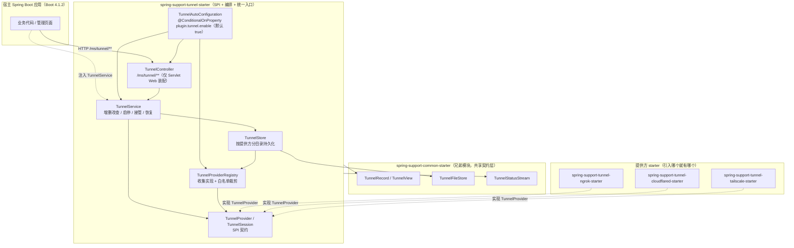
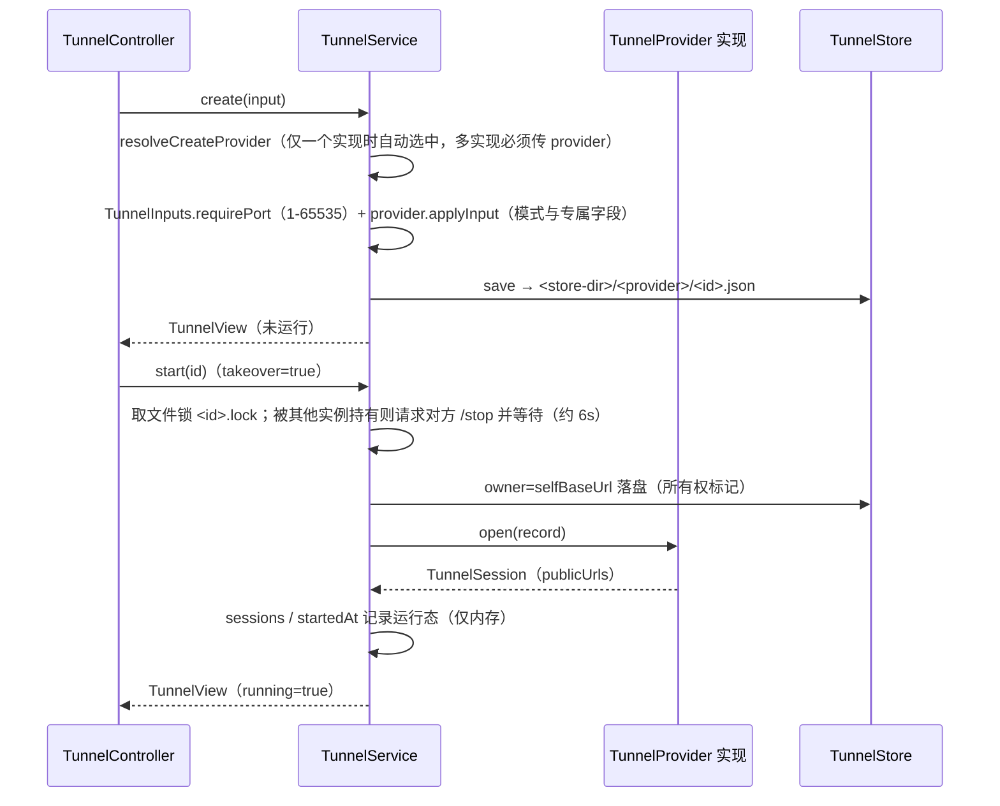

# spring-support-tunnel-starter

内网穿透统一入口：把 ngrok、Cloudflare Tunnel、Tailscale Funnel 等提供方的差异折叠成一套 `TunnelProvider` SPI，映射的增删改查、持久化、启动恢复、多实例接管与 SSE 推送只保留一份。本模块**不含任何厂商客户端**，自身不建立任何隧道——引入哪个提供方 starter（`spring-support-tunnel-ngrok-starter` / `spring-support-tunnel-cloudflared-starter` / `spring-support-tunnel-tailscale-starter`）就具备哪个能力。在 spring-support 体系中，它与 `QueueAutoConfiguration`、`SocketConfiguration` 同型：标准 starter = SPI 契约 + 编排服务 + 统一 REST 入口 `/ms/tunnel/**`。

- 基线：Spring Boot **4.1.2**（Jakarta 命名空间；`@AutoConfiguration` + `META-INF/spring/...AutoConfiguration.imports` 装配，无 `spring.factories`）
- 版本：`4.0.0.51`（跟随仓库父 POM `spring-support-parent-starter`）

## 1. 架构图



依赖方向：`宿主应用 → 本模块 ← 各提供方 starter`；本模块向下只依赖兄弟模块 `spring-support-common-starter` 与 `spring-boot-starter`（`spring-boot-starter-web` 为 optional）。装配层（`TunnelAutoConfiguration`）→ 编排/接口层（`TunnelService`、`TunnelController`、`TunnelStore`）→ SPI 层（`TunnelProviderRegistry`、`TunnelProvider`、`TunnelSession`）。

## 2. 核心流程图

以「创建一条映射并启动」为主线（启动恢复与 SSE 见图后注）：



> 启动恢复：`ApplicationReadyEvent` 触发 `TunnelService#restoreAutoStart()`，仅恢复 `enabled` 且 `autoStart` 且 `provider.autoStartStored()` 的映射，且以 `start(id, takeover=false)` 执行、不接管；SSE：`GET /ms/tunnel/stream` 订阅即推当前快照，守护线程按 `plugin.tunnel.sse-interval`（`TunnelStatusStream` 内部下限 500ms）广播事件 `tunnels`。

## 3. 能力清单

| 能力域 | 关键类 | 入口 / 触发方式 |
|:-------|:-------|:----------------|
| 提供方契约（SPI） | `TunnelProvider` / `TunnelSession` | 实现类声明为 Spring Bean 即被 `TunnelProviderRegistry` 收集 |
| 提供方注册与白名单 | `TunnelProviderRegistry` | `TunnelAutoConfiguration#tunnelProviderRegistry` |
| 映射编排（增删改查/启停/接管） | `TunnelService` | `/ms/tunnel/**` 或直接注入 `TunnelService` |
| 映射持久化台账 | `TunnelStore`（底层 common-starter `TunnelFileStore`） | `<store-dir>/<provider>/<id>.json`，一条映射一个 JSON |
| 统一 REST 接口 | `TunnelController` | `/ms/tunnel`（仅 Servlet Web 环境装配） |
| SSE 实时状态 | `TunnelStatusStream`（common-starter） | `GET /ms/tunnel/stream`，事件名 `tunnels` |
| 启动自动恢复 | `TunnelService#restoreAutoStart` | `@EventListener(ApplicationReadyEvent)` |
| 多实例所有权与接管 | `TunnelService`（文件锁 `<id>.lock` + `owner` 字段） | 启动/停止时自动协商 |
| 公共字段校验与归一 | `TunnelInputs` | 供各 `TunnelProvider#applyInput` 复用 |
| 服务信息登记 | `TunnelAutoConfiguration#tunnelServiceInfoContributor` | `ServiceInfoContributor`（控制台「模块能力」可见） |

设计要点：

- 映射 id 为服务端生成的 UUID，全局唯一、不带 provider 前缀，一个 id 走通全部接口；
- 运行态（会话、`startedAt`、`error`）只存内存不落盘，避免把过期公网地址当成事实；唯一落盘的运行态是 `owner`；
- 更新映射不可更换提供方：`TunnelService#update` 强制沿用记录的 `provider`，换提供方等价于新建一条再删旧的；
- 本模块自身不建隧道，未引入提供方时注册表为空、启动不失败（仅 warn）。

## 4. Bean 能力矩阵

| Bean 名 | 类型 | 装配条件（含默认值） | 可否覆盖 | 典型用途 |
|:--------|:-----|:---------------------|:---------|:---------|
| `tunnelProviderRegistry` | `TunnelProviderRegistry` | 类级 `@ConditionalOnProperty(prefix="plugin.tunnel", name="enable", havingValue="true", matchIfMissing=true)`；方法级 `@ConditionalOnMissingBean` | 可覆盖（定义同类型 Bean 即替换） | 一般不直接注入；可注入查询 `names()` / `describeAll()` |
| `tunnelService` | `TunnelService` | 同上类级开关；方法级 `@ConditionalOnMissingBean` | 可覆盖（定义同类型 Bean 即替换） | 构造器注入，调用 `create/start/stop/delete/list` |
| `tunnelServiceInfoContributor` | `ServiceInfoContributor`（common-starter 函数式接口） | 仅类级开关；方法**无** `@ConditionalOnMissingBean` | 不可缺省覆盖（自定义同类型 Bean 会与自动装配 Bean 并存） | 不直接注入；向控制台登记「tunnel：内网穿透」能力 |
| `tunnelApiController` | `TunnelController` | 内部类 `TunnelWebConfiguration`：`@ConditionalOnWebApplication(type=SERVLET)` 且 `@ConditionalOnClass(name="org.springframework.web.bind.annotation.RestController")` | 无 `@ConditionalOnMissingBean`；Bean 名刻意不用 `tunnelController`，避免与 server-starter 组件扫描的同名 `@RestController` 冲突 | 经 HTTP `/ms/tunnel/**` 访问，不建议注入 |
| `plugin.tunnel-com.chua.starter.tunnel.properties.TunnelProperties` | `TunnelProperties` | 类级开关成立时经 `@EnableConfigurationProperties` 注册（Bean 名按「前缀-全类名」生成，注入建议按类型） | 属性值可在配置文件覆盖；Bean 本身一般不替换 | 注入读取 `plugin.tunnel.*` |

业务方的 `TunnelProvider` 实现 Bean 由 `ObjectProvider<TunnelProvider>` 全量收集，不受上述缺省覆盖语义约束。

## 5. 完整配置

配置前缀 `plugin.tunnel`（`com.chua.starter.tunnel.properties.TunnelProperties`，无嵌套类）：

| 配置路径 | 类型 | 默认值 | 说明 |
|:---------|:-----|:-------|:-----|
| `plugin.tunnel.enable` | `boolean` | `true`（`matchIfMissing=true`，未配置同视为开启） | 总开关；`false` 时不注册 REST 与编排服务、不恢复自动启动；提供方 starter 自己的一次性隧道能力不受影响 |
| `plugin.tunnel.store-dir` | `String` | 未配置 → `~/.chua/tunnel`（`resolveStoreDir()` 取 `user.home/.chua/tunnel`） | 持久化根目录，每个提供方一个子目录；`TunnelProvider#storeDir()` 可覆盖单提供方目录 |
| `plugin.tunnel.providers` | `List<String>` | `[]`（空 = 容器里有几个暴露几个） | 对外暴露的提供方白名单（大小写不敏感），多实现共存时按环境裁剪 |
| `plugin.tunnel.instance-url` | `String` | 未配置 → `http://127.0.0.1:{server.port}`（端口缺省 8080） | 本实例控制地址，写入映射 `owner` 作所有权标记；多实例共享存储目录时据此互认与接管；留空时按 `server.port` 自动推导（自动装配下恒有值，不会因此关闭所有权） |
| `plugin.tunnel.restore-on-startup` | `boolean` | `true` | 应用就绪（`ApplicationReadyEvent`）时是否恢复 `autoStart=true` 且 `enabled` 的映射 |
| `plugin.tunnel.sse-interval` | `Duration` | `1500ms` | SSE 快照推送间隔；`TunnelStatusStream` 内部下限 500ms |

配置元数据由 optional 依赖 `spring-boot-configuration-processor` 在编译期生成。厂商细节（authtoken、二进制路径、域名等）不在本前缀内，见各提供方的 `plugin.ngrok.*` / `plugin.cloudflared.*` 配置。

## 6. 使用方式

Maven 坐标：

```xml
<dependency>
    <groupId>com.chua</groupId>
    <artifactId>spring-support-tunnel-starter</artifactId>
    <version>4.0.0.51</version>
</dependency>
```

最小启用示例（`enable` 默认即 `true` 可省略；必须再引入至少一个提供方 starter，否则无隧道能力）：

```yaml
plugin:
  tunnel:
    enable: true
    # providers: [cloudflared]   # 多实现共存时按环境裁剪
```

```bash
curl -X POST http://127.0.0.1:8080/ms/tunnel -H 'Content-Type: application/json' \
  -d '{"name":"本地调试","provider":"cloudflared","localPort":8080,"mode":"quick","autoStart":false}'
curl -X POST http://127.0.0.1:8080/ms/tunnel/<id>/start
curl http://127.0.0.1:8080/ms/tunnel
```

REST 端点（`TunnelController`，统一前缀 `/ms/tunnel`，响应统一为 `ReturnResult`）：

| 方法 | 路径 | 说明 |
|:-----|:-----|:-----|
| GET | `/ms/tunnel/providers` | 提供方列表（能力、支持模式、可用性） |
| GET | `/ms/tunnel?provider=xxx` | 映射列表（含运行态；不带参数为全部） |
| GET | `/ms/tunnel/stream` | SSE 实时状态推送（事件名 `tunnels`） |
| GET | `/ms/tunnel/{id}` | 映射详情 |
| POST | `/ms/tunnel` | 新建映射（请求体 `TunnelRecord`；单实现部署可省略 `provider`） |
| PUT | `/ms/tunnel/{id}` | 更新映射（不可换 provider；运行中先停止再重启） |
| DELETE | `/ms/tunnel/{id}` | 删除映射（运行中先停止） |
| POST | `/ms/tunnel/{id}/start` | 启动映射（必要时接管其他实例） |
| POST | `/ms/tunnel/{id}/stop` | 停止映射（含远端 owner 实例） |

依赖说明（来自本模块 `pom.xml`）：

| 依赖 | 作用 | 缺失影响 |
|:-----|:-----|:---------|
| `spring-support-common-starter` | `TunnelRecord` / `TunnelView` / `TunnelFileStore` / `TunnelStatusStream` / `ServiceInfoContributor` | 必选 |
| `spring-boot-starter` | 自动配置与容器 | 必选 |
| `spring-boot-starter-web` | REST 与 SSE（Servlet MVC 的 `SseEmitter`） | optional：缺了不注册控制器，纯后台进程仍可注入 `TunnelService` |
| `swagger-annotations` | 接口文档注解 | 必选 |
| `spring-boot-configuration-processor` | 配置元数据生成 | optional |
| `lombok` / `slf4j-api` | 编译期代码生成 / 日志门面 | provided / 必选 |

未引入任何提供方 starter 时：装配成功、`/ms/tunnel/providers` 返回空列表、启动日志 warn，不会失败。

## 7. 使用场景

适用：

- 本地开发机把内网服务临时暴露到公网（联调回调、演示、支付/微信验签）；
- 内网管理端需要固定入口，并希望在页面统一管理多条映射的启停；
- 多提供方共存：classpath 同时有多个实现，用 `plugin.tunnel.providers` 按环境裁剪；
- 多实例共享同一映射目录，需要「同一条隧道同一时刻只被一个实例运行」的所有权与接管能力。

不适用 / 慎用：

- 生产级高可用入口：隧道依赖本地进程与提供方网络，断线即失效，应使用负载均衡 / 内网穿透网关类产品；
- 需要精细化鉴权与审计：本模块不提供鉴权，`/ms/tunnel/**` 的访问控制依赖宿主应用的安全链（网关、Spring Security 等）。

与相邻模块的取舍：

| 模块 | 角色 | 与本模块关系 |
|:-----|:-----|:-------------|
| `spring-support-tunnel-ngrok-starter` | ngrok 提供方（内嵌 Rust Agent，进程内会话） | 依赖本模块，实现 `TunnelProvider` |
| `spring-support-tunnel-cloudflared-starter` | Cloudflare 提供方（每个映射一个 `cloudflared` 子进程） | 依赖本模块，实现 `TunnelProvider` |
| `spring-support-tunnel-tailscale-starter` | Tailscale Funnel 提供方 | 依赖本模块，实现 `TunnelProvider` |
| server-starter | `/ms/server/host/{hostId}/tunnel` 按主机维度的端点集 | 与本模块 `/ms/tunnel/**` 是两套独立端点，可共存 |

## 8. 扩展点

核心 SPI 是 `TunnelProvider`（`com.chua.starter.tunnel.spi`）。实现 → 注册为 Spring Bean（`@Component` / `@Bean` / 独立 starter 自动配置）→ `TunnelProviderRegistry` 自动收集，三步生效：

| 方法 | 是否必须 | 说明 |
|:-----|:---------|:-----|
| `name()` | 必须 | 全局唯一且稳定的标识；写入 `TunnelRecord.provider`，也是存储子目录名 |
| `displayName()` | 可选（default 回退 `name()`） | 页面展示名称 |
| `isAvailable()` | 必须 | 当前环境是否具备执行条件（客户端 jar、外部可执行文件等），与「凭据是否配置」区分 |
| `supportedModes()` / `defaultMode()` | 必须 | 支持的模式与新建默认模式（`defaultMode` 必须包含在 `supportedModes()` 中） |
| `storeDir()` | 可选（default `null`） | 覆盖本提供方存储目录，兼容 `plugin.ngrok.store-dir` 等历史配置；`null` 表示沿用 `<store-dir>/<name>` |
| `autoStartStored()` | 可选（default `true`） | 应用重启时是否恢复本提供方 `autoStart` 的映射 |
| `capabilities()` | 必须 | 能力探测信息（凭据是否配置、可执行文件路径等），直接回填页面 |
| `applyInput(target, input)` | 必须 | 校验并归一模式与专属字段；公共字段已由 `TunnelInputs#applyCommon` 处理 |
| `open(record)` | 必须 | 建立隧道返回 `TunnelSession`；失败抛异常，消息即页面展示的 `error` |

- `TunnelSession`（`TunnelProvider#open` 返回值）：`publicUrls()` 返回公网地址列表（未知返回空列表）；`close()` 必须幂等（重复调用不得抛异常），否则「先停止再重启」流程会中断。
- `TunnelInputs`（实现方复用的静态校验工具）：`requirePort`（1–65535）、`applyCommon`（端口、名称兜底 `provider-port`、备注、`autoStart`/`enabled`、provider 回填）、`requireMode`、`requireBasicAuth`（`user:password` 格式，密码 8–128 位，规避 `ERR_NGROK_360`）、`trimToNull` / `normalize`。
- Bean 级覆盖：`tunnelProviderRegistry`、`tunnelService` 标注 `@ConditionalOnMissingBean`，定义同类型 Bean 即可整体替换；`tunnelApiController` 与 `tunnelServiceInfoContributor` 无缺省覆盖条件，扩展应优先走 SPI 而不是替换控制器。

注册约束：配置了 `plugin.tunnel.providers` 时，`name()` 必须出现在白名单里才会暴露；`name()` 重复（大小写不敏感）会在启动时抛 `IllegalStateException: TunnelProvider 名称重复`。

## 9. 常见问题

**1. 引入后没有 `/ms/tunnel` 接口？**
确认是 Servlet Web 应用（控制器仅在 `@ConditionalOnWebApplication(type=SERVLET)` 且 classpath 存在 `RestController` 时注册，纯后台进程只能注入 `TunnelService`）；确认 `plugin.tunnel.enable` 未改为 `false`；确认依赖确实引入——装配入口是 `META-INF/spring/org.springframework.boot.autoconfigure.AutoConfiguration.imports`（仅声明 `TunnelAutoConfiguration`，本模块无 `spring.factories`）。

**2. `GET /ms/tunnel/providers` 返回空，或新建时提示「请指定提供方（provider）：当前可选 [...]」？**
前者是 classpath 没有任何 `TunnelProvider` 实现——注册表为空只 warn 不失败，引入任一提供方 starter 即可；后者是多个实现共存时 POST 未传 `provider`，显式传参或用 `plugin.tunnel.providers` 收敛为一个。

**3. 启动提示「隧道正被另一实例运行」？**
多实例所有权机制生效：锁文件 `<id>.lock` 被其他活实例持有。手动启动会先请求对方 `/ms/tunnel/{id}/stop` 再接管（约 6s 等待窗口）；自动恢复（`restoreAutoStart`）不接管、直接跳过，避免实例间互抢域名。多实例共享存储目录时请为每个实例配置不同的 `plugin.tunnel.instance-url`。

**4. Spring Boot 4 兼容性？**
本模块随父 POM 升级到 Spring Boot 4.1.2，使用 `@AutoConfiguration` + `AutoConfiguration.imports`（Boot 2.7+ 标准机制，Boot 3/4 通用）；代码基于 Jakarta 命名空间（如 `jakarta.annotation.PreDestroy`），不能与 `javax.*` 旧栈混用；`spring-boot-starter-web` 为 optional，Web 应用引入即得 REST/SSE，非 Web 应用只装配编排服务；`@ConfigurationProperties` 绑定与配置元数据在 Boot 4 下行为不变。
