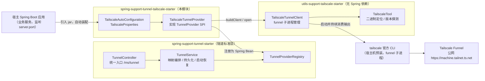
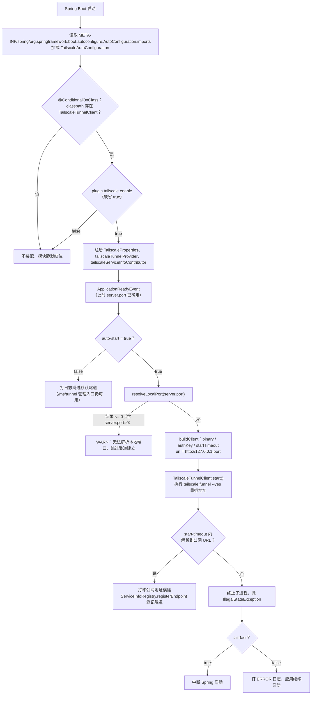
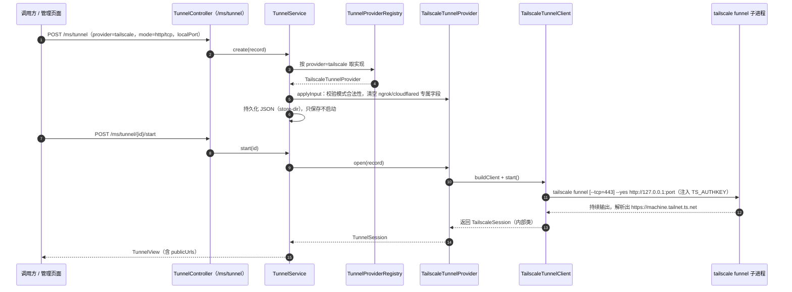

# spring-support-tunnel-tailscale-starter

基于官方 `tailscale` 命令行子进程的 Tailscale Funnel 内网穿透 starter：Spring Boot 启动后自动把本机服务（`server.port`）通过 Tailscale Funnel 暴露为公网 HTTPS 地址（形如 `https://<machine>.<tailnet>.ts.net`）。

模块默认开启（`plugin.tailscale.enable` 缺省为 `true`），但**前提是宿主机已安装 `tailscale` 可执行文件且设备已加入 tailnet**；条件不满足时默认只打日志继续启动（`fail-fast=false`）。本模块**不内置 tailscale 二进制**，也不定义新的 SPI——它实现 `spring-support-tunnel-starter` 的 `TunnelProvider` SPI，并把统一的映射管理交给隧道标准层。

## 1. 架构图

### 1.1 模块在体系中的位置



兄弟模块 `spring-support-tunnel-ngrok-starter`、`spring-support-tunnel-cloudflared-starter` 与本模块平级：都实现同一个 `TunnelProvider` SPI，可共存，由 `plugin.tunnel.providers` 白名单决定暴露哪些。

### 1.2 内部分层

```mermaid
flowchart TD
    subgraph L1["装配层（本模块）"]
        A1["TailscaleAutoConfiguration<br/>@ConditionalOnClass(TailscaleTunnelClient)<br/>@ConditionalOnProperty plugin.tailscale.enable"]
        A2["TailscaleProperties<br/>@ConfigurationProperties(plugin.tailscale)"]
        A3["tailscaleTunnelProvider @Bean<br/>tailscaleServiceInfoContributor @Bean"]
    end
    subgraph L2["提供方层（本模块）"]
        B1["TailscaleTunnelProvider implements TunnelProvider<br/>name=tailscale / modes=http,tcp / applyInput / capabilities"]
        B2["TailscaleSession（内部类）implements TunnelSession"]
    end
    subgraph L3["CLI 适配层（utils-support-tailscale-starter）"]
        C1["TailscaleTunnelClient<br/>funnel 命令拼装 / TS_AUTHKEY 注入 / URL 解析 / 超时与优雅关闭"]
        C2["TailscaleTool<br/>TAILSCALE_BIN → PATH → 常见安装目录；最低版本 1.50"]
    end
    P["tailscale funnel 子进程"]

    A1 --> A2
    A1 --> A3 --> B1
    B1 --> B2
    B1 --> C1
    C1 --> C2
    C1 --> P
```



## 2. 核心流程图

### 2.1 启动装配与默认隧道建立流程



应用关闭时（`ContextClosedEvent` / `@PreDestroy`）调用 `closeClient()`：先 `destroy()`，5 秒未退出再 `destroyForcibly()`，不留孤儿进程。

### 2.2 统一入口创建/启动映射的数据流



## 3. 能力清单

| 能力域 | 关键类 | 入口 |
|:-------|:-------|:-----|
| 自动配置与总开关 | `TailscaleAutoConfiguration` | `plugin.tailscale.enable`（缺省 true） |
| 配置绑定 | `TailscaleProperties` | `plugin.tailscale.*` |
| 启动期默认隧道 | `TailscaleAutoConfiguration#onApplicationReady` | `ApplicationReadyEvent`（`server.port` 已确定） |
| 统一入口提供方 | `TailscaleTunnelProvider`（实现 `TunnelProvider`） | `/ms/tunnel`（由 tunnel-starter 装配） |
| 隧道模式 | `TailscaleTunnelProvider#supportedModes` / `#defaultMode` | `http`（默认）/ `tcp` |
| 字段校验与归一 | `TailscaleTunnelProvider#applyInput` | 创建/更新映射时由 `TunnelService` 调用 |
| 能力探测 | `TailscaleTunnelProvider#isAvailable` / `#capabilities` | `/ms/tunnel/providers` 页面渲染 |
| 认证 Key 解析 | `TailscaleProperties#resolveAuthKey` | 配置文件 → 环境变量 `TS_AUTHKEY` |
| 服务信息登记 | `tailscaleServiceInfoContributor`（`ServiceInfoContributor` Bean） | 控制台模块能力 / `ServiceInfoRegistry` |
| 隧道端点登记 | `TailscaleAutoConfiguration#startTunnel` → `ServiceInfoRegistry#registerEndpoint` | 启动期建立成功后自动登记 |
| 优雅关闭 | `onContextClosed` / `@PreDestroy destroy` → `closeClient` | `ContextClosedEvent`、Bean 销毁 |
| 二进制定位 / 版本探测 | `TailscaleTool`（utils 层） | `TAILSCALE_BIN` → PATH → 常见安装目录，最低版本 1.50 |
| 子进程管理客户端 | `TailscaleTunnelClient`（utils 层） | 链式 API，`tailscale funnel` 子进程 |
| 映射持久化与启动恢复 | `storeDir()` / `autoStartStored()` 委托 + tunnel-starter `TunnelStore` | 每条映射一个 JSON 文件，重启按 `autoStartStored` 恢复 |

## 4. Bean 能力矩阵

以下 Bean 均由 `TailscaleAutoConfiguration` 提供，自动配置注册在 `META-INF/spring/org.springframework.boot.autoconfigure.AutoConfiguration.imports`（本模块**没有** `spring.factories`）。

| Bean 名 | 类型 | 装配条件 | 可否覆盖 | 典型注入姿势 |
|:--------|:-----|:---------|:---------|:-------------|
| `plugin.tailscale-com.chua.starter.tailscale.support.TailscaleProperties` | `TailscaleProperties` | 随自动配置经 `@EnableConfigurationProperties` 注册（classpath 有 `TailscaleTunnelClient` 且 `plugin.tailscale.enable=true`，缺省视为 true） | 不建议覆盖 Bean；改配置项即可 | 构造器/字段注入，读取 `plugin.tailscale.*` |
| `tailscaleTunnelProvider` | `TailscaleTunnelProvider` | `@Bean` + `@ConditionalOnMissingBean` | **可覆盖**：自定义同类型 Bean 即替换默认实现 | 由 tunnel-starter 的 `TunnelProviderRegistry` 收集；也可直接注入调用 |
| `tailscaleServiceInfoContributor` | `ServiceInfoContributor` | `@Bean`，自动配置生效即注册（无条件注解） | 可再注册**额外的** `ServiceInfoContributor` 并存；同名覆盖需开启 `spring.main.allow-bean-definition-overriding=true` | 由服务信息/控制台模块收集，登记 `tailscale` 模块能力 |

说明：

- `TailscaleAutoConfiguration` 本身不是注入目标，它通过 `@EventListener(ApplicationReadyEvent)`、`@EventListener(ContextClosedEvent)` 和 `@PreDestroy` 承担生命周期编排。
- `TunnelController`（`/ms/tunnel`）、`TunnelService`、`TunnelProviderRegistry`、`TunnelStore` 来自依赖的 `spring-support-tunnel-starter`，不属于本模块的 Bean。

## 5. 完整配置

配置前缀：**`plugin.tailscale`**（`TailscaleProperties`，`@ConfigurationProperties`）。

| 配置项 | 类型 | 默认值 | 说明 | 生效开关 / 生效时机 |
|:-------|:-----|:-------|:-----|:--------------------|
| `plugin.tailscale.enable` | `boolean` | `true` | 总开关；`false` 时整个自动配置不装配 | 装配期（`@ConditionalOnProperty`，`matchIfMissing=true`） |
| `plugin.tailscale.binary` | `String` | 无 | tailscale 可执行文件路径；为空时按 `TAILSCALE_BIN` 环境变量 → PATH → 常见安装目录（Windows `C:\Program Files\Tailscale`、`C:\Program Files (x86)\Tailscale`，Linux/macOS `/usr/bin`、`/usr/local/bin`）自动定位 | `buildClient` 时使用；相对路径会转为绝对路径 |
| `plugin.tailscale.auth-key` | `String` | 无 | 设备认证 Key；解析顺序「配置文件 → 环境变量 `TS_AUTHKEY`」，以 `TS_AUTHKEY` 环境变量注入子进程，无登录态设备可一键建隧道 | `resolveAuthKey()` 在 `buildClient` 时调用；设备已 `tailscale up` 时可不填 |
| `plugin.tailscale.start-timeout` | `Duration` | `60s` | 启动后等待公网 URL 输出的超时；超时终止子进程并抛 `IllegalStateException` | `TailscaleTunnelClient#start` 等待阶段 |
| `plugin.tailscale.fail-fast` | `boolean` | `false` | 启动失败时是否中断应用；`false` 只打 ERROR 日志继续启动，`true` 抛 `IllegalStateException` 中断 Spring 启动 | 仅启动期失败路径 |
| `plugin.tailscale.auto-start` | `boolean` | `true` | 启动时是否按本配置自动为 `server.port` 建一条默认隧道；`false` 时模块（含统一入口与持久化映射）仍可用 | `ApplicationReadyEvent` |
| `plugin.tailscale.auto-start-stored` | `boolean` | `true` | 启动时是否恢复上次标记为「自动启动」的持久化映射 | tunnel-starter 的启动恢复阶段（`autoStartStored()`） |
| `plugin.tailscale.store-dir` | `String` | 无（缺省落为 `~/.chua/tunnel/tailscale`） | 映射持久化目录；`storeDir()` 返回 null 时由 tunnel-starter 按 `<plugin.tunnel.store-dir>/tailscale` 解析；一条映射一个 JSON 文件 | 映射保存 / 读取时 |

相关环境变量：`TS_AUTHKEY`（认证 Key 兜底）、`TAILSCALE_BIN`（二进制定位兜底）。

关联配置（来自依赖 `spring-support-tunnel-starter` 的 `TunnelProperties`，前缀 `plugin.tunnel`，影响本模块接入的统一入口行为）：

| 配置项 | 默认值 | 说明 |
|:-------|:-------|:-----|
| `plugin.tunnel.enable` | `true` | 隧道标准层总开关 |
| `plugin.tunnel.store-dir` | `~/.chua/tunnel` | 映射持久化根目录；本模块缺省目录由它派生 |
| `plugin.tunnel.providers` | 空（不裁剪） | 提供方白名单；为空时收集到的所有 `TunnelProvider` 都暴露 |
| `plugin.tunnel.restore-on-startup` | `true` | 是否在启动时恢复持久化映射 |
| `plugin.tunnel.instance-url` | 无 | 实例地址标识（多实例场景） |
| `plugin.tunnel.sse-interval` | `1500ms` | `/ms/tunnel/stream` SSE 推送间隔 |

## 6. 使用方式

### 6.1 Maven 坐标

```xml
<dependency>
    <groupId>com.chua</groupId>
    <artifactId>spring-support-tunnel-tailscale-starter</artifactId>
    <version>4.0.0.51</version>
</dependency>
```

版本随父 pom `spring-support-parent-starter` 管理。传递依赖自动带入，无需重复引入：

| 依赖 | 作用 |
|:-----|:-----|
| `spring-support-tunnel-starter` | `TunnelProvider` SPI、统一入口 `/ms/tunnel`、映射编排与持久化 |
| `spring-support-common-starter` | `TunnelRecord`、`ServiceInfoContributor`、`ServiceInfoRegistry` |
| `utils-support-tailscale-starter` | `TailscaleTool`（二进制定位/版本探测）与 `TailscaleTunnelClient`（子进程管理），无 Spring 依赖 |
| `org.springframework.boot:spring-boot-starter` | Spring Boot 基础自动配置 |
| `io.swagger.core.v3:swagger-annotations` | OpenAPI 注解（编译期） |
| `org.projectlombok:lombok` | `provided`，编译期 |
| `spring-boot-configuration-processor` | `optional`，编译期生成配置元数据 |

> 只想用底层客户端（非 Spring 环境）时，单独引入 `utils-support-tailscale-starter` 即可。

### 6.2 前提条件（宿主机侧）

```bash
# 安装 tailscale 并加入 tailnet（本实现要求主版本 >= 1.50）
curl -fsSL https://tailscale.com/install.sh | sh
tailscale up          # 交互式登录，加入你的 tailnet
tailscale version
```

Windows 默认安装位置 `C:\Program Files\Tailscale\tailscale.exe`；装了但不在 PATH 时，用 `plugin.tailscale.binary` 或环境变量 `TAILSCALE_BIN` 指向它。

### 6.3 最小可运行示例

启动类无需任何额外代码：

```java
@SpringBootApplication
public class TunnelDemoApplication {
    public static void main(String[] args) {
        SpringApplication.run(TunnelDemoApplication.class, args);
    }
}
```

```yaml
server:
  port: 8080
plugin:
  tailscale:
    enable: true
    # 设备已 tailscale up 时可省；无登录态一键建隧道推荐走环境变量
    auth-key: ${TAILSCALE_AUTHKEY}
    # binary: /usr/local/bin/tailscale   # 不在 PATH 时显式指定
    # start-timeout: 90s
```

启动成功后日志形如：

```
=========================================================
  Tailscale Funnel 已建立，本机服务已暴露到公网
=========================================================
  https://<machine>.<tailnet>.ts.net
=========================================================
```

浏览器打开该公网地址即访问本机 `server.port` 服务。也可用统一入口验证提供方是否注册：

```bash
curl http://127.0.0.1:${server.port}/ms/tunnel/providers
# data[*].name 应包含 tailscale，displayName = Tailscale Funnel
```

按需建隧道（`tcp` 模式映射只能走统一入口，启动期默认隧道固定 `http`）：

```bash
curl -X POST http://127.0.0.1:8080/ms/tunnel \
  -H "Content-Type: application/json" \
  -d '{"provider":"tailscale","name":"tcp-转发","localPort":8080,"mode":"tcp"}'
```

底层链式客户端（`utils-support-tailscale-starter`，非 Spring 环境也可用）：

```java
try (TailscaleTunnelClient client = TailscaleTunnelClient.create()
        .url("http://127.0.0.1:8080")
        .authKey("tskey-...")     // 可选，注入子进程 TS_AUTHKEY
        .start()) {
    System.out.println(client.getUrl());   // https://<machine>.<tailnet>.ts.net
}
```

## 7. 使用场景

### 7.1 适用

- **调试回调 / 第三方 Webhook 联调**：本地服务需要被公网服务回调（支付、OAuth、企业微信/钉钉等），一条配置拿到公网 HTTPS 地址。
- **演示与移动端联调**：给外部同事、真机 App 临时暴露本地环境，无需部署。
- **已有 Tailscale 基础设施的团队**：不需要注册第三方账号，Funnel 复用既有 tailnet 身份与设备信任，公网地址是稳定的 `*.ts.net` 域名。
- **需要 HTTPS 入口**：`http` 模式由 Tailscale 自动提供可信证书。

### 7.2 不适用

- **生产高可用公网服务**：Funnel 走 Tailscale 边缘节点，有带宽与配额限制，SLA 不受本模块控制；生产对外请用正规网关/负载均衡。
- **无法安装 CLI 的环境**：容器镜像受限、Serverless、部分托管平台不允许运行 `tailscale` 子进程。
- **需要自定义域名或大量端口**：Funnel 域名固定为 `*.ts.net`；TCP 只能暴露 443/8443/10000 三个公网端口（本实现固定 443）。
- **`server.port=0` 的随机端口场景**：启动期默认隧道无法自动探测实际端口，请显式配置端口或走 `/ms/tunnel` 指定 `localPort`。

### 7.3 与相邻模块的取舍

| 模块 | 接入形态 | 凭据 | 适用倾向 |
|:-----|:---------|:-----|:---------|
| 本模块（Tailscale Funnel） | 宿主机 `tailscale` CLI 子进程 | 设备级认证 Key（`TS_AUTHKEY`）或已登录设备 | 团队已用 Tailscale；要稳定 `ts.net` 域名；免第三方账号注册 |
| `spring-support-tunnel-ngrok-starter` | 进程内 SDK（`ngrok-java` native 内嵌） | 隧道级 `authtoken` | 不想装任何二进制；快速临时暴露 |
| `spring-support-tunnel-cloudflared-starter` | 外部 `cloudflared` 子进程 | Cloudflare Tunnel 凭据 | 已有 Cloudflare/自有域名，需要自定义域名 |

三家互相独立、可同时引入；通过 `plugin.tunnel.providers` 白名单决定 `/ms/tunnel` 实际暴露哪些提供方，页面创建映射时用 `provider` 字段选择。

## 8. 扩展点

本模块**不定义新的 SPI**；它的扩展点分三层：

1. **实现别人的 SPI**：`TailscaleTunnelProvider` 实现 `spring-support-tunnel-starter` 的 `TunnelProvider`（`name()=tailscale`、`supportedModes()=[http, tcp]`、`defaultMode()=http`、`capabilities()` 回填 `binaryAvailable` / `binaryPath` / `authKeyConfigured` / `autoStart` / `autoStartStored`、`applyInput()` 校验归一、`open()` 返回 `TailscaleSession`）。生效链路：Bean 注册 → `TunnelProviderRegistry` 收集 → `plugin.tunnel.providers` 白名单裁剪 → `/ms/tunnel/providers` 可见 → 创建映射时 `provider=tailscale` 可选中。
2. **覆盖默认 Bean**：`tailscaleTunnelProvider` 标注 `@ConditionalOnMissingBean`，业务方可声明自己的 `TailscaleTunnelProvider`（或子类，如定制 `capabilities()`、追加校验）完成替换：
   ```java
   @Bean
   public TailscaleTunnelProvider tailscaleTunnelProvider(TailscaleProperties properties) {
       return new TailscaleTunnelProvider(properties) { /* 定制 */ };
   }
   ```
   新增**其他厂商**提供方同理：实现 `TunnelProvider` 并注册为 Bean，注册表自动收集——本模块即该扩展点的参考实现。
3. **直接使用底层客户端**：`TailscaleTunnelClient`（链式 API）与 `TailscaleTool`（`@Spi("tailscale")`，二进制定位/版本探测）来自 `utils-support-tailscale-starter`，不依赖 Spring，可被任意 Java 程序或上层模块复用；本模块的自动配置只是它的一个 Spring 化封装。

生命周期无需扩展：启动期建隧道（`ApplicationReadyEvent`）、关闭期回收子进程（`ContextClosedEvent` + `@PreDestroy`）均已内建。

## 9. 常见问题

**Q1：引入依赖后没有任何隧道行为，怎么排查？**
按顺序检查：

1. `plugin.tailscale.enable` 是否被设为 `false`（或不存在的配置中心把它解析为 false）——它是装配开关；
2. classpath 是否真的有 `utils-support-tailscale-starter`——`@ConditionalOnClass(TailscaleTunnelClient)` 不满足时整个自动配置静默跳过；
3. 是否被 `spring.autoconfigure.exclude` 显式排除了 `TailscaleAutoConfiguration`；
4. `auto-start` 是否为 `false`（此时只跳过启动期默认隧道，`/ms/tunnel` 仍可用）；
5. 宿主机是否装了 `tailscale`（`TailscaleTool#isAvailable` 只探测可执行文件），守护进程是否在跑、设备是否已 `tailscale up`；
6. `fail-fast=false`（默认）时启动失败只打 ERROR 日志，应用照常起来——「看起来没生效」往往其实是隧道建立失败，去日志里搜 `[Tailscale] 隧道启动失败`。

**Q2：日志出现 `failed to connect to local tailscaled process` 或 `please run tailscale up`？**
分别是「本地 Tailscale 服务未运行（Windows 下常见服务被停）」和「设备未加入 tailnet」。本客户端会把该错误行原样登记到映射并转为 `IllegalStateException`；先 `tailscale up`（或配置 `auth-key`）并确保 Tailscale 服务在运行。

**Q3：`server.port=0` 为什么不建隧道？**
`resolveLocalPort` 读到 `0` 返回 `-1`，只打 WARN「无法解析本地 server.port，跳过隧道建立」。随机端口场景请固定端口，或用 `/ms/tunnel` 显式指定 `localPort`。

**Q4：`tcp` 模式能自定义公网端口吗？**
不能。Tailscale Funnel 对非提权设备只开放 443/8443/10000 三个公网 TCP 端口，本实现固定使用 443（`TCP_PORTS` 首项）；本地服务端口由映射的 `localPort` 决定。

**Q5：`start-timeout` 超时后会怎样？**
`TailscaleTunnelClient#waitForUrl` 在超时（默认 60s）内未解析到公网地址，会终止子进程并抛 `IllegalStateException`；默认 `fail-fast=false` 只打日志继续启动，`true` 则中断 Spring 启动。

**Q6：启动期默认隧道和页面映射会冲突吗？**
`auto-start=true` 时启动期会为 `server.port` 建一条 `http` 隧道；如果同时用管理台页面建映射，会各起一个 `tailscale funnel` 子进程。同时使用页面时建议 `auto-start: false`。

**Q7：认证 Key 是隧道级的吗？**
不是，`TS_AUTHKEY` 是**设备级**凭据。`applyInput` 会清空 ngrok/cloudflared 专属字段（`authtoken`/`remote-address`/`basicAuth`/`metadata`/`token`），所有 tailscale 映射共用同一个 Key；`capabilities()` 里的 `authKeyConfigured` 用于页面提示设备是否就绪。

**Q8：与 Spring Boot 4 的兼容性？**
本模块按 Boot 3+/4 的自动配置机制注册：仅提供 `META-INF/spring/org.springframework.boot.autoconfigure.AutoConfiguration.imports`（内容为 `com.chua.starter.tailscale.support.TailscaleAutoConfiguration`），**没有** `spring.factories` 自动配置条目；生命周期回调使用 `jakarta.annotation.PreDestroy`。当前仓库基线为 Spring Boot 4.1.2（2026-11-19 升级），升级 Boot 版本不影响本模块的装配方式。

**Q9：应用关闭后会有 tailscale 残留进程吗？**
正常路径不会：`close()` 先 `destroy()`，5 秒未退出再 `destroyForcibly()`。注意输出必须持续消费到进程退出，否则管道满会挂起——客户端已内部处理，排查问题时了解即可。另外 `store-dir` 下的映射是明文 JSON（含设备级凭据使用痕迹），注意目录权限。
