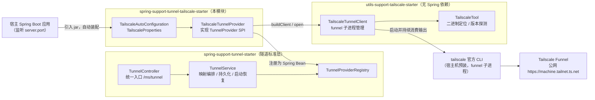
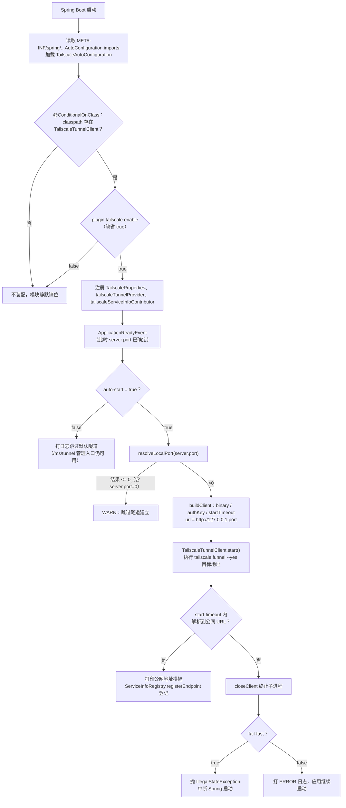

# spring-support-tunnel-tailscale-starter

基于官方 `tailscale` CLI 子进程的 Tailscale Funnel 内网穿透 starter：Spring Boot 启动后自动把本机服务（`server.port`）通过 Funnel 暴露为公网 HTTPS 地址（形如 `https://<machine>.<tailnet>.ts.net`）。

在 spring-support 体系中，本模块是「隧道家族」的 Tailscale 实现：只实现 `spring-support-tunnel-starter` 的 `TunnelProvider` SPI，不定义新 SPI、不自带 Controller 与编排 Service——统一入口 `/ms/tunnel`、映射持久化与启动恢复由隧道标准层提供；子进程管理由无 Spring 依赖的 `utils-support-tailscale-starter` 提供。模块默认开启（`plugin.tailscale.enable` 缺省 `true`），但前提是宿主机已安装 `tailscale` 且设备已加入 tailnet；条件不满足时默认只打日志继续启动（`fail-fast=false`）。

## 1. 架构图



兄弟模块 `spring-support-tunnel-ngrok-starter`、`spring-support-tunnel-cloudflared-starter` 与本模块平级：都实现同一个 `TunnelProvider` SPI，可共存，由 `plugin.tunnel.providers` 白名单决定 `/ms/tunnel` 暴露哪些。

## 2. 核心流程图

启动期默认隧道建立流程（`auto-start=true` 时）：



应用关闭时（`ContextClosedEvent` / `@PreDestroy`）调用 `closeClient()`：先 `destroy()`，5 秒未退出再 `destroyForcibly()`，不留孤儿进程。

## 3. 能力清单

| 能力域 | 关键类 | 入口/触发方式 |
|:-------|:-------|:-------------|
| 自动配置与总开关 | `TailscaleAutoConfiguration` | `plugin.tailscale.enable`（缺省 true） |
| 配置绑定 | `TailscaleProperties` | `plugin.tailscale.*` |
| 启动期默认隧道 | `TailscaleAutoConfiguration#onApplicationReady` | `ApplicationReadyEvent`（`server.port` 已确定） |
| 统一入口提供方 | `TailscaleTunnelProvider`（实现 `TunnelProvider`） | `/ms/tunnel`（由 tunnel-starter 装配） |
| 隧道模式 | `TailscaleTunnelProvider#supportedModes` / `#defaultMode` | `http`（默认）/ `tcp` |
| 字段校验与归一 | `TailscaleTunnelProvider#applyInput` | 创建/更新映射时由 `TunnelService` 调用 |
| 能力探测 | `TailscaleTunnelProvider#isAvailable` / `#capabilities` | `/ms/tunnel/providers` 页面渲染 |
| 认证 Key 解析 | `TailscaleProperties#resolveAuthKey` | 配置文件 → 环境变量 `TS_AUTHKEY` |
| 服务信息登记 | `tailscaleServiceInfoContributor`（`ServiceInfoContributor` Bean） | 控制台模块能力 / `ServiceInfoRegistry` |
| 隧道端点登记 | `TailscaleAutoConfiguration#onApplicationReady`（内部 `startTunnel`）→ `ServiceInfoRegistry#registerEndpoint` | 启动期建立成功后自动登记 |
| 优雅关闭 | `onContextClosed` / `@PreDestroy destroy` → `closeClient` | `ContextClosedEvent`、Bean 销毁 |
| 二进制定位 / 子进程管理 | `TailscaleTool` / `TailscaleTunnelClient`（utils 层） | `TAILSCALE_BIN` → PATH → 常见安装目录，最低版本 1.50 |
| 映射持久化与启动恢复 | `storeDir()` / `autoStartStored()` 委托 + tunnel-starter `TunnelStore` | 一条映射一个 JSON 文件，重启按 `autoStartStored` 恢复 |

## 4. Bean 能力矩阵

以下 Bean 均由 `TailscaleAutoConfiguration` 提供，自动配置注册在 `META-INF/spring/org.springframework.boot.autoconfigure.AutoConfiguration.imports`（本模块**没有** `spring.factories`）。

| Bean 名 | 类型 | 装配条件（含默认值） | 可否覆盖 | 典型用途 |
|:--------|:-----|:--------------------|:---------|:---------|
| `plugin.tailscale-com.chua.starter.tailscale.support.TailscaleProperties` | `TailscaleProperties` | 随自动配置经 `@EnableConfigurationProperties` 注册（classpath 有 `TailscaleTunnelClient` 且 `plugin.tailscale.enable=true`，缺省视为 true） | 不建议覆盖 Bean；改配置项即可 | 读取 `plugin.tailscale.*` 配置 |
| `tailscaleTunnelProvider` | `TailscaleTunnelProvider` | `@Bean` + `@ConditionalOnMissingBean` | **可覆盖**：自定义同类型 Bean 即替换默认实现 | 被 tunnel-starter 的 `TunnelProviderRegistry` 收集，接入 `/ms/tunnel` |
| `tailscaleServiceInfoContributor` | `ServiceInfoContributor` | `@Bean`，自动配置生效即注册（无条件注解） | 可再注册**额外的** `ServiceInfoContributor` 并存；同名覆盖需 `spring.main.allow-bean-definition-overriding=true` | 向 `ServiceInfoRegistry` 登记 `tailscale` 模块能力 |

说明：`TailscaleAutoConfiguration` 本身不是注入目标，它通过 `@EventListener(ApplicationReadyEvent)`、`@EventListener(ContextClosedEvent)` 和 `@PreDestroy` 承担生命周期编排。`TunnelController`、`TunnelService`、`TunnelProviderRegistry`、`TunnelStore` 来自依赖的 `spring-support-tunnel-starter`，不属于本模块的 Bean。

## 5. 完整配置

配置前缀：**`plugin.tailscale`**（`TailscaleProperties`，`@ConfigurationProperties`，无嵌套类）。

| 配置路径 | 类型 | 默认值 | 说明 |
|:---------|:-----|:-------|:-----|
| `plugin.tailscale.enable` | `boolean` | `true` | 总开关；`false` 时整个自动配置不装配（`matchIfMissing=true`） |
| `plugin.tailscale.binary` | `String` | 无 | tailscale 可执行文件路径；为空时按 `TAILSCALE_BIN` → PATH → 常见安装目录自动定位；相对路径会转为绝对路径 |
| `plugin.tailscale.auth-key` | `String` | 无 | 设备认证 Key；解析顺序「配置文件 → 环境变量 `TS_AUTHKEY`」，以 `TS_AUTHKEY` 注入子进程；设备已 `tailscale up` 时可不填 |
| `plugin.tailscale.start-timeout` | `Duration` | `60s` | 启动后等待公网 URL 输出的超时；超时终止子进程并抛 `IllegalStateException` |
| `plugin.tailscale.fail-fast` | `boolean` | `false` | 启动失败时是否中断应用；`false` 只打 ERROR 日志继续启动 |
| `plugin.tailscale.auto-start` | `boolean` | `true` | 启动时是否自动为 `server.port` 建一条默认隧道；`false` 时模块（含 `/ms/tunnel` 与持久化）仍可用 |
| `plugin.tailscale.auto-start-stored` | `boolean` | `true` | 启动时是否恢复上次标记为「自动启动」的持久化映射 |
| `plugin.tailscale.store-dir` | `String` | 无（缺省落为 `~/.chua/tunnel/tailscale`） | 映射持久化目录；返回 null 时由 tunnel-starter 按 `<plugin.tunnel.store-dir>/tailscale` 解析 |

相关环境变量：`TS_AUTHKEY`（认证 Key 兜底）、`TAILSCALE_BIN`（二进制定位兜底）。关联配置来自依赖 `spring-support-tunnel-starter` 的 `TunnelProperties`（前缀 `plugin.tunnel`），影响统一入口与持久化根目录，详见该模块文档。

### 5.1 逐项配置示例

按功能分组给出每个配置项的含义、默认值与 YAML 写法。

**开关与生命周期**

| 配置项 | 含义 | 默认值 |
|:-------|:-----|:-------|
| `enable` | 模块总开关，`false` 时整个自动配置不装配 | `true` |
| `auto-start` | 启动期是否自动为 `server.port` 建一条默认隧道；`false` 时仅跳过默认隧道，`/ms/tunnel` 与持久化仍可用 | `true` |
| `auto-start-stored` | 启动期是否恢复上次标记为「自动启动」的持久化映射 | `true` |
| `fail-fast` | 启动失败时是否中断应用；`false` 只打 ERROR 日志继续启动 | `false` |

```yaml
plugin:
  tailscale:
    enable: true              # 总开关
    auto-start: true          # 启动期为 server.port 自动建隧道
    auto-start-stored: true   # 恢复「自动启动」的持久化映射
    fail-fast: false          # 启动失败是否中断应用
```

**进程与认证**

| 配置项 | 含义 | 默认值 |
|:-------|:-----|:-------|
| `binary` | `tailscale` 可执行文件路径；相对路径会转为绝对路径 | 空 = 自动定位：`TAILSCALE_BIN` → PATH → 常见安装目录 |
| `auth-key` | 设备认证 Key（设备级凭据）；解析顺序「配置文件 → 环境变量 `TS_AUTHKEY`」 | 空 = 读环境变量 `TS_AUTHKEY`；仍无则设备需先 `tailscale up` |
| `start-timeout` | 启动后等待公网 URL 输出的超时；超时终止子进程并抛 `IllegalStateException` | `60s` |

```yaml
plugin:
  tailscale:
    binary: /usr/local/bin/tailscale   # 不在 PATH 时显式指定
    auth-key: ${TS_AUTHKEY}            # 推荐环境变量注入，避免明文落盘
    start-timeout: 90s
```

**持久化**

| 配置项 | 含义 | 默认值 |
|:-------|:-----|:-------|
| `store-dir` | 映射持久化目录，一条映射一个 JSON 文件 | 空 = 由 tunnel-starter 按 `<plugin.tunnel.store-dir 或 ~/.chua/tunnel>/tailscale` 解析，即 `~/.chua/tunnel/tailscale` |

```yaml
plugin:
  tailscale:
    store-dir: /data/app/tunnel/tailscale
```

### 5.2 完整配置示例（YAML）

一份可直接落地的完整示例（含隧道标准层 `plugin.tunnel` 的关键项）：

```yaml
server:
  port: 8080

plugin:
  tunnel:
    enable: true                  # 统一入口 /ms/tunnel 总开关
    # providers: [tailscale]      # 多隧道实现共存时裁剪暴露的提供方
    store-dir: /data/app/tunnel   # 持久化根目录，tailscale 映射位于其 tailscale/ 子目录
  tailscale:
    enable: true                         # 本模块总开关
    binary: /usr/local/bin/tailscale     # 可执行文件；缺省自动定位
    auth-key: ${TS_AUTHKEY}              # 设备认证 Key；缺省读环境变量 TS_AUTHKEY
    start-timeout: 90s                   # 等待公网 URL 的超时
    fail-fast: false                     # 启动失败是否中断应用
    auto-start: true                     # 启动期自动建默认隧道
    auto-start-stored: true              # 恢复持久化映射
    # store-dir: /data/app/tunnel/tailscale  # 缺省 <plugin.tunnel.store-dir>/tailscale
```

## 6. 使用方式

### 6.1 Maven 坐标

```xml
<dependency>
    <groupId>com.chua</groupId>
    <artifactId>spring-support-tunnel-tailscale-starter</artifactId>
    <version>4.0.0.51</version>
</dependency>
```

版本随父 pom `spring-support-parent-starter` 管理；`spring-support-tunnel-starter`、`spring-support-common-starter`、`utils-support-tailscale-starter` 等传递依赖自动带入，无需重复引入。

**可选/provided 依赖说明**：`spring-boot-configuration-processor`（`optional`）只在编译期生成配置元数据，缺失不影响运行，仅损失 IDE 配置提示，且不会传递给下游；`lombok`（`provided`）仅编译期需要，运行时无需。宿主机必须能找到 `tailscale` 可执行文件（本模块不内置二进制）。

### 6.2 最小启用示例

启动类无需任何额外代码，配置即可：

```yaml
server:
  port: 8080
plugin:
  tailscale:
    enable: true
    # 设备已 tailscale up 时可省；无登录态一键建隧道推荐走环境变量
    auth-key: ${TS_AUTHKEY}
    # binary: /usr/local/bin/tailscale   # 不在 PATH 时显式指定
    # start-timeout: 90s
```

启动成功后日志会打印 `https://<machine>.<tailnet>.ts.net` 公网地址，并登记到 `ServiceInfoRegistry`。可用统一入口验证提供方是否注册：

```bash
curl http://127.0.0.1:8080/ms/tunnel/providers
# data[*].name 应包含 tailscale，displayName = Tailscale Funnel
```

按需建隧道（`tcp` 模式只能走统一入口，启动期默认隧道固定 `http`）：

```bash
curl -X POST http://127.0.0.1:8080/ms/tunnel \
  -H "Content-Type: application/json" \
  -d '{"provider":"tailscale","name":"tcp-转发","localPort":8080,"mode":"tcp"}'
```

## 7. 使用场景

### 7.1 适用

- **调试回调 / 第三方 Webhook 联调**：支付、OAuth、企业微信/钉钉等需要公网回调本地服务，一条配置拿到公网 HTTPS 地址。
- **演示与移动端联调**：给外部同事、真机 App 临时暴露本地环境，无需部署。
- **已有 Tailscale 基础设施的团队**：免注册第三方账号，Funnel 复用既有 tailnet 身份，公网地址是稳定的 `*.ts.net` 域名，`http` 模式自动带可信证书。

### 7.2 不适用 / 慎用

- **生产高可用公网服务**：Funnel 走 Tailscale 边缘节点，有带宽与配额限制，生产对外请用正规网关/负载均衡。
- **无法安装 CLI 的环境**（受限容器、Serverless）或 `server.port=0` 随机端口场景：前者跑不了 `tailscale` 子进程，后者启动期无法解析实际端口（可改走 `/ms/tunnel` 显式指定 `localPort`）。

### 7.3 与相邻模块的取舍

| 模块 | 接入形态 | 凭据 | 适用倾向 |
|:-----|:---------|:-----|:---------|
| 本模块（Tailscale Funnel） | 宿主机 `tailscale` CLI 子进程 | 设备级认证 Key（`TS_AUTHKEY`）或已登录设备 | 已用 Tailscale；要稳定 `ts.net` 域名 |
| `spring-support-tunnel-ngrok-starter` | 进程内 SDK（native 内嵌） | 隧道级 `authtoken` | 不想装任何二进制；快速临时暴露 |
| `spring-support-tunnel-cloudflared-starter` | 外部 `cloudflared` 子进程 | Cloudflare Tunnel 凭据 | 已有 Cloudflare/自有域名 |

三家互相独立、可同时引入；`plugin.tunnel.providers` 白名单决定 `/ms/tunnel` 实际暴露哪些，创建映射时用 `provider` 字段选择。

## 8. 扩展点

本模块**不定义新的 SPI**，扩展点分三层：

1. **实现别人的 SPI**：`TailscaleTunnelProvider` 实现 `spring-support-tunnel-starter` 的 `TunnelProvider`（`name()=tailscale`、`supportedModes()=[http, tcp]`、`defaultMode()=http`、`capabilities()` 回填 `binaryAvailable` / `binaryPath` / `authKeyConfigured` / `autoStart` / `autoStartStored`、`applyInput()` 校验归一、`open()` 返回内部类 `TailscaleSession`）。生效链路：Bean 注册 → `TunnelProviderRegistry` 收集 → `plugin.tunnel.providers` 白名单裁剪 → `/ms/tunnel/providers` 可见。新增其他厂商提供方即照此实现 `TunnelProvider` 并注册为 Bean——本模块就是参考实现。
2. **覆盖默认 Bean**：`tailscaleTunnelProvider` 标注 `@ConditionalOnMissingBean`，业务方可声明自己的 `TailscaleTunnelProvider`（或子类，定制 `capabilities()`、追加校验）完成替换。
3. **直接使用底层客户端**：`TailscaleTunnelClient`（链式 API）与 `TailscaleTool` 来自 `utils-support-tailscale-starter`，不依赖 Spring，可被任意 Java 程序复用；本模块的自动配置只是它的 Spring 化封装。

生命周期无需扩展：启动期建隧道（`ApplicationReadyEvent`）、关闭期回收子进程（`ContextClosedEvent` + `@PreDestroy`）均已内建。

## 9. 常见问题

**Q1：引入依赖后没有任何隧道行为，怎么排查？**
按顺序检查：① `plugin.tailscale.enable` 是否被设为 `false`（装配开关）；② classpath 是否真有 `utils-support-tailscale-starter`——`@ConditionalOnClass(TailscaleTunnelClient)` 不满足时整个自动配置静默跳过；③ 是否被 `spring.autoconfigure.exclude` 排除了 `TailscaleAutoConfiguration`；④ `auto-start` 是否为 `false`（此时只跳过默认隧道，`/ms/tunnel` 仍可用）；⑤ 宿主机是否装了 `tailscale`、守护进程是否在跑、设备是否已 `tailscale up`；⑥ 默认 `fail-fast=false` 时启动失败只打 ERROR 日志、应用照常起来——去日志搜 `[Tailscale] 隧道启动失败`。

**Q2：日志出现 `failed to connect to local tailscaled process` 或 `please run tailscale up`？**
分别是「本地 Tailscale 服务未运行」和「设备未加入 tailnet」。该错误会登记到映射并转为 `IllegalStateException`；先 `tailscale up`（或配置 `auth-key`）并确保 Tailscale 服务在运行。

**Q3：`server.port=0` 为什么不建隧道？`tcp` 模式能自定义公网端口吗？**
随机端口解析结果 `<=0` 时只打 WARN 跳过，请固定端口或走 `/ms/tunnel` 指定 `localPort`。TCP 公网端口不能自定义：Funnel 对非提权设备只开放 443/8443/10000，本实现固定用 443（`TCP_PORTS` 首项），本地端口由映射的 `localPort` 决定。

**Q4：与 Spring Boot 4 的兼容性？**
本模块按 Boot 3+/4 机制注册：仅提供 `META-INF/spring/org.springframework.boot.autoconfigure.AutoConfiguration.imports`（内容为 `com.chua.starter.tailscale.support.TailscaleAutoConfiguration`），没有 `spring.factories` 自动配置条目；生命周期回调使用 `jakarta.annotation.PreDestroy`。另注意 `auto-start=true` 与页面建映射会各起一个 `funnel` 子进程，同时使用页面时建议 `auto-start: false`。

## 10. 生产注意事项

- **公网暴露面**：Funnel 地址是公网可达的 `*.ts.net` 域名，任何能上网的人都能访问——务必在上游应用侧启用认证/鉴权，只暴露确需公开的端点；不要把未加防护的管理端口 Funnel 出去。
- **凭据管理**：`auth-key` 是设备级凭据，等价于整台设备的 tailnet 身份。推荐用环境变量 `TS_AUTHKEY` 或密钥管理系统注入，避免明文写入配置文件、镜像或配置中心；一旦泄露立即在 Tailscale 管理台吊销并轮换。
- **进程与资源**：每条映射独占一个 `tailscale` 子进程；`auto-start=true` 的默认隧道与页面创建的映射会各起一个进程——同时使用页面时建议 `auto-start: false`。容器/受限环境需保证 `tailscale` CLI 与 `tailscaled` 守护进程可用，且 CLI 版本 ≥ 1.50。
- **带宽与配额**：Funnel 流量经 Tailscale 边缘节点转发，有带宽与配额限制；生产对外服务请用正规网关/负载均衡（见 7.2）。
- **持久化目录**：`store-dir` 建议指向挂载盘并纳入备份；容器化部署必须挂载该目录，否则重启后持久化映射丢失，`auto-start-stored` 无从恢复。
- **失败策略**：默认 `fail-fast=false`，启动失败只打 ERROR 日志、应用照常起来——若隧道是关键依赖，生产建议 `fail-fast: true` 让启动立刻失败，并配套告警。
- **变更管理**：升级宿主机 `tailscale` CLI 或调整 `binary`/`auth-key` 后，需重启应用进程使新配置生效；滚动发布时先摘流量再重启，避免隧道空窗。
