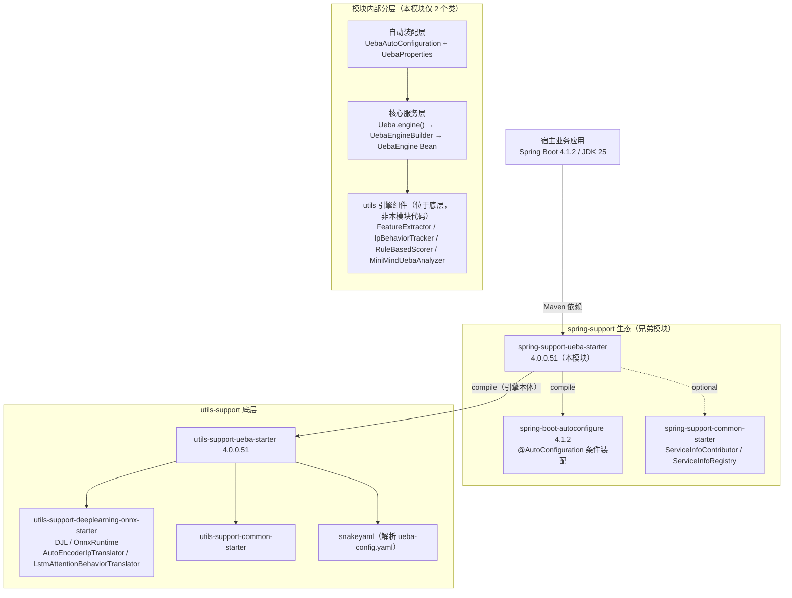
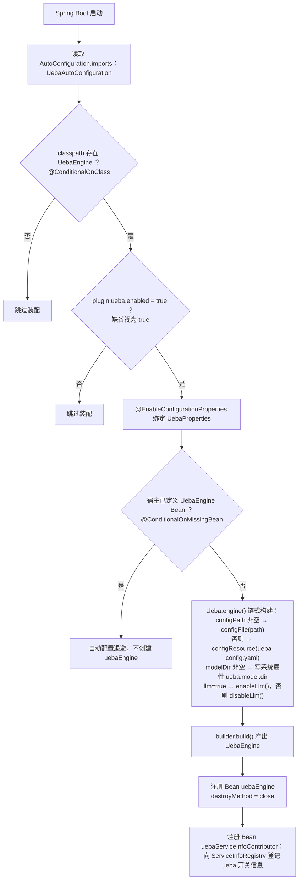

# spring-support-ueba-starter

UEBA（用户实体行为分析）Spring Boot Starter：把 `utils-support-ueba-starter` 的分析引擎装配成可直接注入的 `UebaEngine` Bean，能力覆盖 IP 异常流量检测（AutoEncoder）、行为序列分析（LSTM/GRU + Attention）、风险融合与 MiniMind 语义解释。在 spring-support 体系中它是纯「装配层」——只负责按 `plugin.ueba.*` 配置把引擎建好，并在容器销毁时释放模型资源；**不做 REST、不做持久化、不做调度**，引擎实现全部位于底层 `utils-support-ueba-starter`。

- 自动配置入口：`META-INF/spring/org.springframework.boot.autoconfigure.AutoConfiguration.imports` → `com.chua.starter.ueba.configuration.UebaAutoConfiguration`（无 `spring.factories`）
- 基于 Spring Boot **4.1.2**（`spring-boot-starter-parent`）、Java **25** 构建；当前版本 **4.0.0.51**

## 1. 架构图



模块内没有定义自己的 SPI 接口，也没有 `META-INF/services`；对宿主的扩展面就是 `@ConditionalOnMissingBean` 的 Bean 退避（见第 8 节）。

## 2. 核心流程图

选**自动装配流程**（本模块的全部行为都发生在启动期；运行期 `analyze` 的数据流属于 utils 引擎，见第 6 节示例）。



## 3. 能力清单

| 能力域 | 关键类 | 入口/触发方式 |
| --- | --- | --- |
| 分析引擎自动装配 | `UebaAutoConfiguration` | `AutoConfiguration.imports` 注册，Spring Boot 启动时触发 |
| 配置属性绑定 | `UebaProperties` | `@ConfigurationProperties(prefix = "plugin.ueba")` |
| 引擎链式构建 | `Ueba` / `UebaEngineBuilder` | `UebaAutoConfiguration#uebaEngine(UebaProperties)` 内调 `Ueba.engine()` |
| 单条流量事件综合分析 | `UebaEngine` | 宿主注入 Bean 后调用 `UebaEngine#analyze(TrafficEvent)` |
| 引擎资源释放 | `UebaEngine#close()` | `@Bean(destroyMethod = "close")`，容器销毁时触发 |
| 服务信息登记 | `UebaAutoConfiguration#uebaServiceInfoContributor` | 启动期由 `ServiceInfoRegistry` 收集，展示 ueba 开关与 LLM 状态 |
| 模型训练（utils 层提供，不经本模块装配） | `UebaTrainingBuilder` / `UebaTrainer` | `Ueba.training()...build().execute()` |

本模块**不提供** REST 端点、持久化、定时任务与消息通道；日志采集、落库、告警均由宿主负责。

## 4. Bean 能力矩阵

| Bean 名 | 类型 | 装配条件（含默认值） | 可否覆盖 | 典型用途 |
| --- | --- | --- | --- | --- |
| `uebaEngine` | `com.chua.ueba.support.engine.UebaEngine` | 类级：`@ConditionalOnClass(UebaEngine.class)` 且 `@ConditionalOnProperty(prefix="plugin.ueba", name="enabled", havingValue="true", matchIfMissing=true)`；方法级：`@ConditionalOnMissingBean` | 可覆盖：宿主自定义同类型 `UebaEngine` `@Bean` 后自动配置退避 | `@Resource` 注入后调用 `analyze(TrafficEvent)`；容器销毁自动 `close()` 释放模型 |
| `uebaServiceInfoContributor` | `com.chua.starter.common.support.serviceinfo.ServiceInfoContributor` | 随类级条件生效；方法本身无独立条件注解；返回类型来自 optional 的 `spring-support-common-starter`，且类上没有针对该类型的 `@ConditionalOnClass` 守卫，宿主缺少该依赖时方法签名无法解析，自动配置注册失败 | 方法未加 `@ConditionalOnMissingBean`；同名覆盖需开启 bean-definition-overriding | 一般不注入；由 `ServiceInfoRegistry` 在启动期收集展示 |
| `plugin.ueba-com.chua.starter.ueba.configuration.UebaProperties` | `com.chua.starter.ueba.configuration.UebaProperties` | `@EnableConfigurationProperties(UebaProperties.class)` 随自动配置注册 | 可覆盖但无必要 | 一般不直接注入；由 `UebaAutoConfiguration` 内部消费 |

装配不生效的排查见第 9 节 Q1。

## 5. 完整配置

配置类 `UebaProperties`（`@ConfigurationProperties(prefix = "plugin.ueba")`）为扁平结构，**无嵌套类**，共 5 个字段。

### 5.1 配置总表

| 配置路径 | 类型 | 默认值 | 说明 |
| --- | --- | --- | --- |
| `plugin.ueba.enabled` | `boolean` | `true` | 总开关：是否装配 `UebaEngine`；`false` 时整个自动配置跳过 |
| `plugin.ueba.llm` | `boolean` | `true` | 是否启用 MiniMind 语义解释；`false` 时使用引擎内置模板解释 |
| `plugin.ueba.config-resource` | `String` | `ueba-config.yaml` | classpath 上的引擎配置文件；`config-path` 为空时使用 |
| `plugin.ueba.config-path` | `String` | `""`（空串） | 外部配置文件路径，优先级高于 `config-resource` |
| `plugin.ueba.model-dir` | `String` | `""`（空串） | ONNX 模型目录；非空时写入系统属性 `ueba.model.dir`，AutoEncoder 与 LSTM 模型都从该目录加载 |

```yaml
plugin:
  ueba:
    enabled: true
    llm: true
    config-resource: ueba-config.yaml
    # config-path: D:/config/ueba-config.yaml   # 配置后优先于 config-resource
    # model-dir: D:/models/ueba                 # AutoEncoder / LSTM 的 ONNX 模型目录
```

相关系统属性（非 Spring 配置项）：`ueba.model.dir` 由 `UebaEngineBuilder#build()` 写入（值来自 `plugin.ueba.model-dir`），是 JVM 全局副作用，后写覆盖先写；`ueba.minimind.model.dir` 由宿主以 `-Dueba.minimind.model.dir=...` 提供（MiniMind 模型目录，需含 `model.onnx` 与 `tokenizer.json`）。

`config-resource` / `config-path` 指向的是**引擎配置文件**（utils 层 `UebaConfig` 用 snakeyaml 解析），段结构为 `features` / `autoEncoder` / `lstm` / `risk` / `preprocessing`，不是 Spring 配置项。classpath 默认文件关键值：`features` 10 项（`request_rate`、`path_entropy`、`unique_paths_count`、`error_rate`、`method_diversity`、`ua_diversity`、`avg_response_time`、`max_response_time`、`avg_body_size`、`time_of_day`，顺序即 AutoEncoder 输入维度顺序）、`autoEncoder.threshold=0.8`、`autoEncoder.modelFile=autoencoder_ip.onnx`、`lstm.windowSize=20`、`lstm.numClasses=3`、`lstm.classLabels=[normal, suspicious, attack]`、`lstm.modelFile=lstm_attention_behavior.onnx`、`risk.ipWeight=0.5`、`risk.behaviorWeight=0.5`、`risk.highThreshold=0.7`、`risk.mediumThreshold=0.35`。

### 5.2 逐项配置示例

按功能分组给出每个配置项的含义、默认值与 YAML 写法（均可在 `UebaProperties` 源码中对应到同名字段）。

#### （1）装配开关：`plugin.ueba.enabled`

- 含义：UEBA 自动装配总开关。`true` 时装配 `uebaEngine` 与服务信息贡献者；`false` 时整个 `UebaAutoConfiguration` 跳过，不创建任何 Bean。
- 类型 / 默认值：`boolean`，默认 `true`（未配置视为开启，对应 `matchIfMissing = true`）。

```yaml
plugin:
  ueba:
    enabled: true   # false 时完全关闭 UEBA 装配
```

#### （2）语义解释开关：`plugin.ueba.llm`

- 含义：是否启用 MiniMind 语义解释。`true` → `enableLlm()`；`false` → `disableLlm()`，使用引擎内置模板解释。注意 `llm=true` 还需 JVM 系统属性 `ueba.minimind.model.dir` 提供模型目录（含 `model.onnx` 与 `tokenizer.json`），缺失或加载失败时运行期自动回退模板解释，不阻塞分析。
- 类型 / 默认值：`boolean`，默认 `true`。

```yaml
plugin:
  ueba:
    llm: true
```

#### （3）引擎配置文件来源：`plugin.ueba.config-path` / `plugin.ueba.config-resource`

- 含义：两者都指向**引擎配置文件**（段结构 `features` / `autoEncoder` / `lstm` / `risk` / `preprocessing`），不是 Spring 配置项。`config-path` 非空时以外部文件加载并优先；为空时回落到 `config-resource` 指定的 classpath 资源。
- 类型 / 默认值：`config-path` 为 `String`，默认空串 `""`；`config-resource` 为 `String`，默认 `ueba-config.yaml`。

```yaml
plugin:
  ueba:
    config-resource: ueba-config.yaml   # 默认：classpath 内置引擎配置
    # config-path: /opt/app/config/ueba-config.yaml   # 配置后优先于 config-resource
```

#### （4）模型目录：`plugin.ueba.model-dir`

- 含义：AutoEncoder 与 LSTM 的 ONNX 模型目录。非空时 `UebaEngineBuilder#build()` 将其写入 JVM 系统属性 `ueba.model.dir`（JVM 全局副作用，后写覆盖先写）；为空时不写该属性，引擎按内置策略定位模型。
- 类型 / 默认值：`String`，默认空串 `""`。

```yaml
plugin:
  ueba:
    # model-dir: /opt/app/models/ueba   # 目录内含 autoencoder_ip.onnx / lstm_attention_behavior.onnx
```

### 5.3 完整 YAML 使用示例

```yaml
# application.yml —— UEBA 完整配置示例
plugin:
  ueba:
    # 总开关：false 时整个自动配置跳过，不创建 UebaEngine
    enabled: true
    # MiniMind 语义解释开关；false 时使用引擎内置模板解释
    llm: true
    # 引擎配置文件（features / autoEncoder / lstm / risk / preprocessing），
    # config-path 为空时从 classpath 加载该资源
    config-resource: ueba-config.yaml
    # 外部引擎配置文件，优先级高于 config-resource；不需要外部文件时删除本行
    # config-path: /opt/app/config/ueba-config.yaml
    # AutoEncoder / LSTM 的 ONNX 模型目录；不配置则按引擎内置策略加载
    # model-dir: /opt/app/models/ueba

# MiniMind 语义解释模型目录不是 Spring 配置项，需以 JVM 系统属性提供：
#   -Dueba.minimind.model.dir=/opt/app/models/minimind
#   （目录内需含 model.onnx 与 tokenizer.json）
```

### 5.4 生产注意事项

1. **开关语义**：`enabled=false` 时容器内没有 `UebaEngine` Bean，宿主代码里的 `@Resource UebaEngine` 会导致启动失败——下线 UEBA 时同步移除注入点，或改用 `ObjectProvider<UebaEngine>` / `@Autowired(required = false)`。
2. **配置文件校验**：`config-path` 指向的文件需进程可读且格式合法；`UebaEngineBuilder#build()` 解析失败会抛 `IllegalStateException` 使应用启动失败，更换引擎配置请先在测试环境验证。
3. **系统属性副作用**：`model-dir` 写入的 `ueba.model.dir` 是 JVM 全局属性，同一进程构建多个不同模型目录的引擎时后写覆盖先写；建议每进程只保留一个引擎实例，或统一模型目录。
4. **LLM 回退**：`llm=true` 但未设置 `ueba.minimind.model.dir`（或目录缺 `model.onnx` / `tokenizer.json`）时不会阻塞启动，分析照常进行、解释降级为模板文案；需要语义解释时务必配置该系统属性。
5. **资源占用**：ONNX 模型在引擎构建期加载并常驻内存，MiniMind 语义解释额外增加推理开销；容量规划时把模型内存与 `analyze` 的同步推理耗时计入，高吞吐场景在宿主侧做异步化 / 限流。
6. **能力边界**：本模块无 REST 端点、无持久化、无定时任务；日志采集、结果落库、告警通知由宿主自行实现。
7. **运行环境**：随父 POM 基于 Spring Boot 4.1.2 / Java 25 构建，宿主需 JDK 25+；DJL / OnnxRuntime 经 `utils-support-ueba-starter` 传递引入，部署前确认目标机可正常加载本地 ONNX 运行时。

## 6. 使用方式

Maven 坐标：

```xml
<dependency>
    <groupId>com.chua</groupId>
    <artifactId>spring-support-ueba-starter</artifactId>
    <version>4.0.0.51</version>
</dependency>
```

最小启用示例——`application.yml`：

```yaml
plugin:
  ueba:
    enabled: true
    llm: true
    # model-dir: D:/models/ueba      # 自备 ONNX 模型时指定
    # config-path: D:/config/ueba-config.yaml
```

注入 `UebaEngine` 并分析事件：

```java
@Service
public class AccessLogUebaService {

    @Resource                       // UebaAutoConfiguration 注册，容器关闭时自动 close()
    private UebaEngine uebaEngine;

    public UebaResult onAccessLog(String ip, String path, int status, long timestamp) {
        TrafficEvent event = TrafficEvent.builder()
                .ip(ip).path(path).method("GET").statusCode(status)
                .userAgent("curl/8.5.0").timestamp(timestamp)
                .responseTimeMs(35).responseSizeBytes(1024L).sessionId("sess-0001")
                .build();

        UebaResult result = uebaEngine.analyze(event);   // 同步调用，内部有滑动窗口与模型推理
        double risk = result.getRiskScore();             // [0,1]
        UebaResult.RiskLevel level = result.getRiskLevel();
        String explanation = result.getExplanation();    // MiniMind 生成，或模板文案
        return result;
    }
}
```

依赖说明（`pom.xml` 实际声明）：

| 依赖 | Scope | 作用 / 缺失后果 |
| --- | --- | --- |
| `com.chua:utils-support-ueba-starter`（`${utils.version}` = `4.0.0.51`） | compile | 引擎本体；缺失时 `@ConditionalOnClass` 不满足，整个模块静默不装配 |
| `org.springframework.boot:spring-boot-autoconfigure`（父 POM 管理 4.1.2） | compile | `@AutoConfiguration` 与条件装配 |
| `com.chua:spring-support-common-starter`（4.0.0.51） | **optional** | 仅为 `uebaServiceInfoContributor` 提供 `ServiceInfoContributor` 类型；由于自动配置类直接引用该类型而未加 `@ConditionalOnClass` 守卫，宿主未引入时 `uebaServiceInfoContributor` 方法签名不可解析，自动配置注册失败（需引入该依赖，或用 `spring.autoconfigure.exclude` 排除本自动配置）——生态内宿主通常已引入 |
| `org.springframework.boot:spring-boot-configuration-processor` | optional | 编译期生成 `plugin.ueba.*` 配置元数据，宿主无需关心 |
| `org.projectlombok:lombok` | optional | 编译期 `@Data` / `@Slf4j`，宿主无需关心 |

经 `utils-support-ueba-starter` 传递引入：`utils-support-deeplearning-onnx-starter`（DJL / OnnxRuntime）、`utils-support-common-starter`、`snakeyaml`。本模块 `spring-boot-maven-plugin` 设为 `skip=true`，产物是普通 jar，不是可执行 fat jar。

## 7. 使用场景

适用：

- 宿主应用已有访问日志 / 网关日志流，需要**进程内实时**做 IP 异常检测与行为序列分析，并给出人可读的风险解释。
- 分析结果需要与业务 Spring Bean（告警服务、限流器等）直接协作，希望 `@Resource` 注入开箱即用。
- 内网 / 离线环境：模型推理全部本地完成（ONNX + 可选 MiniMind），不依赖外部安全服务。
- 已有自训模型：把 ONNX 文件放入目录，经 `plugin.ueba.model-dir` 接入。

不适用 / 慎用：

- 需要跨实例聚合、历史回溯、告警工单、SIEM 对接的场景——本模块无持久化与外部通道，需宿主自建。
- 需要 REST 接口触发分析的场景——模块不发布任何端点，入口只有 Bean 方法；非 Spring 环境请直接用 `utils-support-ueba-starter`。

与相邻模块的取舍：

| 需求 | 选择 |
| --- | --- |
| Spring Boot 宿主，要自动装配 + 配置绑定 + Bean 生命周期管理 | 本模块 `spring-support-ueba-starter` |
| 非 Spring 环境，或宿主完全自管引擎构建 / 销毁 | `utils-support-ueba-starter`（`Ueba.engine()` 直建，`UebaEngine#loadDefault()` 快捷入口） |
| 训练 / 重建模型 | `Ueba.training()` → `UebaTrainingBuilder` → `UebaTrainer`（utils 层，与本模块装配无关） |
| 通用 ONNX 推理能力 | `utils-support-deeplearning-onnx-starter`（本模块经传递依赖使用，不直接暴露） |

## 8. 扩展点

本模块**没有传统意义的 SPI**：没有 `META-INF/services`，也没有自定义扩展接口。可用的扩展方式：

1. **Spring Bean 退避（推荐）**：`uebaEngine` 带 `@ConditionalOnMissingBean`，宿主自定义同类型 Bean 即可整体接管引擎构建（换配置来源、换模型、关 LLM 等）：

```java
@Configuration
public class MyUebaConfig {

    @Bean(destroyMethod = "close")
    public UebaEngine uebaEngine() {
        return Ueba.engine()
                .configFile("D:/config/ueba-config.yaml")
                .modelDir("D:/models/ueba")
                .disableLlm()
                .build();
    }
}
```

2. **引擎配置自定义**：`plugin.ueba.config-path` / `config-resource` 指定自己的 `ueba-config.yaml`（调整 `features`、阈值、权重、词表；训练端与推理端共享同一份）。
3. **模型目录**：`plugin.ueba.model-dir`（写 `ueba.model.dir`）替换 AutoEncoder / LSTM 模型；`-Dueba.minimind.model.dir=...` 替换 MiniMind 模型。
4. **服务信息**：宿主可自行声明更多 `ServiceInfoContributor` Bean；本模块登记的 `ueba` 标记会展示 LLM 开 / 关状态。
5. **训练管线**（utils 层提供，不属于本模块装配范围）：`Ueba.training().configResource("ueba-config.yaml").data("access.csv").epochs(60).build().execute()`。

无法按接口挂接多个分析实现——想换算法只能替换整个 `UebaEngine` Bean（见第 1 条）。

## 9. 常见问题

**Q1：装配不生效，`UebaEngine` 注入失败？**
按序排查：① `plugin.ueba.enabled` 是否被设为 `false`；② 运行期 classpath 是否存在 `utils-support-ueba-starter`（`@ConditionalOnClass(UebaEngine)` 不满足会静默跳过）；③ 宿主是否自定义了同类型 `UebaEngine` Bean（`@ConditionalOnMissingBean` 会让自动配置退避）。装配成功时会打印日志 `[UEBA-Spring] UebaEngine 装配完成: ...`。

**Q2：模块开放了哪些端口？有哪些开关？**
不开任何端口、不发布任何 REST 端点。开关只有两个 Spring 属性：`plugin.ueba.enabled`（总开关）与 `plugin.ueba.llm`（MiniMind 语义解释开关）；服务信息页会显示 `ueba` 标记及 `[LLM: 开/关]` 状态。

**Q3：`llm=true` 但解释一直是模板文案？**
`plugin.ueba.llm=true` 只是把 `MiniMindUebaAnalyzer` 装进引擎，它还需要 JVM 系统属性 `ueba.minimind.model.dir` 指向包含 `model.onnx` 与 `tokenizer.json` 的目录。注意 `plugin.ueba.model-dir` 写入的是 `ueba.model.dir`（AutoEncoder / LSTM 用），**不会**设置 MiniMind 的目录；未设置或加载失败时自动回退模板解释，不阻塞分析。

**Q4：与 Spring Boot 4 的兼容性如何？会不会与兄弟模块冲突？**
本模块随父 POM 基于 `spring-boot-starter-parent:4.1.2` 构建，使用 `@AutoConfiguration` + `AutoConfiguration.imports` 注册机制（无 `spring.factories`），该机制在 Boot 2.7+ 通用；父 POM `java.version=25`，宿主需运行在 **JDK 25+**。模块本身极简（2 个类、3 个 Bean），不携带 Controller / 定时任务 / 表迁移，不会与其它 starter 冲突；唯一全局副作用是 `ueba.model.dir` 系统属性——同一 JVM 构建多个不同模型目录的引擎时后建覆盖先建，建议每进程只保留一个引擎实例或统一目录。
