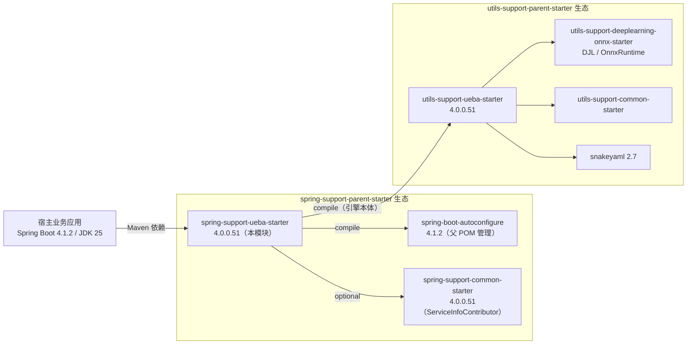
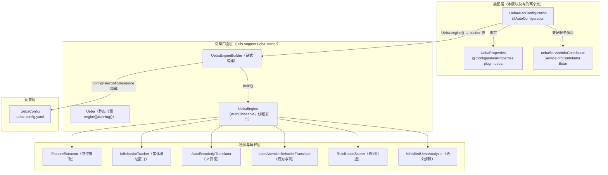
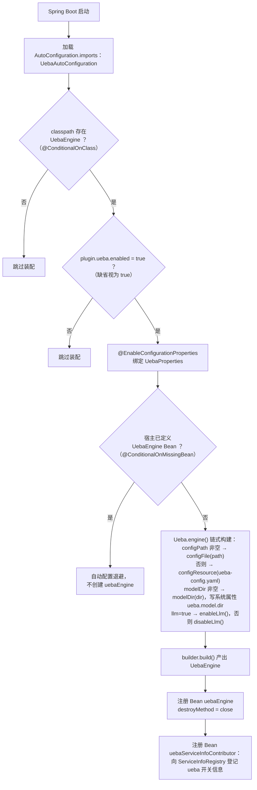
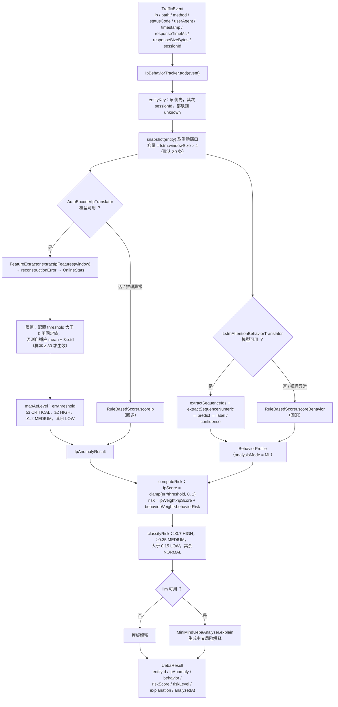

# spring-support-ueba-starter

UEBA（用户实体行为分析）Spring Boot Starter：把 `utils-support-ueba-starter` 的分析引擎装配成可直接注入的 Spring Bean。
纯自动配置模块——**不做 REST、不做持久化、不做调度**，只负责「按 `plugin.ueba.*` 配置把 `UebaEngine` 建好，并在容器销毁时释放模型资源」。

- 引擎能力：IP 异常流量检测（AutoEncoder）+ 行为序列分析（LSTM/GRU + Attention）+ 风险融合 + MiniMind 语义解释
- 自动配置入口：`META-INF/spring/org.springframework.boot.autoconfigure.AutoConfiguration.imports` → `com.chua.starter.ueba.configuration.UebaAutoConfiguration`
- 基于 Spring Boot **4.1.2**（`spring-boot-starter-parent`）、Java **25** 构建；当前版本 **4.0.0.51**

---

## 1. 架构图

### 1.1 模块在体系中的位置



本模块在依赖链中处于「装配层」：宿主只依赖本模块，引擎实现全部来自 `utils-support-ueba-starter`。当前父 POM 中没有任何模块声明依赖本模块（仅 `<modules>` 注册与 `dependencyManagement` 条目），使用方是下游宿主业务。

### 1.2 模块内部分层



---

## 2. 核心流程图

### 2.1 自动装配流程（启动期）



### 2.2 请求分析数据流（`UebaEngine#analyze(TrafficEvent)`，运行期）



---

## 3. 能力清单

| 能力域 | 关键类 | 入口 |
| --- | --- | --- |
| 分析引擎自动装配 | `UebaAutoConfiguration` | `UebaAutoConfiguration#uebaEngine(UebaProperties)` |
| 配置属性绑定 | `UebaProperties` | `@ConfigurationProperties(prefix = "plugin.ueba")` |
| 单条流量事件综合分析（IP 异常 + 行为序列 + 风险融合 + 文字解释） | `UebaEngine` | `UebaEngine#analyze(TrafficEvent)` |
| 链式构建引擎（门面，位于 utils 层） | `Ueba` / `UebaEngineBuilder` | `Ueba.engine()...build()` |
| 配置文件来源选择（外部文件优先） | `UebaAutoConfiguration` | `configPath` 优先于 `configResource` |
| 模型目录注入 | `UebaEngineBuilder#modelDir(String)` | 写入系统属性 `ueba.model.dir` |
| MiniMind 语义解释开关 | `UebaEngineBuilder#enableLlm()` / `#disableLlm()` | `plugin.ueba.llm` |
| 引擎资源释放 | `UebaEngine#close()` | `@Bean(destroyMethod = "close")` |
| 服务信息登记 | `UebaAutoConfiguration#uebaServiceInfoContributor` | `ServiceInfoContributor` → `ServiceInfoRegistry` |
| 模型训练（非本模块装配，随 utils 引擎提供） | `Ueba` / `UebaTrainingBuilder` / `UebaTrainer` | `Ueba.training()...build().execute()` |

本模块**不提供** REST 端点、持久化、定时任务与消息通道；采集、落库、告警均由宿主负责。

---

## 4. Bean 能力矩阵

| Bean 名 | 类型 | 装配条件 | 可否覆盖 | 典型注入姿势 |
| --- | --- | --- | --- | --- |
| `uebaEngine` | `com.chua.ueba.support.engine.UebaEngine` | 类级：`@ConditionalOnClass(UebaEngine.class)` 且 `@ConditionalOnProperty(prefix="plugin.ueba", name="enabled", havingValue="true", matchIfMissing=true)`；方法级：`@ConditionalOnMissingBean` | 可覆盖：宿主自定义同类型 `UebaEngine` `@Bean` 后自动配置退避 | `@Resource private UebaEngine uebaEngine;` 或构造器注入；容器销毁时自动调用 `close()` 释放模型 |
| `uebaServiceInfoContributor` | `com.chua.starter.common.support.serviceinfo.ServiceInfoContributor` | 随类级条件生效；方法本身无独立条件注解；该类型来自 optional 的 `spring-support-common-starter` | 方法未加 `@ConditionalOnMissingBean`；宿主一般不覆盖（同名覆盖需开启 bean-definition-overriding） | 通常不注入；由 `ServiceInfoRegistry` 在启动期收集，用于服务信息/开关展示 |
| `plugin.ueba-com.chua.starter.ueba.configuration.UebaProperties` | `com.chua.starter.ueba.configuration.UebaProperties` | `@EnableConfigurationProperties(UebaProperties.class)` 随自动配置注册 | 可覆盖但无必要 | 一般不直接注入；由 `UebaAutoConfiguration` 内部消费 |

装配不生效的常见原因见第 9 节 Q1。

---

## 5. 完整配置

### 5.1 Spring 配置项（前缀 `plugin.ueba`，绑定类 `UebaProperties`）

| 配置 key | 类型 | 默认值 | 说明 | 生效开关 |
| --- | --- | --- | --- | --- |
| `plugin.ueba.enabled` | `boolean` | `true` | 总开关：是否装配 `UebaEngine`；`false` 时整个自动配置跳过 | 自身即总开关 |
| `plugin.ueba.llm` | `boolean` | `true` | 是否启用 MiniMind 语义解释；`false` 时使用 `UebaEngine` 内置模板解释 | `enabled=true` 时生效 |
| `plugin.ueba.config-resource` | `String` | `ueba-config.yaml` | classpath 上的引擎配置文件路径；`config-path` 为空时使用 | `enabled=true` 且 `config-path` 为空 |
| `plugin.ueba.config-path` | `String` | `""`（空串） | 外部配置文件路径，优先级高于 `config-resource` | `enabled=true` 且非空 |
| `plugin.ueba.model-dir` | `String` | `""`（空串） | ONNX 模型目录；非空时写入系统属性 `ueba.model.dir`，AutoEncoder 与 LSTM 模型都从该目录加载 | `enabled=true` 且非空 |

```yaml
plugin:
  ueba:
    enabled: true
    llm: true
    config-resource: ueba-config.yaml
    # config-path: D:/config/ueba-config.yaml   # 配置后优先于 config-resource
    # model-dir: D:/models/ueba                 # AutoEncoder / LSTM 的 ONNX 模型目录
```

### 5.2 相关系统属性（非 Spring 配置项）

| 系统属性 | 谁写入 | 谁读取 | 说明 |
| --- | --- | --- | --- |
| `ueba.model.dir` | `UebaEngineBuilder#build()`（值来自 `plugin.ueba.model-dir`） | `AutoEncoderIpTranslator` / `LstmAttentionBehaviorTranslator` | ONNX 模型目录；JVM 全局副作用，后写覆盖先写 |
| `ueba.minimind.model.dir` | **本模块不写入**，需宿主以 `-Dueba.minimind.model.dir=...` 提供 | `MiniMindUebaAnalyzer` | MiniMind 模型目录，需含 `model.onnx` 与 `tokenizer.json`；未设置或加载失败时回退模板解释 |

### 5.3 引擎配置文件 `ueba-config.yaml`（不是 Spring 配置项）

`config-resource` / `config-path` 指向的是**引擎配置文件**，由 utils 层的 `UebaConfig` 用 snakeyaml 解析，段结构为 `features` / `autoEncoder` / `lstm` / `risk` / `preprocessing`。`features` 的书写顺序就是 AutoEncoder 输入向量的维度顺序，训练端（Python）与推理端（Java）必须一致。classpath 默认文件的关键值：

| 段.键 | 默认值 | 说明 |
| --- | --- | --- |
| `features` | 10 项：`request_rate`、`path_entropy`、`unique_paths_count`、`error_rate`、`method_diversity`、`ua_diversity`、`avg_response_time`、`max_response_time`、`avg_body_size`、`time_of_day` | AutoEncoder 输入维度顺序 |
| `autoEncoder.hiddenDims` | `[32, 16]` | 仅训练参考，推理端忽略 |
| `autoEncoder.threshold` | `0.8` | 重建误差阈值；`≤ 0` 时改为在线自适应（mean + 3×std） |
| `autoEncoder.modelFile` | `autoencoder_ip.onnx` | 模型文件名 |
| `lstm.windowSize` | `20` | 行为序列长度（时间步） |
| `lstm.numNumericFeatures` | `4` | 每步数值特征数 |
| `lstm.numClasses` | `3` | 类别数 |
| `lstm.classLabels` | `[normal, suspicious, attack]` | 类别标签，顺序与训练下标一致 |
| `lstm.modelFile` | `lstm_attention_behavior.onnx` | 模型文件名 |
| `risk.ipWeight` / `risk.behaviorWeight` | `0.5` / `0.5` | 风险融合权重 |
| `risk.highThreshold` / `risk.mediumThreshold` | `0.7` / `0.35` | 综合风险等级阈值 |
| `preprocessing.scalers` / `preprocessing.vocab` | 训练端回写 | 归一化参数与类别词表，推理端读取同一份 |

---

## 6. 使用方式

### 6.1 Maven 坐标

```xml
<dependency>
    <groupId>com.chua</groupId>
    <artifactId>spring-support-ueba-starter</artifactId>
    <version>4.0.0.51</version>
</dependency>
```

### 6.2 依赖说明

| 依赖 | 版本 | 作用 |
| --- | --- | --- |
| `com.chua:utils-support-ueba-starter` | `${utils.version}` = `4.0.0.51`（compile，随本模块传递） | 引擎本体：`UebaEngine`、`UebaEngineBuilder`、`Ueba`、`UebaConfig`、`TrafficEvent`、`UebaResult`、`FeatureExtractor`、`IpBehaviorTracker`、`RuleBasedScorer`、`MiniMindUebaAnalyzer` 及 classpath 默认 `ueba-config.yaml` |
| `org.springframework.boot:spring-boot-autoconfigure` | `4.1.2`（父 POM 管理） | `@AutoConfiguration` 与条件装配 |
| `org.springframework.boot:spring-boot-configuration-processor` | `4.1.2`（`optional`） | 生成 `plugin.ueba.*` 配置元数据 |
| `com.chua:spring-support-common-starter` | `4.0.0.51`（`optional`） | 提供 `ServiceInfoContributor`；未引入时服务信息不登记 |
| `org.projectlombok:lombok` | 父 POM 管理（`optional`） | `@Data` / `@Slf4j` |

经 `utils-support-ueba-starter` 传递引入：`utils-support-deeplearning-onnx-starter`（DJL / OnnxRuntime 推理）、`utils-support-common-starter`、`snakeyaml 2.7`。

父 POM：`com.chua:spring-support-parent-starter:4.0.0.51` ← `spring-boot-starter-parent:4.1.2`，`java.version=25`。本模块 POM 将 `spring-boot-maven-plugin` 设为 `skip=true`，产物是普通 jar，不是可执行 fat jar。

### 6.3 最小可运行示例

**第一步**：引入依赖（见 6.1），并在 `application.yml` 中按需配置：

```yaml
plugin:
  ueba:
    enabled: true
    llm: true
    # model-dir: D:/models/ueba      # 自备 ONNX 模型时指定
    # config-path: D:/config/ueba-config.yaml
```

**第二步**：注入 `UebaEngine` 并喂入 `TrafficEvent`：

```java
@Service
public class AccessLogUebaService {

    @Resource                       // 由 UebaAutoConfiguration 注册，容器关闭时自动 close()
    private UebaEngine uebaEngine;

    public void onAccessLog(String ip, String path, int status, long timestamp) {
        TrafficEvent event = TrafficEvent.builder()
                .ip(ip)
                .path(path)
                .method("GET")
                .statusCode(status)
                .userAgent("curl/8.5.0")
                .timestamp(timestamp)
                .responseTimeMs(35)
                .responseSizeBytes(1024L)
                .sessionId("sess-0001")
                .build();

        UebaResult result = uebaEngine.analyze(event);   // 同步调用，内部有滑动窗口与模型推理

        String entity = result.getEntityId();                     // IP 优先，其次 sessionId，否则 "unknown"
        double risk = result.getRiskScore();                      // [0,1]
        UebaResult.RiskLevel level = result.getRiskLevel();       // NORMAL / LOW / MEDIUM / HIGH
        String explanation = result.getExplanation();             // MiniMind 生成，或模板文案
        String ipLevel = result.getIpAnomaly().getLevel().name(); // NORMAL/LOW/MEDIUM/HIGH/CRITICAL
        String behaviorLabel = result.getBehavior().getLabel();   // normal / suspicious / attack
        double confidence = result.getBehavior().getConfidence();
        String mode = result.getBehavior().getAnalysisMode();     // ML（模型）或 RULE（规则回退）
    }
}
```

`TrafficEvent` 字段由 `FeatureExtractor` 按 `ueba-config.yaml` 的 `features` 定义消费（请求速率、路径熵、错误率、UA 多样性、响应耗时、时段等）；`sessionId` 只在 `ip` 为空时用作实体键。

**不经过 Spring 的等价写法**（自管生命周期时）：

```java
UebaEngine engine = Ueba.engine()
        .configResource("ueba-config.yaml")   // 或 .configFile("D:/config/ueba-config.yaml")
        .modelDir("D:/models/ueba")           // 写入系统属性 ueba.model.dir
        .enableLlm()                          // 或 .disableLlm()
        .build();
try {
    engine.analyze(event);
} finally {
    engine.close();
}
```

`UebaEngineBuilder` 全部方法：`config(UebaConfig)`、`config(Path)`、`configFile(String)`、`configResource(String)`、`modelDir(String)`、`enableLlm()`、`disableLlm()`、`build()`（除 `build()` 外均返回 `this`）。另有静态快捷入口 `UebaEngine#loadDefault()`（读 classpath 的 `ueba-config.yaml`）。

### 6.4 可选依赖说明

- `spring-support-common-starter`：仅影响 `uebaServiceInfoContributor` 的服务信息登记能力；引擎装配不依赖它。生态内宿主通常已引入。
- `spring-boot-configuration-processor`、`lombok`：编译期使用，宿主无需关心。

---

## 7. 使用场景

### 7.1 适用

- 宿主应用已有访问日志 / 网关日志流，需要**进程内实时**做 IP 异常检测与行为序列分析，并能给出人可读的风险解释。
- 安全分析结果需要与业务 Spring Bean（如告警服务、限流器）直接协作，希望以 `@Resource` 注入开箱即用。
- 内网 / 离线环境：模型推理全部本地完成（ONNX + 可选 MiniMind），不依赖外部安全服务。
- 已有自训模型：把 ONNX 文件放入目录，通过 `plugin.ueba.model-dir` 接入；特征口径由 `ueba-config.yaml` 的 `features` 定义。

### 7.2 不适用

- 需要跨实例聚合、历史回溯、告警工单、SIEM 对接的场景——本模块无持久化与外部通道，需宿主自建。
- 需要 REST 接口触发分析的场景——模块不发布任何端点，入口只有 Bean 方法。
- 非Spring 环境且不想引入 Spring 依赖的场景——直接使用 `utils-support-ueba-starter`。

### 7.3 与相邻模块的取舍

| 需求 | 选择 |
| --- | --- |
| Spring Boot 宿主，要自动装配 + 配置绑定 + Bean 生命周期管理 | 本模块 `spring-support-ueba-starter` |
| 非 Spring 环境，或宿主要完全自管引擎构建/销毁 | `utils-support-ueba-starter`（`Ueba.engine()` 直建，`UebaEngine#loadDefault()` 快捷入口） |
| 训练 / 重建模型 | `Ueba.training()` → `UebaTrainingBuilder` → `UebaTrainer`（在 utils 层，与本模块装配无关） |
| 通用 ONNX 推理能力 | `utils-support-deeplearning-onnx-starter`（本模块经传递依赖使用，不直接暴露） |

---

## 8. 扩展点

**本模块没有传统意义的 SPI**：模块内没有任何 `META-INF/services` 文件，也没有定义自己的扩展接口。可用的扩展方式如下：

1. **Spring Bean 退避（推荐）**：`uebaEngine` 带 `@ConditionalOnMissingBean`，宿主自定义同类型 Bean 即可整体接管引擎构建（换配置来源、换模型、关 LLM 等）：

   ```java
   @Configuration
   public class MyUebaConfig {

       @Bean(destroyMethod = "close")
       public UebaEngine uebaEngine() {
           return Ueba.engine()
                   .configFile("D:/config/ueba-config.yaml")
                   .modelDir("D:/models/ueba")
                   .disableLlm()
                   .build();
       }
   }
   ```

2. **引擎配置自定义**：通过 `plugin.ueba.config-path` / `config-resource` 指定自己的 `ueba-config.yaml`（调整 `features`、阈值、权重、类别词表等），训练端与推理端共享同一份文件。
3. **模型目录**：通过 `plugin.ueba.model-dir`（写 `ueba.model.dir`）与 `-Dueba.minimind.model.dir=...`（MiniMind）替换模型文件。
4. **服务信息**：宿主可自行声明更多 `ServiceInfoContributor` Bean；本模块登记的 `ueba` 开关信息可在服务信息页展示 LLM 开/关状态。
5. **训练管线**（utils 层提供，不属于本模块装配范围）：`Ueba.training().configResource("ueba-config.yaml").data("access.csv").epochs(60).build().execute()`，训练产出的模型放入 `model-dir` 供推理使用。

无法按接口挂接多个分析实现——想换算法只能替换整个 `UebaEngine` Bean（见第 1 条）。

---

## 9. 常见问题

**Q1：装配不生效，`UebaEngine` 注入失败？**
按序排查：① `plugin.ueba.enabled` 是否被设为 `false`；② 运行期 classpath 是否存在 `utils-support-ueba-starter`（`@ConditionalOnClass(UebaEngine)` 不满足会静默跳过）；③ 宿主是否自定义了同类型 `UebaEngine` Bean（`@ConditionalOnMissingBean` 会让自动配置退避）。装配成功时会打印日志 `[UEBA-Spring] UebaEngine 装配完成: ...`。

**Q2：模块开放了哪些端口？有哪些开关？**
不开任何端口、不发布任何 REST 端点。开关只有两个 Spring 属性：`plugin.ueba.enabled`（总开关）与 `plugin.ueba.llm`（MiniMind 语义解释开关）。服务信息页会显示 `ueba` 标记及 `[LLM: 开/关]` 状态。

**Q3：`llm=true` 但解释一直是模板文案？**
`plugin.ueba.llm=true` 只是把 `MiniMindUebaAnalyzer` 装进引擎；它还需要 JVM 系统属性 `ueba.minimind.model.dir` 指向包含 `model.onnx` 与 `tokenizer.json` 的目录。注意 `plugin.ueba.model-dir` 写入的是 `ueba.model.dir`（AutoEncoder/LSTM 用），**不会**设置 MiniMind 的目录。未设置或加载失败时自动回退模板解释，不阻塞分析。

**Q4：启动时抛 `IllegalArgumentException`（如 `config.features 不能为空`）？**
`UebaEngine` 构造时会校验 `ueba-config.yaml` 的 `features` / `autoEncoder` / `lstm` / `risk` 四段，缺失即抛异常、启动失败——这是有意的快速失败。检查自定义配置文件是否缺段，或改回默认 `config-resource: ueba-config.yaml`。

**Q5：为什么前几十条请求都不告警？**
AutoEncoder 判定要求在线统计样本数 ≥ `AE_MIN_SAMPLES = 30`（`anomalous = warmedUp && err > threshold`），warm-up 期间不判定异常，避免冷启动误报。

**Q6：多个引擎实例的模型目录互相覆盖？**
`UebaEngineBuilder#build()` 通过 `System.setProperty("ueba.model.dir", ...)` 设置目录，是 JVM 全局副作用；同一 JVM 创建多个目录不同的引擎时，后构建的覆盖先构建的。建议每进程只保留一个引擎实例或统一目录。

**Q7：与 Spring Boot 4 的兼容性如何？**
本模块随仓库父 POM 基于 `spring-boot-starter-parent:4.1.2` 构建，使用 `@AutoConfiguration` + `AutoConfiguration.imports` 注册机制（无 `spring.factories`），该机制在 Boot 2.7+ 通用。注意字节码层面：父 POM `java.version=25`（utils 引擎模块以 release 25 编译），宿主需运行在 **JDK 25+**。

**Q8：为什么结果等级从不出现在 `CRITICAL`？**
`UebaResult.RiskLevel` 枚举虽有 `CRITICAL`，但 `classifyRisk` 只产出 `NORMAL` / `LOW` / `MEDIUM` / `HIGH`；`CRITICAL` 只可能出现在 IP 侧的 `IpAnomalyResult.AnomalyLevel`（按 `err / threshold ≥ 3.0` 映射）。

**Q9：`analyze` 会阻塞吗？线程安全吗？**
同步阻塞调用，每个事件走一遍特征提取 + 两次模型推理。引擎内部对窗口与统计状态做了同步，可多线程并发调用；高吞吐场景请宿主自行控制采样率与线程池。

**Q10：ONNX 模型文件缺失会怎样？**
`autoencoder_ip.onnx` / `lstm_attention_behavior.onnx` 缺失或推理异常时，`detectIp` / `analyzeBehavior` 各自回退到 `RuleBasedScorer`，分析流程不中断；此时 `BehaviorProfile#getAnalysisMode()` 为 `RULE` 而非 `ML`，可用该字段监控模型是否真正生效。
